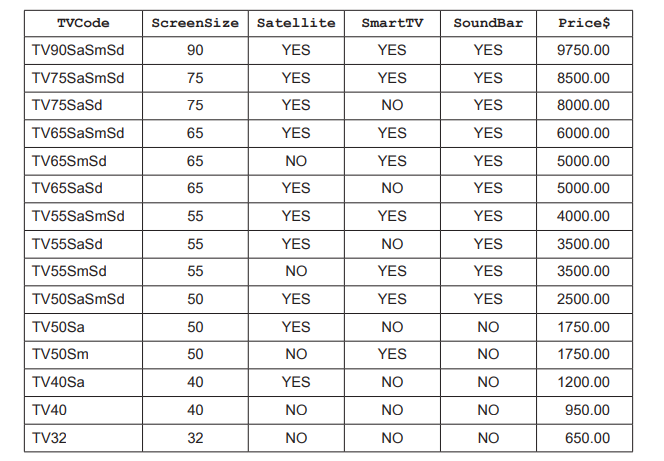

# Exam Questions — SQL
**9. Databases** · Cambridge (CIE) IGCSE computer-science (0478 & 0984)
> Source: [https://www.savemyexams.com/igcse/computer-science/cie/23/topic-questions/](https://www.savemyexams.com/igcse/computer-science/cie/23/topic-questions/) · 6 questions across 1 sets

## Exam Questions (8 questions)

### Q1 — medium — 5 marks

**Q1** [5 marks]

A database table called `SoftDrinks` stores details of the soft drinks sold by a small shop.

| Field | Example data |
|---|---|
| `Name` | Cola |
| `Supplier` | Cambridge Beverages |
| `Container` | Can |
| `SizeCl` | 330 |
| `NumberInStock` | 30 |
| `ReorderLevel` | 15 |
| `Reordered` | Yes |

**Complete **the structured query language (SQL) statement to return the number of cans the shop has in stock.

`SELECT ..................(..............) `

`FROM ................ `

`WHERE ......................... =...........................;`

*Source: June 2024 0478/21 Q9B*

### Q2 — hard — 7 marks

**Q2** [4 marks]

The table `students `stores information about students and their exam results. The table has the following structure:

| **Field Name** | **Data Type** | **Description** |
|---|---|---|
| StudentID | NUMERIC | Unique identifier for each student |
| FirstName | STRING | First name of the student |
| LastName | STRING | Last name of the student |
| Class | STRING | Class of the student (e.g., '10A') |
| Subject | STRING | Subject of the exam (e.g., 'Maths') |
| Score | NUMERIC | Score obtained in the exam (0-100) |

**Write an SQL query** to find the total sum of scores obtained by students in each class. The results should be ordered by class, and the output should display the class and the total sum of scores

**Q2** [3 marks]

**Extract:**

The table students stores information about students and their exam results. The table has the following structure:

| **Field Name** | **Data Type** | **Description** |
| --- | --- | --- |
| StudentID | NUMERIC | Unique identifier for each student |
| FirstName | STRING | First name of the student |
| LastName | STRING | Last name of the student |
| Class | STRING | Class of the student (e.g., '10A') |
| Subject | STRING | Subject of the exam (e.g., 'Maths') |
| Score | NUMERIC | Score obtained in the exam (0-100) |

** Write an SQL query** to find the total number of exam records where the students scored above 75. The output should display just the total count

### Q3 — medium — 3 marks

**Q3** [3 marks]

A music streaming service has a new database table named Songs to store details of songs available for streaming. The table contains the fields:

- `SongNumber` – the catalogue number, for example AG123
- `Title `– the title of the song
- `Author `– the name of the song writer(s)
- `Singer `– the name of the singer(s)
- `Genre `– the type of music, for example rock
- `Minutes `– the length of the song in minutes, for example 3.75
- `Recorded `– the date the song was recorded.

**Explain the purpose **of the structured query language (**SQL**) statements.

`SUM (Minutes) FROM Songs WHERE Genre = "rock"; `

`COUNT (Title) FROM Songs WHERE Genre = "rock";`

*Source: June 2023 0478/22 Q10C*

### Q4 — medium — 4 marks

**Q4** [4 marks]

A database table called TVRange shows the main features and prices of a range of televisions.

**Complete the structured query language** (**SQL**) query to return the television (TV) code, screen size and price of all Smart TVs in the database table

`SELECT TVCode,..................................., `

`.................TVRange `

`WHERE SmartTV =.............................;`

*Source: June 2023 0478/21 Q10C*

### Q5 — medium — 2 marks

**Q5** [2 marks]

A database table, 2018MOV, is used to keep a record of movie details.

**Complete the structured query language** (**SQL**) to return the category number and title for all Comedy movies.

`SELECT CatNo, Title `

`....................2018MOV `

`WHERE Genre1 = ...................................;`

*Source: Specimen 2023 0478/02 2A Q11D*

### Q6 — easy — 2 marks

**Q6** [2 marks]

A database table, PERFORMANCE, is used to keep a record of the performances at a local theatre.

| **ShowNumber** | **Type** | **Title** | **Date** | **SoldOut** |
|---|---|---|---|---|
| SN091 | Comedy | An Evening at Home | 01 Sept | Yes |
| SN102 | Drama | Old Places | 02 Oct | No |
| SN113 | Jazz | Acoustic Evening | 03 Nov | No |
| SN124 | Classical | Mozart Evening | 04 Dec | Yes |
| SN021 | Classical | Bach Favourites | 01 Feb | Yes |
| SN032 | Jazz | 30 Years of Jazz | 02 Mar | Yes |
| SN043 | Comedy | Street Night | 03 Apr | No |
| SN054 | Comedy | Hoot | 04 May | No |

**Show the output** that would be given by this structured query language (SQL) statement:

`SELECT Date, Title`

`FROM PERFORMANCE`

`WHERE SoldOut="No" AND Type = "Jazz";`

*Source: Specimen 2023 0478/02 2B Q11C*

