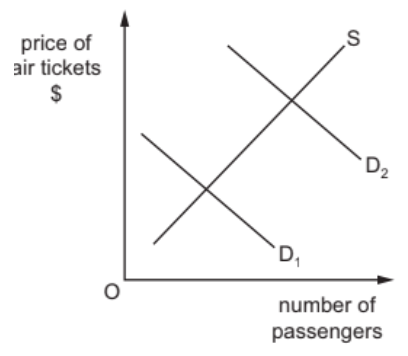
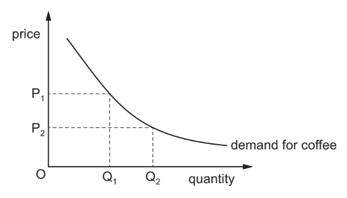

# Exam Questions — 2.3 Demand
**2. The Allocation of Resources** · Cambridge (CIE) IGCSE economics (0455 & 0987)
> Source: [https://www.savemyexams.com/igcse/economics/cie/20/topic-questions/](https://www.savemyexams.com/igcse/economics/cie/20/topic-questions/) · 15 questions across 1 sets

## Paper 1 (15 questions)

### Q1 — hard — 1 marks

**Q1** [1 mark]

In the context of market demand, what does the term "ceteris paribus" imply?

### Q2 — hard — 1 marks

**Q2** [1 mark]

Which factor can lead to an increase in the demand for a product?

### Q3 — hard — 1 marks

**Q3** [1 mark]

Which of the following is NOT a condition that can lead to a change in the demand for a product?

### Q4 — hard — 1 marks

**Q4** [1 mark]

The table shows the sales of cold drinks made by a company in the UK in 2016 and 2017. Demand for cold drinks is influenced by changes in the temperature. In 2016 the sales followed the usual seasonal pattern.

| month | sales 2016 (thousand cans) | sales 2017 (thousand cans) |
|---|---|---|
| April   May   June   July  August | 300  400  550  570  620 | 290  350  270  490  590 |

In which month of 2017 was the usual pattern disturbed?

*Source: Nov 2019 0455/12 Q14*

### Q5 — hard — 1 marks

**Q5** [1 mark]

What is the key distinction between individual demand and market demand?

### Q6 — easy — 1 marks

**Q6** [1 mark]

What term describes a change in the quantity demanded of a product due to a change in its own price, while other factors remain constant?

### Q7 — easy — 1 marks

**Q7** [1 mark]

The table shows the demand schedule for a good at different prices.

| price \$ | quantity demanded |
|---|---|
| 8  10  12  14 | 200  160  120  60 |

The current market price for the good is \$10.

Following a 20% increase in price, what will be the change in the quantity demanded?

*Source: 2019 0455/11 Q7*

### Q8 — easy — 1 marks

**Q8** [1 mark]

A market consists of 10 individuals with different demand curves in a given period.

What is a calculation that could be used as part of the process to determine the market equilibrium in that period?

*Source: 2020 0455/11 Q4*

### Q9 — easy — 1 marks

**Q9** [1 mark]

When the price of a product decreases, what is likely to happen along the demand curve?

### Q10 — easy — 1 marks

**Q10** [1 mark]

What does a movement along the demand curve represent?

### Q11 — medium — 1 marks

**Q11** [1 mark]

When the price of a product decreases and leads to an increase in the quantity demanded, what type of movement along the demand curve is this called?

### Q12 — medium — 1 marks

**Q12** [1 mark]

When the price of a product increases and the quantity demanded decreases, what is the outcome?

### Q13 — medium — 1 marks

**Q13** [1 mark]

Petrol (fuel) retailers in a country have noticed a sharp increase in sales in August when many people take their holidays.

Why might this take place?

*Source: 2018 0455/12 Q11*

### Q14 — medium — 1 marks

**Q14** [1 mark]

The diagram shows the demand for and the supply of air travel.

What could cause a shift of the demand curve from D1 to D2?

*Source: 2018 0455/13 Q5*

### Q15 — medium — 1 marks

**Q15** [1 mark]

The diagram shows the demand curve for coffee in the US.

Why did the quantity demanded move from Q1 to Q2?

*Source: 2020 0455/13 Q6*

