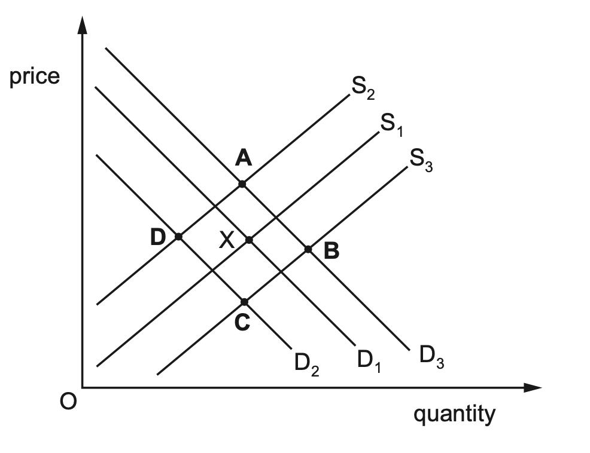
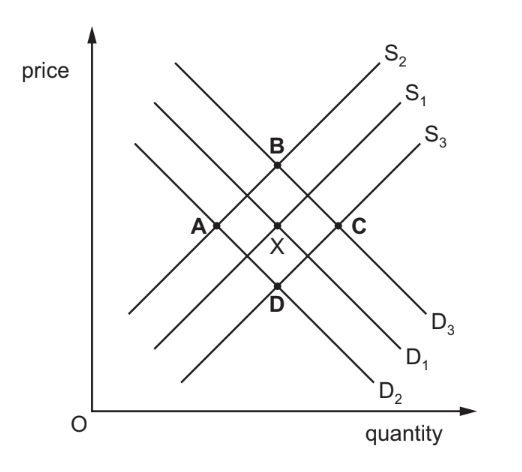

# Exam Questions — 2.6 Price Changes
**2. The Allocation of Resources** · Cambridge (CIE) IGCSE economics (0455 & 0987)
> Source: [https://www.savemyexams.com/igcse/economics/cie/20/topic-questions/](https://www.savemyexams.com/igcse/economics/cie/20/topic-questions/) · 15 questions across 1 sets

## Paper 1 (15 questions)

### Q1 — hard — 1 marks

**Q1** [1 mark]

The diagram shows the market for sugar in Singapore with an equilibrium point of X.

Which point represents the new equilibrium after the government legislates that fizzy drinks have to halve their sugar content and two of the three sugar manufacturers decide to leave the market?

### Q2 — hard — 1 marks

**Q2** [1 mark]

The diagram shows the global market for copper with an equilibrium point of X.

Which point represents the new equilibrium after the copper producers’ costs increase and there is rapid global economic growth?

*Source: Nov 2020 0455/12 Q6*

### Q3 — hard — 1 marks

**Q3** [1 mark]

In 2015, the world price of oil fell rapidly due to changes in the conditions of demand and supply. One change was the use of a new method of extraction called fracking.

Which event would **not** have contributed to the fall in prices?

*Source: 2018 0455/13 Q6*

### Q4 — hard — 1 marks

**Q4** [1 mark]

The diagram shows the market for a firm making electric vehicles with an initial equilibrium at X.

What will be the new equilibrium if there is an increase in the government subsidy for electric vehicles and a 40% increase in the cost of petrol?

### Q5 — hard — 1 marks

**Q5** [1 mark]

The diagram shows the market for a firm making clothing with an initial equilibrium of X.

What will be the new equilibrium if there is a successful advertising campaign by a rival firm and an increase in workers’ wages?

*Source: 2018 0455/12 Q5*

### Q6 — easy — 1 marks

**Q6** [1 mark]

A large amount of the agricultural products in a country were damaged by floods.

What is likely to have happened to the price of agricultural products and the volume of imports of agricultural products?

|   | price of products | volume of imports |
|---|---|---|
| **A**  **B**  **C**  **D** | fall  fall  rise  rise | fall  rise  fall  rise |

*Source: 2019 0455/13 Q30*

### Q7 — easy — 1 marks

**Q7** [1 mark]

If consumer incomes increase, what effect might this have on the equilibrium price and quantity of cinema tickets?

### Q8 — easy — 1 marks

**Q8** [1 mark]

What happens to the market for umbrellas when it starts raining?

### Q9 — easy — 1 marks

**Q9** [1 mark]

Suppose the price of a complementary good decreases. How would this likely affect the equilibrium price and quantity of the main product?

### Q10 — easy — 1 marks

**Q10** [1 mark]

If a technological advancement reduces the cost of production for a product, what is likely to happen to its equilibrium price and quantity?

### Q11 — medium — 1 marks

**Q11** [1 mark]

The table shows the quantity demanded and supplied for a commodity at different prices.

| price (\$) | quantity demanded | quantity supplied |
|---|---|---|
| 10  9  8  7  6 | 100  210  400  500  600 | 800  700  600  500  400 |

What would happen to the equilibrium price if the quantity supplied increased by 200 units at each price?

*Source: 2019 0455/11 Q6*

### Q12 — medium — 1 marks

**Q12** [1 mark]

What effect does an increase in the number of suppliers have on the equilibrium price and quantity of a product?

### Q13 — medium — 1 marks

**Q13** [1 mark]

If a substitute good becomes more expensive, what effect does this have on the equilibrium price and quantity of the original good?

### Q14 — medium — 1 marks

**Q14** [1 mark]

In 2018 the UK government introduced a tax on the production of sugary drinks. How would this affect the market for sugary drinks as shown on a demand and supply diagram?

|   | demand curve for sugary drinks | supply curve of sugary drinks |
|---|---|---|
| **A**  **B**  **C**  **D** | contraction in demand  extension in demand  shift to the left  shift to the right | shift to the left  shift to the right  contraction in supply  extension in supply |

*Source: 2020 March 0455/12 Q6*

### Q15 — medium — 1 marks

**Q15** [1 mark]

In 2019 the Malaysian government increased a per litre subsidy on the production of petrol. How would this affect the market for petrol as shown on a demand and supply diagram?

|   | demand curve for petrol | supply curve of petrol |
|---|---|---|
| **A**  **B**  **C**  **D** | extension in demand  contraction in demand  shift to the left  shift to the right | shift to the right  shift to the left  contraction in supply  extension in supply |
