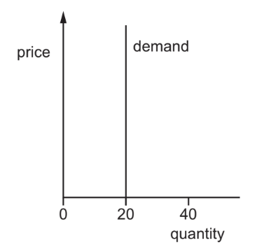

# Exam Questions — 2.7 Price Elasticity of Demand (PED)
**2. The Allocation of Resources** · Cambridge (CIE) IGCSE economics (0455 & 0987)
> Source: [https://www.savemyexams.com/igcse/economics/cie/20/topic-questions/](https://www.savemyexams.com/igcse/economics/cie/20/topic-questions/) · 14 questions across 1 sets

## Paper 1 (14 questions)

### Q1 — hard — 1 marks

**Q1** [1 mark]

The price of a good increased by \$10, resulting in a decrease in quantity demanded by 8%. If the initial price was \$80 and the initial quantity demanded was 120 units, calculate the price elasticity of demand

### Q2 — hard — 1 marks

**Q2** [1 mark]

The initial price of a product was \$80, and the initial quantity demanded was 200 units. After a price increase to \$120, the quantity demanded decreased to 150 units. Calculate the price elasticity of demand.

### Q3 — hard — 1 marks

**Q3** [1 mark]

A railway company increases ticket prices by 10% for travel between 06:00 and 09:00, causing a reduction in demand by 2%. After 09:00 it reduces ticket prices by 5%, resulting in a 7% increase in demand. What is the price elasticity of demand in response to these price changes?

|   | between 06:00 and 09:00 | after 09:00 |
|---|---|---|
| **A**  **B**  **C**  **D** | elastic  elastic  inelastic  inelastic | elastic  inelastic  elastic  inelastic |

*Source: Nov 2019 0455/12 Q7*

### Q4 — hard — 1 marks

**Q4** [1 mark]

What can be concluded from the demand curve for the product shown in the diagram?

*Source: 2019 May/June 0455/12 Q6*

### Q5 — hard — 1 marks

**Q5** [1 mark]

How might the concept of price elasticity of demand (PED) be useful for a government?

*Source: 2020 0455/11 Q6*

### Q6 — easy — 1 marks

**Q6** [1 mark]

If the price elasticity of demand for a good is greater than 1, how would you classify its elasticity?

### Q7 — easy — 1 marks

**Q7** [1 mark]

Price elasticity of demand (PED) measures the responsiveness of demand to a change in price. It can differ for different goods.

For which good is the PED **most** elastic according to the table?

|   | good | percentage change in quantity demanded | percentage change in price |
|---|---|---|---|
| **A**  **B**  **C**  **D** | butter  cars  furniture  petrol | 6.0  5.5  5.0  3.0 | 5.0  5.0  5.0  5.0 |

*Source: 2019 0455/13 Q7*

### Q8 — easy — 1 marks

**Q8** [1 mark]

If many close substitutes for a product become available in the market, what is likely to happen to its price elasticity of demand?

### Q9 — easy — 1 marks

**Q9** [1 mark]

If a 10% increase in the price of a product leads to a 5% decrease in quantity demanded, what type of price elasticity of demand does this represent?

### Q10 — easy — 1 marks

**Q10** [1 mark]

In an African country with large areas of tropical desert the price elasticity of demand for salt is highly inelastic. This will result in greater consumer expenditure on salt when price changes from P1 to P2.

Which diagram illustrates this situation?

*Source: 2020 0455/13 Q7*

### Q11 — medium — 1 marks

**Q11** [1 mark]

In Portugal, the response to changes in the price of French cheese are considered to be unit elastic.

Which diagram illustrates this situation?

### Q12 — medium — 1 marks

**Q12** [1 mark]

A mobile (cell) phone operator increases the price of making calls on its network. After the price increase, the revenue of the mobile phone operator falls by 10%. What is the price elasticity of demand (PED) for the mobile operator’s service?

*Source: 2019 May/June 0455/12 Q7*

### Q13 — medium — 1 marks

**Q13** [1 mark]

The table shows the demand and supply for spices in a market in Africa.

| price per kg (US\$) | quantity demanded (kg) | quantity supplied (kg) |
|---|---|---|
| 10  20  30  40 | 50  40  30  20 | 10  20  30  40 |

When the price rises from US\$20 to US\$30 per kg, what is the price elasticity of demand (PED) for spices?

*Source: 2018 0455/11 Q7*

### Q14 — medium — 1 marks

**Q14** [1 mark]

A product has a price elasticity of demand of – 0.5.

What happens to the demand for a product if its price falls from \$1 to \$0.80?

*Source: 2019 0455/13 Q7*

