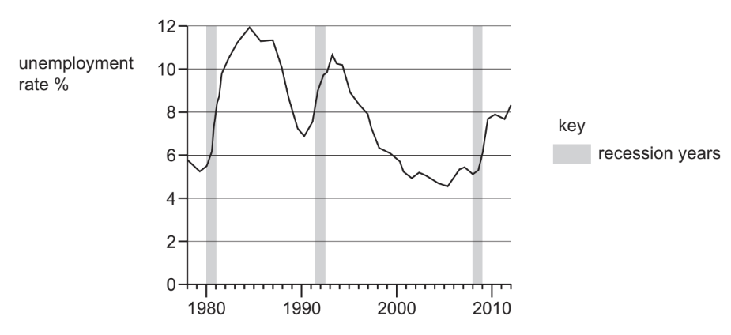
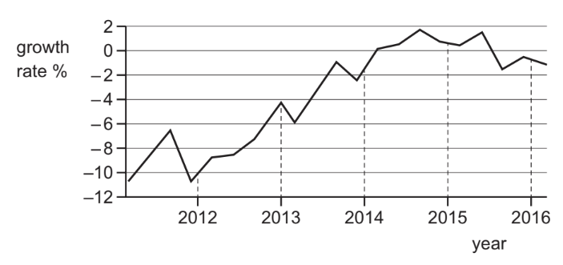

# Exam Questions — 4.6 Economic Growth
**4. Government & the Macroeconomy** · Cambridge (CIE) IGCSE economics (0455 & 0987)
> Source: [https://www.savemyexams.com/igcse/economics/cie/20/topic-questions/](https://www.savemyexams.com/igcse/economics/cie/20/topic-questions/) · 16 questions across 1 sets

## Paper 1 (16 questions)

### Q1 — hard — 1 marks

**Q1** [1 mark]

The diagram shows the rate of unemployment and the periods of recession in a country between 1978 and 2012.

What can be concluded from the diagram?

*Source: 2018 0455/11 Q22*

### Q2 — hard — 1 marks

**Q2** [1 mark]

The table shows the rates of unemployment and real GDP growth for an economy in 2014 and 2018.

|   | 2014 | 2018 |
|---|---|---|
| rate of unemployment(%) | 3 | 10 |
| rate of real GDP growth (%) | 4 | –2 |

Which combination of policy measures would be **most **effective in returning the economy to the 2014 level of economic activity?

*Source: Nov 2020 0455/12 Q21*

### Q3 — hard — 1 marks

**Q3** [1 mark]

A government uses a mixture of fiscal policy measures and supply-side policy measures to stimulate growth in the economy.

Which combination of policy measures will achieve this?

|   | fiscal policy measures | supply-side policy measures |
|---|---|---|
| **A**  **B**  **C**  **D** | increase government expenditure  increase government investment  increase direct taxation  increase interest rates | increase skills training  increase indirect taxes  decrease unemployment benefit  decrease money supply |

*Source: 2019 0455/13 Q17*

### Q4 — hard — 1 marks

**Q4** [1 mark]

The chart shows the GDP annual growth rate (percentage), 2012–2016, for Greece.

In which years did Greece experience the longest period of positive economic growth?

*Source: 2019 0455/11 Q20*

### Q5 — hard — 1 marks

**Q5** [1 mark]

Countries in Europe were in a recession in 2012. World oil prices were expected to fall. In fact in 2012, oil prices rose.

Which combination of international events might explain this?

|   | Possible causes of the expected fall in oil prices | Possible causes of the oil price rise in 2012 |
|---|---|---|
| **A** | European industrial production declined | China increased its car production |
| **B** | India invested huge amounts in road building | Japan’s economy had negative growth |
| **C** | Middle East conflicts made oil supplies uncertain | Saudi Arabia increased oil production |
| **D** | New oil exploration in Poland was successful | Demand for alternative fuels increased |

*Source: 2020 0455/11 Q30*

### Q6 — easy — 1 marks

**Q6** [1 mark]

When is a recession said to occur?

*Source: 2018 0455/13 Q20*

### Q7 — easy — 1 marks

**Q7** [1 mark]

Which increase is **most** likely to cause a rise in the output of an economy?

*Source: Nov 2019 0455/12 Q20*

### Q8 — easy — 1 marks

**Q8** [1 mark]

An increase in which economic indicator is usually taken as the measure of a country’s economic growth?

*Source: 2018 0455/11 Q20*

### Q9 — easy — 1 marks

**Q9** [1 mark]

Economic growth is usually measured by the annual change in

*Source: 2018 0455/12 Q20*

### Q10 — easy — 1 marks

**Q10** [1 mark]

What is defined as ‘a reduction in gross domestic product (GDP) for more than two successive quarters’?

*Source: 2020 March 0455/12 Q21*

### Q11 — medium — 1 marks

**Q11** [1 mark]

Which combination of policy measures would be effective in reducing the effects of a recession?

*Source: Nov 2019 0455/12 Q18*

### Q12 — medium — 1 marks

**Q12** [1 mark]

In the past, governments have adopted policies to try to end a recession in their country and increase economic growth.

Which combination of policies is **most **likely to achieve this?

*Source: 2020 March 0455/12 Q19*

### Q13 — medium — 1 marks

**Q13** [1 mark]

In 2016, Romania had an increase in its real gross domestic product of 4.8%.

What must this mean about the Romanian economy?

*Source: 2020 0455/11 Q21*

### Q14 — medium — 1 marks

**Q14** [1 mark]

The table shows the percentage change from 2015–2016 in gross domestic product (GDP) and consumer prices for selected countries.

Which country was suffering from economic recession and inflation?

|   | country | GDP | consumer prices |
|---|---|---|---|
| **A**  **B**  **C**  **D** | Australia  Brazil  China  Japan | +1.8  –2.9  +6.7  +1.1 | +1.3  +8.3  +2.0  –0.2 |

*Source: 2019 0455/11 Q23*

### Q15 — medium — 1 marks

**Q15** [1 mark]

What is the most likely result of a sustained increase in Gross Domestic Product (GDP)?

*Source: 2019 0455/13 Q20*

### Q16 — medium — 1 marks

**Q16** [1 mark]

A country has the highest GDP per head in the world.

What is this information most likely to suggest about the country?

*Source: 2019 March  0455/12 Q20*

