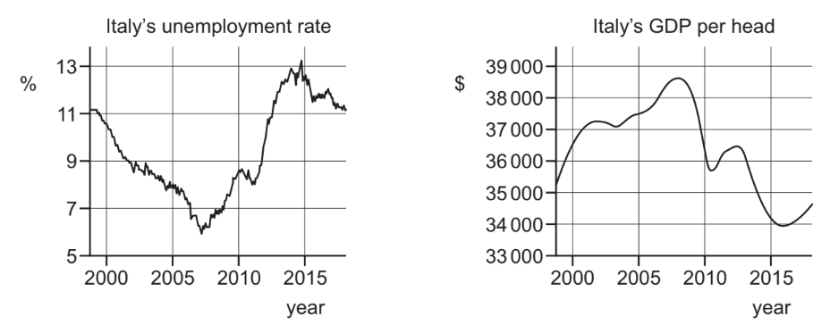

# Exam Questions — 4.7 Employment & Unemployment
**4. Government & the Macroeconomy** · Cambridge (CIE) IGCSE economics (0455 & 0987)
> Source: [https://www.savemyexams.com/igcse/economics/cie/20/topic-questions/](https://www.savemyexams.com/igcse/economics/cie/20/topic-questions/) · 15 questions across 1 sets

## Paper 1 (15 questions)

### Q1 — hard — 1 marks

**Q1** [1 mark]

The table provides information about a country’s labour market.

| population size  labour force size  number of employed  number of full-time students | 2000000  1200000  900000  100000 |
|---|---|

What is the unemployment rate of this country?

*Source: 2020 March 0455/12 Q20*

### Q2 — hard — 1 marks

**Q2** [1 mark]

An economy is experiencing an unemployment rate of 8%. The government implements policies to stimulate economic growth and create jobs. As a result, the unemployment rate decreases to 5% over a year. What type of unemployment has likely decreased?

### Q3 — hard — 1 marks

**Q3** [1 mark]

The diagrams show Italy’s unemployment rate and GDP per head.

When do Italy’s unemployment rate and GDP per head rise at the same time?

*Source: 2020 0455/13 Q21*

### Q4 — hard — 1 marks

**Q4** [1 mark]

A country experienced its usual August increase in the rate of unemployment. Unfortunately this was followed by the loss of jobs resulting from the regular downturn in global economic activity.

Which types of unemployment occurred?

|   | first type of unemployment (August) | second type of unemployment (global downturn) |
|---|---|---|
| **A**  **B**  **C**  **D** | cyclical  frictional  seasonal  structural | structural  seasonal  cyclical  frictional |

*Source: 2018 0455/11 Q23*

### Q5 — hard — 1 marks

**Q5** [1 mark]

What is most likely to have caused a long-term decrease in the numbers employed in the banking sector of an economy?

*Source: 2019 0455/13 Q22*

### Q6 — easy — 1 marks

**Q6** [1 mark]

What describes frictional unemployment?

*Source: 2019 May/June 0455/12 Q22*

### Q7 — easy — 1 marks

**Q7** [1 mark]

Which group should **not **be included in the measurement of unemployment?

*Source: Nov 2020 0455/12 Q20*

### Q8 — easy — 1 marks

**Q8** [1 mark]

Which type of unemployment is the result of a permanent fall in the demand for the products of an industry?

*Source: 2019 0455/13 Q22*

### Q9 — easy — 1 marks

**Q9** [1 mark]

Which activity takes place in the tertiary sector?

*Source: 2018 0455/11 Q4*

### Q10 — easy — 1 marks

**Q10** [1 mark]

Some governments in the European Union are trying to reduce unemployment.

What should increase to achieve this?

*Source: 2020 0455/11 Q20*

### Q11 — medium — 1 marks

**Q11** [1 mark]

What is the **most** likely effect of raising the retirement age in a country?

*Source: 2018 0455/13 Q24*

### Q12 — medium — 1 marks

**Q12** [1 mark]

What is an example of someone who lost their job because of structural unemployment?

*Source: 2019 March  0455/12 Q22*

### Q13 — medium — 1 marks

**Q13** [1 mark]

There was a fall in investment spending by businesses in the third quarter of 2015.

What would be the likely result of this?

*Source: 2018 0455/11 Q22*

### Q14 — medium — 1 marks

**Q14** [1 mark]

Why might a government decide to subsidise a high-cost steel industry?

*Source: 2019 May/June 0455/12 Q19*

### Q15 — medium — 1 marks

**Q15** [1 mark]

During periods of high unemployment across the entire labour force, the highest unemployment rate in an economy is often in the 16–19 year-old age group. Which statement explains why 16–19 year-olds may find it difficult to find a job?

*Source: Nov 2019 0455/12 Q22*

