# Exam Questions — 1.4 Production Possibility Curve (PPC) Diagrams
**1. The Basic Economic Problem** · Cambridge (CIE) IGCSE economics (0455 & 0987)
> Source: [https://www.savemyexams.com/igcse/economics/cie/25/topic-questions/](https://www.savemyexams.com/igcse/economics/cie/25/topic-questions/) · 15 questions across 1 sets

## Paper 1 (15 questions)

### Q1 — medium — 1 marks

**Q1** [1 mark]

The diagram shows a production possibility curve (PPC). The economy moves from point X to point Y.

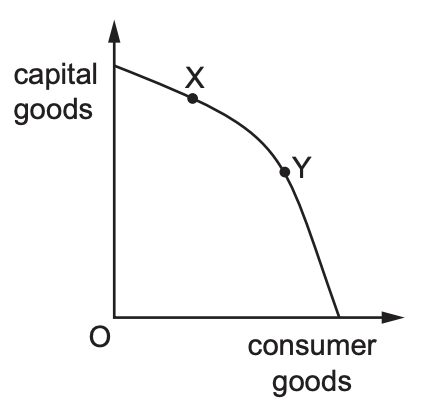

What does this movement represent?

### Q2 — hard — 1 marks

**Q2** [1 mark]

The diagram shows two production possibility curves.

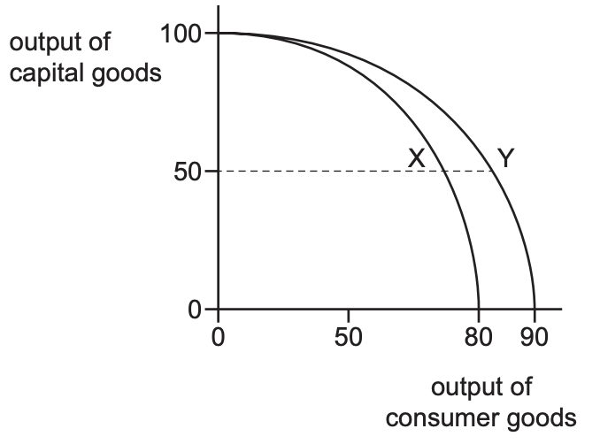

Which statement about the movement from point X to point Y is correct?

*Source: Nov 2019 0455/12 Q2*

### Q3 — hard — 1 marks

**Q3** [1 mark]

The diagram shows a production possibility curve (PPC) for an economy that produces both capital goods and consumer goods. At which point will the economy show the highest potential for sustained long run economic growth?

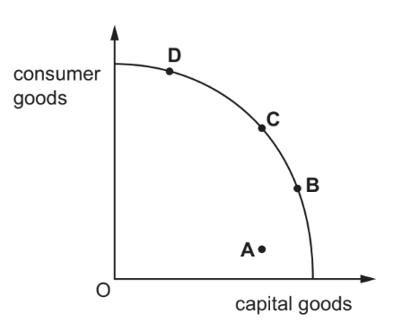

*Source: 2019 May/June 0455/12 Q2*

### Q4 — hard — 1 marks

**Q4** [1 mark]

What would cause an outward shift of a country’s production possibility curve (PPC)?

*Source: 2019 0455/13 Q2*

### Q5 — hard — 1 marks

**Q5** [1 mark]

The diagram shows a production possibility curve (PPC) for a country. The country moved from position X to position Y on the PPC.

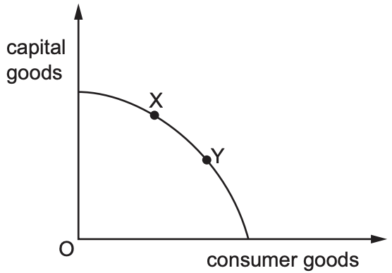

What is the **most** likely reason for this change?

*Source: Nov 2020 0455/12 Q3*

### Q6 — easy — 1 marks

**Q6** [1 mark]

The diagram shows a production possibility curve (PPC).

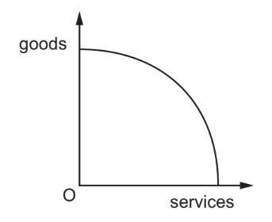

What would cause the curve to shift inwards?

### Q7 — easy — 1 marks

**Q7** [1 mark]

Using all available resources an economy produces different combinations of two types of good, clothes and food, shown on the production possibility curve (PPC) diagram.

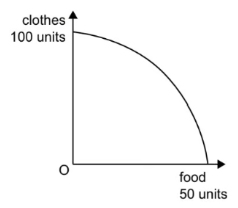

What does the PPC indicate?

*Source: 2020 0455/11 Q1*

### Q8 — easy — 1 marks

**Q8** [1 mark]

The diagram shows a production possibility curve (PPC).

Why is the curve usually drawn like this?

*Source: 2019 0455/11 Q2*

### Q9 — easy — 1 marks

**Q9** [1 mark]

A production possibility curve shows all of the following except?

### Q10 — easy — 1 marks

**Q10** [1 mark]

The diagram shows the production possibility curve (PPC) of an economy producing at point X.

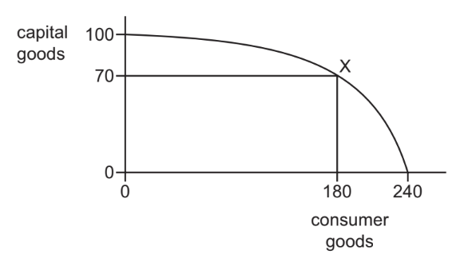

What would be the opportunity cost of moving from point X to produce only consumer goods?

*Source: 2020 0455/13 Q3*

### Q11 — medium — 1 marks

**Q11** [1 mark]

The diagram shows the production possibility curve (PPC) for an economy.

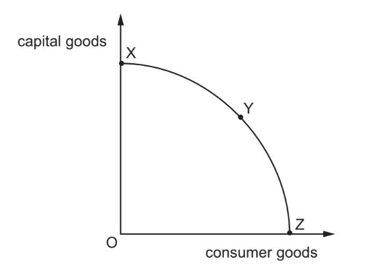

What will happen to the opportunity cost of producing more units of consumer goods in terms of capital goods as the economy moves down its PPC from point X to point Z?

*Source: 2018 0455/11 Q3*

### Q12 — medium — 1 marks

**Q12** [1 mark]

The diagram shows the production possibility curve (PPC) of a country producing at point T.

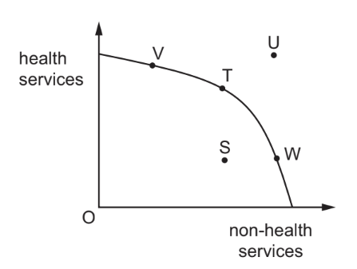

The country has an ageing population and decides to allocate more resources to the production of health services. Which movement shows this change in resource allocation?

*Source: 2020 March 0455/12 Q2*

### Q13 — medium — 1 marks

**Q13** [1 mark]

Countries X and Y have identical resources. The diagram shows their production possibility curves.

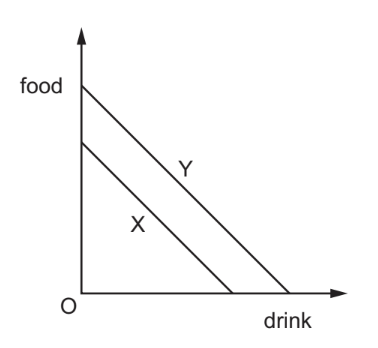

What can be concluded from the diagram?

*Source: 2019 0455/11 Q2*

### Q14 — medium — 1 marks

**Q14** [1 mark]

Country X provides computers to help teachers in the classroom.

How would this technology increase the economic potential of country X?

*Source: 2019 0455/13 Q2*

### Q15 — medium — 1 marks

**Q15** [1 mark]

The diagram shows a country’s production possibility curve (PPC).

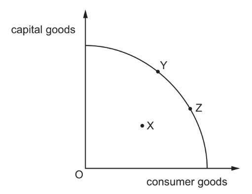

Which statement is correct?

*Source: 2018 0455/12 Q3*

