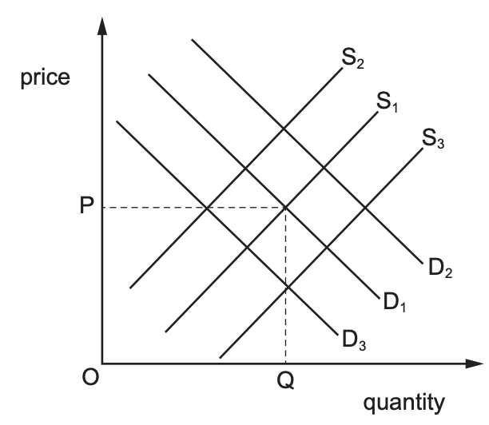

# Exam Questions — 2.3 Supply
**2. The Allocation of Resources** · Cambridge (CIE) IGCSE economics (0455 & 0987)
> Source: [https://www.savemyexams.com/igcse/economics/cie/25/topic-questions/](https://www.savemyexams.com/igcse/economics/cie/25/topic-questions/) · 17 questions across 1 sets

## Paper 1 (17 questions)

### Q1 — medium — 1 marks

**Q1** [1 mark]

In the diagram below, there is a shift of the demand curve for rice from D1 to D2.

What could have caused this?

### Q2 — medium — 1 marks

**Q2** [1 mark]

A rise in wages in the car industry increases production costs.
What will happen to the supply curve of cars?

### Q3 — hard — 1 marks

**Q3** [1 mark]

What impact does an increase in the cost of labor have on the supply curve for a product?

### Q4 — hard — 1 marks

**Q4** [1 mark]

How does a decrease in an indirect tax rate typically affect the producer's willingness to supply a product?

### Q5 — hard — 1 marks

**Q5** [1 mark]

Which of the following factors is likely to cause a rightward shift in the supply curve for smartphones?

### Q6 — hard — 1 marks

**Q6** [1 mark]

If a natural disaster destroys a significant portion of a country's agricultural land, what is the likely impact on the supply of food products?

### Q7 — hard — 1 marks

**Q7** [1 mark]

There has been a movement upwards along the supply curve of a product.

What is the **most** likely explanation for this?

*Source: 2019 0455/13 Q6*

### Q8 — easy — 1 marks

**Q8** [1 mark]

What can cause the supply curve for a product to shift to the right?

*Source: Nov 2019 0455/12 Q6*

### Q9 — easy — 1 marks

**Q9** [1 mark]

What is the key difference between individual supply and market supply?

### Q10 — easy — 1 marks

**Q10** [1 mark]

What term describes a graph that illustrates the relationship between the quantity of a good supplied by an individual producer and its price?

### Q11 — easy — 1 marks

**Q11** [1 mark]

What does individual supply refer to?

### Q12 — easy — 1 marks

**Q12** [1 mark]

How does an improvement in technology typically affect supply?

### Q13 — medium — 1 marks

**Q13** [1 mark]

What is the effect on the supply curve of a product if there is an increase in the price of a key raw material used in its production?

### Q14 — medium — 1 marks

**Q14** [1 mark]

What effect would an increase in government subsidies for solar panel manufacturers have on the supply of solar panels?

### Q15 — medium — 1 marks

**Q15** [1 mark]

If the government imposes a tax on a product, what is the likely impact on its supply curve?

### Q16 — medium — 1 marks

**Q16** [1 mark]

How does an increase in the number of suppliers in a market impact the supply curve?

### Q17 — medium — 1 marks

**Q17** [1 mark]

What is **not **held constant when constructing the supply curve of a firm?

*Source: 2020 March 0455/12 Q7*

