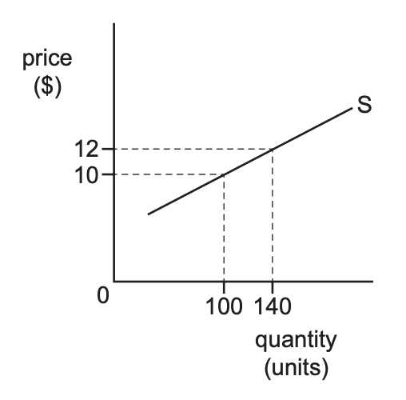

# Exam Questions — 2.7 Price Elasticity of Supply (PES)
**2. The Allocation of Resources** · Cambridge (CIE) IGCSE economics (0455 & 0987)
> Source: [https://www.savemyexams.com/igcse/economics/cie/25/topic-questions/](https://www.savemyexams.com/igcse/economics/cie/25/topic-questions/) · 16 questions across 1 sets

## Paper 1 (16 questions)

### Q1 — medium — 1 marks

**Q1** [1 mark]

Which of the following is a likely determinant of the price elasticity of supply (PES) of tomatoes?

### Q2 — hard — 1 marks

**Q2** [1 mark]

A technological innovation leads to a significant increase in the production capacity of a product with inelastic supply. How might this impact the stakeholders involved?

### Q3 — hard — 1 marks

**Q3** [1 mark]

Which of the following products is most likely to have an inelastic supply?

### Q4 — hard — 1 marks

**Q4** [1 mark]

A product has a price elasticity of supply (PES) of 0.2. How might this impact consumers and producers during a sudden surge in demand?

### Q5 — hard — 1 marks

**Q5** [1 mark]

A product has a price elasticity of supply (PES) of 0.3. If the price of the product decreases by 8%, by how much will the quantity supplied change?

### Q6 — hard — 1 marks

**Q6** [1 mark]

A product with a price elasticity of supply (PES) of 1.2 experiences a 15% decrease in price. By what percentage will the quantity supplied change?

### Q7 — easy — 1 marks

**Q7** [1 mark]

The diagram shows the supply curve for a good. What is the price elasticity of supply when the price rises from \$10 to \$12?

*Source: Nov 2020 0455/12 Q7*

### Q8 — easy — 1 marks

**Q8** [1 mark]

Which of the following factors does not influence the price elasticity of supply?

### Q9 — easy — 1 marks

**Q9** [1 mark]

The table shows the quantity that producers are willing to supply at different price levels.

| price (\$) | quantity supplied |
|---|---|
| 120  150  180 | 20  40  80 |

If the price increases from \$120 to \$180, what would be the price elasticity of supply?

*Source: 2019 0455/11 Q7*

### Q10 — easy — 1 marks

**Q10** [1 mark]

Which of the following would likely result in a more elastic supply?

### Q11 — easy — 1 marks

**Q11** [1 mark]

The PES of salt is considered to be relatively elastic in the long term.

Which of the following illustrations would best demonstrate this?

### Q12 — medium — 1 marks

**Q12** [1 mark]

The price elasticity of supply of a good is 2. The price of the good then falls by 10%.

What is the effect on quantity supplied?

*Source: 2020 0455/11 Q7*

### Q13 — medium — 1 marks

**Q13** [1 mark]

Which of the following statements about the price elasticity of supply (PES)? is accurate?

### Q14 — medium — 1 marks

**Q14** [1 mark]

If the price elasticity of supply (PES) of a product is 0.5, what can be inferred about the supply responsiveness?

### Q15 — medium — 1 marks

**Q15** [1 mark]

What is the key characteristic of a product with a perfectly inelastic price elasticity of supply (PES)?

### Q16 — medium — 1 marks

**Q16** [1 mark]

The table shows the effect of a change in the market price from \$5 to \$6 on the supply of mobile (cell) phones.

| price (\$) | supply (units) |
|---|---|
| 5  6 | 10000  15000 |

Which statement about the price elasticity of supply of mobile phones is correct?

*Source: 2019 March  0455/12 Q7*

