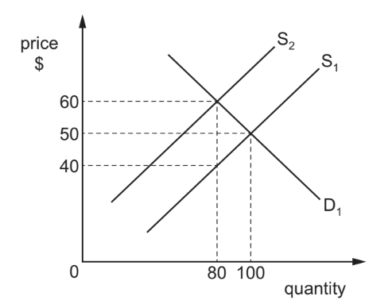
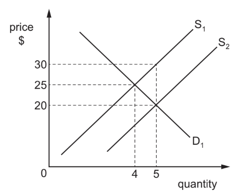
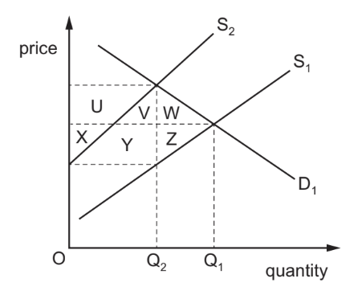
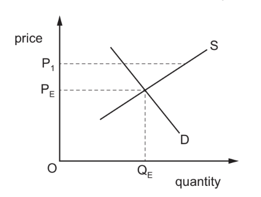
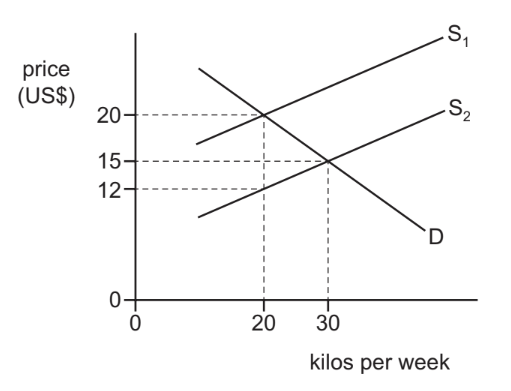

# Exam Questions — 2.9 Market Failure
**2. The Allocation of Resources** · Cambridge (CIE) IGCSE economics (0455 & 0987)
> Source: [https://www.savemyexams.com/igcse/economics/cie/25/topic-questions/](https://www.savemyexams.com/igcse/economics/cie/25/topic-questions/) · 17 questions across 1 sets

## Paper 1 (17 questions)

### Q1 — medium — 1 marks

**Q1** [1 mark]

A factory produces chemicals. Local residents benefit from new jobs but suffer from polluted water supplies.

What type of market failure does this situation illustrate?

### Q2 — hard — 1 marks

**Q2** [1 mark]

A private sector firm is given a contract by the government to supply a country’s water. Which government directive will minimise the risk of market failure?

*Source: 2019 March  0455/12 Q5*

### Q3 — hard — 1 marks

**Q3** [1 mark]

The diagram shows the impact of a government imposing an indirect tax on a good. The original demand curve is D1 and original supply curve is S1.

What is the total tax revenue gained by the government?

*Source: 2019 0455/11 Q19*

### Q4 — hard — 1 marks

**Q4** [1 mark]

The diagram shows the demand curve D1 and supply curve S1 for a good. The government introduces a subsidy to encourage production.

What will be the total cost of the subsidy to the government?

*Source: 2019 0455/11 Q18*

### Q5 — hard — 1 marks

**Q5** [1 mark]

The diagram shows the effect of the imposition of a tax on a product.

Which area represents the part of the tax paid by consumers of the product?

*Source: 2019 May/June 0455/12 Q18*

### Q6 — hard — 1 marks

**Q6** [1 mark]

A government approved the construction of a new railway line connecting major cities. It would be built by a private company but be funded partly through taxation. It would create many jobs. People living on the route worried about the harm to their environment.

Which concepts are directly involved in this statement?

*Source: 2018 0455/11 Q6*

### Q7 — easy — 1 marks

**Q7** [1 mark]

A major highway has been built at a cost of US\$175 million between Nairobi, Kenya and its suburbs. This reduces travel time and increases safety, but there are environmental problems for small enterprises along its route.

Who bears the external costs of this project?

*Source: 2018 0455/11 Q6*

### Q8 — easy — 1 marks

**Q8** [1 mark]

Coal production in the UK has declined in recent years. One reason given for this is that the social cost of coal production is too high.

What best describes the social cost of coal production?

*Source: 2018 0455/12 Q6*

### Q9 — easy — 1 marks

**Q9** [1 mark]

The government wants to reduce the consumption of cigarettes.

Which policy would be **most** likely to do this?

*Source: Nov 2020 0455/12 Q19*

### Q10 — easy — 1 marks

**Q10** [1 mark]

What causes market failure?

*Source: 2019 0455/11 Q5*

### Q11 — easy — 1 marks

**Q11** [1 mark]

Sometimes the government regulates the market to protect the interests of consumers.

Which kind of regulation would achieve this protection?

*Source: 2019 0455/13 Q18*

### Q12 — medium — 1 marks

**Q12** [1 mark]

What suggests that there is market failure?

*Source: Nov 2019 0455/12 Q5*

### Q13 — medium — 1 marks

**Q13** [1 mark]

Which situation involving the building industry is most likely to be investigated by a government body set up to control restrictive practices?

*Source: 2018 0455/11 Q19*

### Q14 — medium — 1 marks

**Q14** [1 mark]

The diagram shows the equilibrium market price PE and quantity QE for rice in a country.

Which government action could cause the market price for rice to become $P_{1}$?

*Source: 2018 0455/11 Q5*

### Q15 — medium — 1 marks

**Q15** [1 mark]

In the diagram, which level of subsidy per kilo would a government have to give to producers to encourage them to increase production from 20 kilos per week to 30 kilos per week?

*Source: 2018 0455/11 Q18*

### Q16 — medium — 1 marks

**Q16** [1 mark]

China has built a new railway in Kenya from the capital, Nairobi, to the seaport of Mombasa. Kenya must repay the cost of the railway to China. Journey time has been reduced significantly but fares have increased and farmers have lost agricultural land along the new line.

Who bears the external costs of this operation?

*Source: 2019 0455/13 Q5*

### Q17 — medium — 1 marks

**Q17** [1 mark]

In a private market system certain goods and services would not be available unless the government intervened.

What does this identify in a private market?

*Source: 2019 0455/13 Q5*

