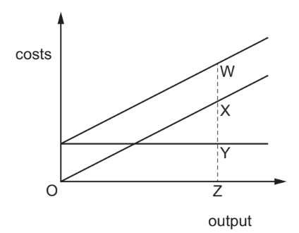

# Exam Questions — 3.6 Firms' Costs, Revenue & Objectives
**3. Microeconomic Decision-Makers** · Cambridge (CIE) IGCSE economics (0455 & 0987)
> Source: [https://www.savemyexams.com/igcse/economics/cie/25/topic-questions/](https://www.savemyexams.com/igcse/economics/cie/25/topic-questions/) · 20 questions across 1 sets

## Paper 1 (20 questions)

### Q1 — hard — 1 marks

**Q1** [1 mark]

The table shows the costs of a firm.

| variable cost per good | fixed cost |
|---|---|
| \$2 | \$40 |

What is the average total cost if the firm produces 20 goods?

*Source: 2020 March 0455/12 Q12*

### Q2 — hard — 1 marks

**Q2** [1 mark]

The table shows a firm’s average revenue and average cost at different levels of output.

When all output is sold, which level of output gives maximum profit?

|   | output (units) | average revenue (US\$) | average cost (US\$) |
|---|---|---|---|
| **A**  **B**  **C**  **D** | 5  10  15  20 | 10  20  25  30 | 30  20  15  18 |

*Source: 2018 0455/11 Q14*

### Q3 — hard — 1 marks

**Q3** [1 mark]

A firm producing bicycles has the following costs at different levels of output.

| output | total fixed costs (\$) | total variable costs (\$) |
|---|---|---|
| 10  20  30 | 300  300  300 | 800  1500  3300 |

What happens to the average total cost over this range of output?

*Source: Nov 2019 0455/12 Q15*

### Q4 — hard — 1 marks

**Q4** [1 mark]

The table shows the output and total costs of a small firm.

| output (units) | total costs (\$) |
|---|---|
| 0  1000  5000  10000 | 50000  100000  400000  600000 |

What is the average fixed cost of producing 10 000 units?

*Source: Nov 2020 0455/12 Q12*

### Q5 — hard — 1 marks

**Q5** [1 mark]

The table shows the total cost of firm X at each level of output.

| output | total cost |
|---|---|
| 0  1  2  3 | 3  5  6  9 |

At which level of output does total variable cost exceed total fixed cost?

*Source: 2020 0455/13 Q12*

### Q6 — hard — 1 marks

**Q6** [1 mark]

A firm’s average revenue is \$10. It sells 2000 units.

What is the firm’s total revenue and the price of the product?

|   | total revenue (\$) | price (\$) |
|---|---|---|
| **A**  **B**  **C**  **D** | 10  2000  20000  20000 | 10  200  10  200 |

*Source: 2019 March  0455/12 Q15*

### Q7 — easy — 1 marks

**Q7** [1 mark]

The diagrams show the average total cost (ATC) curves of four firms and how they change as output increases.

Which firm has the highest fixed costs?

*Source: 2020 0455/11 Q13*

### Q8 — easy — 1 marks

**Q8** [1 mark]

What must result from an increase in output?

*Source: 2019 0455/11 Q12*

### Q9 — easy — 1 marks

**Q9** [1 mark]

An entrepreneur buys a workshop for \$200 000 to make plastic boxes. In the first year of operation he spends \$70 000 on materials, employs ten production workers paid by the amount produced (piece rate) at a total cost of \$80 000 and buys two delivery vehicles for \$10 000 each.

What are his total variable costs?

*Source: 2019 May/June 0455/12 Q15*

### Q10 — easy — 1 marks

**Q10** [1 mark]

When is profit maximisation achieved?

*Source: 2020 March 0455/12 Q13*

### Q11 — easy — 1 marks

**Q11** [1 mark]

When will a firm maximise its profits?

*Source: 2019 March  0455/12 Q13*

### Q12 — easy — 1 marks

**Q12** [1 mark]

Which statement about total fixed cost is correct?

*Source: 2018 0455/11 Q15*

### Q13 — easy — 1 marks

**Q13** [1 mark]

Which statement about fixed costs is correct?

*Source: 2018 0455/11 Q15*

### Q14 — medium — 1 marks

**Q14** [1 mark]

A firm that sells its product for \$6 a unit has the following total costs.

| output (units) | 0 | 10 | 20 | 30 |
|---|---|---|---|---|
| total costs (\$) | 40 | 100 | 120 | 150 |

Which statement is correct?

*Source: 2018 0455/11 Q14*

### Q15 — medium — 1 marks

**Q15** [1 mark]

In the short run, a firm calculates its total fixed cost, total variable cost and total cost. It then plots a graph showing how they change as output increases.

What happens to the lines showing the total variable cost and total cost as output increases?

*Source: 2020 0455/11 Q12*

### Q16 — medium — 1 marks

**Q16** [1 mark]

A firm has fixed costs of \$1000. The table shows the variable cost at different levels of output.

| output (units) | 1 | 2 | 3 | 4 |
|---|---|---|---|---|
| variable cost (\$) | 100 | 190 | 270 | 350 |

If the goods are sold for \$500 each, how much profit will be made from the sale of 4 units?

*Source: Nov 2020 0455/12 Q13*

### Q17 — medium — 1 marks

**Q17** [1 mark]

Why is the energy supply industry dominated by very large firms in many economies?

*Source: 2019 0455/11 Q13*

### Q18 — medium — 1 marks

**Q18** [1 mark]

The table shows the costs of a firm.

| units of output | variable costs (\$) | total costs (\$) |
|---|---|---|
| 10  20  30  40 | 20  50  80  110 | 80  110  140  170 |

What is the value of the firm’s fixed costs?

*Source: 2019 March  0455/12 Q14*

### Q19 — medium — 1 marks

**Q19** [1 mark]

The table shows a firm’s total revenue and total cost at different levels of output.

Which level of output gives maximum profit?

|   | output (units) | total revenue (\$) | total cost (\$) |
|---|---|---|---|
| **A**  **B**  **C**  **D** | 10  20  30  40 | 15  20  25  30 | 15  18  20  21 |

*Source: 2020 0455/11 Q14*

### Q20 — medium — 1 marks

**Q20** [1 mark]

The diagram shows the fixed costs, variable costs and total costs of a firm.

Which distance represents the firm’s fixed costs?

*Source: 2019 May/June 0455/12 Q14*

