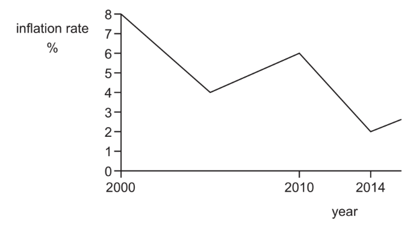
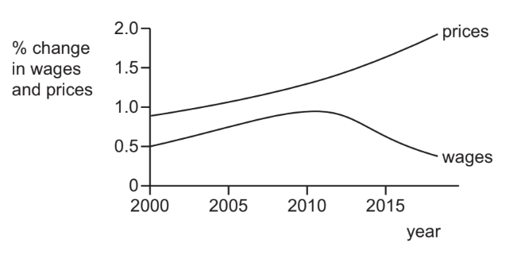

# Exam Questions — 4.7 Inflation
**4. Government & the Macroeconomy** · Cambridge (CIE) IGCSE economics (0455 & 0987)
> Source: [https://www.savemyexams.com/igcse/economics/cie/25/topic-questions/](https://www.savemyexams.com/igcse/economics/cie/25/topic-questions/) · 20 questions across 1 sets

## Paper 1 (20 questions)

### Q1 — hard — 1 marks

**Q1** [1 mark]

The table shows unemployment and inflation statistics for the US, Japan and Sweden for year 1 and year 2.

| country | unemployment (%) | inflation (% pa) |   |   |
|---|---|---|---|---|
| year 1 | year 2 | year 1 | year 2 |   |
| US  Japan  Sweden | 4.8  2.7  2.7 | 4.4  2.7  3.2 | 5.6  1.7  8.3 | 3.4  0.7  6.6 |

Which conclusion can be made from the table?

*Source: 2020 0455/11 Q22*

### Q2 — hard — 1 marks

**Q2** [1 mark]

In January 2016 the rate of inflation in a country changed from 3% to 2%. In March 2016 the rate of inflation was 4%.

What happened to the price level in January and March?

|   | January | March |
|---|---|---|
| A  B  C  D | fell  fell  rose  rose | fell  rose  fell  rose |

*Source: 2019 May/June 0455/12 Q23*

### Q3 — hard — 1 marks

**Q3** [1 mark]

In Uganda, the rate of inflation fell from 5% in 2014 to 2% in 2015.

Which conclusion can be drawn from this information?

*Source: 2019 0455/11 Q20*

### Q4 — hard — 1 marks

**Q4** [1 mark]

What might cause prices to rise because of cost-push inflation?

*Source: 2019 0455/13 Q23*

### Q5 — hard — 1 marks

**Q5** [1 mark]

Four groups who are affected by changing economic conditions are creditors, debtors, exporters and importers.

Which pair is most likely to be disadvantaged by a high rate of inflation?

*Source: 2018 0455/12 Q21*

### Q6 — hard — 1 marks

**Q6** [1 mark]

The graph shows the rate of inflation in a country between 2000 and 2014.

What can be concluded about average prices?

*Source: 2019 0455/13 Q23*

### Q7 — easy — 1 marks

**Q7** [1 mark]

What is used to measure inflation?

*Source: 2018 0455/11 Q21*

### Q8 — easy — 1 marks

**Q8** [1 mark]

Some goods take a greater percentage of a typical household’s total spending than others.

How is this accounted for in the construction of a consumer prices index?

*Source: Nov 2020 0455/12 Q23*

### Q9 — easy — 1 marks

**Q9** [1 mark]

A person receives annual interest of 4% on their savings. Inflation is 5% per annum.

What is the approximate change in the real value of their savings?

*Source: 2020 March 0455/12 Q22*

### Q10 — easy — 1 marks

**Q10** [1 mark]

Rates of inflation and deflation are measured using a consumer prices index (CPI) over a period of time.

The table shows average rates of CPI for Japan from 2010–2014.

| year | change in CPI |
|---|---|
| 2010  2011  2012  2013  2014 | –0.72  –0.28  –0.03  0.36  2.75 |

In which period did Japan experience deflation followed by inflation?

*Source: 2019 0455/11 Q23*

### Q11 — easy — 1 marks

**Q11** [1 mark]

An increase in which of the following is **least **likely to cause inflation?

*Source: 2020 March 0455/12 Q23*

### Q12 — medium — 1 marks

**Q12** [1 mark]

Which country is suffering from the worst deflation?

|   | annual change in indicator |   |   |
|---|---|---|---|
| inflation % | unemployment rate % | real GDP per capita (US\$) % |   |
| **A**  **B**  **C**  **D** | –5  –2  +2  +12 | +3  –2  –3  +10 | –3  –2  +1  +3 |

*Source: 2018 0455/13 Q21*

### Q13 — medium — 1 marks

**Q13** [1 mark]

The diagram shows percentage (%) changes in prices and wages over time.

What does the diagram indicate?

*Source: 2019 0455/13 Q19*

### Q14 — medium — 1 marks

**Q14** [1 mark]

A country is experiencing a period of full employment.

What is **most** likely to lead to an increase in demand-pull inflation?

*Source: 2019 0455/11 Q22*

### Q15 — medium — 1 marks

**Q15** [1 mark]

Venezuela, a leading world oil producer, has experienced hyperinflation of over 400% per annum in recent years. How does hyperinflation affect an economy?

|   | prices | effect |
|---|---|---|
| **A**  **B**  **C**  **D** | fluctuate up and down  fluctuate up and down  rise very rapidly  rise very rapidly | consumers are uncertain about future price levels  consumers can anticipate future price levels  value of fixed assets remains stable  money has limited worth as a medium of exchange |

*Source: Nov 2019 0455/12 Q23*

### Q16 — medium — 1 marks

**Q16** [1 mark]

An economy is experiencing rising prices. Which government policy will help reduce consumer expenditure?

*Source: Nov 2020 0455/12 Q22*

### Q17 — medium — 1 marks

**Q17** [1 mark]

What is **most **likely to cause a rise in the rate of inflation in an economy?

*Source: 2019 May/June 0455/12 Q16*

### Q18 — medium — 1 marks

**Q18** [1 mark]

What is included in the calculation of a consumer prices index (CPI)?

*Source: 2018 0455/11 Q21*

### Q19 — medium — 1 marks

**Q19** [1 mark]

An economy experienced deflation.

Which combination shows the likely outcome of this?

|   | consumer confidence | price level | investor confidence |
|---|---|---|---|
| A  B  C  D | decrease  decrease  increase  increase | decrease  increase  decrease  increase | decrease  decrease  increase  increase |

*Source: 2019 March  0455/12 Q23*

### Q20 — medium — 1 marks

**Q20** [1 mark]

In the construction of a consumer prices index (CPI), a total weight of 1000 is used.

If a weight of 300 is given to food and a weight of 150 is given to transport, then

*Source: 2020 0455/11 Q21*

