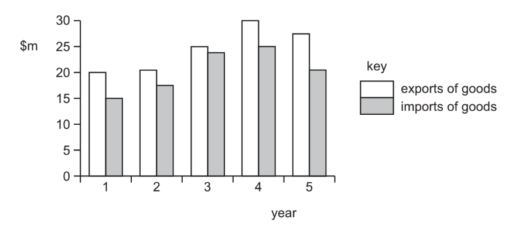
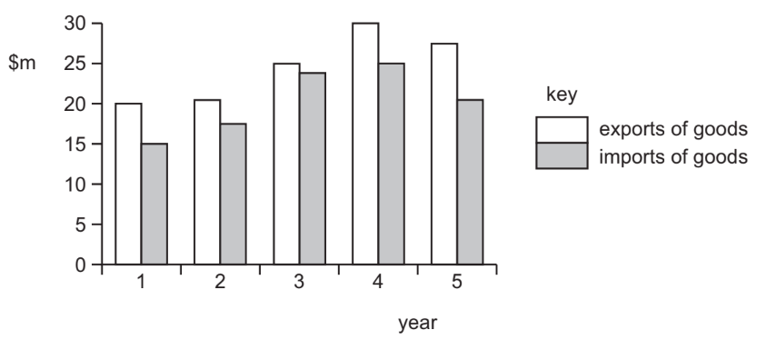

# Exam Questions — 6.4 Current Account of the Balance of Payments
**6. International Trade & Globalisation** · Cambridge (CIE) IGCSE economics (0455 & 0987)
> Source: [https://www.savemyexams.com/igcse/economics/cie/25/topic-questions/](https://www.savemyexams.com/igcse/economics/cie/25/topic-questions/) · 18 questions across 1 sets

## Paper 1 (18 questions)

### Q1 — medium — 1 marks

**Q1** [1 mark]

What is a likely consequence of a current account surplus for an economy?

### Q2 — hard — 1 marks

**Q2** [1 mark]

What would **not** be included in the current account of the balance of payments?

*Source: 2020 0455/13 Q27*

### Q3 — hard — 1 marks

**Q3** [1 mark]

Which item will register as an outflow on the services section of the current account of the US balance of payments?

*Source: 2019 0455/13 Q29*

### Q4 — hard — 1 marks

**Q4** [1 mark]

The diagram shows the value of a country’s exports and imports of goods over five years.

Between which two years did the country have an increase in the value of imports and an improvement in its balance of trade in goods?

*Source: 2020 0455/13 Q30*

### Q5 — hard — 1 marks

**Q5** [1 mark]

What would cause a rise in the deficit on the current account of the balance of payments?

*Source: Nov 2019 0455/12 Q29*

### Q6 — hard — 1 marks

**Q6** [1 mark]

The table shows a selection of economic data for a country.

|   | \$ m |
|---|---|
| primary income (net income transfers)  secondary income (net current transfers)  total value of exported goods  total value of imported goods  total value of exported services  total value of imported services | 1000  -500  1000  2000  800  200 |

What is the current account balance of this country?

*Source: 2020 March 0455/12 Q29*

### Q7 — easy — 1 marks

**Q7** [1 mark]

In 2012 the UK held the Olympic Games, which attracted a large number of visitors from foreign countries.

Which item of the UK’s current account balance will have benefited directly from this event?

*Source: 2018 0455/11 Q28*

### Q8 — easy — 1 marks

**Q8** [1 mark]

The table shows a country’s exports and imports.

|   | \$m |
|---|---|
| exports of goods  imports of goods  exports of services  imports of services | 200  190  35  38 |

What was the country’s balance of trade in goods and services?

*Source: Nov 2020 0455/12 Q29*

### Q9 — easy — 1 marks

**Q9** [1 mark]

A government is faced with an unwanted deficit on the current account of its balance of payments.

Which action is **most** likely to reduce the deficit?

*Source: 2020 0455/11 Q27*

### Q10 — easy — 1 marks

**Q10** [1 mark]

In July 2015, Australia’s balance of trade with the rest of the world was –2809 billion Australian dollars. In January 2016 it was –3294 billion Australian dollars.

What describes Australia’s balance of trade over this period?

|   | balance of trade | trend |
|---|---|---|
| **A**  **B**  **C**  **D** | deficit  deficit  surplus  surplus | improving  worsening  improving  worsening |

*Source: 2018 0455/13 Q29*

### Q11 — easy — 1 marks

**Q11** [1 mark]

Which measure would a government take to reduce a current account deficit?

*Source: 2019 March  0455/12 Q16*

### Q12 — medium — 1 marks

**Q12** [1 mark]

The table shows information from a country’s current account of its balance of payments.

|   | \$ billion |
|---|---|
| exports of goods  imports of goods  net services  net primary income  net secondary income | 20  24  +5  -8  -8 |

What is the country’s current account balance?

*Source: 2020 0455/11 Q29*

### Q13 — medium — 1 marks

**Q13** [1 mark]

It is estimated that in 2016 the Olympic Games in Rio, Brazil attracted over 600 000 foreign visitors.

What is likely to have been the result of this number of visitors?

*Source: 2018 0455/12 Q27*

### Q14 — medium — 1 marks

**Q14** [1 mark]

Which government policy is **most** likely to improve a country’s balance of trade?

*Source: 2018 0455/11 Q29*

### Q15 — medium — 1 marks

**Q15** [1 mark]

The diagram shows the value of a country’s exports and imports of goods over five years.

Between which two years did the country have an increase in the value of imports and an improvement in its balance of trade in goods?

*Source: Nov 2020 0455/12 Q30*

### Q16 — medium — 1 marks

**Q16** [1 mark]

A country wishes to increase a current account surplus on the balance of payments. Which action would it take?

*Source: Nov 2020 0455/12 Q28*

### Q17 — medium — 1 marks

**Q17** [1 mark]

What would cause a favourable change in the Kenyan trade in services (invisible) account?

*Source: Nov 2019 0455/12 Q27*

### Q18 — medium — 1 marks

**Q18** [1 mark]

What is **most** likely to happen if South Korea builds a factory in Switzerland that becomes profitable?

*Source: 2018 0455/11 Q28*

