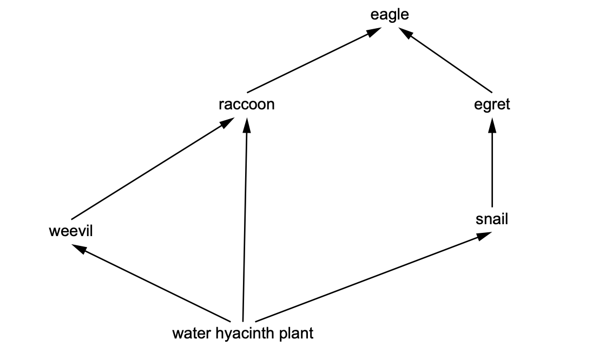
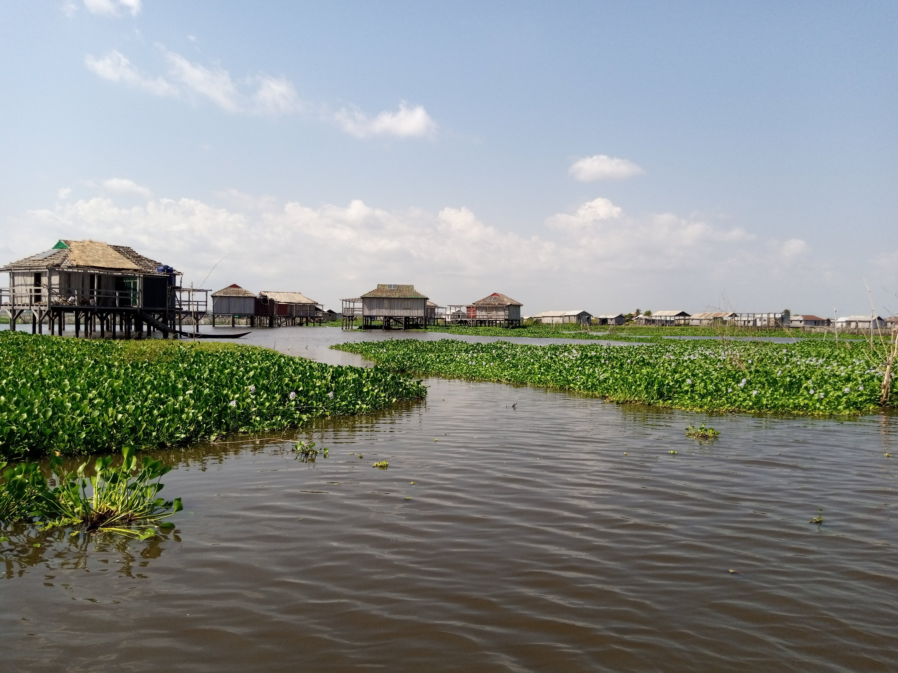

# Exam Questions — Ecosystems
**Ecosystems, Biodiversity & Fieldwork** · Cambridge (CIE) IGCSE environmental-management (0680)
> Source: [https://www.savemyexams.com/igcse/environmental-management/cie/25/topic-questions/](https://www.savemyexams.com/igcse/environmental-management/cie/25/topic-questions/) · 7 questions across 1 sets

## Exam Questions (7 questions)

### Q1 — easy — 2 marks

**Q1** [2 marks]

Giant African land snails are an invasive species in Florida.

Suggest two other reasons why scientists are concerned about the populations of giant African land snails in Florida.

*Source: Specimen 2027 0680/02 Q2D*

### Q2 — medium — 2 marks

**Q2** [2 marks]

The snails contain 100 units of energy.

*Figure 6.3*

Complete Figure 6.3 to show the units of energy in the food chain.

*Source: Specimen 2027 0680/01 Q6C(II)*

### Q3 — medium — 3 marks

**Q3** [3 marks]

Figure 6.2 shows a food web containing water hyacinth plants.

*Figure 6.2*

Use Figure 6.2 to identify:

all the primary consumers

the organism that only feeds as a secondary consumer

the organism that feeds at trophic levels two and three

*Source: Specimen 2027 0680/01 Q6C(I)*

### Q4 — easy — 2 marks

**Q4** [2 marks]

Complete the sentences about the events that occur in a flower after pollination.

After pollination, the flower is ..........

This allows the formation of fruits and ..........

*Source: Specimen 2027 0680/01 Q6B(II)*

### Q5 — easy — 2 marks

**Q5** [2 marks]

Water hyacinth plants produce flowers above the surface of the water. These flowers are pollinated by two different methods.

Suggest two ways that water hyacinth flowers are pollinated.

*Source: Specimen 2027 0680/01 Q6B(I)*

### Q6 — easy — 1 marks

**Q6** [1 mark]

Figure 6.1 shows water hyacinth plants in a river ecosystem.

*Figure 6.1 Adoscam, CC BY-SA 4.0, via Wikimedia Commons*

Water hyacinth plants are not native to this river ecosystem.

State the term for an organism living in an ecosystem they are not native to.

*Source: Specimen 2027 0680/01 Q6A(II)*

### Q7 — easy — 2 marks

**Q7** [2 marks]

Figure 6.1 shows water hyacinth plants in a river ecosystem.

*Figure 6.1 Adoscam, CC BY-SA 4.0, via Wikimedia Commons*

Water hyacinth plants reduce the growth of other aquatic plants by competition.

Suggest two ways water hyacinth plants compete with other aquatic plants.

*Source: Specimen 2027 0680/01 Q6A(I)*

