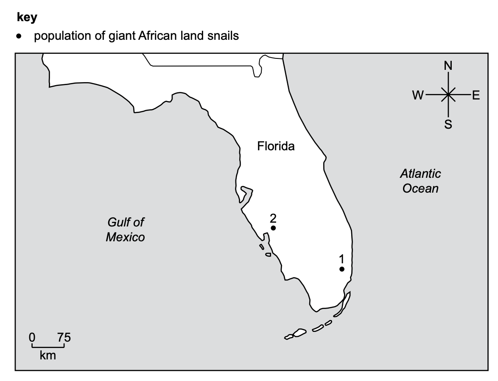
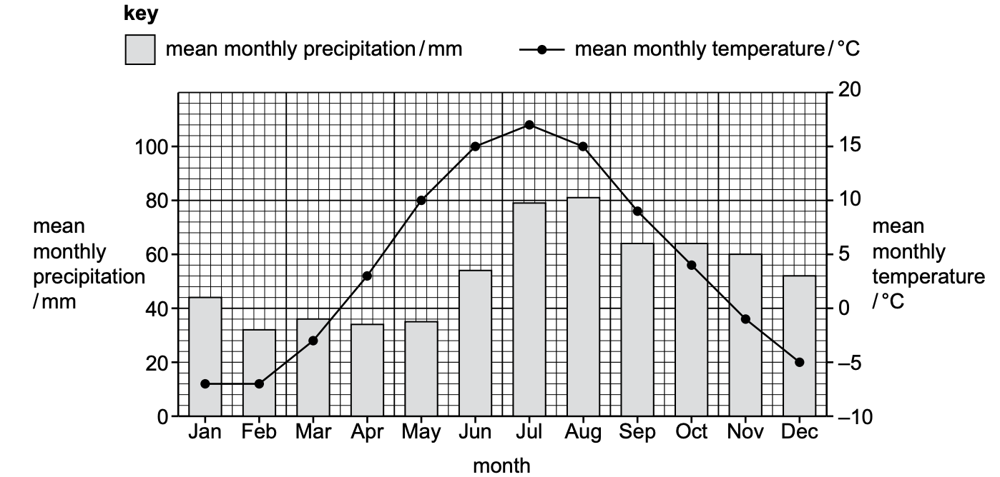
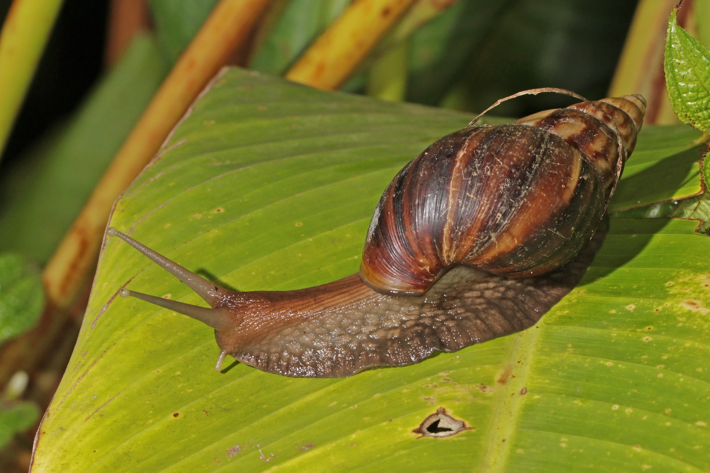

# Exam Questions — Fieldwork Investigations
**Ecosystems, Biodiversity & Fieldwork** · Cambridge (CIE) IGCSE environmental-management (0680)
> Source: [https://www.savemyexams.com/igcse/environmental-management/cie/25/topic-questions/](https://www.savemyexams.com/igcse/environmental-management/cie/25/topic-questions/) · 11 questions across 1 sets

## Exam Questions (11 questions)

### Q1 — easy — 2 marks

**Q1** [2 marks]

The scientist investigates the effect of three different fertilisers on the crop yield of maize plants.

Table 3.1 shows the results of the investigation.

**Table 3.1**

| fertiliser used | formula for ion | days until harvest | crop yield / thousand kg per Ha |
|---|---|---|---|
| nitrate | .......... | 94 | 31 |
| phosphate | .......... | 98 | 28 |
| potassium | K⁺ | 95 | 25 |
| control |   | 96 | 18 |

State two control variables in this investigation.

*Source: Specimen 2027 0680/02 Q3B(VII)*

### Q2 — easy — 1 marks

**Q2** [1 mark]

The scientist investigates the effect of three different fertilisers on the crop yield of maize plants.

Table 3.1 shows the results of the investigation.

**Table 3.1**

| fertiliser used | formula for ion | days until harvest | crop yield / thousand kg per Ha |
|---|---|---|---|
| nitrate | .......... | 94 | 31 |
| phosphate | .......... | 98 | 28 |
| potassium | K⁺ | 95 | 25 |
| control |   | 96 | 18 |

State one dependent variable in this investigation.

*Source: Specimen 2027 0680/02 Q3B(VI)*

### Q3 — easy — 1 marks

**Q3** [1 mark]

The scientist investigates the effect of three different fertilisers on the crop yield of maize plants.

Table 3.1 shows the results of the investigation.

**Table 3.1**

| fertiliser used | formula for ion | days until harvest | crop yield / thousand kg per Ha |
|---|---|---|---|
| nitrate | .......... | 94 | 31 |
| phosphate | .......... | 98 | 28 |
| potassium | K⁺ | 95 | 25 |
| control |   | 96 | 18 |

State the independent variable in this investigation.

*Source: Specimen 2027 0680/02 Q3B(V)*

### Q4 — medium — 2 marks

**Q4** [2 marks]

The scientist investigates the effect of three different fertilisers on the crop yield of maize plants.

Table 3.1 shows the results of the investigation.

**Table 3.1**

| fertiliser used | formula for ion | days until harvest | crop yield / thousand kg per Ha |
|---|---|---|---|
| nitrate | .......... | 94 | 31 |
| phosphate | .......... | 98 | 28 |
| potassium | K⁺ | 95 | 25 |
| control |   | 96 | 18 |

Give one conclusion about the effect of fertilisers on the crop yield of maize.

Justify your conclusion.

*Source: Specimen 2027 0680/02 Q3B(IV)*

### Q5 — medium — 2 marks

**Q5** [2 marks]

The scientist investigates the effect of three different fertilisers on the crop yield of maize plants.

Table 3.1 shows the results of the investigation.

**Table 3.1**

| fertiliser used | formula for ion | days until harvest | crop yield / thousand kg per Ha |
|---|---|---|---|
| nitrate | .......... | 94 | 31 |
| phosphate | .......... | 98 | 28 |
| potassium | K⁺ | 95 | 25 |
| control |   | 96 | 18 |

The scientist concludes:

'Adding fertiliser to maize crops decreases the number of days until harvest.'

Explain one way the data:

supports the conclusion

does not support the conclusion

*Source: Specimen 2027 0680/02 Q3B(III)*

### Q6 — medium — 3 marks

**Q6** [3 marks]

The scientist also uses a systematic sampling strategy to estimate the population of giant African land snails.

Suggest benefits and limitations of using a systematic sampling strategy to estimate the population of giant African land snails in Florida.

*Source: Specimen 2027 0680/02 Q2C*

### Q7 — hard — 5 marks

**Q7** [5 marks]

A scientist wants to use a random sampling strategy to estimate the population of giant African land snails in Florida.

Describe a random sampling strategy to estimate the population of giant African land snails in Florida.

In your answer include a method to:

- select the area to sample
- collect and record your data
- estimate the population of giant African land snails in Florida.

*Source: Specimen 2027 0680/02 Q2B*

### Q8 — easy — 1 marks

**Q8** [1 mark]

In 2022, two populations of giant African land snails were found in the state of Florida, USA.

Figure 2.2 shows the location of these two populations.

*Figure 2.2*

Give the direction of population 2 from population 1.

*Source: Specimen 2027 0680/02 Q2A(II)*

### Q9 — hard — 4 marks

**Q9** [4 marks]

Figure 1.1 shows data collected at a farm in Finland.

*Figure 1.1 -NASA's Earth Observatory*

A student uses the data in Figure 1.1 to make two conclusions:

- February is always the wettest month in Finland.
- The temperature in October is always higher than the temperature in November in Finland.

Suggest two limitations of these conclusions.

Explain these limitations.

*Source: Specimen 2027 0680/02 Q1A(V)*

### Q10 — easy — 1 marks

**Q10** [1 mark]

The scientist investigates the effect of three different fertilisers on the crop yield of maize plants.

Table 3.1 shows the results of the investigation.

**Table 3.1**

| fertiliser used | formula for ion | days until harvest | crop yield / thousand kg per Ha |
|---|---|---|---|
| nitrate | .......... | 94 | 31 |
| phosphate | .......... | 98 | 28 |
| potassium | K⁺ | 95 | 25 |
| control |   | 96 | 18 |

The investigation uses a control. The control is pure water.

Suggest why a control is used in this investigation.

*Source: Specimen 2027 0680/02 Q3B(II)*

### Q11 — medium — 2 marks

**Q11** [2 marks]

Figure 2.1 shows a giant African land snail.

*Figure 2.1 Charles J. Sharp, CC BY-SA 4.0 via Wikimedia Commons*

Giant African land snails eat plants.

In 2022, two populations of giant African land snails were found in the state of Florida, USA.

Figure 2.2 shows the location of these two populations.

*Figure 2.2*

Use Figure 2.2 to calculate the distance between the two populations.

Show your working.

*Source: Specimen 2027 0680/02 Q2A(I)*

