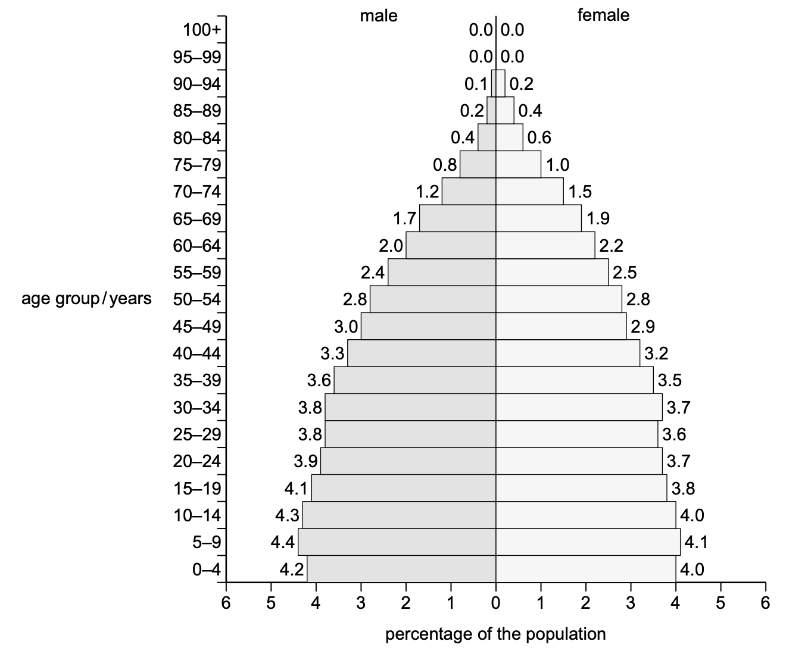

# Exam Questions — Human Population Density, Distribution & Structure
**Human Population** · Cambridge (CIE) IGCSE environmental-management (0680)
> Source: [https://www.savemyexams.com/igcse/environmental-management/cie/25/topic-questions/](https://www.savemyexams.com/igcse/environmental-management/cie/25/topic-questions/) · 4 questions across 1 sets

## Exam Questions (4 questions)

### Q1 — easy — 2 marks

**Q1** [2 marks]

The population pyramids for low-income countries (LICs) and high-income countries (HICs) are different.

Complete Table 3.1.

| description | tick (✓) if true | tick (✓) if false |
|---|---|---|
| LICs have a wider base than HICs. |   |   |
| HICs have a smaller percentage of people in the working population than LICs. |   |   |
| LICs have a smaller percentage of elderly dependants than HICs. |   |   |

Tick (✓) to show if a description is true or false.

*Source: Specimen 2027 0680/01 Q3B*

### Q2 — medium — 3 marks

**Q2** [3 marks]

Figure 3.1 shows the world population pyramid in 2023.

*Figure 3.1 PopulationPyramid.net, CC BY 3.0 IGO*

Use Figure 3.1 to compare the world population of males to the world population of females in 2023.

*Source: Specimen 2027 0680/01 Q3A(III)*

### Q3 — medium — 1 marks

**Q3** [1 mark]

Figure 3.1 shows the world population pyramid in 2023.

*Figure 3.1 PopulationPyramid.net, CC BY 3.0 IGO*

Suggest why the percentage values in the pyramid in Figure 3.1 do not total 100%.

*Source: Specimen 2027 0680/01 Q3A(II)*

### Q4 — easy — 1 marks

**Q4** [1 mark]

Figure 3.1 shows the world population pyramid in 2023.

*Figure 3.1 PopulationPyramid.net, CC BY 3.0 IGO*

State the percentage of the world population that is over 74 years of age in 2023.

*Source: Specimen 2027 0680/01 Q3A(I)*

