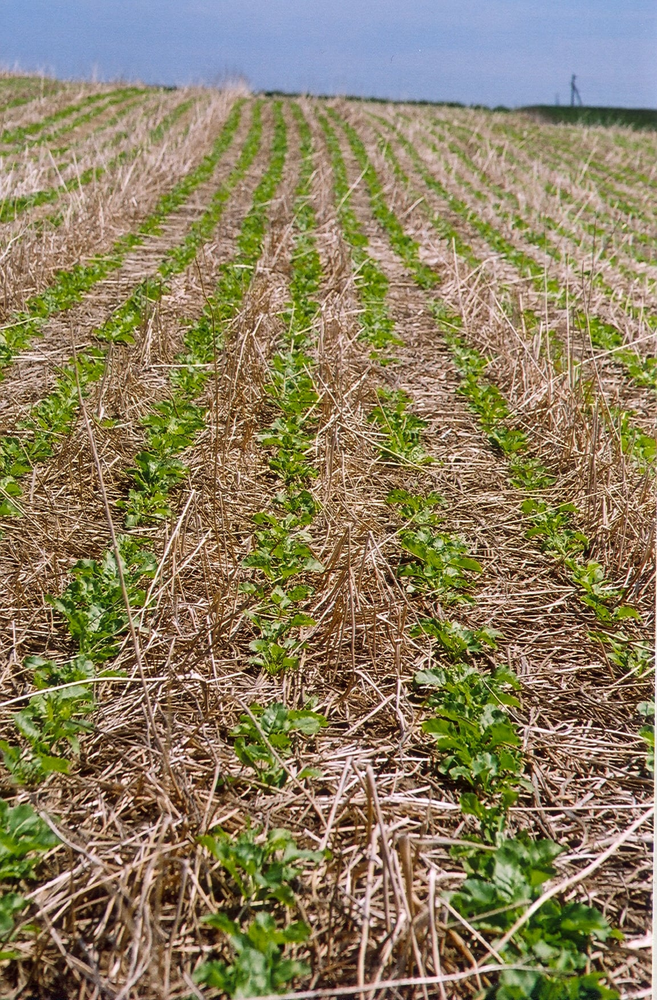

# Exam Questions — Food Production & Crop Yield
**Land** · Cambridge (CIE) IGCSE environmental-management (0680)
> Source: [https://www.savemyexams.com/igcse/environmental-management/cie/25/topic-questions/](https://www.savemyexams.com/igcse/environmental-management/cie/25/topic-questions/) · 2 questions across 1 sets

## Exam Questions (2 questions)

### Q1 — medium — 4 marks

**Q1** [4 marks]

Figure 3.2 shows plants surrounded by a layer of mulch.

*Figure 3.2 Volker Prasuhn, CC BY-SA 3.0, via Wikimedia Commons*

Describe four ways that mulch increases crop yield.

*Source: Specimen 2027 0680/02 Q3C*

### Q2 — easy — 2 marks

**Q2** [2 marks]

The scientist investigates the effect of three different fertilisers on the crop yield of maize plants.

Table 3.1 shows the results of the investigation.

| fertiliser used | formula for ion | days until harvest | crop yield / thousand kg per Ha |
|---|---|---|---|
| nitrate | .......... | 94 | 31 |
| phosphate | .......... | 98 | 28 |
| potassium | K⁺ | 95 | 25 |
| control |   | 96 | 18 |

Complete Table 3.1.

*Source: Specimen 2027 0680/02 Q3B(I)*

