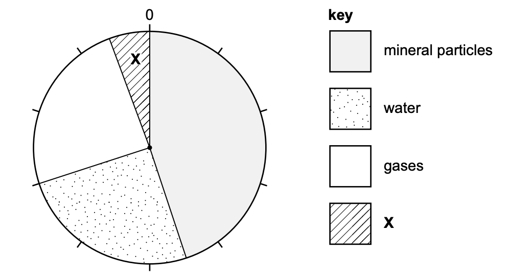
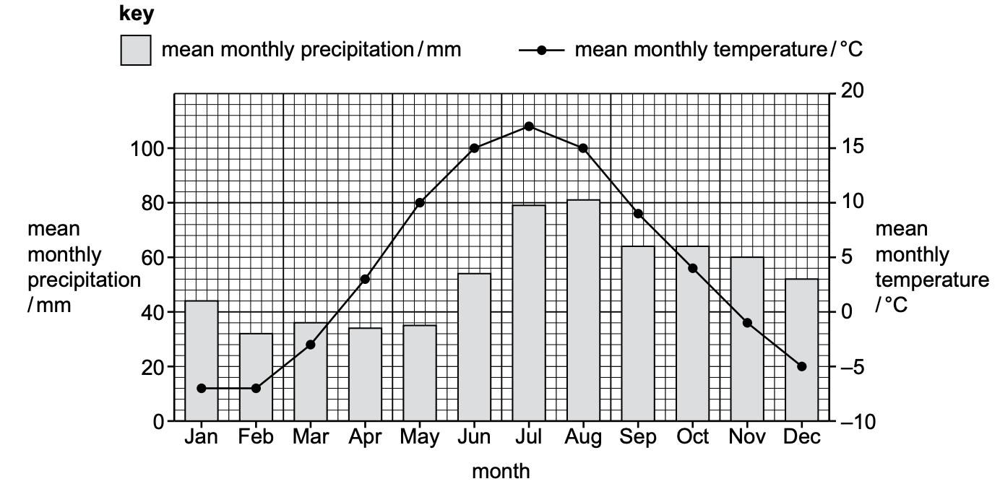

# Exam Questions — Soils & Crop Growth
**Land** · Cambridge (CIE) IGCSE environmental-management (0680)
> Source: [https://www.savemyexams.com/igcse/environmental-management/cie/25/topic-questions/](https://www.savemyexams.com/igcse/environmental-management/cie/25/topic-questions/) · 8 questions across 1 sets

## Exam Questions (8 questions)

### Q1 — medium — 3 marks

**Q1** [3 marks]

A scientist investigates soils.

Explain why the gas content of a soil is important for plant growth.

*Source: Specimen 2027 0680/02 Q3A(IV)*

### Q2 — easy — 1 marks

**Q2** [1 mark]

A scientist investigates soils.

Figure 3.1 shows the composition of a soil.

*Figure 3.1*

Calculate the percentage of the soil that is pore space.

*Source: Specimen 2027 0680/02 Q3A(III)*

### Q3 — easy — 1 marks

**Q3** [1 mark]

A scientist investigates soils.

Figure 3.1 shows the composition of a soil.

*Figure 3.1*

Determine the percentage of the soil that is mineral particles.

*Source: Specimen 2027 0680/02 Q3A(II)*

### Q4 — easy — 1 marks

**Q4** [1 mark]

A scientist investigates soils.

*Figure 3.1*

Figure 3.1 shows the composition of a soil.

Identify the component of the soil labelled X.

*Source: Specimen 2027 0680/02 Q3A(I)*

### Q5 — medium — 2 marks

**Q5** [2 marks]

Figure 1.1 shows data collected at a farm in Finland.

*Figure 1.1*

Sorghum is a crop plant. Sorghum needs a growing season of four months.

Sorghum seeds need a minimum temperature of 12 °C to start to grow.

Sorghum plants need a minimum temperature of 15 °C to grow into a crop that can be harvested.

Suggest why sorghum is not a suitable crop to grow on the farm in Finland.

Use Figure 1.1 to support your answer.

*Source: Specimen 2027 0680/02 Q1A(IV)*

### Q6 — easy — 2 marks

**Q6** [2 marks]

Figure 1.1 shows data collected at a farm in Finland.

*Figure 1.1*

Calculate the annual temperature range for this farm.

*Source: Specimen 2027 0680/02 Q1A(III)*

### Q7 — easy — 1 marks

**Q7** [1 mark]

Figure 1.1 shows data collected at a farm in Finland.

*Figure 1.1*

State the number of months with a mean monthly precipitation less than 60 mm.

*Source: Specimen 2027 0680/02 Q1A(II)*

### Q8 — easy — 1 marks

**Q8** [1 mark]

Figure 1.1 shows data collected at a farm in Finland.

*Figure 1.1*

Identify the month with the highest mean monthly precipitation.

*Source: Specimen 2027 0680/02 Q1A(I)*

