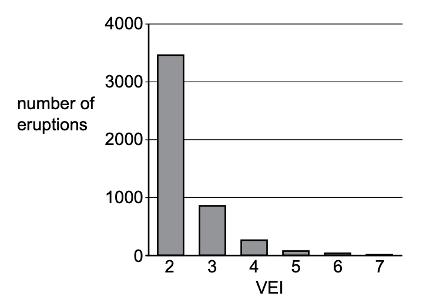

# Exam Questions — Earthquakes & Volcanoes
**Natural Hazards** · Cambridge (CIE) IGCSE environmental-management (0680)
> Source: [https://www.savemyexams.com/igcse/environmental-management/cie/25/topic-questions/](https://www.savemyexams.com/igcse/environmental-management/cie/25/topic-questions/) · 6 questions across 1 sets

## Exam Questions (6 questions)

### Q1 — easy — 3 marks

**Q1** [3 marks]

Volcanic activity provides opportunities for people.

State three of these opportunities.

*Source: Specimen 2027 0680/02 Q4D*

### Q2 — easy — 2 marks

**Q2** [2 marks]

During volcanic eruptions, magma rises to the surface to form lava.

Name two other substances emitted from volcanoes.

*Source: Specimen 2027 0680/02 Q4C*

### Q3 — hard — 5 marks

**Q3** [5 marks]

Table 4.1 compares two volcanic eruptions, A and B, in 2010.

**Table 4.1**

| volcanic eruption | A | B |
|---|---|---|
| country | Iceland | Indonesia |
| location | Eyjafjallajökull | Mount Merapi |
| number of deaths | 0 | 353 |
| VEI value | 4 | 4 |
| world bank classification of country | HIC | MIC |

Suggest why the number of deaths from eruption A was lower than the number of deaths from eruption B.

*Source: Specimen 2027 0680/02 Q4B(II)*

### Q4 — easy — 2 marks

**Q4** [2 marks]

The volcanic explosivity index, VEI, is a measure of the explosiveness of volcanic eruptions.

A VEI value of 0 is the least explosive and a VEI value of 8 is the most explosive.

Figure 4.2 shows the VEI value for some eruptions around the world.

*Figure 4.2*

Describe what Figure 4.2 shows about these volcanic eruptions.

*Source: Specimen 2027 0680/02 Q4B(I)*

### Q5 — medium — 3 marks

**Q5** [3 marks]

Iceland is situated on the Mid-Atlantic Ridge plate boundary.

Figure 4.1 shows the plates, the Mid-Atlantic Ridge and the location of Iceland's major volcanoes.

*Figure 4.1*

Use Figure 4.1 to describe the distribution of major volcanoes in Iceland.

*Source: Specimen 2027 0680/02 Q4A(III)*

### Q6 — easy — 1 marks

**Q6** [1 mark]

Iceland is situated on the Mid-Atlantic Ridge plate boundary.

Figure 4.1 shows the plates, the Mid-Atlantic Ridge and the location of Iceland's major volcanoes.

*Figure 4.1*

State the type of plate boundary that occurs in Iceland.

*Source: Specimen 2027 0680/02 Q4A(II)*

