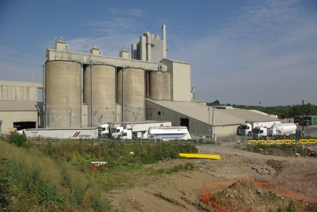

# Exam Questions — Extraction of Rocks, Ores & Minerals
**Natural Resources** · Cambridge (CIE) IGCSE environmental-management (0680)
> Source: [https://www.savemyexams.com/igcse/environmental-management/cie/25/topic-questions/](https://www.savemyexams.com/igcse/environmental-management/cie/25/topic-questions/) · 4 questions across 1 sets

## Exam Questions (4 questions)

### Q1 — easy — 2 marks

**Q1** [2 marks]

Table 5.1 contains statements about manufacturing cement.

**Table 5.1**

| statement | true | false |
|---|---|---|
| Calcium carbonate is the raw material for manufacturing cement. |   |   |
| Calcium carbonate is also known as lime. |   |   |
| Calcium oxide is also a product of manufacturing cement. |   |   |
| Calcium oxide is also known as limestone. |   |   |

Complete Table 5.1 by adding a tick (✓) in each row to show if the statement is true or false.

*Source: Specimen 2027 0680/02 Q5A(II)*

### Q2 — easy — 2 marks

**Q2** [2 marks]

Figure 5.1 shows a factory manufacturing cement.

*Figure 5.1  Stephen McKay / Rugby Cement Works - CC BY SA 2.0*

The manufacture of cement releases carbon dioxide. Carbon dioxide is an atmospheric pollutant.

Use information in Figure 5.1 to suggest one other environmental impact and one economic impact of this factory.

*Source: Specimen 2027 0680/02 Q5A(I)*

### Q3 — easy — 2 marks

**Q3** [2 marks]

The African thistle plant, Berkheya coddii, is used for the biological extraction of minerals.

Suggest two limitations of using plants for the biological extraction of minerals.

*Source: Specimen 2027 0680/01 Q1D(II)*

### Q4 — medium — 3 marks

**Q4** [3 marks]

The African thistle plant, Berkheya coddii, is used for the biological extraction of minerals.

Describe how plants are used for the biological extraction of minerals.

*Source: Specimen 2027 0680/01 Q1D(I)*

