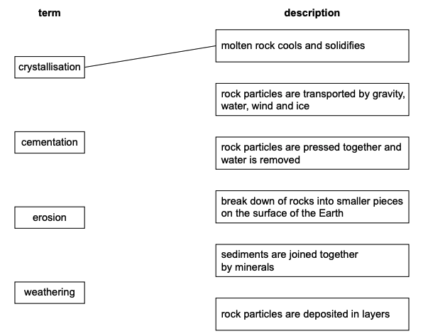
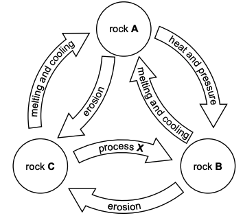

# Exam Questions — Formation of Rocks
**Natural Resources** · Cambridge (CIE) IGCSE environmental-management (0680)
> Source: [https://www.savemyexams.com/igcse/environmental-management/cie/25/topic-questions/](https://www.savemyexams.com/igcse/environmental-management/cie/25/topic-questions/) · 5 questions across 1 sets

## Exam Questions (5 questions)

### Q1 — easy — 2 marks

**Q1** [2 marks]

Most sedimentary rocks are permeable.

Name a sedimentary rock that is:

permeable

impermeable

*Source: Specimen 2027 0680/01 Q1C(II)*

### Q2 — easy — 2 marks

**Q2** [2 marks]

Most sedimentary rocks are permeable.

Define permeability.

*Source: Specimen 2027 0680/01 Q1C(I)*

### Q3 — easy — 3 marks

**Q3** [3 marks]

Figure 1.2 shows terms used in the rock cycle and their descriptions.

*Figure 1.2*

Draw one line from each term to its correct description.

One line has been done for you.

*Source: Specimen 2027 0680/01 Q1B*

### Q4 — easy — 1 marks

**Q4** [1 mark]

Figure 1.1 represents the rock cycle.

*Figure 1.1*

In Figure 1.1, process X changes rock C into rock B.

Circle the correct description of process X.

erosion

heat and pressure

melting and cooling

*Source: Specimen 2027 0680/01 Q1A(II)*

### Q5 — easy — 1 marks

**Q5** [1 mark]

Figure 1.1 represents the rock cycle.

*Figure 1.1*

Identify the rock, A, B or C, that represents igneous rocks in Figure 1.1.

*Source: Specimen 2027 0680/01 Q1A(I)*

