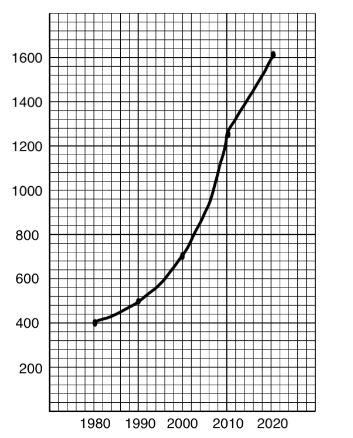

# Mark Schemes — Climate Change
**The Atmosphere & Human Activities** · Cambridge (CIE) IGCSE environmental-management (0680)

## Exam Questions (6 questions)

### Q1
Farmers grow drought-resistant crops that can survive hotter and drier conditions  **[1 mark]**.

Coastal towns build stronger flood defences, such as sea walls, to protect against rising sea levels  **[1 mark]**.

> **[mark-scheme]**
> **Mark allocation**
> 
> - **One mark** for each described example, to a maximum of 2 marks
> 
> **Alternative content**
> 
> The answer above is just one example of how to respond to this question. Other information that could be used includes:
> 
> - Laws that stop new buildings on floodplains or near coasts
> - Changing building designs and materials to cope with heat or flooding
> - Studying local risks so that communities can prepare
> - Any other suitable response
> 
> **Common errors**
> 
> - Giving a way to reduce carbon dioxide emissions, which is mitigation, not adaptation

### Q2
**Changing behaviour, practices or infrastructure to cope with the impacts of climate change**  **[1 mark]**

> **[exam-tip]**
> - Adaptation means coping with the effects of climate change. Cutting carbon dioxide emissions is mitigation, which is a different strategy.

### Q3
> **[mark-scheme]**
> Any **two** from:
> 
> - The population may change, which changes the demand for buildings
> - The rate of cement production may change
> - Other building materials may be developed
> - New technologies may reduce the carbon dioxide released
> 
> **[2 marks]**

### Q4
> **[mark-scheme]**
> Any **two** from:
> 
> - The predictions are based on variable or uncertain data
> - The calculations are not precise
> - Scientists do not know how energy use will change in the future
> - Scientists cannot predict how the human population will change
> - There may be natural changes in climate
> - Current trends may only be short term
> 
> **[2 marks]**

### Q5
Temperature increase: 5.4 - 1.5 = 3.9 °C  **[1 mark]**

Number of years: 2100 - 2033 = 67

Mean annual increase: 3.9 ÷ 67 = 0.0582... °C  **[1 mark]**

To two significant figures: **0.058 °C**  **[1 mark]**

> **[exam-tip]**
> - Zeros at the start of a decimal are not significant, so the first two significant figures of 0.0582 are 5 and 8.
> - Show every step of your working. If the final answer is wrong, you can still gain marks for correct working.

### Q6

- Label the x-axis 'year' and the y-axis 'global production of carbon dioxide from manufacturing cement / thousand million tonnes'  **[1 mark]**
- Use linear scales that make the data fill at least half the grid, for example 1980 to 2020 in steps of 10 years and 0 to 1800 in steps of 200  **[1 mark]**
- Plot all five points accurately with small crosses or circled dots  **[2 marks]**
- Join the points with straight, ruled lines from 1980 to 2020 only  **[1 mark]**

> **[mark-scheme]**
> **Mark allocation**
> 
> - **One mark** for both axes labelled, with the unit on the y-axis
> - **One mark** for linear scales with the data using at least half the grid
> - **2 marks** for all five points plotted correctly (**1 mark** for four)
> - **One mark** for point-to-point straight lines with no extrapolation
> 
> **Common errors**
> 
> - Drawing a line or curve of best fit when the question asks for straight lines between points
> - Extending the line before 1980 or after 2020
> - Leaving out the axis labels or the unit

> **[exam-tip]**
> - Use a ruler and a sharp pencil, and follow the instruction exactly: straight lines from point to point.
