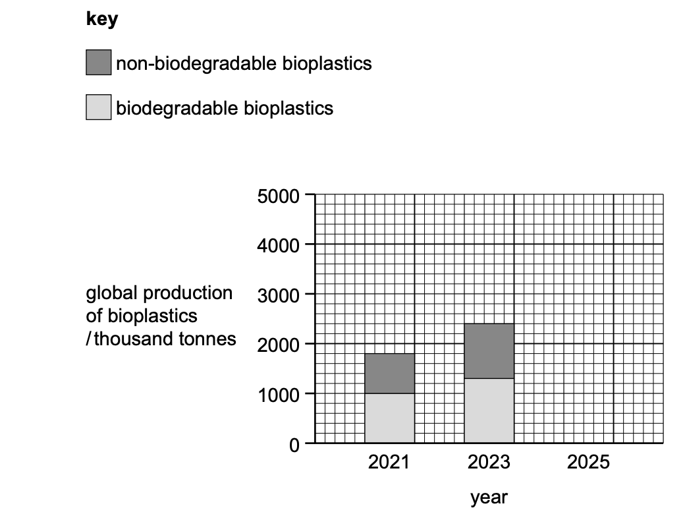

# Exam Questions — Plastic Pollution
**Water** · Cambridge (CIE) IGCSE environmental-management (0680)
> Source: [https://www.savemyexams.com/igcse/environmental-management/cie/25/topic-questions/](https://www.savemyexams.com/igcse/environmental-management/cie/25/topic-questions/) · 6 questions across 1 sets

## Exam Questions (6 questions)

### Q1 — medium — 4 marks

**Q1** [4 marks]

Bioaccumulation and biomagnification are two impacts of plastic pollution on marine ecosystems.

Describe other impacts of plastic pollution on marine ecosystems.

*Source: Specimen 2027 0680/01 Q5C*

### Q2 — easy — 2 marks

**Q2** [2 marks]

Biodegradable bioplastics break down over time.

Suggest two abiotic factors that affect the rate of break down of biodegradable bioplastics.

*Source: Specimen 2027 0680/01 Q5B(III)*

### Q3 — easy — 2 marks

**Q3** [2 marks]

Biodegradable bioplastics break down over time.

Name two products formed when biodegradable bioplastics break down.

*Source: Specimen 2027 0680/01 Q5B(II)*

### Q4 — easy — 1 marks

**Q4** [1 mark]

Biodegradable bioplastics break down over time.

Name one group of organisms that break down biodegradable bioplastics.

*Source: Specimen 2027 0680/01 Q5B(I)*

### Q5 — medium — 3 marks

**Q5** [3 marks]

Figure 5.1 shows the global production of non-biodegradable bioplastics and biodegradable bioplastics in 2021 and 2023.

*Figure 5.1*

Determine the mass of non-biodegradable bioplastics produced in 2023.

Give the unit.

*Source: Specimen 2027 0680/01 Q5A(II)*

### Q6 — easy — 2 marks

**Q6** [2 marks]

Figure 5.1 shows the global production of non-biodegradable bioplastics and biodegradable bioplastics in 2021 and 2023.

*Figure 5.1*

Table 5.1 shows the predicted global production of non-biodegradable bioplastics and biodegradable bioplastics in 2025.

**Table 5.1**

| year | global production of non-biodegradable bioplastics / thousand tonnes | global production of biodegradable bioplastics / thousand tonnes |
|---|---|---|
| 2025 | 2500 | 2400 |

Plot the data for 2025 on the grid in Figure 5.1.

*Source: Specimen 2027 0680/01 Q5A(I)*

