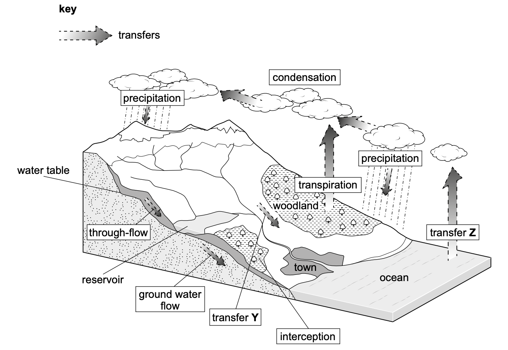

# Exam Questions — Water Sources & Supply
**Water** · Cambridge (CIE) IGCSE environmental-management (0680)
> Source: [https://www.savemyexams.com/igcse/environmental-management/cie/25/topic-questions/](https://www.savemyexams.com/igcse/environmental-management/cie/25/topic-questions/) · 6 questions across 1 sets

## Exam Questions (6 questions)

### Q1 — hard — 6 marks

**Q1** [6 marks]

Discuss the benefits and limitations of desalination.

*Source: Specimen 2027 0680/01 Q2B(IV)*

### Q2 — easy — 1 marks

**Q2** [1 mark]

Distillation is one type of desalination.

Name one other type of desalination.

*Source: Specimen 2027 0680/01 Q2B(III)*

### Q3 — medium — 3 marks

**Q3** [3 marks]

Distillation is one type of desalination.

Describe the process of distillation.

*Source: Specimen 2027 0680/01 Q2B(II)*

### Q4 — easy — 1 marks

**Q4** [1 mark]

The oceans are a store of water.

Desalination makes sea water potable.

Define potable water.

*Source: Specimen 2027 0680/01 Q2B(I)*

### Q5 — easy — 2 marks

**Q5** [2 marks]

Suggest how planting trees affects interception.

Give a reason for your answer.

*Source: Specimen 2027 0680/01 Q2A(II)*

### Q6 — easy — 2 marks

**Q6** [2 marks]

Figure 2.1 shows part of the water cycle.

*Figure 2.1*

In Figure 2.1, identify:

transfer Y

transfer Z

*Source: Specimen 2027 0680/01 Q2A(I)*

