# Mark Schemes — Equations, Inequalities & Graphs
**Algebra & Functions** · Cambridge (CIE) IGCSE further-maths (0606)

## Exam Questions (18 questions)

### Q1
**Method 1**

> *Square both sides*

`4 open parentheses x minus 1 close parentheses squared less or equal than open parentheses 2 minus x close parentheses squared`

**[M1]**

> *Expand and collect terms on one side*

`table row cell 4 open parentheses x squared minus 2 x plus 1 close parentheses end cell less or equal than cell 4 minus 4 x plus x squared end cell row cell 4 x squared minus 8 x plus 4 end cell less or equal than cell 4 minus 4 x plus x squared end cell row cell 3 x squared minus 4 x end cell less or equal than 0 end table`

**[A1]**

> *Solve the quadratic inequality, e..g by factorising to find the critical points*

`x open parentheses 3 x minus 4 close parentheses less or equal than 0`

*critical points are *$x=0$* and *$x=\frac{4}{3}$

**[A1]**

> *The curve *`y equals x open parentheses 3 x minus 4 close parentheses`* is a positive quadratic (so goes below the *$x$*-axis between *$x=0$* and *$x=\frac{4}{3}$*)*

$0\leqx\leq\frac{4}{3}$

**[A1]**

**Method 2**

> *Sketch *`y equals 2 vertical line x minus 1 vertical line`* (graph 1) and *`y equals vertical line 2 minus x vertical line`* (graph 2) on the same axes*

**[B1 B1]**

> **[mark-scheme]**
> **B1: **For at least sketching one graph correctly (numerical values not needed).
> 
> **B1: **For sketching both graphs correctly, intersecting each other on the positive $y$-axis (numerical values not needed).

> *Find where the line *`y equals 2 vertical line x minus 1 vertical line`* is always below the line *`y equals vertical line 2 minus x vertical line`

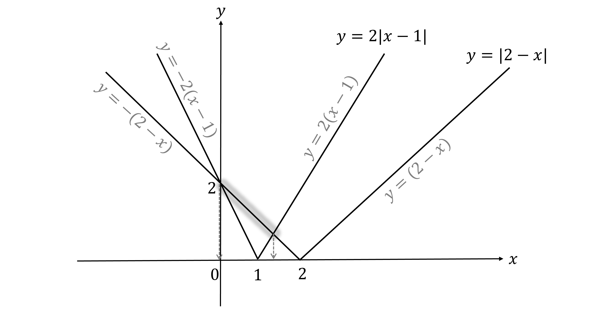

> *Find the *$x$*-coordinates of this region (the first *$x$*-coordinate must be 0)*

> *The second *$x$*-coordinate is the intersection of *`y equals 2 open parentheses x minus 1 close parentheses`* with *$y=2-x$

`table row cell 2 open parentheses x minus 1 close parentheses end cell equals cell 2 minus x end cell end table`

**[M1]**

> **[mark-scheme]**
> This mark is for identifying the two correct branches that intersect on the graph and using them to form an equation.

> *Solve*

`table row cell 2 open parentheses x minus 1 close parentheses end cell equals cell 2 minus x end cell row cell 2 x minus 2 end cell equals cell 2 minus x end cell row cell 3 x end cell equals 4 row x equals cell 4 over 3 end cell end table`

> *Give the *$x$*-values for the region above as an inequality*

$0\leqx\leq\frac{4}{3}$

**[A1]**

### Q2
> *You are told that *`open parentheses 1 comma space 0 close parentheses`* is an *$x$*-intercept so substitute in *$x=1$* and *$y=0$* to find *$a$

`table row 0 equals cell 5 open parentheses 1 close parentheses cubed minus 17 open parentheses 1 close parentheses squared plus 16 open parentheses 1 close parentheses plus a end cell row 0 equals cell 5 minus 17 plus 16 plus a end cell row 0 equals cell 4 plus a end cell row a equals cell negative 4 end cell end table`

**[B1]**

> *Given that *$x=1$* is a solution to *`straight p open parentheses x close parentheses equals 0`*, the Factor theorem says that *`open parentheses x minus 1 close parentheses`* is a factor*

*If *`p open parentheses 1 close parentheses equals 0`* then *`open parentheses x minus 1 close parentheses`* is a factor of *`straight p open parentheses x close parentheses equals 5 x cubed minus 17 x squared plus 16 x minus 4`

> *Use polynomial division to divide *`straight p open parentheses x close parentheses`* by *`open parentheses x minus 1 close parentheses`* to find the quadratic factor*

`space space space space space space space space space space space space space space space space space space space space space space space space 5 x squared minus 12 x plus 4
open parentheses x minus 1 close parentheses top enclose left enclose 5 x cubed minus 17 x squared plus 16 x minus 4 end enclose end enclose
space space space space space space space space space space space space space bottom enclose 5 x cubed minus 5 x squared end enclose
space space space space space space space space space space space space space space space space space space space minus 12 x squared plus 16 x
space space space space space space space space space space space space space space space space space space space space bottom enclose negative 12 x squared plus 12 x end enclose
space space space space space space space space space space space space space space space space space space space space space space space space space space space space space space space space space space space space space space 4 x minus 4
space space space space space space space space space space space space space space space space space space space space space space space space space space space space space space space space space space space space space space bottom enclose 4 x minus 4 end enclose
space space space space space space space space space space space space space space space space space space space space space space space space space space space space space space space space space space space space space space space space space space space space space space space 0 space space space space space space space space space space space`

**[M1]**

$5x^{2}-12x+4$

**[A1]**

> *This means the cubic has the form*

`y equals k open parentheses x minus 1 close parentheses open parentheses 5 x squared minus 12 x plus 4 close parentheses`

> *The *$x$*-intercepts are found when *$y=0$

> *Solve *$5x^{2}-12x+4=0$* to find the remaining two *$x$*-intercepts*

`open parentheses 5 x minus 2 close parentheses open parentheses x minus 2 close parentheses`

**[M1]**

> **[mark-scheme]**
> This mark is for using a correct method to solve your 3-term quadratic factor equal to zero.

> *Recall that the question labels them *`open parentheses b comma space 0 close parentheses`*, *`open parentheses 1 comma space 0 close parentheses`* and *`open parentheses c comma space 0 close parentheses`* where *$b<c$

$b=\frac{2}{5}$* and *$c=2$

**[A1]**

> *Present all your answers from above*

**Final answer:** $a=-4$**, **$b=\frac{2}{5}$** and **$c=2$
> *It helps to imagine the cubic *`y equals straight p open parentheses x close parentheses`* with the information given*

> *Then imagine the modulus of this cubic equation, *`y equals vertical line straight p open parentheses x close parentheses vertical line`

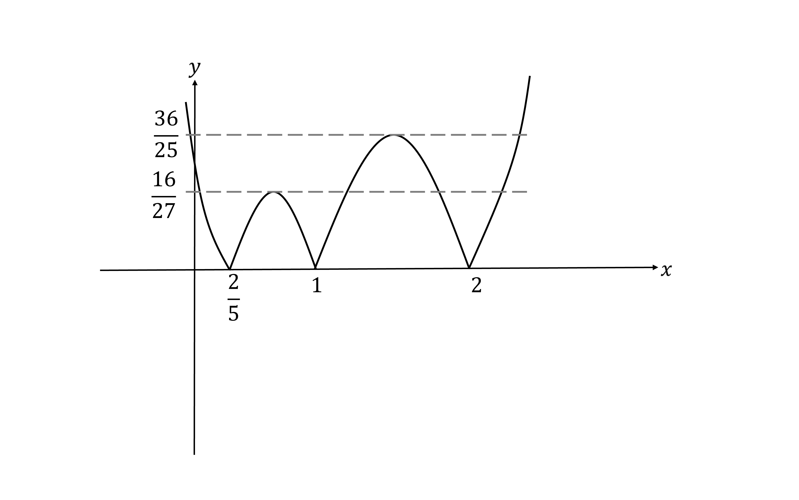

**[M1]**

> **[mark-scheme]**
> This mark is for attempting to sketch `y equals vertical line straight p open parentheses x close parentheses vertical line` with the peaks in the correct size order (no numerical values are needed for this mark)

> *You need to find the horizontal line, *$y=d$*, that intersects the graph *`y equals vertical line straight p open parentheses x close parentheses vertical line`* exactly 5 times*

> *This only happens with the line *$y=\frac{16}{27}$

$d=\frac{16}{27}$

**[A1]**

### Q3
> *Sketch the lines *`y equals vertical line 3 x minus 2 vertical line`* and *$y=4+x$* on the same axes to identify how many intersections there are.*

> *  *

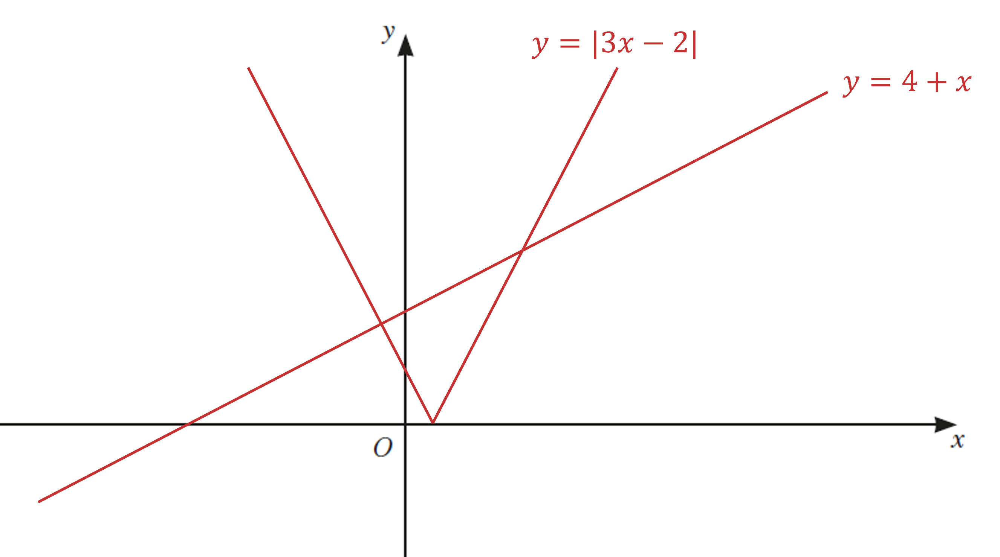

> * *

> *By examining the graph, we can see there is an intersection in the first quadrant. This is where *$y=3x-2$* and *$y=4+x$* cross.*

> * *

`table row cell 3 x minus 2 end cell equals cell 4 plus x end cell row cell 3 x minus x end cell equals cell 4 plus 2 end cell row cell 2 x end cell equals 6 row x equals 3 end table`

> *  *

> *The other intersection is where the reflection of *$y=3x-2$* in the *$x$* axis and the line *$y=4+x$* cross.*

> *The equation of this reflection is *$y=-3x+2$*.*

> *Therefore,*

`table row cell negative 3 x plus 2 end cell equals cell 4 plus x end cell end table`

**[1]**

`table row cell negative 3 x minus x end cell equals cell 4 minus 2 end cell row cell negative 4 x end cell equals 2 row x equals cell negative 0.5 end cell end table`

$x=3$* ***[1]**

$x=-0.5$* ***[1]**

### Q4
> *The two possible options for the modulus function is a positive and a negative.*

> *Solving the positive bracket*

$3x+2>8+x$

> *Collecting like terms*

$2x>6$

$x>3$

> *Solving the negative bracket*

`negative open parentheses 3 x space plus thin space 2 close parentheses space greater than thin space 8 space plus thin space x`

> *Multiplying out the bracket*

$-3x-2>8+x$

**[1]**

> *Collecting like terms*

$-10>4x$

$x<-\frac{5}{2}$ **[1]**

$x>3$ **[1]**

### Q5
> *Sketch the graph *`y equals open parentheses x minus 2 close parentheses open parentheses x plus 1 close parentheses open parentheses x plus 2 close parentheses`* first*

> *This will be a positive cubic graph since *$x\timesx\timesx=x^{3}$

> *Find where the graph crosses the *$x$*-axis*

*When** *$y=0$*,*

`0 equals open parentheses x minus 2 close parentheses open parentheses x plus 1 close parentheses open parentheses x plus 2 close parentheses`

$x=2,-1\mathrm{or}-2$

> *Find where the graph crosses the *$y$*-axis*

*When *$x=0$*,*

`y equals open parentheses 0 minus 2 close parentheses open parentheses 0 plus 1 close parentheses open parentheses 0 plus 2 close parentheses`

$y=-4$

> *Sketch the graph of *`y equals open parentheses x minus 2 close parentheses open parentheses x plus 1 close parentheses open parentheses x plus 2 close parentheses`

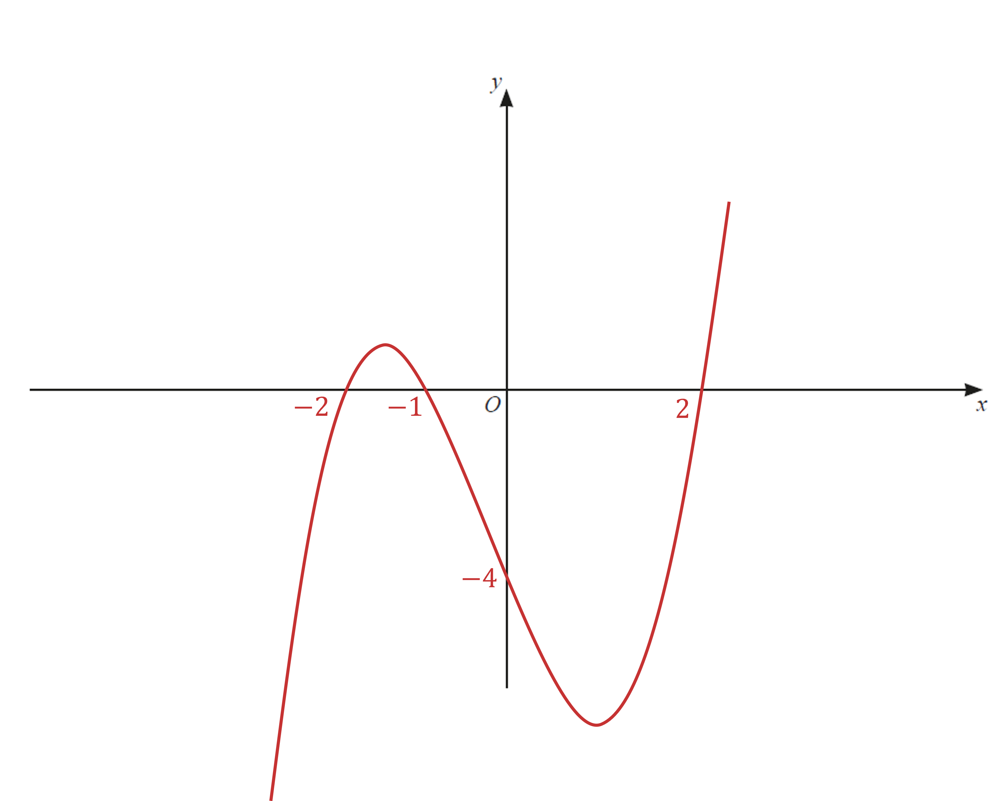

> *The modulus graph *`y equals open vertical bar open parentheses x minus 2 close parentheses open parentheses x plus 1 close parentheses open parentheses x plus 2 close parentheses close vertical bar`* will be similar to the graph above, but any parts below the *$x$*-axis will be reflected up above the *$x$*-axis*

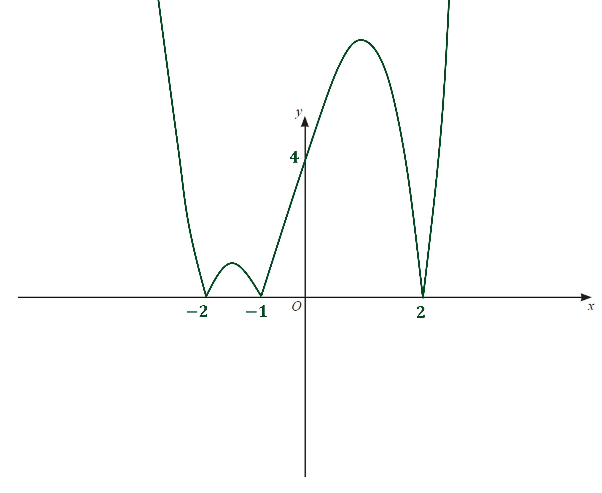

**correct shape**** [1]**

**correct **$x$**-coordinates ****[1]**

**correct **$y$**-coordinate and max in first quadrant ****[1]**

### Q6
> *Factorise the first two terms to make the coefficient of *$x^{2}$* equal 1 inside the brackets.*

`2 open square brackets x squared plus 3 over 2 x close square brackets minus 4`

**[1]**

> *Complete the square for the expression in the brackets. To complete the square, *`x squared plus b x plus c space equals space open parentheses x plus b over 2 close parentheses squared minus open parentheses b over 2 close parentheses squared plus c`

`2 open square brackets open parentheses x plus 3 over 4 close parentheses squared minus open parentheses 3 over 4 close parentheses squared close square brackets minus 4`

**[1]**

> *Simplify.*

`2 open square brackets open parentheses x plus 3 over 4 close parentheses squared minus 9 over 16 close square brackets minus 4`

> *Expand the outer brackets only and simplify.*

`2 open parentheses x plus 3 over 4 close parentheses squared minus open parentheses 2 close parentheses open parentheses 9 over 16 close parentheses minus 4`

> $2(x+\frac{3}{4})^{2}-\frac{41}{8}$* [1]*
> *The minimum point on the curve *`y equals open parentheses x plus a close parentheses squared plus b`* is  *`open parentheses negative a comma space b close parentheses`*.*

> *For *`y equals open parentheses x plus 3 over 4 close parentheses squared minus 41 over 8`*,*

$(-\frac{3}{4},-\frac{41}{8})$* *
**1 mark for each coordinate**** [2]**
> *Solve *`y equals 2 open parentheses x plus 3 over 4 close parentheses squared minus 41 over 8`*when *$y=0$* to find the *$x$*intercepts.*

`table row cell 2 open parentheses x plus 3 over 4 close parentheses squared minus 41 over 8 end cell equals 0 row cell 2 open parentheses x plus 3 over 4 close parentheses squared end cell equals cell 41 over 8 end cell row cell open parentheses x plus 3 over 4 close parentheses squared end cell equals cell 41 over 16 end cell row cell x plus 3 over 4 end cell equals cell plus-or-minus square root of 41 over 16 end root end cell row x equals cell fraction numerator plus-or-minus square root of 41 over denominator 4 end fraction minus 3 over 4 end cell row x equals cell fraction numerator negative 3 plus-or-minus square root of 41 over denominator 4 end fraction end cell end table`

> *Solve *`y equals open vertical bar 2 x squared plus 3 x minus 4 close vertical bar`* when *$x=0$* to find the *$y$*intercept.*

`table row y equals cell open vertical bar 2 open parentheses 0 close parentheses squared plus 3 open parentheses 0 close parentheses minus 4 close vertical bar end cell row y equals cell open vertical bar negative 4 close vertical bar end cell row y equals 4 end table`

> $y=2x^{2}+3x-4$* is a parabola. Since we are taking the modulus, everything below the *$x$*axis will be reflected above the *$x$* axis.*

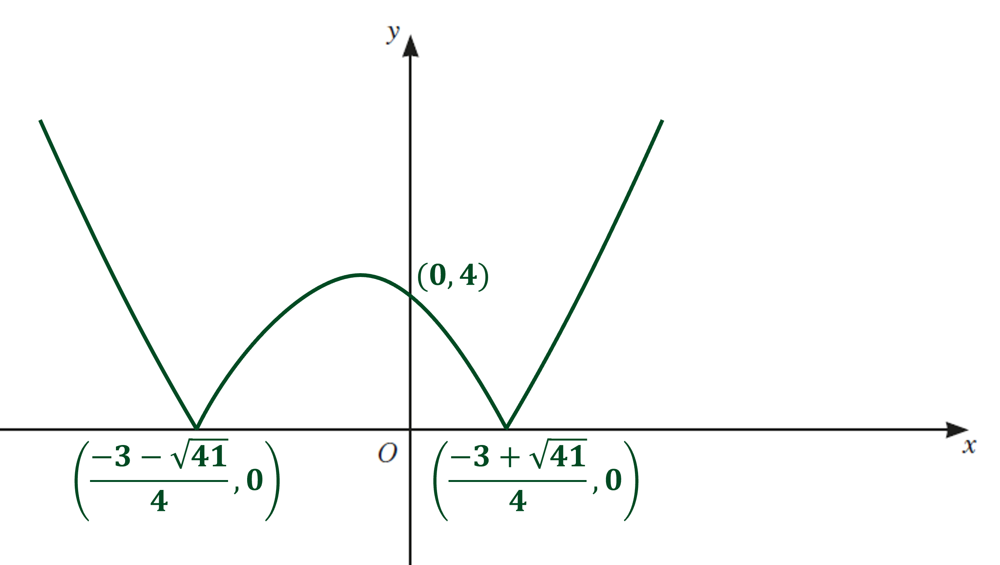

**correct shape ****[1]**

**correct **$x$**intercepts **$\frac{-3\pm\sqrt{41}}{4}$** ****[1]**

**correct **$y$**intercept of 4 ****[1]**
> *Using the graph from part *$c$*, identify where we would need to draw the horizontal line *$y=k$* to achieve three intersections with the curve.*

> *Three intersections are achieved at the reflection of the minimum point found in part *$b$*, when the line is *$y=\frac{41}{8}$

$\frac{41}{8}$** [1]**

### Q7
> *The roots of the graph are *$-5,-1,$* and *$2$

> *Therefore, we can start with:*

`y equals open parentheses x plus 5 close parentheses open parentheses x plus 1 close parentheses open parentheses x minus 2 close parentheses`

> *  *

> *If I were to expand this, the constant at the end would be:*

$5\times1\times-2=-10$

> *This would also be the *$y$* intercept of the graph.*

> *Since we want a *$y$* intercept of *$5$*, and an inverted cubic shape, we need to multiply our equation by *$-\frac{1}{2}$

$y=-\frac{1}{2}(x+5)(x+1)(x-2)$

> *  *

**for negative ****[1]**

**for **$\frac{1}{2}$**[1]**

**correct factors **`open parentheses x plus 5 close parentheses open parentheses x plus 1 close parentheses open parentheses x minus 2 close parentheses`** ****[1]**
> `straight f open parentheses x close parentheses less than 0`* when the graph under the *$x$*axis.*

> *Examine the graph to decide between which values of *$x$* the graph is negative.*

$x>2$* ***[1]**

$-5<x<-1$* ***[1]**

### Q8
> *If we expand the brackets of the equation, the highest power of *$x$* we would get would be *$x^{3}$*. Therefore, the graph is cubic.*

> *Solve *`5 open parentheses x plus 1 close parentheses open parentheses 3 x minus 2 close parentheses open parentheses x minus 2 close parentheses equals 0`* to find where the the curve will cross the *$x$* axis.*

$x=-1,x=\frac{2}{3},x=2$

> *Substitute *$x=0$* into *`y equals 5 open parentheses x plus 1 close parentheses open parentheses 3 x minus 2 close parentheses open parentheses x minus 2 close parentheses`* to find where the curve will cross the *$y$* axis.*

`y equals 5 open parentheses 1 close parentheses open parentheses negative 2 close parentheses open parentheses negative 2 close parentheses`

$y=20$

> *Draw a cubic curve on the given axes. Label where the curve crosses the *$x$*and *$y$*axes.*

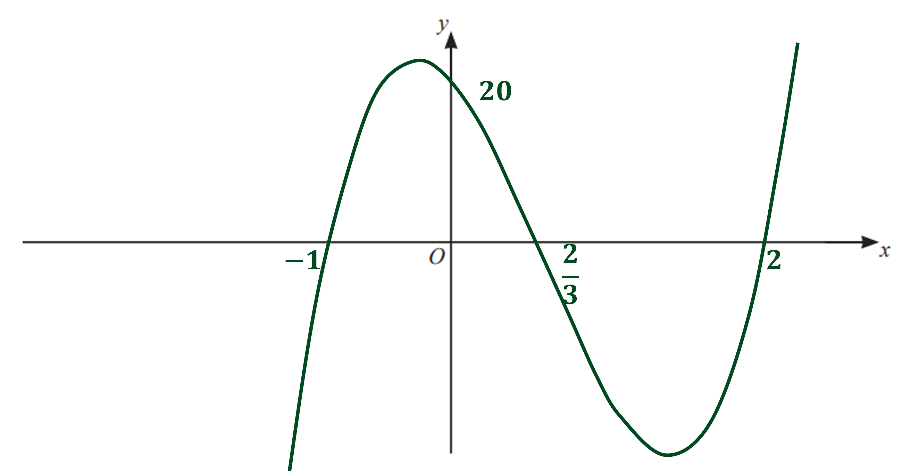

**Correct shape ****[1]**

**Correct roots at **$x=-1,x=2,x=\frac{2}{3}$** ****[1]**

**Correct y-intercet at **$y=20$** ****[1]**
> $y>0$* above the *$x$* axis.*

> *Look at the graph from part *`open parentheses a close parentheses`* to identify the *$x$* values where the curve is above the *$x$* axis.*

$-1<x<\frac{2}{3}$* ***[1]**

$x>2$* ***[1]**

### Q9
> *The function has roots at *$x=-1$*, *$x=\frac{1}{2}$* and *$x=2$*, so due to the factor theorem we know that: *

> `equation`* *

**'**`open parentheses x plus 1 close parentheses open parentheses 2 x minus 1 close parentheses open parentheses x minus 2 close parentheses`**' or an equivalent factorisation**** [1]**

> *The **y**-intercept of the function is (0, 10) so substitute *$x=0$* and *`straight f open parentheses x close parentheses equals 10`* into the above, and solve to find *$a$*.*

`table row 10 equals cell a open parentheses 0 plus 1 close parentheses open parentheses 2 open parentheses 0 close parentheses minus 1 close parentheses open parentheses 0 minus 2 close parentheses end cell row 10 equals cell a open parentheses 1 close parentheses open parentheses negative 1 close parentheses open parentheses negative 2 close parentheses end cell row 10 equals cell 2 a end cell row a equals 5 end table`

** ****[1]**

> *Remember that the graph is of the modulus of *`straight f open parentheses x close parentheses`* so *$a$* could be positive or negative 5*

$f(x)=\pm5(x+1)(2x-1)(x-2)$** [1]**

### Q10
> *Find the critical values (the solutions of *$f(x)=-1$*) by drawing *$y=-1$* on the diagram and reading the *$x$* values where it intersects *$y=f(x)$

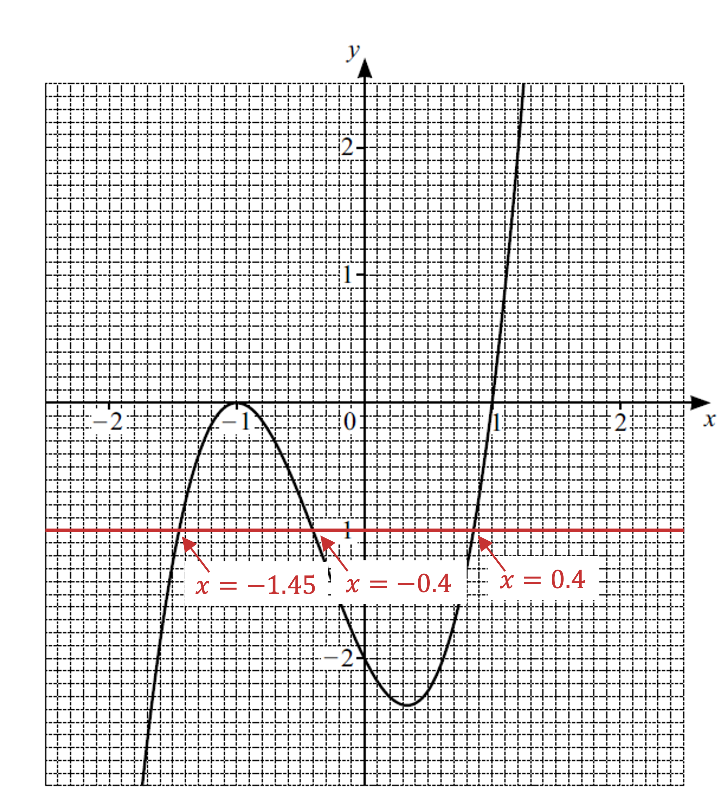

$x=-1.45,x=-0.4,x=0.85$

**for the first and last value above, answers from -1.4 to 1.5 and from 0.8 to 0.9 are allowed**** [1]**

> *Use these values to write as inequalities the regions of the diagram where the curve is below *$y=-1$

$x\leq-1.45\mathrm{and}-0.4\leqx\leq0.85$* ***[2]*** *
**one mark for each correct inequality**

**Take care to use "or equals to" inequalities, corresponding to the condition **`straight f open parentheses x close parentheses less or equal than negative 1`

### Q11
> *If we expand the brackets of the equation, the highest power of *$x$* we would get would be *$x^{3}$*. Therefore, the graph is cubic. Since one of the *$x$* in the brackets is negative, we will have an inverted cubic shape.*

> *Solve *`open parentheses x minus 2 close parentheses open parentheses x plus 1 close parentheses open parentheses 3 minus x close parentheses equals 0`* to find where the the curve will cross the *$x$* axis.*

$x=2,x=-1,x=3$

> *Substitute *$x=0$* into *`y equals open parentheses x minus 2 close parentheses open parentheses x plus 1 close parentheses open parentheses 3 minus x close parentheses`* to find where the curve will cross the *$y$* axis.*

`y equals open parentheses negative 2 close parentheses open parentheses 1 close parentheses open parentheses 3 close parentheses`

$y=-6$

> *Draw a cubic curve on the given axes. Label where the curve crosses the *$x$*and *$y$*axes.*

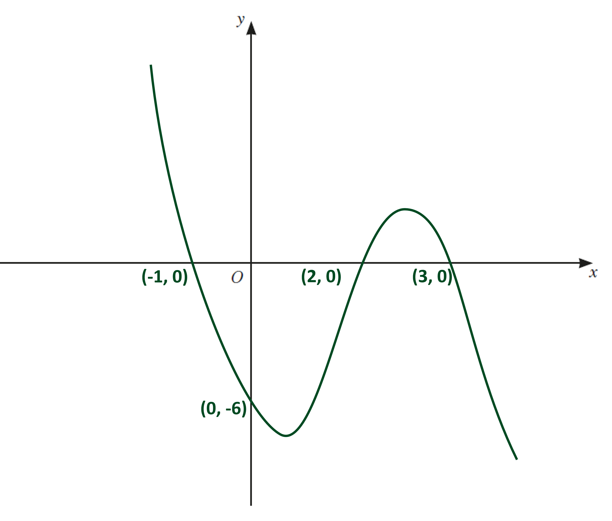

**correct shape ****[1]**

**correct **$x$**axis intercepts ****[1]**

**correct **$y$**axis intercept ****[1]**
> $y>0$* is above the *$x$* axis.*

> *Look at the graph from part *`open parentheses a close parentheses`* to identify the *$x$* values where the curve is above the *$x$* axis.*

$2<x<3$* ***[1]**

$x<-1$* ***[1]**

### Q12
> *Notice that the graph will be a negative cubic since *$-3\timesx\timesx\timesx=-3x^{3}$*.*

> *Find where the graph will cross the *$x$*-axis. This is true when *$y=0$*.*

`0 equals negative 3 open parentheses x minus 2 close parentheses open parentheses x minus 4 close parentheses open parentheses x plus 1 close parentheses`

*Either *$x-2=0,x-4=0\mathrm{or}x+1=0$

*So *$x=2,x=4\mathrm{or}x=-1$

> *Find where the graph will cross the *$y$*-axis. This is true when *$x=0$*.*

> *Substitute *$x=0$* into the equation giving:*

`y equals negative 3 open parentheses 0 minus 2 close parentheses open parentheses 0 minus 4 close parentheses open parentheses 0 plus 1 close parentheses`

$y=-24$

> *Plot the intercepts onto the graph which will be:*

`open parentheses 2 comma space 0 close parentheses comma space open parentheses 4 comma space 0 close parentheses comma space open parentheses negative 1 comma space 0 close parentheses space and space open parentheses 0 comma negative 24 close parentheses`

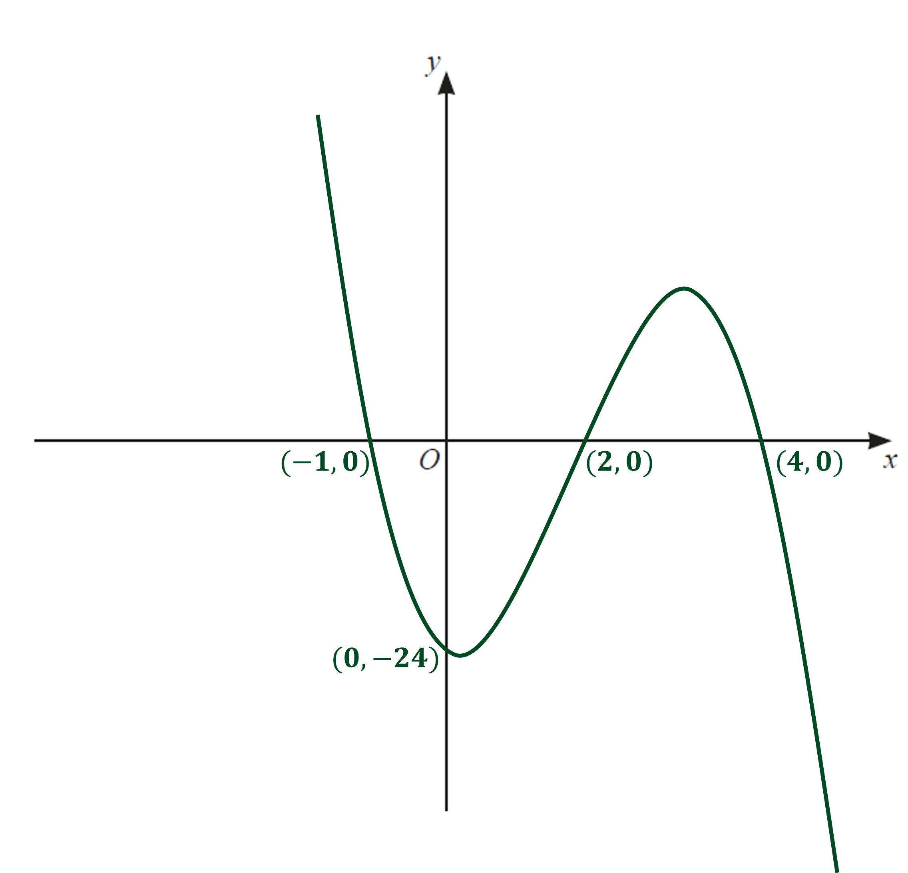

**correct shape ****[1]**
** correct **$x$**-intercepts ****[1]**** **
**correct **$y$**-intercept ****[1]**
> *We want to find where the graph is greater than 0 (but NOT equal to 0). In other words, where the graph is strictly above the *$x$*-axis.*

*The graph is above the *$x$*-axis in 2 sections:*

*When *$x<-1$* or when *$2<x<4$

$x<-1\mathrm{or}2<x<4$
** ****1 mark for each statement**** [1]**

### Q13
> *Sketch the two graphs.*

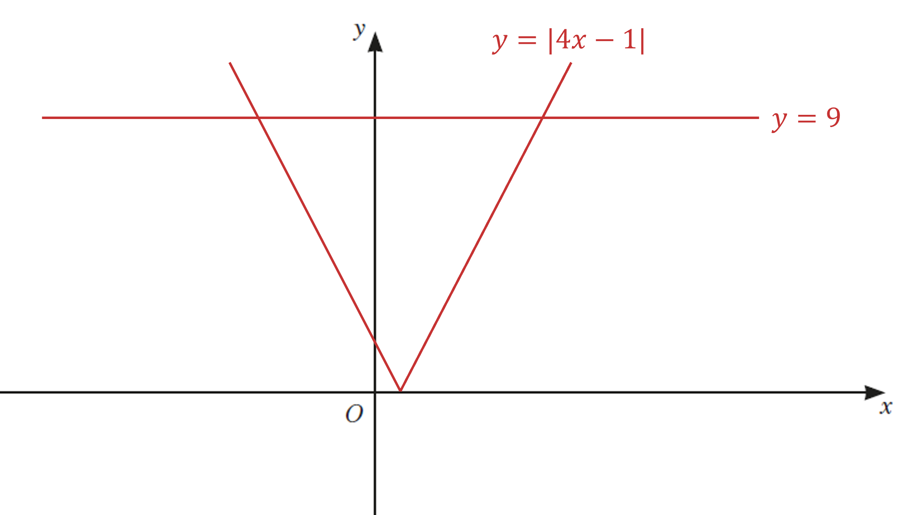

> *To find the values of x when the two graphs are equation form two equtions.*

`table attributes columnalign right center left columnspacing 0px end attributes row cell 4 x minus 1 end cell equals 9 row cell negative open parentheses 4 x minus 1 close parentheses end cell equals 9 end table`

**[1]**

> *Solve each equation to find the x values.*

$4x-1=9\Rightarrowx=\frac{5}{2}\,1-4x=9\Rightarrowx=-2$

**[1]**

> *We want when the modulus function is greater than the constant function. This happens when the graph of the modulus function is above the graph of the straight line.*

$x<-2$** ****or **$x>\frac{5}{2}$* ***[1]**

### Q14
> *First isolate the modulus*

`table row cell 5 open vertical bar 5 x minus 2 close vertical bar end cell equals 15 row cell open vertical bar 5 x minus 2 close vertical bar end cell equals 3 end table`

> *To obtain the first solution, assume the contents of the modulus brackets are positive and solve*

`table row cell 5 x minus 2 end cell equals 3 row cell 5 x end cell equals 5 end table`

$x=1$** [1]**

> *To obtain the second solution, assume the contents of the modulus brackets are negative*

`table row cell 5 x minus 2 end cell equals cell negative 3 space space space space open parentheses or space minus 5 x plus 2 equals 3 close parentheses end cell end table`

**[1]**

> *And solve*

`table row cell 5 x end cell equals cell negative 1 end cell end table`

$x=-\frac{1}{5}$ **[1]**

### Q15
> *The graph crosses the x-axis at the roots of the equation, and this will help us to identify the factors:*

$x=-2,x=-1.x=4$

> *This means that the brackets must be *

`straight f open parentheses x close parentheses space equals space open parentheses x space plus thin space 2 close parentheses open parentheses x space plus thin space 1 close parentheses open parentheses x space minus space 4 close parentheses`

* ***correct brackets** **[1]**

> *If we expand the brackets, we get *

`straight f open parentheses x close parentheses thin space equals space x to the power of 3 space end exponent minus space x to the power of 2 space end exponent minus space 10 x space minus space 8`

> *We can see from the graph that it has a y-intercept of 24, therefore, we need to multiply the whole function by 3 to give the positive cubic graph.*

* ***for multiplying by 3**** [1]**

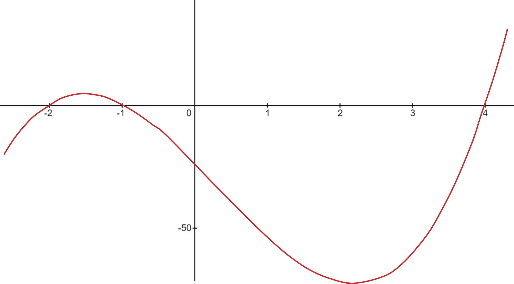

> *The graph of *`y equals open vertical bar p open parentheses x close parentheses close vertical bar`* means means anything below the x-axis gets reflected above the x-axis.*

> *We could also multiply the function by -3 to give the negative cubic graph.*

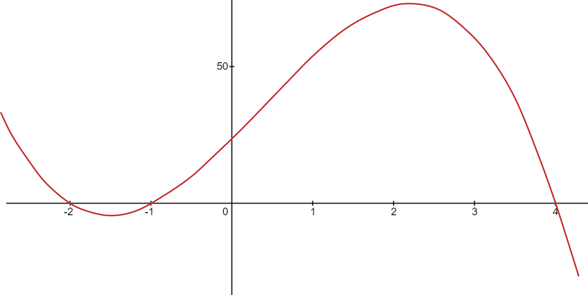

> *As before, the graph of *`y space equals space open vertical bar p open parentheses x close parentheses close vertical bar`* means anything below the x-axis gets reflected above the x-axis.*

> *Therefore, the final expression for the function would be*

$p(x)=\pm3(x+2)(x+1)(x-4)$ **[1]**

### Q16
> *Find where the graph intersects the *$x$*axis by substituting in *$y=0$

`0 equals negative open parentheses x plus 2 close parentheses open parentheses x minus 1 close parentheses open parentheses x minus 6 close parentheses`

> $x=-2$*        *$x=1$*         *$x=6$

> *Find the *$y$* intercept by substituting in *$x=0$

`y equals negative open parentheses 2 close parentheses open parentheses negative 1 close parentheses open parentheses negative 6 close parentheses`

$y=-12$

> *The shape of the graph will be an inverted cubic.*

> *Draw on the given axes, labeling where the curve crosses the axes.*

> *  *

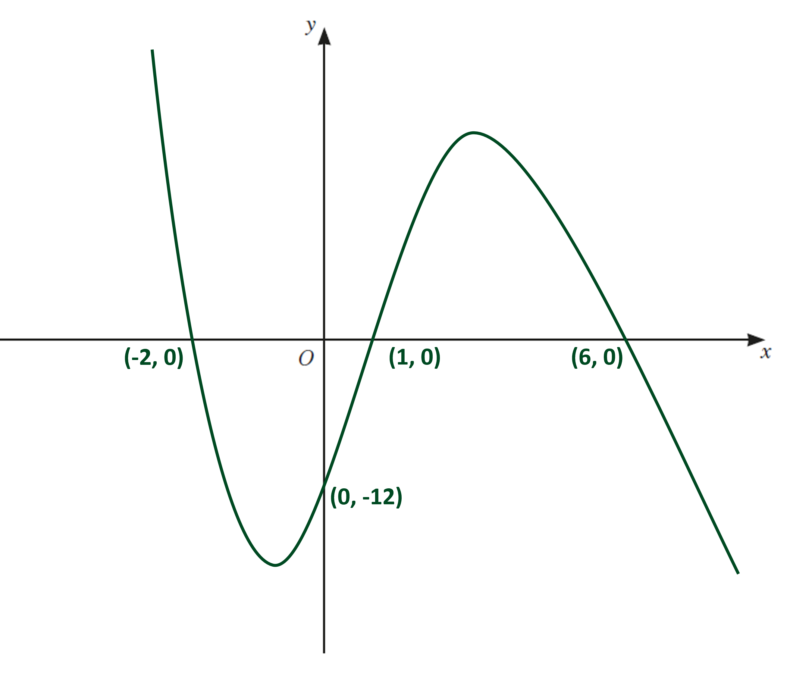

**correct shape ****[1]**

**correct coordinates **`open parentheses negative 2 comma space 0 close parentheses`**, **`open parentheses 1 comma space 0 close parentheses`**, **`open parentheses 6 comma space 0 close parentheses`** and **`open parentheses 0 comma space minus 12 close parentheses`** ****[1]**
> $y\leq0$* on and below the *$x$* axis.*

> *Look at the graph from part *`open parentheses a close parentheses`* to identify the range of *$x$* values for which the curve is on or below the *$x$* axis.*

$-2\leqx\leq1$* ***[1]**

$x\geq6$* ***[1]**

### Q17
> *The graph crosses the **x** axis at the roots of the equation, and this will help us to identify the factors:*

$x=-2,x=-1,x=5$

`straight f open parentheses x close parentheses space equals space a open parentheses x space plus thin space 2 close parentheses open parentheses x space plus thin space 1 close parentheses open parentheses x space minus space 5 close parentheses`

**correct factors**** [1]**

> *This would give us a y-intercept of *$-10$*, but the graph shows us that the y-intercept is *$5$*, so we need to adjust our expression with a reflection in the **x **axis and a vertical stretch of *$-\frac{1}{2}$

* *`straight f open parentheses x close parentheses space equals space minus 1 half open parentheses x space plus thin space 2 close parentheses open parentheses x space plus thin space 1 close parentheses open parentheses x space minus space 5 close parentheses`

$f(x)=-\frac{1}{2}(x+2)(x+1)(x-5)$**[1]**
> *We are looking for the parts of the graph that are below the **x**-axis. This happens when:*

$-2\leqx\leq-1$

*and*

$x\geq5$

$-2\leqx\leq-1,x\geq5$** **
**1 mark for each statement**** [2]**

### Q18
> *The line *$y=5x-7$* would have *$y$*-intercept *`open parentheses 0 comma space minus 7 close parentheses`* and would intersect the *$x$*-axis at *`open parentheses 7 over 5 comma space 0 close parentheses`

> *Sketch this on the axes*

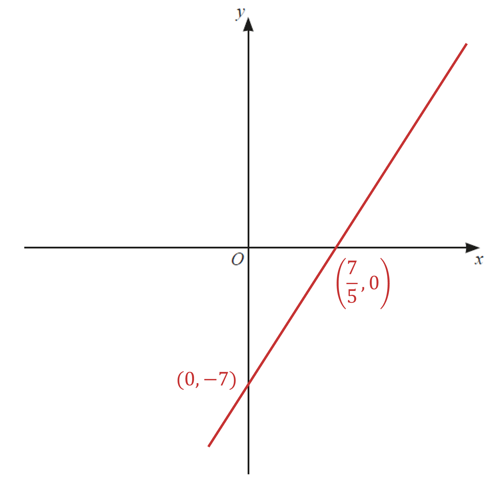

> *We need to sketch *`y equals open vertical bar 5 x minus 7 close vertical bar`* which means that all the *$y$* values are made positive. This means the part of the graph that goes below the *$x$*-axis gets reflected in the *$x$*-axis:*

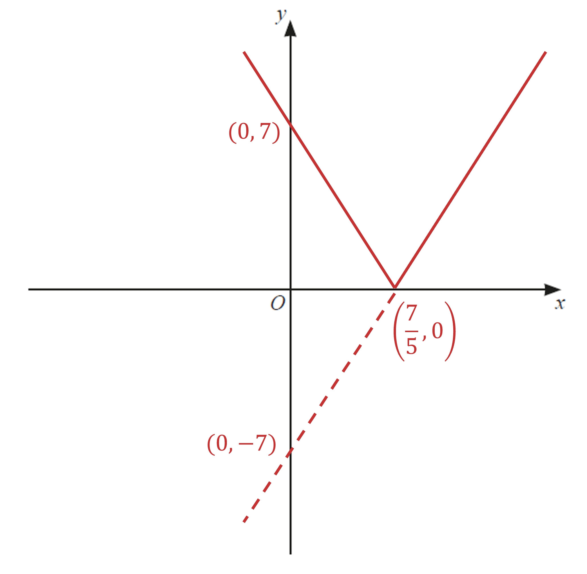

> *The final graph should look like this*

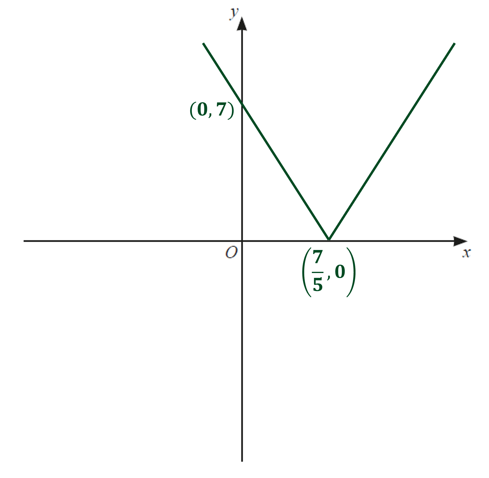

**correct V shape with vertex on positive **$x$**-axis**** [1]**

** correct coordinate**** **`open parentheses 0 comma space 7 close parentheses`** [1]**

**correct coordinate**** **`open parentheses 7 over 5 comma space 0 close parentheses`** [1]**
> *Add 1 to both sides and then divide by 5*

`5 open vertical bar 5 x minus 7 close vertical bar minus 1 equals 14`

`5 open vertical bar 5 x minus 7 close vertical bar equals 15`

`open vertical bar 5 x minus 7 close vertical bar equals 3`

> *Use part (a) to see where the graph of *`y equals open vertical bar 5 x minus 7 close vertical bar`* and the line *$y=3$* intersect*

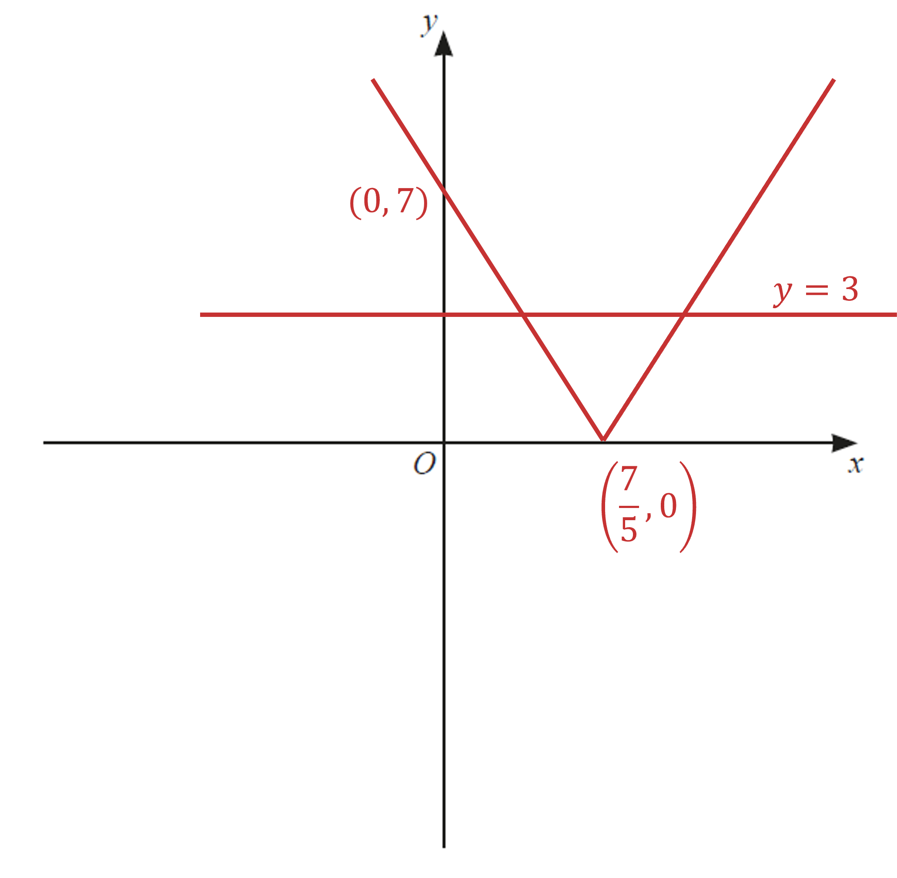

> *There are 2 intersections so the original equation will have 2 solutions*

> *Use the equation of the positive straight line and solve *

$5x-7=3$

$x=2$

**[1]**

> *Use the equation of the negative straight line and solve*

$-5x+7=3$

$x=\frac{4}{5}$

**[1]**

$x=2\mathrm{or}x=\frac{4}{5}$ **[1]**
