# Exam Questions — Equations, Inequalities & Graphs
**Algebra & Functions** · Cambridge (CIE) IGCSE further-maths (0606)
> Source: [https://www.savemyexams.com/igcse/further-maths/cie/additional-maths/25/topic-questions/](https://www.savemyexams.com/igcse/further-maths/cie/additional-maths/25/topic-questions/) · 18 questions across 1 sets

## Exam Questions (18 questions)

### Q1 — medium — 4 marks

**Q1** [4 marks]

Solve the following equation.

$2 \vert x - 1 \vert \text{less} \text{or} \text{equal} \text{than} \vert 2 - x \vert$

### Q2 — hard — 7 marks

**Q2** [5 marks]

The graph $y = \mathrm{p} ( x )$ where $\mathrm{p} ( x ) = 5 x^{3} - 17 x^{2} + 16 x + a$ intersects the $x$-axis at the points $( b , 0 )$, $( 1 , 0 )$ and $( c , 0 )$ where $b<c$.

Find the constants $a$, $b$ and $c$.

**Q2** [2 marks]

The curve $y = \mathrm{p} ( x )$ has a local maximum point at $( \frac{2}{3} , \frac{16}{27} )$ and a local minimum point at $( \frac{8}{5} , - \frac{36}{25} )$.

Find the value of $d$ for which the equation $\vert p ( x ) \vert = d$ has exactly 5 distinct solutions.

### Q3 — hard — 3 marks

**Q3** [3 marks]

Solve `open vertical bar 3 x minus 2 close vertical bar space equals space 4 plus x` .

*Source: Nov 2020 0606/23 Q1*

### Q4 — very_hard — 3 marks

**Q4** [3 marks]

Solve the inequality `open vertical bar 3 x plus 2 close vertical bar space greater than space 8 plus x`.

*Source: Nov 2020 0606/21 Q1*

### Q5 — hard — 3 marks

**Q5** [3 marks]

On the axes below, sketch the graph of $y = \left| ( x - 2 ) ( x + 1 ) ( x + 2 ) \right|$showing the coordinates of the points where the curve meets the axes.

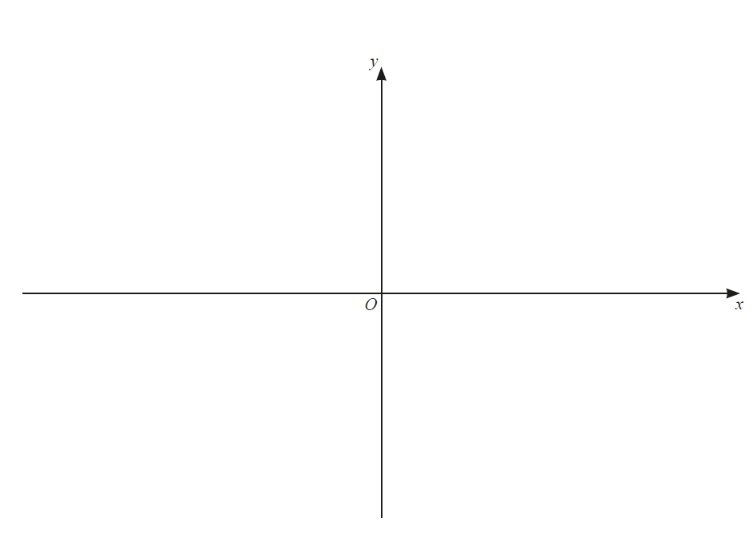

*Source: june 2020 0606/12 Q1*

### Q6 — very_hard — 9 marks

**Q6** [3 marks]

Write $2x^{2}+3x-4$ in the form $a(x+b)^{2}+c$, where $a,b$ and $c$ are constants.

*Source: june 2020 0606/13 Q4A*

**Q6** [2 marks]

**Extract:**

Write 2x² + 3x - 4 in the form a(x + b)² + c, where a, b and c are constants.

Answer: 2(x + 3/4)² - 41/8

Hence write down the coordinates of the stationary point on the curve $y=2x^{2}+3x-4$.

*Source: june 2020 0606/13 Q4B*

**Q6** [3 marks]

**Extract:**

2(x + 3/4)² - 41/8

On the axes below, sketch the graph of `y space equals space open vertical bar 2 x squared space plus 3 x minus space 4 close vertical bar`, showing the exact values of the intercepts of the curve with the coordinate axes.

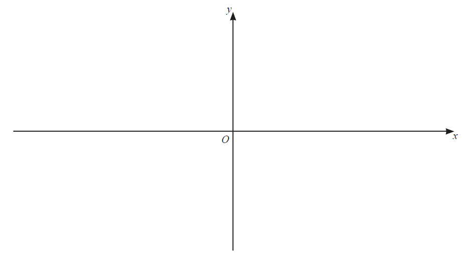

*Source: june 2020 0606/13 Q4C*

**Q6** [1 mark]

**Extract:**

The minimum point on the curve y = 2x² + 3x - 4 is (-3/4, -41/8).

The graph of y = |2x² + 3x - 4| is a parabola where everything below the x-axis is reflected above the x-axis. The x-intercepts are ((-3 + √41)/4, 0) and ((-3 - √41)/4, 0), and the y-intercept is (0, 4).

Find the value of $k$ for which `open vertical bar 2 x squared space plus 3 x minus space 4 close vertical bar equals space k` has exactly 3 values of $x$.

*Source: june 2020 0606/13 Q4D*

### Q7 — hard — 5 marks

**Q7** [3 marks]

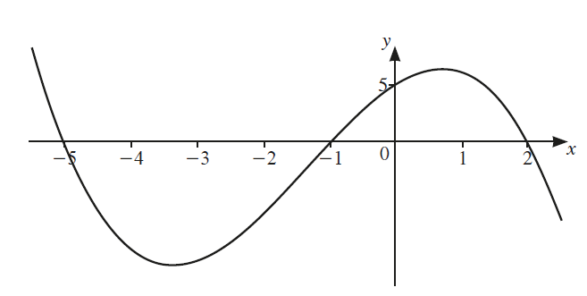

The diagram shows the graph of $y=f(x)$, where $f(x)$ is a cubic polynomial. Find $f(x)$.

*Source: Nov 2020 0606/12 Q2A*

**Q7** [2 marks]

**Extract:**

The diagram shows the graph of y = f(x), where f(x) is a cubic polynomial.

Write down the values of $x$ such that $f(x)<0$.

*Source: Nov 2020 0606/12 Q2B*

### Q8 — medium — 5 marks

**Q8** [3 marks]

On the axes, sketch the graph of $y = 5 ( x + 1 ) ( 3 x - 2 ) ( x - 2 )$, stating the intercepts with the coordinate axes.

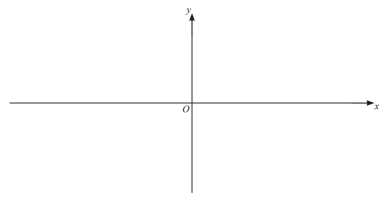

*Source: June 2021 paper 11 Q1A*

**Q8** [2 marks]

**Extract:**

On the axes, sketch the graph of y = 5(x+1)(3x-2)(x-2), stating the intercepts with the coordinate axes.

From the mark scheme:
The graph is cubic.
Solve 5(x+1)(3x-2)(x-2) = 0 to find where the curve will cross the x axis.
x = -1, x = 2/3, x = 2
Substitute x = 0 into y = 5(x+1)(3x-2)(x-2) to find where the curve will cross the y axis.
y = 5(1)(-2)(-2)
y = 20

Hence find the values of $x$ for which $5 ( x + 1 ) ( 3 x - 2 ) ( x - 2 ) > 0$.

*Source: June 2021 Paper 11 Q1B*

### Q9 — very_hard — 3 marks

**Q9** [3 marks]

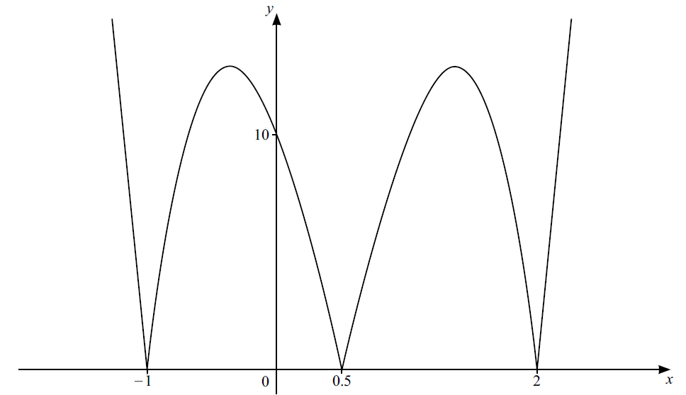

The diagram shows the graph of $y = \vert \mathrm{f} ( x ) \vert$, where $f(x)$ is a cubic function. Find the possible expressions for $f(x)$ in factorised form.

*Source: Specimen 2025 Paper 1 Q1A*

### Q10 — medium — 3 marks

**Q10** [3 marks]

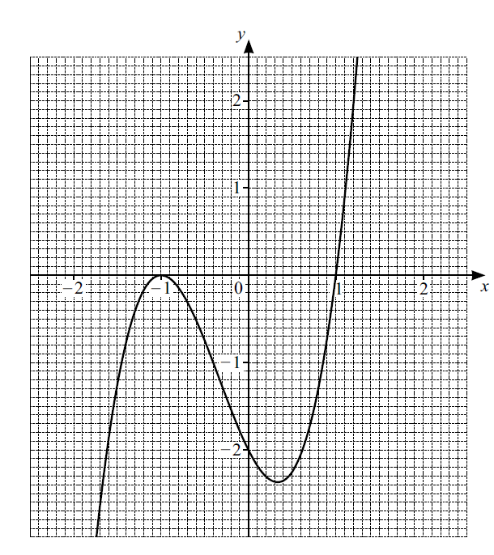

The diagram shows the graph of $y=f(x),\mathrm{where}f(x)=2(x+1)^{2}(x--1)$ . 
Use the graph to solve the inequality $\mathrm{f} ( x ) less-than \text{or} \text{slanted} \text{equal} \text{to} – 1$.

*Source: Specimen 2025 Paper 2 Q1B*

### Q11 — hard — 5 marks

**Q11** [3 marks]

On the axes below, sketch the graph of $y=(x-2)(x+1)(3-x)$, stating the intercepts on the coordinate axes.

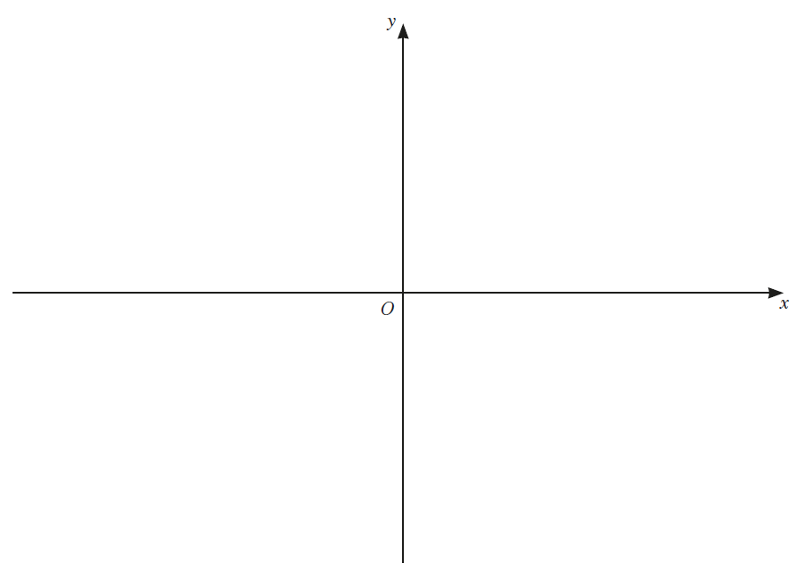

*Source: Nov 2020 0606/13 Q1A*

**Q11** [2 marks]

**Extract:**

On the axes below, sketch the graph of y = (x-2)(x+1)(3-x), stating the intercepts on the coordinate axes.

If we expand the brackets of the equation, the highest power of x we would get would be x cubed. Therefore, the graph is cubic. Since one of the x in the brackets is negative, we will have an inverted cubic shape.

Solve (x-2)(x+1)(3-x) = 0 to find where the curve will cross the x axis.
x = 2, x = -1, x = 3

Substitute x = 0 into y = (x-2)(x+1)(3-x) to find where the curve will cross the y axis.
y = (-2)(1)(3)
y = -6

Hence write down the values of $x$ such that $(x-2)(x+1)(3-x)>0$.

*Source: Nov 2020 0606/13 Q1B*

### Q12 — medium — 5 marks

**Q12** [3 marks]

On the axes below sketch the graph of $y=-3(x-2)(x-4)(x+1)$, showing the coordinates of the points where the curve intersects the coordinate axes.

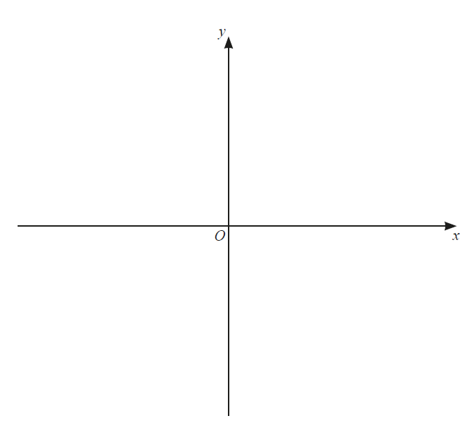

*Source: March 2020 0606/12 Q1A*

**Q12** [2 marks]

**Extract:**

On the axes below sketch the graph of y = -3(x-2)(x-4)(x+1), showing the coordinates of the points where the curve intersects the coordinate axes.

The graph will be a negative cubic since -3 × x × x × x = -3x³.

The graph crosses the x-axis when y = 0:
0 = -3(x-2)(x-4)(x+1)
Either x-2 = 0, x-4 = 0 or x+1 = 0
So x = 2, x = 4 or x = -1

The graph crosses the y-axis when x = 0:
y = -3(0-2)(0-4)(0+1)
y = -24

The intercepts are: (2, 0), (4, 0), (-1, 0) and (0, -24)

Hence find the values of $x$ for which $-3(x-2)(x-4)(x+1)>0$.

*Source: March 2020 Paper 12 Q1B*

### Q13 — hard — 3 marks

**Q13** [3 marks]

Solve the inequality `open vertical bar 4 x minus 1 close vertical bar space greater than space 9`.

*Source: June 2021 Paper 21 Q3A*

### Q14 — medium — 3 marks

**Q14** [3 marks]

Solve the equation $5 \vert 5 x – 2 \vert – 1 = 14$.

*Source: Specimen 2025 Paper 2 Q1A*

### Q15 — very_hard — 3 marks

**Q15** [3 marks]

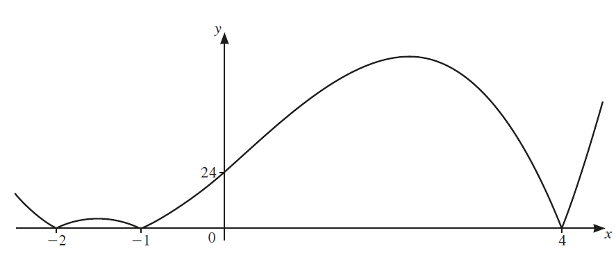

The diagram shows the graph of $y = \left| \mathrm{p} ( x ) \right|$ , where $p(x)$ is a cubic function. Find the two possible expressions for $p(x)$.

*Source: Nov 2020 0606/11 Q1*

### Q16 — medium — 4 marks

**Q16** [2 marks]

On the axes below, sketch the graph of $y=-(x+2)(x-1)(x-6)$, showing the coordinates of the points where the graph meets the coordinate axes.

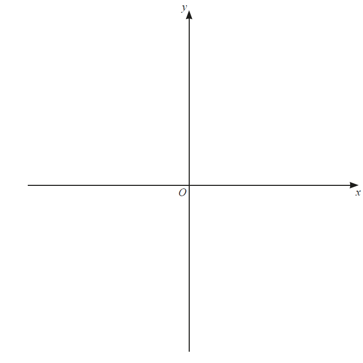

*Source: june 2020 0606/23 Q3A*

**Q16** [2 marks]

**Extract:**

On the axes below, sketch the graph of y = -(x+2)(x-1)(x-6), showing the coordinates of the points where the graph meets the coordinate axes.

Find where the graph intersects the x axis by substituting in y = 0
0 = -(x+2)(x-1)(x-6)
x = -2        x = 1         x = 6

Find the y intercept by substituting in x = 0
y = -(2)(-1)(-6)
y = -12

The shape of the graph will be an inverted cubic.

Hence solve $-(x+2)(x-1)(x-6)\leq0$.

*Source: june 2020 0606/23 Q3B*

### Q17 — very_hard — 4 marks

**Q17** [2 marks]

The diagram shows the graph of a cubic curve .

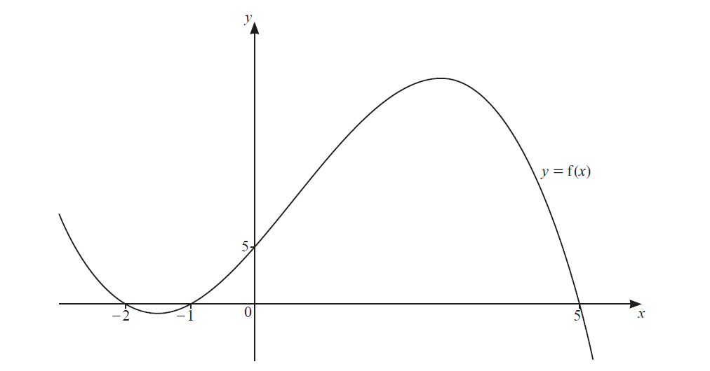

Find an expression for $\mathrm{f} ( x )$.

*Source: June 2020 0606/11 Q1A*

**Q17** [2 marks]

**Extract:**

The diagram shows the graph of a cubic curve.

The graph crosses the x axis at the roots of the equation:
x = -2, x = -1, x = 5

f(x) = -1/2(x + 2)(x + 1)(x - 5)

Solve $f(x)\leq0$.

*Source: June 2020 0606/11 Q1B*

### Q18 — medium — 6 marks

**Q18** [3 marks]

On the axes below, sketch the graph of `y space equals space open vertical bar 5 x minus 7 close vertical bar`, showing the coordinates of the points where the graph meets the coordinate axes.

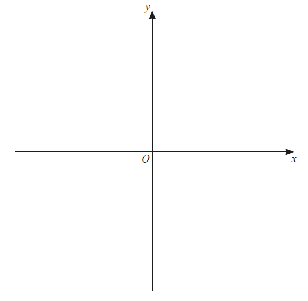

*Source: March 2020 0606/22 Q5A*

**Q18** [3 marks]

**Extract:**

On the axes below, sketch the graph of y = |5x - 7|, showing the coordinates of the points where the graph meets the coordinate axes.

The line y = 5x - 7 would have y-intercept (0, -7) and would intersect the x-axis at (7/5, 0)

We need to sketch y = |5x - 7| which means that all the y values are made positive. This means the part of the graph that goes below the x-axis gets reflected in the x-axis.

The final graph is a correct V shape with vertex on positive x-axis at coordinate (7/5, 0) and y-intercept at coordinate (0, 7).

Solve `5 open vertical bar space 5 x minus 7 close vertical bar space minus 1 space equals space 14`.

*Source: March 2020 0606/22 Q5B*

