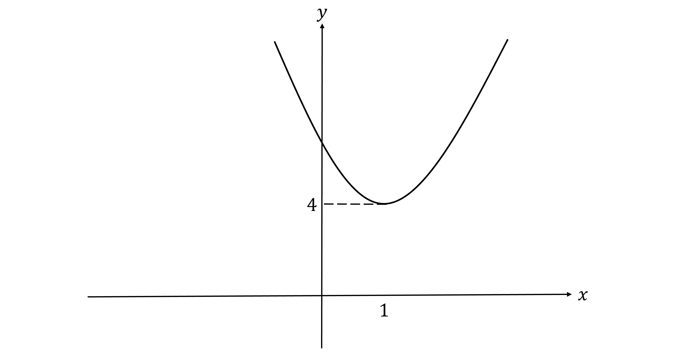
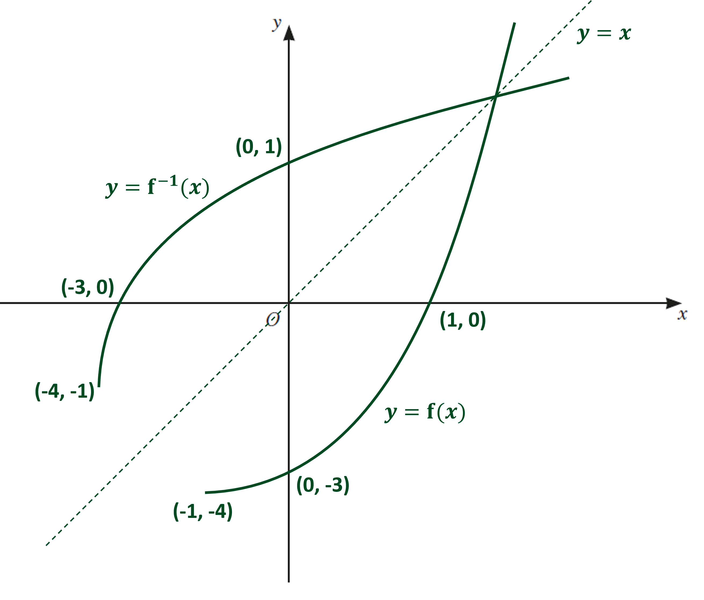
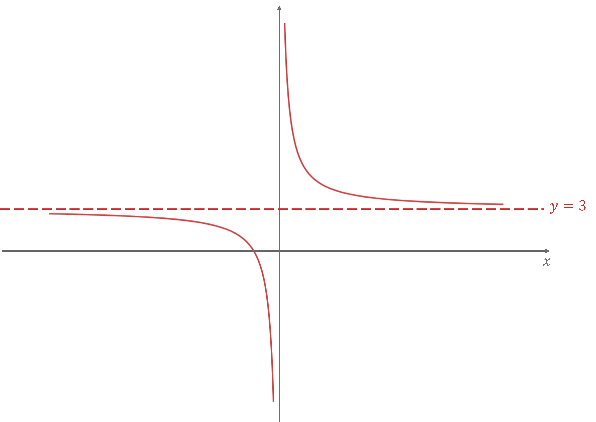
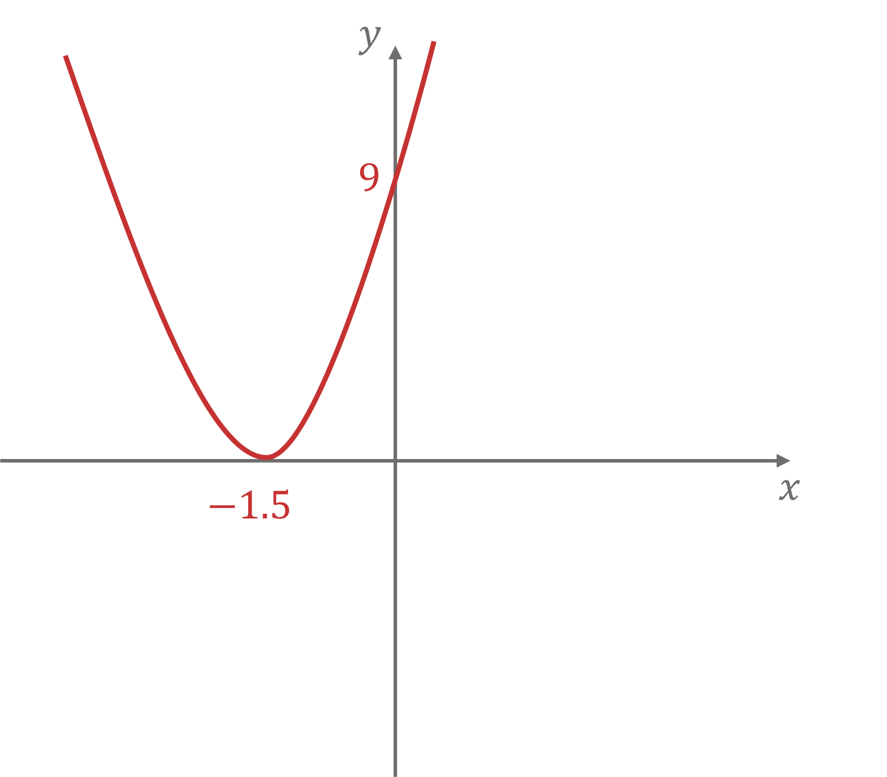
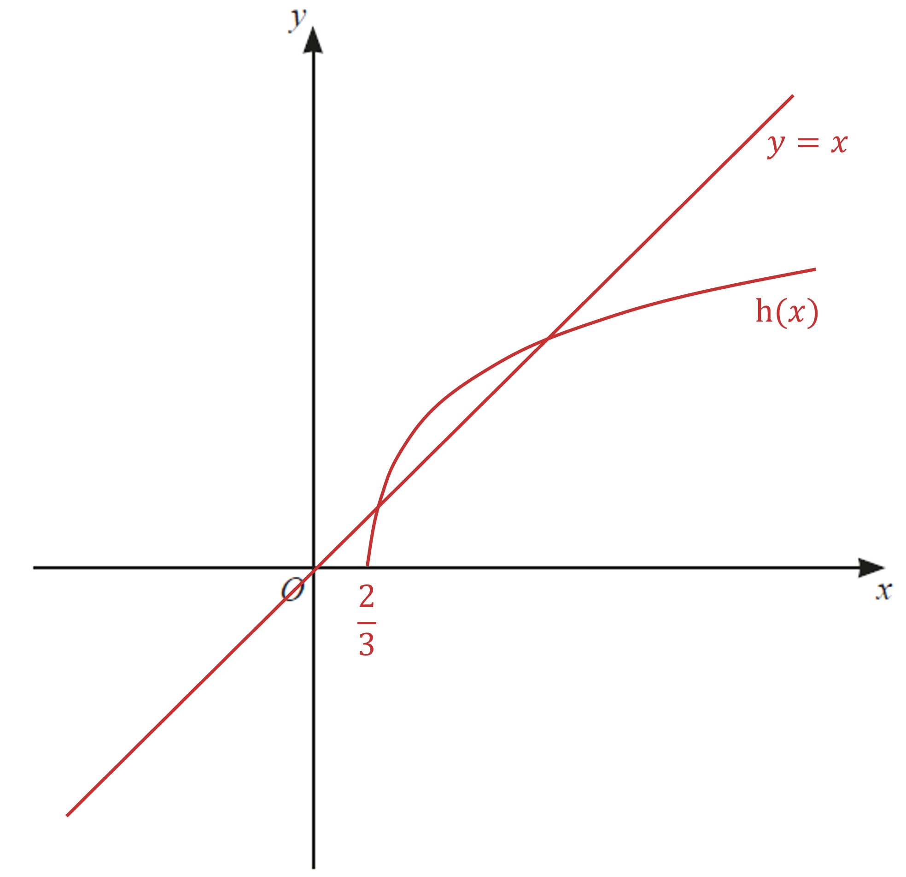
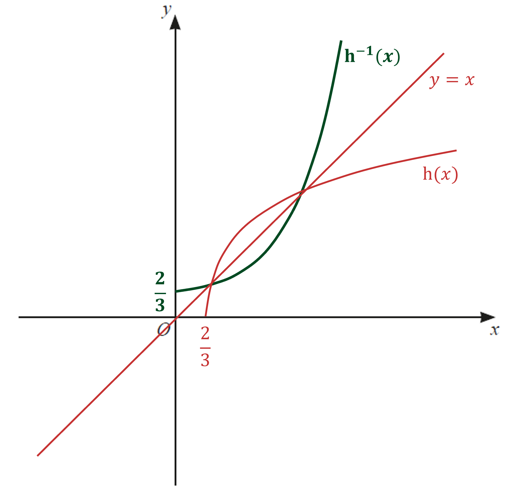
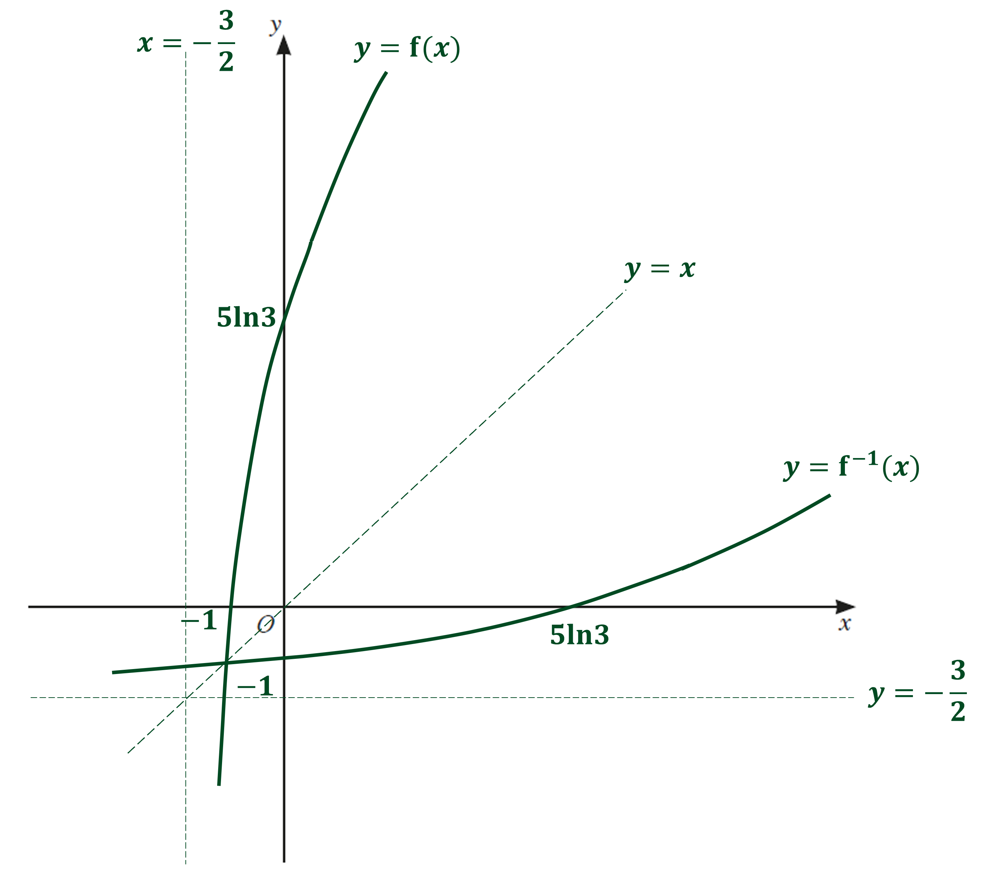
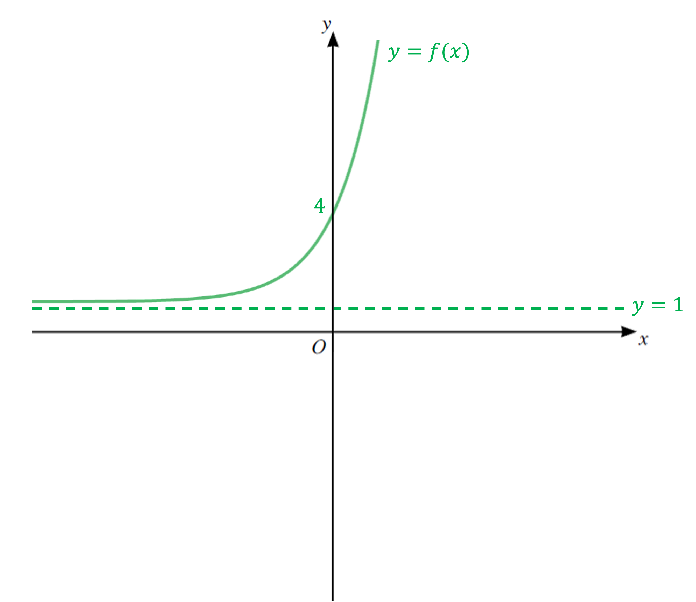
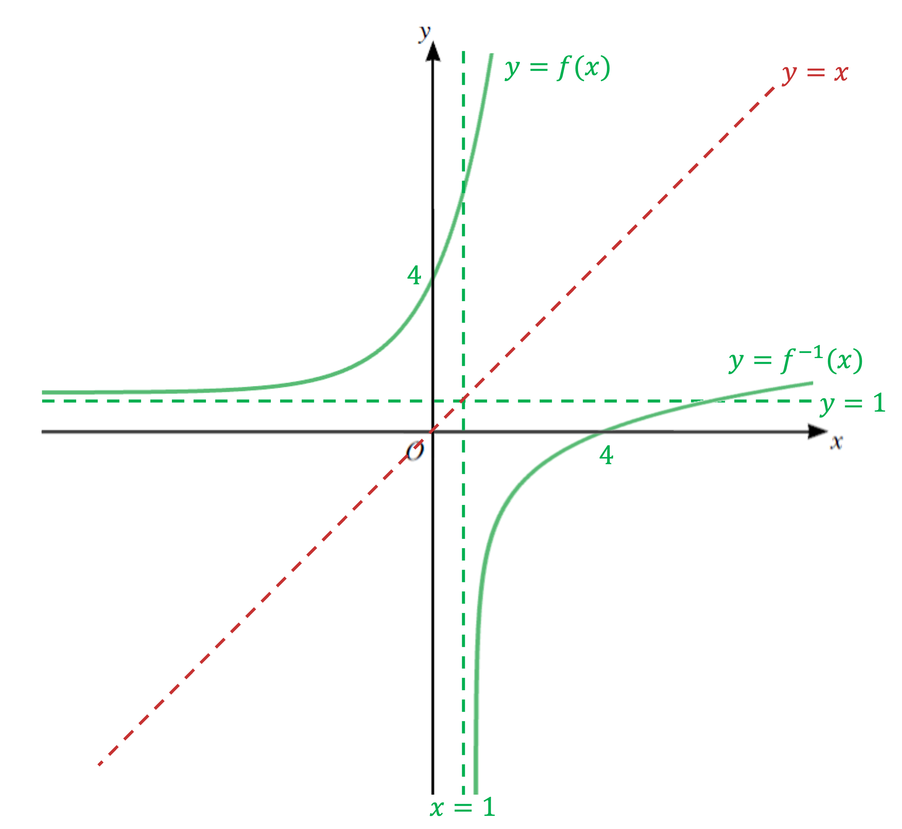

# Mark Schemes — Functions
**Algebra & Functions** · Cambridge (CIE) IGCSE further-maths (0606)

## Exam Questions (15 questions)

### Q1
> *To complete the square, first factorise out a 5 from first two terms*

$y = 5 [ x^{2} - 2 x ] + 9$

> *Complete the square on *$x^{2}-2x$* by halving the *$-2$* and writing it as *$( x - 1 )^{2} - ( - 1 )^{2}$

$( x - 1 )^{2} - 1$

> *Substitute that back into the original expression*

$y = 5 [ ( x - 1 )^{2} - 1 ] + 9$

> *Expand through by the 5 (without expanding the brackets)*

$y = 5 ( x - 1 )^{2} - 5 + 9$

> *Simplify the final constant*

$y = 5 ( x - 1 )^{2} + 4$

**[B1 B1]**

> **[mark-scheme]**
> **B1: **For at least $5 ( x - 1 )^{2} +...$ in your answer (may have the wrong constant).
> 
> **B1:** For $5 ( x - 1 )^{2} + 4$ fully correct (does not need "$y=$" for this mark).
> *The turning point on any curve in the form *$y = p ( x + q )^{2} + r$* is always *$( - q , r )$

> *For *$y = 5 ( x - 1 )^{2} + 4$*, the turning point is at *$( 1 , 4 )$

$( 1 , 4 )$

**[B1]**
> *The graph *$y=5x^{2}-10x+9$* is a positive quadratic (U-shape)*

> *This makes the turning point *$( 1 , 4 )$* from part (b) a minimum point*

> *That means all outputs (*$y$*-coordinates) from *$\mathrm{f} ( x )$* are greater than or equal to 4*

$\mathrm{f} ( x ) \ge 4$

**[B1]**
> *A function can only have an inverse if it is one-to-one*

> $\mathrm{f} ( x ) = 5 x^{2} - 10 x + 9$* is many-to-one*

**Final answer:** $\mathrm{f} ( x )$** is not one-to-one, so it cannot have an inverse function**

**[B1]**

> **[mark-scheme]**
> Your answer must refer to the function not being 'one-to-one' to get this mark.
> 
> Writing '$\mathrm{f} ( x )$ is many-to-one' does not score the mark.
> 
> Writing '$\mathrm{f} ( x )$ is many-to-one but functions must be one-to-one for their inverses to exist' does score the mark.

### Q2
**Method 1**

> *It is possible to see the answer by undoing the function*

*subtract one then divide by 8*

$\mathrm{f}^{- 1} ( x ) = \frac{x - 1}{8}$

**[B1]**

**Method 2**

> *Set *$y=...$* to the function*

$y=1+8x$

> *swap *$x$* and *$y$*, then make *$y$* the subject*

$\begin{gathered} x = 1 + 8 y \\ x - 1 & = 8 y \\ \frac{x - 1}{8} & = y \end{gathered}$

> *Write the answer as *$\mathrm{f}^{- 1} ( x ) =...$

$\mathrm{f}^{- 1} ( x ) = \frac{x - 1}{8}$

**[B1]**
**Final answer:** **The graph of **$y = \mathrm{f}^{- 1} ( x )$** is a reflection in the line **$y=x$** of the graph **$y = \mathrm{f} ( x )$

**[B1]**

> **[mark-scheme]**
> Your explanation must state the equation of the line of reflection $( y = x )$ to get this mark.
> *This means *$\text{fgg} ( 1 )$* which is *$\mathrm{g} ( 1 )$* first, then *$g$* of the answer, then *$f$* of that answer*

$\mathrm{g} ( 1 ) = 2 + \ln 1$

> *Remember that *$\mathrm{log}_{a}1=0$

$\mathrm{g} ( 1 ) = 2$

> *Now do *$\mathrm{g} ( 2 )$

$\mathrm{g} ( 2 ) = 2 + \ln 2$

**[M1]**

> *Now do *$\mathrm{f} ( 2 + \ln 2 )$* and simplify*

$\begin{gathered} \mathrm{f} ( 2 + \ln 2 ) & = 1 + 8 ( 2 + \ln 2 ) \\ = 1 + 16 + 8 \ln 2 \end{gathered}$

$17+8\mathrm{ln}2$

**[A1]**

> **[mark-scheme]**
> **M1: **For an attempt to substitute 1 into $\mathrm{g} ( x )$ twice (you do not need to simplify working for this mark).
> 
> **A1: **For the correct final answer, fully simplified in terms of $\mathrm{ln}2$.
> *The function *$\mathrm{f} ( x )$* allows negative inputs, which can give negative outputs in the range*

*e.g. *$\mathrm{f} ( - 1 ) = 1 + 8 ( - 1 ) = - 7$

> *These negative outputs from *$f$* become negative inputs in *$g$

> *But *$\mathrm{g} ( x )$* only accepts positive inputs (as its domain is *$x>0$*)*

**Final answer:** **The range of **$\mathrm{f} ( x )$** does not lie within the domain of **$\mathrm{g} ( x )$

**[B1]**

> **[mark-scheme]**
> You must refer to both the 'range of $\mathrm{f} ( x )$' and the 'domain of $\mathrm{g} ( x )$' in your explanation to get this mark.

### Q3
> *The key features of the logarithmic graph *$y=\mathrm{ln}x$* are that it has an asymptote at *$x=0$*, a root at *$( 1 , 0 )$* and does not have any minimum or maximum points.*

> *The function *$\mathrm{f} ( x ) = \ln ( 2 x + 1 )$* has been translated by 1 unit to the left, then stretched in the horizontal direction by a scale factor *$\frac{1}{2}$*, so now passes through *$( 0 , 0 )$*. The questions wants a sketch over the domain *$x\geq0$*.*

> *The graph of the inverse function is a reflection in the line *$y=x$*.*

**correct shape of f or f ****-1**** ****[1]**

**for symmetry of f and f**** -1**** in the line y = x**** [1]**

**sketched over the correct domain, x ≥ 0**** [1]**
i) *To find the inverse function, set the equation equal to y and rearrange to make x the subject.   *

$y = ( x - 4 )^{2 } + 1$

> $y - 1 = ( x - 4 )^{2}$* *

$\pm\sqrt{y-1}=x-4$

$\pm\sqrt{y-1}+4=x$

**[1]**

> *Since the domain of g is given as *$x\leq4$*, we disregard the positive square root. The domain of the inverse is the same as the range of the original function and vice versa.*

$g^{-1}(x)=4-\sqrt{x-1}$** [1]**

$g^{-1}\leq4$** [1]**

$x\geq1$** [1]**

ii) *To find the composite function *$fg ( x )$*, substitute the equation for *$\mathrm{g} ( x )$* into the equation for *$\mathrm{f} ( x )$*   *

$\text{fg} ( x ) = \ln ( 2 [ ( x - 4 )^{2 } + 1 ] + 1 )$

**[1]**

> *Expanding the brackets gives   *

$\text{fg} ( x ) = \ln ( 2 [ x^{2} - 8 x + 16 + 1 ] + 1 )$

> *Simplifying*

$\mathrm{fg}(x)=\mathrm{ln}(2x^{2}-16x+35)$** [1]**

iii)

**The function gf does not exist because the range of **$f(x)$** includes values that are not valid in the domain of **$g(x)$** [1]**

### Q4
> *We are told that the function has a domain of *$x \geq - 1$*. So it is only only half of a quadratic graph.*

> *This means that we have a one-one function, since every point *$y$* will only have one value of *$x$*.*

> *One-one functions have inverse functions.*

> *  *

**It is a one-one function because the function is always increasing for the given restricted domain / because each value of **$x$** gives a unique value of **$y$** ****[1]**
> *We are told in part *$a$* that the minimum for *$\mathrm{f} ( x )$* occurs when *$x=-1$*.*

> *Substitute *$x=-1$* into the equation to find the corresponding *$y$* value.*

> *  *

$y = ( - 1 )^{2} + ( 2 ) ( - 1 ) - 3
y = - 4$

> * *

> *Substitute *$x=0$* into the equation to find the *$y$* intercept.*

$y=-3$

> *Solve the equation to find the point where the curve crosses the *$x$* axis.*

$( x + 3 ) ( x - 1 ) = 0$

$x=-3$* and *$x=1$

> *We can exclude *$x=-3$* because of the given domain.*

> *  *

*Therefore, we need to draw half a parabola starting a *$( - 1 , - 4 )$* that passes through *$( 1 , 0 )$* and *$( 0 , - 3 )$

> *The inverse function of *$\mathrm{f} ( x )$* can be drawn by reflecting this in the line *$y=x$

> *  *

**correct graph of **$y = \mathrm{f} ( x )$** [1]**

**correctly labelling (0,-3) and (1,0) ****[1]**

**correct graph of **$y = \mathrm{f}^{- 1} ( x )$** [1]**

**correctly labelling (-3,0) and (0,1) ****[1]**

> * *

### Q5
> *Substitute *$\mathrm{h} ( x )$* into *$\mathrm{g} ( x )$

$\text{gh} ( x ) = \sqrt{2 x - 3} + 5$

> *Equate to 7.*

$\sqrt{2x-3}+5=7$

**[1]**

> *Rearrange to make *$x$* the subject.*

$\begin{array}{rcl} \sqrt{2 x - 3} & = 2 \\ 2 x - 3 & = 2^{2} \\ 2 x & = 4 + 3 \end{array}$

> * *

** ****[1]**

$x=\frac{7}{2}$** [1]**

### Q6
**Each value of **$x$** is mapped to a unique value of **$y$** ****[1]**** **
> *The range of f means the *$y$* values that the function can take*

> *Look at the minimum and maximum points of the function*

$-5\leqf\leq1$** [1]**

### Q7
(i) *Since you cannot take the logarithm of a negative number, *$2x-1$* must be greater than 0.*

> *Therefore, the domain of *$\mathrm{f} ( x )$* is*

$x>\frac{1}{2}$* ***[1]**

(ii) *To find the inverse of *$y = 4 \ln ( 2 x - 1 )$*, switch *$x$* and *$y$*, then rearrange to make *$y$* the subject.*

> * *

$\begin{gathered} x = 4 \ln ( 2 y - 1 ) \\ \\ \frac{x}{4} & = \ln ( 2 y - 1 ) \end{gathered}$

> *Exponentiate both sides and rearrange.*

> *  *

$\begin{gathered} \mathrm{e}^{ \frac{x}{4} } & = 2 y - 1 \\ \\ \mathrm{e}^{ \frac{x}{4} } + 1 & = 2 y \\ \\ y = 1 \frac{1}{2} ( \mathrm{e}^{ \frac{x}{4} } + 1 ) \end{gathered}$

**[1]**

`equation`** ****[1]**

> * *

> $x$* can be any real number, therefore the domain is*

> $x\inℝ$* *$[ 1 ]$*  *

### Q8
i) *Let *$y=3+\frac{1}{x}$

> *Rearrange the equation to make *$x$* the subject*

> *Subtract 3*

$y-3=\frac{1}{x}$

> *Make *$x$* the subject*

$x=\frac{1}{y-3}$

**[1]**

$g^{-1}(x)=\frac{1}{x-3}$ **[1]**

ii) *The range of *$g^{-1}$* is the domain of *$g$

$g^{-1}\geq1$ **[1]**

iii) *The domain of *$g^{-1}$* is equal to the range of *$g$

> *To work out the range of *$g$*, consider what the graph without a restriction on the domain will look like*

> *However, the domain is restricted to *$x\geq1$* so work out *$y$* at the point when *$x=1$

$y=3+\frac{1}{1}=4$

> *When *$x$* is greater than this, the graph tends towards the asymptote so the minimum of the graph is when *$y=3$* but it cannot be equal to this point due to the asymptote*

> *So the range of *$g$* is *$3<g\leq4$* which means the domain of *$g^{-1}$* is*

$3<x\leq4$

**correct numbers**** [1]**
** ****correct inequalities ****[1]  **

### Q9
> *Consider the graph of the function*

> *The domain is *$x>0$* so the part of the graph we want is the part to the right of the *$y$*-axis*

*When *$x=0$

$( 2 x + 3 )^{2} = 3^{2} = 9$

> *We want the section of the graph to the right of this so the range is *$f>9$

$f>9$** [1]**
> *Only one-one functions have an inverse*

> *Since the domain has been restricted by *$x>0$*, f is now one-one so it does have an inverse (without the restriction it would not have had an inverse because this would be a many-one function)*

**It is a one-one function because of the restricted domain**** ****[1]**
*Let *$y = ( 2 x + 3 )^{2}$

**[1]**

> *Rearrange to make *$x$* the subject*

> *Square root both sides*

$\pm\sqrt{y}=2x+3$

> *Subtract 3*

$\pm\sqrt{y}-3=2x$

> *Divide by 2*

$x=\frac{\pm\sqrt{y}-3}{2}$

**[1]**

> *Replace the *$x$* with *$f^{-1}$* and the *$y$* with *$x$

> *Take the positive square root as range of the inverse is the same as the domain of f which includes only positive values*

$f^{-1}=\frac{\sqrt{x}-3}{2}$ **[1]**
> *The domain of *$f^{-1}$* is the same as the range of *$f$* (but remember that domains are written in terms of *$x$*)*

$x>9$ **[1]**
> *Method 1*

$\mathrm{f} : x \rightarrow \text{from} \text{bar} ( 2 x + 3 )^{2} \text{for} x > 0$

$\mathrm{g} : x \rightarrow \text{from} \text{bar} \ln ( x + 4 ) \text{for} x > 0$

> *Find *$fg ( x )$

$\text{fg} ( x ) = \mathrm{f} ( \mathrm{g} ( x ) )$

$\text{fg} ( x ) = \mathrm{f} ( \ln ( x + 4 ) )$

**[1]**

$\text{fg} ( x ) = ( 2 \ln ( x + 4 ) + 3 )^{2}$

> *Use that *$fg ( x ) = 49$

$( 2 \ln ( x + 4 ) + 3 )^{2} = 49$

> *Square root*

$2 \ln ( x + 4 ) + 3 = 7$

> *Subtract 3*

$2 \ln ( x + 4 ) = 4$

> *Divide by 2*

$\ln ( x + 4 ) = 2$

**[1]**

> *Take the exponential of both sides to undo the natural log*

$x+4=e^{2}$

$x=e^{2}-4$

$x=e^{2}-4$ **[1]**

> *Method 2*

$\mathrm{f} : x \rightarrow \text{from} \text{bar} ( 2 x + 3 )^{2} \text{for} x > 0$

$\mathrm{g} : x \rightarrow \text{from} \text{bar} \ln ( x + 4 ) \text{for} x > 0$

> *Rearrange *$fg ( x ) = 49$* by taking the inverse of f*

$\mathrm{g} ( x ) = \mathrm{f}^{- 1} ( 49 )$

> *Substitute 49 into the expression for the inverse of f*

$\mathrm{g} ( x ) = \frac{ \sqrt{49} - 3}{2} = 2$

**[1]**

> *use the expression for the function g*

$\ln ( x + 4 ) = 2$

**[1]**

> *Take the exponential of both sides to undo the natural log*

$x+4=e^{2}$

$x=e^{2}-4$

$x=e^{2}-4$ **[1]**

### Q10
> *Consider the graph of *$\mathrm{h} ( x ) = 2 \ln ( 3 x - 1 )$

> *It is a transformation of the graph *$y = \ln ( x )$

> *Find the *$x$*-intercept of *$\mathrm{h} ( x )$* i.e. when *$\mathrm{h} ( x ) = 0$

$2 \ln ( 3 x - 1 ) = 0$

> *Solve for *$x$

$\ln ( 3 x - 1 ) = 0$

$3x-1=1$

$x=\frac{2}{3}$

> *Since the domain of *$\mathrm{h} ( x )$* is *$x\geq\frac{2}{3}$*, the graph will start from this point*

> *Draw a sketch of *$\mathrm{h} ( x )$* and *$y=x$

**[1]**

> *Now draw *$h^{-1}$* which will be a reflection of *$h$* in the line *$y=x$

**reflection in the line **$y=x$** [1]**

**both graphs drawn over correct domain**** [1]**

**correct graphs intersecting twice**** [1]**

### Q11
> *For *$e^{x}$*, as *$x\rightarrow-\infty$*, *$e^{x}\rightarrow0$

> $e^{x}$* is greater than *$0$*, and will never reach 0, and therefore the function must be greater than *$3$*.*

> $f>3$* [1]*

> *The function *$\mathrm{g} ( x )$* is a linear function, and its domain is *$x$* is all real numbers. Therefore, its range is all real numbers *$( - \infty , \infty )$*.*

$g\inℝ$* ***[1]**
> *Work out the inverse of *$\mathrm{f} ( x )$*.*

$\begin{gathered} y = 3 + \mathrm{e}^{x} \\ y - 3 & = \mathrm{e}^{x} \\ \ln ( y - 3 ) & = x \end{gathered}$

> *Switch *$x$* and *$y$* to find the inverse function.*

$\begin{array}{rcl} y = \ln ( x - 3 ) \\ \\ \mathrm{f}^{- 1} ( x ) & = \ln ( x - 3 ) \end{array}$

**[1]**

> *Differentiate *$\mathrm{g} ( x )$*.*

$\mathrm{g} ' ( x ) = 9$

> *Put *$\mathrm{f}^{- 1} ( x )$* and *$\mathrm{g} ' ( x )$* equal to each other, exponentiate both sides and solve.*

$\begin{array}{rcl} \ln ( x - 3 ) & = 9 \\ x - 3 & = \mathrm{e}^{9} \end{array}$

** ****[1]**

$x=e^{9}+3$* ***[1]**
$\mathrm{g}^{2} ( x ) = \text{gg} ( x )$

> *Substitute *$\mathrm{g} ( x )$* into *$\mathrm{g} ( x )$* and put equal to *$112$*.*

$\begin{gathered} 9 ( 9 x - 5 ) - 5 & = 112 \\ 81 x - 50 & = 112 \end{gathered}$

**[1]**

> *Solve.*

$81x=162$

$x=2$* ***[1]**

### Q12
> *Identify the *$y$*coordinate of turning point by completing the square for *$\mathrm{f} ( x ) = x^{2} + 4 x$*.*

$( x + 2 )^{2} - ( 2 )^{2}$

$= ( x + 2 )^{2} - 4$

$( - 2 , - 4 )$

$[ 1 ]$

> *Since the coefficient of *$x^{2}$* is positive, this turning point is the **minimum **point.*

> $f(x)\geq-4$* *$[ 1 ]$
> *For *$e^{2x}$*, as *$x\rightarrow-\infty$*, *$e^{2x}\rightarrow0$

> $e^{2x}$* must be greater than *$0$*, but will never reach 0, and therefore the function must be greater than *$1$*.*

> $g(x)>1$* *$[ 1 ]$
> *Substitute *$\mathrm{g} ( x )$* into *$\mathrm{f} ( x )$*, expand and simplify to get *$fg ( x )$*.*

$( 1 + \mathrm{e}^{2 x} )^{2} + ( 4 ) ( 1 + \mathrm{e}^{2 x} )$

$= ( 1 + \mathrm{e}^{2 x} ) ( 1 + \mathrm{e}^{2 x} ) + 4 + 4 \mathrm{e}^{2 x} 
= 1 + 2 \mathrm{e}^{2 x} + \mathrm{e}^{4 x} + 4 + 4 \mathrm{e}^{2 x} 
= \mathrm{e}^{4 x} + 6 \mathrm{e}^{2 x} + 5$

$[ 1 ]$

> *Factorise *$fg ( x ) = 21$*.*

$e^{4x}+6e^{2x}+5=21$

$e^{4x}+6e^{2x}-16=0$

$( \mathrm{e}^{2 x} + 8 ) ( \mathrm{e}^{2 x} - 2 ) = 0$

$[ 1 ]$

> *The first bracket will lead us to *$e^{2x}=-8$*. Since we cannot take a logarithm of a negative number, we cannot use this bracket to achieve a solution. We can use the second bracket.*

$e^{2x}-2=0$

$e^{2x}=2$

$[ 1 ]$

> *Take the natural log of both sides and solve.*

$\mathrm{ln}e^{2x}=\mathrm{ln}2$

$2 x ( \ln \mathrm{e} ) = \ln 2$

$2x=\mathrm{ln}2$

$x=\frac{1}{2}\mathrm{ln}2$

> $x=\mathrm{ln}(2^{\frac{1}{2}})$* *$[ 1 ]$

### Q13
i)$\begin{gathered} \\ \end{gathered}$ *We can't divide by 0; so at **x** = 0, *$\mathrm{h} ( x ) = a + \frac{b}{0}$* which is undefined*

**the function is undefined at ****x**** = 0** **[1]**

ii) *We will form simultaneous equations in *$a$* and *$b$* from the information given* $\mathrm{h} ( 1 ) = 4$* so for the first equation,*

$\begin{gathered} a + \frac{b}{1^{2}} & = 4 \\ a + b & = 4 \end{gathered}$

> $\mathrm{h} ' ( 1 ) = 16$* so we need to differentiate h(**x). **Start by rewriting *$\frac{b}{x^{2}}$*as a negative power of** x*

$\begin{gathered} \frac{b}{x^{2}} & = b x^{- 2} \end{gathered}$

> *Now differentiate** **h**(x). **Remember that *$a$* and *$b$* are just constants like any others*

$\begin{gathered} \mathrm{h} ( x ) & = a + b x^{- 2} \\ \mathrm{h} ' ( x ) & = - 2 b x^{- 3} \end{gathered}$

**correct derivative as well as ****'**$a+b=4$**' [1]**

> *Now form a second equation from *$\mathrm{h} ' ( 1 ) = 16$

$\begin{gathered} - 2 b ( 1 )^{- 3} & = 16 \end{gathered}$

> *As *$a$* was eliminated by the differentiation, we can simplify and solve for *$b$* directly*

$\begin{gathered} - 2 b & = 16 \\ b = - 8 \end{gathered}$

> *Substitute *$b=-8$* into *$a+b=4$* and solve for *$a$

$\begin{array}{rcl} a - 8 & = 4 \end{array}$

$a=12$ **[1]**

### Q14
> *The domain is given by *$x>-\frac{3}{2}$* and this would prevent taking a natural log of a negative number or 0. This means that all other numbers are valid and the output could be any real number. *

$f\inℝ$ **[1]**
> *To find the inverse function, we set the function equal to y, rearrange to make x the subject, and then "swap" the variables.*

> *Set the function equal to y*

$y = 5 \ln ( 2 x + 3 )$

> *Divide both sides by 5*

$\frac{y}{5} = \ln ( 2 x + 3 )$

> *Take exponentials of both sides*

$e^{\frac{y}{5}}=2x+3$

**[1]**

> *Make x the subject*

$\frac{e^{\frac{y}{5}}-3}{2}=x$

> *"Swap" the variables *

$\frac{e^{\frac{x}{5}}-3}{2}=y$

> *The domain of an inverse function is the range of the original function, therefore*

$f^{-1}(x)=\frac{e^{\frac{x}{5}}-3}{2}$ **[1]**

$x\inℝ$ **[1]**
> *One of the key features of a log graph is that is has an x-intercept at (1 , 0) and an asymptote at *$x=0$*. We need to apply a horizontal translation in the negative direction of 3 units, a horizontal stretch of scale factor *$\frac{1}{2}$*, and a vertical stretch of scale factor 5. This means that the x-intercept is now (-1 , 0) and the asymptote is now *$x=-\frac{3}{2}$*. The y-intercept occurs when *$x=0$*, so in this case *

$y = 5 \ln ( 0 + 3 ) = 5 \ln 3$

> *The inverse function is a reflection in the line *$y=x$*.*

**correct shape of **$y = \mathrm{f} ( x )$** [1]**

**correct shape of **$y = \mathrm{f}^{- 1} ( x )$** [1]**

**correct intercepts for **$y = \mathrm{f} ( x )$** [1]**

**correct intercepts for **$y = \mathrm{f}^{- 1 } ( x )$** [1]**

**correct line of symmetry**** [1]**

### Q15
i) $ae^{bx}>0$* therefore *

$3e^{2x}>0$

> *Therefore *

$3e^{2x}+1>1$

> *Therefore the range of *$\mathrm{f} ( x )$* is *

$f(x)>1$**[1]**

> $\mathrm{g} ( x ) = x + 1$* is a linear function therefore there is no restriction on the range*

$g(x)\inℝ$** [1]**

ii) *Method 1*

> *Find *$\mathrm{g} ( 0 )$* *

$\mathrm{g} ( 0 ) = 0 + 1 = 1$

> *Find *$\mathrm{g} ( 1 )$

$\mathrm{g} ( 1 ) = 1 + 1 = 2$

> *Method 2*

> *Find *$\mathrm{g}^{2} ( x )$

$\mathrm{g}^{2} ( x ) = \mathrm{g} \text{ring} \text{operator} \mathrm{g} ( x ) = ( x + 1 ) + 1 = x + 2$

> *Now find *$\mathrm{g}^{2} ( 0 )$

$\mathrm{g}^{2} ( 0 ) = 0 + 2 = 2$

> *Either method** leads to*

$g^{2}(0)=2$**[1]**

iii) *Find *$\mathrm{f} ( 2 )$* *

$\mathrm{f} ( 2 ) = 3 \mathrm{e}^{2 \times 2} + 1$

**[1]**

> *Evaluate*

$f(2)=3e^{4}+1$** [1]**

iv) *Find *$\mathrm{f} ( 0 )$* to be sure of the *$y$*-intercept*

$\mathrm{f} ( 0 ) = 3 \mathrm{e}^{2 \times 0} + 1 = 3 + 1 = 4$

> *So the curve crosses the **y**-axis at 4. In addition we know from part (i) that *$\mathrm{f} ( x ) > 1$* therefore there is a horizontal asymptote at *$y=1$* and we should know the general shape of the graph of an exponential function. So we are ready to sketch *$y = \mathrm{f} ( x )$*. *
*Make sure the the curve passes through (0, 4) and mark the horizontal asymptote with a broken line and its equation*

**  ****[1]**

> *  *$y = \mathrm{f}^{- 1} ( x )$* is a reflection of *$y = \mathrm{f} ( x )$* in *$y=x$*. Draw *$y=x$*on the diagram and sketch a reflection of *$y = \mathrm{f} ( x )$*on it Note that the reflection should go through (4, 0) and there will be a vertical asymptote at **x **= 1*

** c****orrect shape of inverse ****[1]**
** ****correct asymptotes**** [1]**
** ****correct symmetry in y = x ****[1]**
