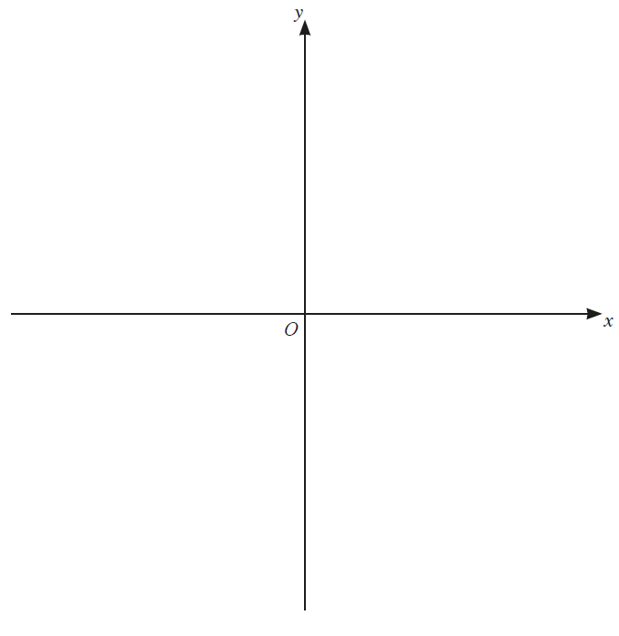
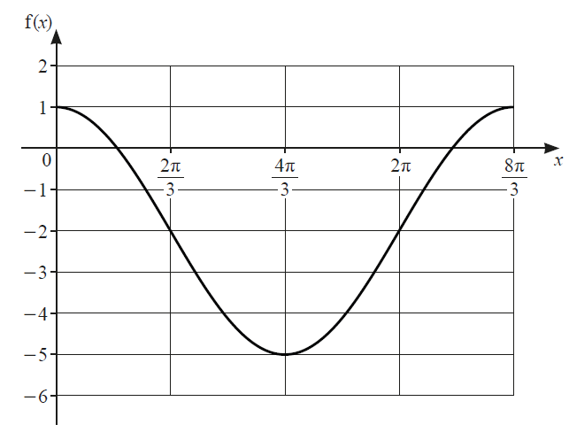
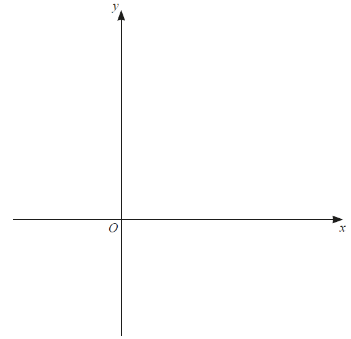
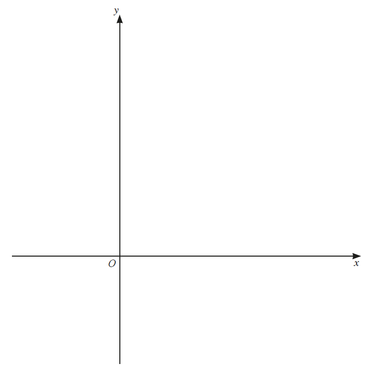
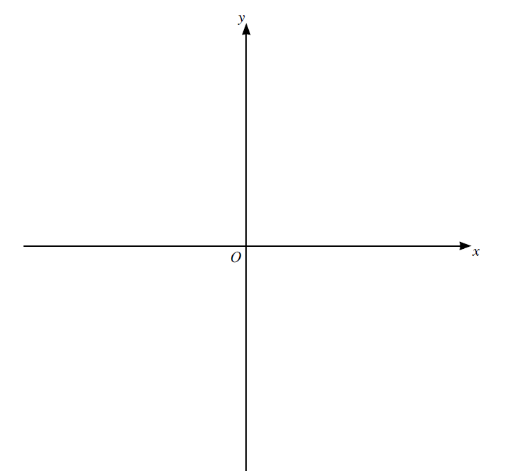

# Exam Questions — Functions
**Algebra & Functions** · Cambridge (CIE) IGCSE further-maths (0606)
> Source: [https://www.savemyexams.com/igcse/further-maths/cie/additional-maths/25/topic-questions/](https://www.savemyexams.com/igcse/further-maths/cie/additional-maths/25/topic-questions/) · 15 questions across 1 sets

## Exam Questions (15 questions)

### Q1 — medium — 5 marks

**Q1** [2 marks]

A curve has the equation $y=5x^{2}-10x+9$.

Write the equation in the form $y = p ( x + q )^{2} + r$ where $p$, $q$ and $r$ are constants to be found.

**Q1** [1 mark]

Hence find the coordinates of the turning point on the curve.

**Q1** [1 mark]

Find the range of the function $\mathrm{f} ( x ) = 5 x^{2} - 10 x + 9$ where $x\inℝ$.

**Q1** [1 mark]

Explain why the inverse function $\mathrm{f}^{- 1} ( x )$ does not exist.

### Q2 — medium — 5 marks

**Q2** [1 mark]

Two functions are given by $\mathrm{f} ( x ) = 1 + 8 x$ where $x\inℝ$ and $\mathrm{g} ( x ) = 2 + \ln x$ where $x>0$.

Find an expression for $\mathrm{f}^{- 1} ( x )$.

**Q2** [1 mark]

State the geometric relationship between the graph of $y = \mathrm{f} ( x )$ and the graph of $y = \mathrm{f}^{- 1} ( x )$.

**Q2** [2 marks]

Find $fg^{2} ( 1 )$.

**Q2** [1 mark]

Explain why the function $gf ( x )$ does not exist.

### Q3 — very_hard — 10 marks

**Q3** [3 marks]

The function$f$ is defined by$f(x)=\mathrm{ln}(2x+1)\mathrm{for}x\geq0$.

Sketch the graph of $y=f(x)$ and hence sketch the graph of $y=f^{-1}(x)$ on the axes below.

*Source: june 2020 0606/21 Q11A*

**Q3** [7 marks]

**Extract:**

The function f is defined by f(x) = ln(2x + 1) for x ≥ 0.

The function $g$ is defined by $g(x)=(x-4)^{2}+1\mathrm{for}x\leq4$.

(i) Find an expression for $g^{-1}(x)$ and state its domain and range.

[4]

(ii) Find and simplify an expression for $\mathrm{fg}(x)$.

[2]

(iii) Explain why the function $\mathrm{gf}$ does not exist.

[1]

*Source: june 2020 0606/21 Q11B*

### Q4 — hard — 5 marks

**Q4** [1 mark]

$f(x)=x^{2}+2x-3\mathrm{for}x\geq-1$

Given that the minimum value of $x^{2}+2x-3$ occurs when $x=-1$, explain why $f(x)$ has an inverse.

*Source: Nov 2020 0606/12 Q6A*

**Q4** [4 marks]

**Extract:**

straight f left parenthesis x right parenthesis space equals space x squared space plus 2 x minus 3 space for space x space greater or equal than negative 1

Given that the minimum value of x squared space plus 2 x minus 3 occurs when x space equals negative 1

On the axes below, sketch the graph of $y=f(x)$ and the graph of $y=f^{-1}(x)$. Label each graph and state the intercepts on the coordinate axes.

*Source: Nov 2020 0606/12 Q6B*

### Q5 — hard — 3 marks

**Q5** [3 marks]

$g(x)=x+5\mathrm{for}x\inℝ$
 $\mathrm{h} ( x ) = \sqrt{2 x - 3} \text{for} x \text{greater} \text{or} \text{equal} \text{than} \frac{3}{2}$

Solve $\mathrm{gh}(x)=7$.

*Source: Nov 2020 0606/13 Q3B*

### Q6 — medium — 2 marks

**Q6** [1 mark]

The diagram shows the graph of $\mathrm{f} ( x ) = a \cos b x + c \text{for} 0 \text{less} \text{or} \text{equal} \text{than} x \text{less} \text{or} \text{equal} \text{than} \frac{8 \pi }{3}$radians. Explain why $f$ is a function.

*Source: March 2020 0606/22 Q8A*

**Q6** [1 mark]

**Extract:**

The diagram shows the graph of f(x) = a cos bx + c for 0 ≤ x ≤ 8π/3 radians.

Write down the range of $f$.

*Source: March 2020 0606/22 Q8B*

### Q7 — medium — 4 marks

**Q7** [4 marks]

$f(x)=4\mathrm{ln}(2x-1)$

(i) Write down the largest possible domain for the function $f$.

[1]

(ii) Find $f^{-1}(x)$ and its domain.

[3]

*Source: Nov 2020 0606/13 Q3A*

### Q8 — medium — 5 marks

**Q8** [5 marks]

$\mathrm{g} ( x ) = 3 + \frac{1}{x} \text{for} x \text{greater} \text{or} \text{equal} \text{than} 1$.

(i) Find an expression for $g^{-1}(x)$.

[2]

(ii) Write down the range of $g^{-1}$.

[1]

(iii) Find the domain of $g^{-1}$.

[2]

*Source: March 2020 0606/22 Q10A*

### Q9 — hard — 9 marks

**Q9** [1 mark]

$\mathrm{f} : x \rightarrow \text{from} \text{bar} ( 2 x + 3 )^{2} \text{for} x > 0$

Find the range of $f$.

*Source: june 2020 0606/12 Q5A*

**Q9** [1 mark]

**Extract:**

f : x → (2x + 3)² for x > 0

Explain why $f$ has an inverse.

*Source: june 2020 0606/12 Q5B*

**Q9** [3 marks]

**Extract:**

f : x → (2x + 3)² for x > 0

Find $f^{-1}$.

*Source: june 2020 0606/12 Q5C*

**Q9** [1 mark]

**Extract:**

straight f space colon space x space rightwards arrow from bar space left parenthesis 2 x plus 3 right parenthesis squared space for space x space greater than space 0

Find the range of straight f.

The range is straight f greater than 9

State the domain of $f^{-1}$.

*Source: june 2020 0606/12 Q5D*

**Q9** [3 marks]

**Extract:**

f : x → (2x+3)² for x > 0

Given that $\mathrm{g} : x \rightarrow \text{from} \text{bar} \ln ( x + 4 ) \text{for} x > 0$, find the exact solution of $\mathrm{fg}(x)=49$.

*Source: june 2020 0606/12 Q5E*

### Q10 — medium — 4 marks

**Q10** [4 marks]

$\mathrm{h} ( x ) = 2 \ln ( 3 x - 1 ) \text{for} x \text{greater} \text{or} \text{equal} \text{than} \frac{2}{3}$. 
The graph of $y=h(x)$ intersects the line $y=x$ at two distinct points. On the axes below, sketch the graph of $y=h(x)$ and hence sketch the graph of $y=h^{-1}(x)$.

*Source: March 2020 0606/22 Q10B*

### Q11 — very_hard — 7 marks

**Q11** [2 marks]

$f(x)=3+e^{x}\mathrm{for}x\inℝ$
 $g(x)=9x-5\mathrm{for}x\inℝ$

Find the range of $f$ and of $g$.

*Source: june 2020 0606/13 Q1A*

**Q11** [3 marks]

**Extract:**

straight f left parenthesis x right parenthesis space equals space 3 plus straight e to the power of x space for space x space element of space straight real numbers

straight g left parenthesis x right parenthesis space equals space 9 x minus 5 space for space x space element of space straight real numbers

Find the exact solution of $f^{-1}(x)=g'(x)$ .

*Source: june 2020 0606/13 Q1B*

**Q11** [2 marks]

**Extract:**

g(x) = 9x - 5 for x ∈ ℝ

Find the solution of $g^{2}(x)=112$.

*Source: june 2020 0606/13 Q1C*

### Q12 — hard — 7 marks

**Q12** [2 marks]

The functions $f$ and $g$ are defined as follows.

$f(x)=x^{2}+4x\mathrm{for}x\inR\,g(x)=1+e^{2x}\mathrm{for}x\inR$

Find the range of $f$.

*Source: june 2021 paper 11 Q5A*

**Q12** [1 mark]

**Extract:**

The functions straight f and straight g are defined as follows.

straight f left parenthesis x right parenthesis space equals space x squared space plus 4 x space space for space space x space element of space R space space
$\mathrm{g} ( x ) = 1 + \mathrm{e}^{2 x} \text{for} x \in R$

Write down the range of $g$.

*Source: june 2021 paper 11 Q5B*

**Q12** [4 marks]

**Extract:**

The functions f and g are defined as follows.

f(x) = x² + 4x for x ∈ R
g(x) = 1 + e^(2x) for x ∈ R

Find the exact solution of the equation $\mathrm{fg}(x)=21$, giving your answer as a single logarithm

*Source: june 2021 paper 11 Q5C*

### Q13 — hard — 3 marks

**Q13** [3 marks]

It is given that $h(x)=a+\frac{b}{x^{2}}$, where $a$ and $b$ are non-zero constants.

(i) Explain why $- 2 \text{less} - \text{than} or \text{slanted} \text{equal} to x \text{less} - \text{than} or \text{slanted} \text{equal} to 2$ is not a suitable domain for $h(x)$.

(ii) Given that $h(1)=4$ and $h'(1)=16$ , find the values of $a$ and $b$.

*Source: Specimen 2025 Paper 1 Q6B*

### Q14 — medium — 9 marks

**Q14** [1 mark]

It is given that $\mathrm{f} ( x ) = 5 \ln ( 2 x + 3 ) \text{for} x > - \frac{3}{2}$.

Write down the range of $f$.

*Source: Nov 2020 0606/11 Q7A*

**Q14** [3 marks]

**Extract:**

It is given that straight f open parentheses x close parentheses equals 5 space ln open parentheses 2 x plus 3 close parentheses space for space x greater than negative 3 over 2.

Find$f^{-1}$ and state its domain.

*Source: Nov 2020 0606/11 Q7B*

**Q14** [5 marks]

**Extract:**

It is given that f(x) = 5 ln(2x + 3) for x > -3/2.

The inverse function is f^(-1)(x) = (e^(x/5) - 3)/2 with domain x ∈ ℝ (all real numbers).

On the axes below, sketch the graph of $y=f(x)$ and the graph of $y=f^{-1}(x)$. Label each curve and state the intercepts on the coordinate axes.

*Source: Nov 2020 0606/11 Q7C*

### Q15 — very_hard — 9 marks

**Q15** [9 marks]

$f(x)=3e^{2x}+1$ for $x\inℝ$
 $g(x)=x+1$ for $x\inℝ$

(i) Write down the range of $f$ and the range of $g$.

(ii) Find$g^{2}(0)$.

(iii) Hence find $\mathrm{fg}^{2}(0)$ .

(iv) On the axes below, sketch the graphs of $y=f(x)$ and $y=f^{--1}(x)$ . State the intercepts with the coordinate axes and the equations of any asymptotes.

*Source: Specimen 2025 Paper 1 Q6A*

