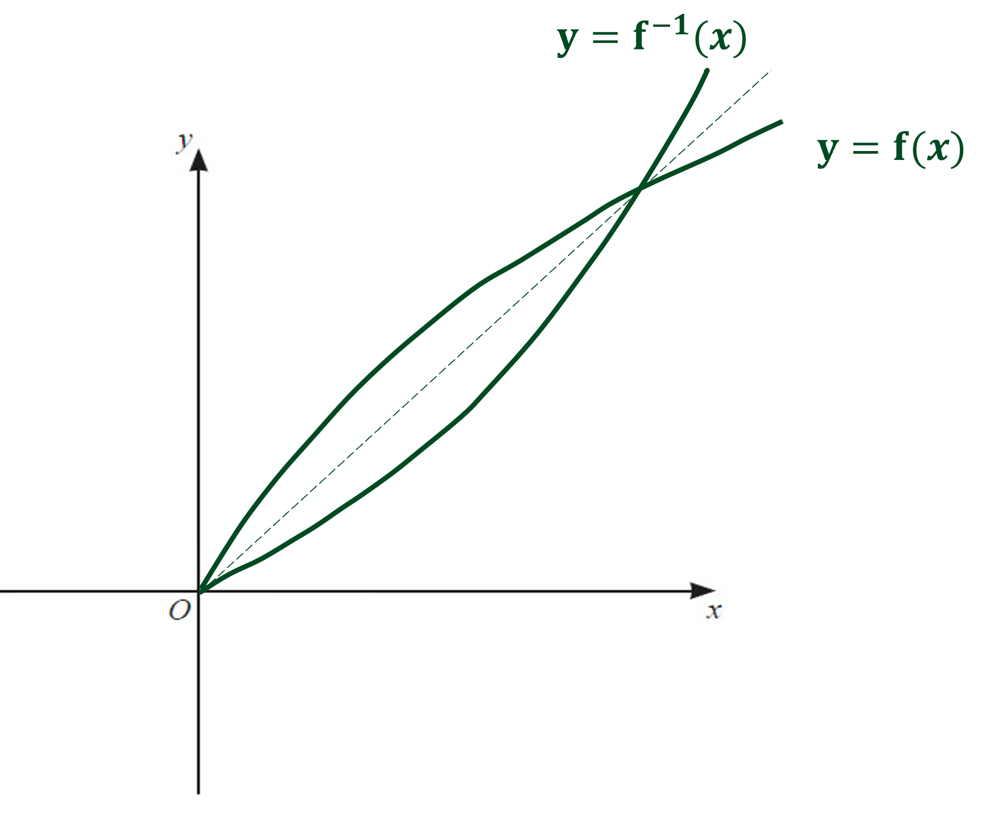

# Mark Schemes — Logarithmic & Exponential Functions
**Algebra & Functions** · Cambridge (CIE) IGCSE further-maths (0606)

## Exam Questions (24 questions)

### Q1
> *Find the midpoint of *`open parentheses 0 comma space 11 close parentheses`* and *`open parentheses 6 comma space 7 close parentheses`

`table row cell open parentheses fraction numerator x subscript 1 plus x subscript 2 over denominator 2 end fraction comma space fraction numerator y subscript 1 plus y subscript 2 over denominator 2 end fraction close parentheses end cell equals cell open parentheses fraction numerator 0 plus 6 over denominator 2 end fraction comma space fraction numerator 11 plus 7 over denominator 2 end fraction close parentheses end cell row blank equals cell open parentheses 6 over 2 comma space 18 over 2 close parentheses end cell row blank equals cell open parentheses 3 comma space 9 close parentheses end cell end table`

**[B1]**

> *Find the gradient of the line from *`open parentheses 0 comma space 11 close parentheses`* to *`open parentheses 6 comma space 7 close parentheses`

`table row cell fraction numerator 7 minus 11 over denominator 6 minus 0 end fraction end cell equals cell negative 4 over 6 end cell row blank equals cell negative 2 over 3 end cell end table`

**[M1]**

> *Find the perpendicular gradient (the negative reciprocal)*

$\frac{3}{2}$

**[A1]**

> *Find the equation of the perpendicular bisector (the line through *`open parentheses 3 comma space 9 close parentheses`* with gradient *$\frac{3}{2}$*)*

`y minus y subscript 1 equals m open parentheses x minus x subscript 1 close parentheses
y minus 9 equals 3 over 2 open parentheses x minus 3 close parentheses
y minus 9 equals 3 over 2 x minus 9 over 2
y equals 3 over 2 x plus 9 over 2`

**[A1]**

> **[exam-tip]**
> A quick check of the graph confirms that this line meant to have a positive gradient and a y-intercept between 4 and 6.

> *Substitute in *$y=\mathrm{ln}P$* and *$x=\mathrm{ln}t$

$\mathrm{ln}P=\frac{3}{2}\mathrm{ln}t+\frac{9}{2}$

**[M1]**

> *Make *$P$* the subject by raising both sides to the power *$e$

$P=e^{\frac{3}{2}\mathrm{ln}t+\frac{9}{2}}$

> *Simplify the answer using index and log laws (and that *$e^{\mathrm{ln}...}$* cancel out)*

$P=e^{\frac{3}{2}\mathrm{ln}t}e^{\frac{9}{2}}\,P=e^{\mathrm{ln}t^{\frac{3}{2}}}e^{\frac{9}{2}}\,P=t^{\frac{3}{2}}e^{\frac{9}{2}}\,P=e^{\frac{9}{2}}t^{\frac{3}{2}}$

$P=e^{\frac{9}{2}}t^{\frac{3}{2}}$

**[A1]**

> **[mark-scheme]**
> Answers which round to $P=90.0t^{\frac{3}{2}}$ are also accepted.

### Q2
> *Multiply both sides by the denominator*

$1+3e^{x}=e^{x}+e^{-x}$

> *This is a hidden quadratic in *$e^{x}$* so let *$u=e^{x}$

> *This means that *$e^{-x}=\frac{1}{e^{x}}=\frac{1}{u}$

$1+3u=u+\frac{1}{u}$

**[M1]**

> **[mark-scheme]**
> This mark is for recognising that it leads to a quadratic and attempting to write the quadratic in the form `a open parentheses blank close parentheses squared plus b open parentheses blank close parentheses plus c equals 0`.

> *Rearrange into a quadratic equation (start by multiplying both sides by *$u$*)*

`u open parentheses 1 plus 3 u close parentheses equals u squared plus 1`

> *Expand and bring terms to one side*

`table row cell u plus 3 u squared end cell equals cell u squared plus 1 end cell row cell 2 u squared plus u minus 1 end cell equals 0 end table`

**[A1]**

> *Solve the quadratic equation, e.g. by factorisation*

`open parentheses 2 u minus 1 close parentheses open parentheses u plus 1 close parentheses equals 0`

**[M1]**

$u=\frac{1}{2}$* or *$u=-1$

> *Substitute *$u=e^{x}$* back into the answers*

$e^{x}=\frac{1}{2}$* or *$e^{x}=-1$

> *The graph *$y=e^{x}$* is always positive so there are no solutions to *$e^{x}=-1$

> *Solve *$e^{x}=\frac{1}{2}$* by taking natural logarithms*

`x equals ln open parentheses 1 half close parentheses`

> *Write this in the form *$p\mathrm{ln}q$* by using log laws*

`x equals ln open parentheses 2 to the power of negative 1 end exponent close parentheses equals negative ln space 2`

$x=-\mathrm{ln}2$

**[A1]**
> *Use the log law *`log open parentheses a b close parentheses equals log space a plus log space b`* for the first term*

`log subscript 2 open parentheses 2 y close parentheses equals log subscript 2 2 plus log subscript 2 y`

> *Use that *$\mathrm{log}_{2}2=1$* and that *$\mathrm{log}_{2}y=c$

`log subscript 2 open parentheses 2 y close parentheses equals 1 plus c`

> *For the second term, apply a change of base using the rule *$\mathrm{log}_{a}b=\frac{1}{\mathrm{log}_{b}a}$

$\mathrm{log}_{y}2=\frac{1}{\mathrm{log}_{2}y}=\frac{1}{c}$

> *Combine the results above*

`log subscript 2 open parentheses 2 y close parentheses minus log subscript y 2 equals 1 plus c minus 1 over c`

**[B1 B1]**

> **[mark-scheme]**
> **B1:** For having at least $1+c$ or $-\frac{1}{c}$ in your answer, or seeing  $\mathrm{log}_{y}2=\frac{1}{c}$.
> 
> **B1: **For having a fully correct final answer in any equivalent form, e.g. $\frac{c+c^{2}-1}{c}$.

### Q3
> *Let *$y=3^{x}$* then *

$3^{2x}=3^{x}\times3^{x}=y^{2}$

$3^{x+1}=3^{x}\times3^{1}=3y$

> *Use the original equation and change the variables*

$3^{2x}-3^{x+1}-4=0$

$y^{2}-3y-4=0$

**[1]**

> *Factorise and solve the quadratic equation*

`open parentheses y plus 1 close parentheses open parentheses y minus 4 close parentheses equals 0`

$y=-1\mathrm{or}y=4$

**[1]**

> *But *$y=3^{x}$* so*

$3^{x}=-1\mathrm{or}3^{x}=4$

**[1]**

> *Solve each equation using the inverse which is *$\mathrm{log}_{3}$

`x equals log subscript 3 open parentheses negative 1 close parentheses space or space x equals log subscript 3 4`

> *The first equation has no solutions so disregard this and our final answer is*

$x=\mathrm{log}_{3}4$ **[1]**

### Q4
> *The key features of the logarithmic graph *$y=\mathrm{ln}x$* are that it has an asymptote at *$x=0$*, a root at *`open parentheses 1 comma space 0 close parentheses`* and does not have any minimum or maximum points.*

> *The function *`straight f open parentheses x close parentheses space equals space ln open parentheses 2 x space plus thin space 1 close parentheses`* has been translated by 1 unit to the left, then stretched in the horizontal direction by a scale factor *$\frac{1}{2}$*, so now passes through *`open parentheses 0 space comma space 0 close parentheses`*. The questions wants a sketch over the domain *$x\geq0$*.*

> *The graph of the inverse function is a reflection in the line *$y=x$*.*

**correct shape of f or f ****-1**** ****[1]**

**for symmetry of f and f**** -1**** in the line y = x**** [1]**

**sketched over the correct domain, x ≥ 0**** [1]**

### Q5
> *In 2010, 10 years have passed, therefore *$t=10$* and we are given *$P=40.$

> *In 2013, 13 years have passed, therefore *$t=13$* and we are given *$P=45.$

> *This means that we can form two equations*

$40=A\timesb^{10}$

$45=A\timesb^{13}$

**[1]**

> *Solving these simultaneously by dividing the second equation by the first gives*

$\frac{45}{40}=b^{3}$

**[1]**

> *Taking the cube root of both sides gives*

$1.04004...=b$

> *Rounding this to two decimal places, as required, gives*

$1.04=b$

**[1]**

> *Substituting this in to the first equation*

`40 space equals space A space cross times space open parentheses 1.04... close parentheses to the power of 10`

> *Dividing both sides by *$1.04^{10}$* and rounding to the nearest integer gives*

$A=27$ **[1]**
> *In 2020, 20 years have passed so *$t=20$*. Substituting this and the rounded answers to part (a) we have*

$P=27\times1.04^{20}$

$P=59$ **[1]**
> *We can use the information to form and solve an inequality in *$t$

$27\times1.04^{t}>100$

**[1]**

> *Dividing both sides by 27*

$1.04^{t}>\frac{100}{27}$

> *Taking logs of both sides*

$\mathrm{log}1.04^{t}>\mathrm{log}\frac{100}{27}$

> *Applying the log law *$\mathrm{log}a^{b}=b\mathrm{log}a$

$t\mathrm{log}1.04>\mathrm{log}\frac{100}{27}$

> *Dividing both sides by *$\mathrm{log}1.04$

$t>33.38...$

**[1]**

> *We know that *$t$* represents the number of years after 2000, therefore it will be 34 years before the population exceeds 100 million for the first time if the data is collected in January only. *

$2034$ **[1]**

### Q6
$\mathrm{log}_{a}\sqrt{b}-\frac{1}{2}=\mathrm{log}_{b}a$

> *Rewrite the square root as a power*

$\mathrm{log}_{a}b^{\frac{1}{2}}-\frac{1}{2}=\mathrm{log}_{b}a$

> *Bring down the *$\frac{1}{2}$* *

$\frac{1}{2}\mathrm{log}_{a}b-\frac{1}{2}=\mathrm{log}_{b}a$

**[1]**

> *Change the base of the log on the right hand side *

$\frac{1}{2}\mathrm{log}_{a}b-\frac{1}{2}=\frac{1}{\mathrm{log}_{a}b}$

**[1]**

> *Multiply through by 2*

$\mathrm{log}_{a}b-1=\frac{2}{\mathrm{log}_{a}b}$

> *Multiply through by *$\mathrm{log}_{a}b$

`open parentheses log subscript a b close parentheses squared minus log subscript a b equals 2`

> *Make the equation equal to 0*

`open parentheses log subscript a b close parentheses squared minus log subscript a b minus 2 equals 0`

**[1]**

> *Factorise the quadratic equation*

`open parentheses log subscript a b minus 2 close parentheses open parentheses log subscript a b plus 1 close parentheses equals 0`

**[1]**

> *Find the solutions*

*Either* $\mathrm{log}_{a}b=2$ *or *$\mathrm{log}_{a}b=-1$* *

> *Make **b** the subject*

* *$\mathrm{log}_{a}b=2$* leads to *$a^{2}=b$ $\mathrm{log}_{a}b=-1$* leads to *$a^{-1}=b$

$b=a^{2}\mathrm{or}b=\frac{1}{a}$ **[1]**

### Q7
> *When *$t=0,b=500$

> *Substitute the above values into the equation*

`500 equals P plus Q straight e to the power of 2 open parentheses 0 close parentheses end exponent`

> *Simplify*

*(1)   **  *$500=P+Q$

> *When *$t=1,b=600$

> *Substitute the above values into the equation*

`600 equals P plus Q straight e to the power of 2 open parentheses 1 close parentheses end exponent`

> *Simplify*

*(2)   ** *$600=P+Qe^{2}$

**[1]**

> *Solve equations (1) and (2) simultaneously by subtracting (1) from (2)*

$100=Qe^{2}-Q$

**[1]**

> *Factorise out *$Q$

`100 equals Q open parentheses straight e squared minus 1 close parentheses`

> *Divide both sides by *`open parentheses straight e squared minus 1 close parentheses`

`Q equals fraction numerator 100 over denominator straight e squared minus 1 end fraction equals 15.651... equals 15.7 space open parentheses 3 sf close parentheses`

**[1]**

> *Find *$P$* by substituting *$Q$* into equation (1)*

`P equals 500 minus 15.65... equals 484.34... equals 484 space open parentheses 3 sf close parentheses`

$P=484,Q=15.7$ **[1]**
> *From part (a), the model is *$b=484.3...+15.65e^{2t}$

> *When 2 weeks has passed, *$t=2$

> *Substitute *$t=2$* into the equation to find *$b$

`b equals 484.34... plus 15.65... cross times straight e to the power of 2 open parentheses 2 close parentheses end exponent equals 1338.90...`

$1338$ **[1]**

> **[mark-scheme]**
> Accept 1338 to 1340 to allow for rounding of $P$ and $Q$.
> *Make an inequality for when the bacteria is greater than 1 000 000*

$484.3...+15.65...e^{2t}>1000000$

> *Solve for *$t$

$15.65...e^{2t}>999515.7$

$e^{2t}>\frac{999515.7}{15.65...}$

**[1]**

> *Take natural logs of both sides*

`2 t greater than ln open parentheses fraction numerator 999 space 515.7 over denominator 15.65... end fraction close parentheses`

**[1]**

> *Divide by 2*

`t greater than 1 half ln open parentheses fraction numerator 999 space 515.7 over denominator 15.65... end fraction close parentheses`

$t>5.532...$

> *Find the first integer which is greater than 5.532...*

**6th week**** ****[1]**

### Q8
> *The first equation is *`log subscript 3 open parentheses x plus y close parentheses equals 2`

> *Use the inverse of *$\mathrm{log}_{3}$* which is doing 3 to the power of both sides*

$x+y=3^{2}$

* (1)**      *$x+y=9$

**[1]**

> *The second equation is *`2 log subscript 3 open parentheses x plus 1 close parentheses equals log subscript 3 open parentheses y plus 2 close parentheses`

> *Move the 2 from in front to be a power*

`log subscript 3 open parentheses x plus 1 close parentheses squared equals log subscript 3 open parentheses y plus 2 close parentheses`

> *Use the inverse of *$\mathrm{log}_{3}$* which is doing 3 to the power of both sides*

`open parentheses x plus 1 close parentheses squared equals y plus 2`

**[1]**

> *Subtract 2 from both sides to make *$y$* the subject *

*(2)  **    *`y equals open parentheses x plus 1 close parentheses squared minus 2`

> *Solve equations (1) and (2) simultaneously by substituting equation (2) into equation (1)*

`x plus open parentheses x plus 1 close parentheses squared minus 2 equals 9`

**[1]**

> *Expand the double bracket*

$x+x^{2}+x+x+1-2=9$

> *Simplify the left hand side*

$x^{2}+3x-1=9$

> *Subtract 9 from both sides to make the quadratic equal 0*

$x^{2}+3x-10=0$

**[1]**

> *Solve by factorising (or using the quadratic formula)*

`open parentheses x plus 5 close parentheses open parentheses x minus 2 close parentheses equals 0`

$x=-5\mathrm{or}x=2$

**[1]**

> *Find *$y$* by substituting each value into equation (1)*

*When *$x=-5$

`y equals 9 minus open parentheses negative 5 close parentheses equals 14`

*Reject this as we cannot have* `log subscript 3 open parentheses negative close parentheses`

*When* $x=2$

$y=9-2=7$

$x=2\mathrm{and}y=7$ **[1]**

### Q9
> *Rearrange the first equation.*

`log subscript 2 open parentheses y plus 1 close parentheses plus 2 log subscript 2 x equals 3`

> *Rewrite using logarithm laws.*

`log subscript 2 open parentheses y plus 1 close parentheses plus log subscript 2 x squared equals 3`

> *Combine using logarithm laws.*

`log subscript 2 open parentheses open parentheses y plus 1 close parentheses open parentheses x squared close parentheses close parentheses equals 3`

> *Rewrite using logarithm laws.*

`open parentheses y plus 1 close parentheses open parentheses x squared close parentheses equals 2 cubed
open parentheses y plus 1 close parentheses open parentheses x squared close parentheses equals 8`

**[1]**

> *Rearrange the second equation.*

`log subscript 2 open parentheses x plus 2 close parentheses minus log subscript 2 y equals 2`

> *Rewrite using logarithm laws.*

`log subscript 2 open parentheses fraction numerator x plus 2 over denominator y end fraction close parentheses equals 2`

> *Rewrite using logarithm laws.*

`table row cell fraction numerator x plus 2 over denominator y end fraction end cell equals cell 2 squared end cell row blank blank blank row cell x plus 2 end cell equals cell 4 y end cell end table`

**[1]**

> *Solve the two equations *`open parentheses y plus 1 close parentheses open parentheses x squared close parentheses equals 8`* and *$x+2=4y$* simultaneously. For example, by rearranging the second equation and using a substitution method.*

$y=\frac{x+2}{4}$

> *Substitute into the first equation.*

`open parentheses x squared close parentheses open parentheses fraction numerator x plus 2 over denominator 4 end fraction plus 1 close parentheses equals 8`

**[1]**

> *Expand the brackets.*

`table row cell fraction numerator open parentheses x squared close parentheses open parentheses x plus 2 close parentheses over denominator 4 end fraction plus x squared end cell equals 8 row blank blank blank row cell fraction numerator x cubed plus 2 x squared over denominator 4 end fraction plus x squared end cell equals 8 end table`

> *Multiply through by 4.*

$x^{3}+2x^{2}+4x^{2}=32$

> *  *

> *Simplify and rearrange to write in the form specified in the question.*

$x^{3}+6x^{2}=32$

$x^{3}+6x^{2}-32=0$* ***[1]**
`straight f open parentheses x close parentheses equals x cubed plus 6 x squared minus 32`

> *Use factor theorem to identify one of the roots.*

> *Since *`straight f open parentheses 2 close parentheses equals 0`*, one of the roots of the polynomial is:*

$x=2$

> *This means that one of the factors of the polynomial is:*

`open parentheses x minus 2 close parentheses`

**[1]**

> *Use algebraic (polynomial) division to find the quadratic factor.*

`long division by x minus 2 yields none x squared none plus 8 x none plus 16 none pile none x cubed none plus 6 x to the power of 2 space end exponent plus none 0 x none minus 32 none x cubed minus none 2 x squared none none none none none none none none none none minus horizontal line none none none none 8 x squared none minus none 0 x none none none none none none 8 x squared none minus none 16 x none none none none minus horizontal line none none none none none none none none none 16 x minus 32 none none none none none none none none none 16 x minus 32 none minus horizontal line none none none none none none none none none none none none none none 0 end pile end long division`

**[1]**

> *Therefore,*

`x cubed plus 6 x squared minus 32 space equals space open parentheses x minus 2 close parentheses open parentheses x squared plus 8 x plus 16 close parentheses`

** correct quadratic factor ****[1]**

> *Factorise *$x^{2}+8x+16$*.*

`open parentheses x plus 4 close parentheses open parentheses x plus 4 close parentheses`

> *Therefore,*

`x cubed plus 6 x squared minus 32 space equals space open parentheses x minus 2 close parentheses open parentheses x plus 4 close parentheses squared`

> *  *

> *The roots to the equation *$x^{3}+6x^{2}-32=0$* are:*

$x=2,x=-4,x=-4$* ***[1]**
> *When *$x=-4$*, *$\mathrm{log}_{2}x$* and *`log subscript 2 space open parentheses x plus 2 close parentheses`* will be:*

`log subscript 2 space open parentheses negative 4 close parentheses`* **and** *`log subscript 2 space open parentheses negative 4 plus 2 close parentheses`

> *We cannot take the logarithm of a negative number.*

**There is no real value for **$\mathrm{log}_{2}(-4)$** and **$\mathrm{log}_{2}(-2)$**  ****[1]**

> *Therefore, the only root is *$x=2$*.*

> *Substitute *$x=2$* into *`log subscript 2 open parentheses y plus 1 close parentheses equals 3 minus 2 log subscript 2 x`

`log subscript 2 open parentheses y plus 1 close parentheses equals 3 minus 2 log subscript 2 open parentheses 2 close parentheses`

`log subscript 2 open parentheses y plus 1 close parentheses equals 1`

> *Since *$\mathrm{log}_{2}2=1$

$y+1=2$

$y=1$*  ***[1]**

### Q10
> *Take the natural logarithm of both sides.*

`ln space y equals ln open parentheses A x to the power of n close parentheses`

> *Use logarithm laws to rewrite.*

$\mathrm{ln}y=\mathrm{ln}A+\mathrm{ln}x^{n}$

**[1]**

> *Use the logarithm power rule to rewrite in the form *$Y=mX+c$

$\mathrm{ln}y=n\mathrm{ln}x+\mathrm{ln}A$* ***[1]**
> *The equation from part *$a$* is in the form *$Y=mX+c$*, therefore the gradient is *$n$* and the *$y$* intercept is *$\mathrm{ln}A$*.*

> *The coordinate *`open parentheses 0 comma space 0.5 close parentheses`* tells us that the *$y$* intercept of the line is *$0.5$*.*

> *Therefore,*

$\mathrm{ln}A=0.5$

**[1]**

> *Exponentiate both sides and simplify.*

`table row cell straight e to the power of ln space A end exponent end cell equals cell straight e to the power of 0.5 end exponent end cell row A equals cell straight e to the power of 0.5 end exponent end cell end table`

$A=e^{0.5}$* ***[1]**

$A=1.65$**to 3sf  is also accepted**

> *To find the gradient of the line when we know two coordinates, *$\frac{y_{2}-y_{1}}{x_{2}-x_{1}}$*. This is equal to *$n$*.*

> *   *

$n=\frac{1.7-0.5}{3.2-0}$

**[1]**

$n=\frac{3}{8}$** [1]**
> *Substitute *$A=e^{0.5}$* and *$n=\frac{3}{8}$* into *$y=Ax^{n}$*.*

`table row cell space y end cell equals cell x to the power of 3 over 8 end exponent cross times straight e to the power of 0.5 end exponent end cell end table`

> *  *

> *Substitute the value of *$x$* into the equation to find the value of *$y$*.*

`y equals open parentheses 11 close parentheses to the power of 3 over 8 end exponent cross times straight e to the power of 0.5 end exponent equals 4.0520...`

**[1]**

$y=4.05$* ***[1]**

### Q11
> *All the logs have the same base, *$a$* *
*Use the laws of logarithms to write the three terms on the left hand side as one term*

`table row cell log subscript a space end subscript p plus log subscript a 5 minus log subscript a 4 end cell equals cell log subscript a 20 end cell row cell log subscript a open parentheses 5 p close parentheses minus log subscript a 4 end cell equals cell log subscript a 20 end cell row cell log subscript a open parentheses fraction numerator 5 p over denominator 4 end fraction close parentheses end cell equals cell log subscript a 20 end cell end table`

**[1]**

> *Therefore we can eliminate the logs to leave*

$\frac{5p}{4}=20$

> *Now solve for **p **(Multiply both sides by 4)*

$5p=80$

> *(Divide both sides by 5)*

$p=16$ **[1]**

### Q12
> *Calculate the gradient between (6, 7) and (10, 9)*

$\mathrm{gradient}=\frac{9-7}{10-6}$

$\mathrm{gradient}=\frac{1}{2}$

**[1]**

> *Calculate the **y**-intercept of the line using the gradient and the point (6, 7) *

`7 equals open parentheses 1 half cross times 6 close parentheses plus c`

$c=4$

**[1]**

> *Using *$y=mx+c$* the equation will be*

$\mathrm{lg}y=\frac{1}{2}x^{3}+4$

**[1]**

> *Taking the exponential function of both sides we get*

$y=10^{\frac{1}{2}x^{3}+4}$** [1]**

### Q13
> *Taking logs of both sides of each equation*

$\mathrm{lg}10^{x+2y}=\mathrm{lg}5$

$\mathrm{lg}10^{3x+4y}=\mathrm{lg}50$

> $\mathrm{lg}10=1$*, therefore*

$x+2y=\mathrm{lg}5$

$3x+4y=\mathrm{lg}50$

**[1]**

> *Multiplying the first equation by 2 gives*

$2x+4y=2\mathrm{lg}5$

> *Subtracting this from the second equation gives *

$x=\mathrm{lg}50-2\mathrm{lg}5$

**[1]**

> *Using the log laws that *$a\mathrm{log}b=\mathrm{log}b^{a}$* and *$\mathrm{log}m-\mathrm{log}n=\mathrm{log}\frac{m}{n}$

$x=\mathrm{lg}50-\mathrm{lg}25=\mathrm{lg}2$

**[1]**

> *Substituting this into the equation *$x+2y=\mathrm{lg}5$

$\mathrm{lg}2+2y=\mathrm{lg}5$

$2y=\mathrm{lg}\frac{5}{2}$

$x=\mathrm{lg}2,y=\frac{1}{2}\mathrm{lg}\frac{5}{2}$ **[1]**

### Q14
> *Rewrite the question using index laws so the powers are *$2^{x}$

`table row cell open parentheses 2 to the power of 1 close parentheses open parentheses 2 to the power of 2 x end exponent close parentheses minus open parentheses 2 to the power of 1 close parentheses open parentheses 2 to the power of x close parentheses minus open parentheses 2 to the power of x close parentheses plus 1 end cell equals 0 row cell open parentheses 2 close parentheses open parentheses 2 to the power of x close parentheses squared minus open parentheses 2 close parentheses open parentheses 2 to the power of x close parentheses minus open parentheses 2 to the power of x close parentheses plus 1 end cell equals 0 end table`

*Substitute *$y=2^{x}$ *into the equation.*

`table attributes columnalign right center left columnspacing 0px end attributes row cell 2 y squared minus 2 y minus y plus 1 end cell equals 0 row cell 2 y squared minus 3 y plus 1 end cell equals 0 end table`

**[1]**

> *Factorise.*

`open parentheses 2 y minus 1 close parentheses open parentheses y minus 1 close parentheses equals 0`

> *Solve for *$y$*.*

$y=\frac{1}{2}$* **and *$y=1$

**[1]**

> *Substitute *$y=2^{x}$* into the solutions.*

$2^{x}=\frac{1}{2}$* and *$2^{x}=1$

> *Using index laws, solve for *$x$*.*

$x=-1$* ***[1]**

* *$x=0$** [1]**

### Q15
> *Multiply both sides by *$27^{x-2}$

$9^{5x}=243\times27^{x-2}$

> *Write each term as a power of 3 (change the base to 3)*

`open parentheses 3 squared close parentheses to the power of 5 x end exponent equals 3 to the power of 5 cross times open parentheses 3 cubed close parentheses to the power of x minus 2 end exponent`

> *Simplify each term using index laws*

$3^{10x}=3^{5}\times3^{3x-6}$

> *Divide both sides by *$3^{5}$

$\frac{3^{10x}}{3^{5}}=3^{3x-6}$

**[1]**

> *Simplify the left hand side*

$3^{10x-5}=3^{3x-6}$

**[1]**

> *The powers on each side of the equation must be equal (*$3^{a}=3^{b}\mathrm{means}a=b$*) so*

$10x-5=3x-6$

> *Solve the equation to find *$x$

$7x-5=-6$

$7x=-1$

$x=-\frac{1}{7}$

$x=-\frac{1}{7}$ **[1]**

### Q16
> *In order to apply log laws, each term must be in terms of logs. We can write 2 as *$\mathrm{lg}100$* because *$10^{2}=100$* and *$\mathrm{lg}$* means base 10.  Therefore we have*

$3\mathrm{lg}x+\mathrm{lg}100-\mathrm{lg}y$

**[1]**

> *Applying the log law *$a\mathrm{log}b=\mathrm{log}b^{a}$

$\mathrm{lg}x^{3}+\mathrm{lg}100-\mathrm{lg}y$

> *Applying the log law *$\mathrm{log}a+\mathrm{log}b=\mathrm{log}ab$* *

$\mathrm{lg}100x^{3}-\mathrm{lg}y$

**[1]**

> *Applying the log law *`log a space minus space log b space equals space log open parentheses a over b close parentheses`

$\mathrm{lg}(\frac{100x^{3}}{y})$** [1]**

### Q17
> *We have two logs with different bases so we need to change them to the same base. Here we will change them both to log**2** but you could also change to log**y **and then use a similar method with a quadratic equation in log**y*

> *If you don't recognise log**2**y** as 1/(log**y**2) then use the change of base rule, *$\mathrm{log}_{x}y=\frac{\mathrm{log}_{a}y}{\mathrm{log}_{a}x}$

$\mathrm{log}_{y}2=\frac{\mathrm{log}_{2}2}{\mathrm{log}_{2}y}=\frac{1}{\mathrm{log}_{2}y}$

**or writing **$\mathrm{log}_{2}y$** as**** **$\frac{1}{\mathrm{log}_{y}2}$**[1]**

> *Now rewrite the equation in terms of log**2*

$\frac{4}{\mathrm{log}_{2}y}+\mathrm{log}_{2}y=4$

> *Multiply all terms by log**2**y** to form a quadratic equation in log**2**y*

`4 plus open parentheses log subscript 2 space end subscript y close parentheses squared equals 4 log subscript 2 y`

> *If you like, replace log**2**y** with a letter, like **x**, and rearrange to an equation equalling 0*

`table row cell 4 plus x squared end cell equals cell 4 x end cell row cell x squared minus 4 x plus 4 end cell equals 0 end table`

> *Factorise and solve*

`table row cell x squared minus 4 x plus 4 end cell equals 0 row cell open parentheses x minus 2 close parentheses squared end cell equals 0 row x equals 2 end table`

> *Remember that **x** = log**2**y** therefore*

`table row cell log subscript 2 space end subscript y end cell equals 2 end table`

**or " **$\mathrm{log}_{y}2=\frac{1}{2}$**" using similar method**** [1]**

> *Rewrite in exponent form*

`table attributes columnalign right center left columnspacing 0px end attributes row cell 2 squared end cell equals y end table`

$y=4$** [1]**

### Q18
> *Find the gradient using *$m=\frac{y_{2}-y_{1}}{x_{2}-x_{1}}$

$m=\frac{9-5}{8-6}=2$

**[1]**

> *Substitute one of the points and the gradient into **Y** = m**X** + **c** and solve to find **c*

`5 equals 2 open parentheses 6 close parentheses plus c`

**[1]**

$c=-7$

> *The equation of a straight line in terms of *$\mathrm{ln}y$* and *$\mathrm{ln}x$* is *$\mathrm{ln}y=m\mathrm{ln}x+c$

$\mathrm{ln}y=2\mathrm{ln}x-7$

**[1]**

> *Rewrite *$\mathrm{ln}y$* as a power of **e*

$y=e^{2\mathrm{ln}x-7}$

> *And rearrange using laws of logs and exponents. Remember that *$e^{\mathrm{ln}x}=x$

`table row y equals cell straight e to the power of ln x squared minus 7 end exponent end cell row blank equals cell straight e to the power of ln x squared end exponent straight e to the power of negative 7 end exponent end cell row blank equals cell x squared straight e to the power of negative 7 end exponent end cell end table`

$y=e^{-7}x^{2}$ **[1]**

### Q19
> *Change the base of *$2\mathrm{log}_{4}y$* so it has a base of 2 like the other term in the equation.*

$\mathrm{log}_{4}y=\frac{\mathrm{log}_{2}y}{\mathrm{log}_{2}4}\,\mathrm{log}_{4}y=\frac{\mathrm{log}_{2}y}{2}$

> *Therefore,*

$2\mathrm{log}_{4}y=\mathrm{log}_{2}y$

**[1]**

> *Substitute into the given equation.*

$\mathrm{log}_{2}x+\mathrm{log}_{2}y=8$

> *Use logarithms laws to combine the left hand side.*

`log subscript 2 open parentheses x y close parentheses equals 8`

**[1]**

> *Rearrange and solve for *$xy$*.*

$xy=2^{8}$

$xy=256$* ***[1]**

### Q20
> *The trick here is to recognise that *`3 to the power of 2 x plus 1 end exponent equals 3 to the power of 2 x end exponent cross times 3 to the power of 1 equals open parentheses 3 to the power of x close parentheses squared cross times 3`*, so we could rewrite '*`3 to the power of 2 x minus 1 end exponent plus 8 open parentheses 3 to the power of x close parentheses minus 3 equals 0`*' as *

`3 open parentheses 3 to the power of x close parentheses squared plus 8 open parentheses 3 to the power of x close parentheses minus 3 equals 0`

> *Now we can recognise that we have a quadratic equation in '*$3^{x}$*'. If you like, replace '*$3^{x}$*' with a letter, like *$y$

$3y^{2}+8y-3=0$

> *Factorise this*

`open parentheses 3 y minus 1 close parentheses open parentheses y plus 3 close parentheses equals 0`

** [1]**

> *And solve to find *$y$* (or *$3^{x}$*)*

$y=\frac{1}{3},y=-3$

> *Remember that a number to the power of something can't be negative therefore*

$3^{x}=\frac{1}{3},3^{x}\neq-3$

**[1]**

> *If necessary, rewrite *$\frac{1}{3}$* as a power of 3*

$3^{x}=3^{-1}$

$x=-1$** [1]**

### Q21
> *Change the base of *$\mathrm{log}_{\sqrt{b}}9a$* to base *$a$*.*

$\frac{\mathrm{log}_{a}9a}{\mathrm{log}_{a}\sqrt{b}}$

**[1]**

> *Use the logarithm power law to rewrite the denominator.*

`fraction numerator log subscript a 9 a over denominator open parentheses begin display style 1 half end style close parentheses log subscript a b end fraction`

> *Use the addition/multiplication law to rewrite the numerator.*

`fraction numerator log subscript a 9 plus log subscript a a over denominator open parentheses begin display style 1 half end style close parentheses log subscript a b end fraction`

**[1]**

$\mathrm{log}_{a}a=1$

`fraction numerator open parentheses log subscript a 9 close parentheses plus 1 over denominator open parentheses 1 half close parentheses log subscript a b end fraction`

**[1]**

> *Substitute into original equation.*

`log subscript a 9 plus open parentheses log subscript a b close parentheses open parentheses fraction numerator open parentheses log subscript a 9 close parentheses plus 1 over denominator open parentheses begin display style 1 half end style close parentheses log subscript a b end fraction close parentheses`

> *Simplify.*

`log subscript a 9 plus open parentheses fraction numerator open parentheses log subscript a 9 close parentheses plus 1 over denominator open parentheses begin display style 1 half end style close parentheses end fraction close parentheses`

`log subscript a 9 plus 2 open parentheses log subscript a 9 close parentheses plus 2`

$2+3\mathrm{log}_{a}9$* ***[1]**

### Q22
i) *Since we cannot take the logarithm of a negative number, both *`open parentheses x plus 3 close parentheses`* and *`open parentheses 2 x minus 1 close parentheses`* must be greater than 0. If *$2x-1>0$* then*$x>\frac{1}{2}$* .*

> * *

**This ensures the argument of both logarithms is greater than 0 ****[1]**

ii) *Multiply both sides by *`log subscript a open parentheses y plus 3 close parentheses`*  *

> `log subscript a 6 equals 2 space log subscript a open parentheses y plus 3 close parentheses`*   *

> *Use the logarithm power rule to rewrite.  *

`log subscript a 6 equals log subscript a open parentheses y plus 3 close parentheses squared`

**[1]**

> *Remove logarithms.  *

`6 equals open parentheses y plus 3 close parentheses squared`

**[1]**

> *Solve.   *

$\pm\sqrt{6}=y+3$

> $y=-3\pm\sqrt{6}$*  *

> `open parentheses y plus 3 close parentheses greater or equal than 0`*, therefore *$y$*cannot equal *$-3-\sqrt{6}$*   *

$y=-3+\sqrt{6}$** [1]**

### Q23
$y=A\times10^{bx^{2}}$

> *Take logarithms of both sides.*

`lg space y equals lg space open parentheses A cross times 10 to the power of b x squared end exponent close parentheses`

> *Use logarithm laws to rewrite.*

$\mathrm{lg}y=\mathrm{lg}A+bx^{2}$

$\mathrm{lg}y=bx^{2}+\mathrm{lg}A$

**[1]**

> *Find the gradient between the two coordinates.*

$m=\frac{6.88-5.25}{4.83-3.63}\,m=1.3583...$

> *  *

> *Substitute *$m=1.36$*, *$X=x^{2}$* and *`y equals lg open parentheses y close parentheses`* into the equation of a line *`open parentheses Y equals m X plus c close parentheses`*.*

> * *

$\mathrm{lg}y=1.358x^{2}+\mathrm{lg}A$

> *Compare to *$\mathrm{lg}y=bx^{2}+\mathrm{lg}A$

$b=1.358$

> *  *

> *Substitute *$b=1.358$* and one of the coordinates into *$Y=mX+c$* to find the value of *$c$*.*

> *  *

> *  *`table row cell 5.25 end cell equals cell 1.358 open parentheses 3.63 close parentheses plus c end cell row blank blank blank row c equals cell 0.32046 end cell end table`

> *Compare to *$\mathrm{lg}y=bx^{2}+\mathrm{lg}A$

$\mathrm{lg}A=0.32046$

> *Solve by raising 10 to the power of both sides.*

$A=10^{0.32046}\,A=2.0915...$

$A=2.09$* ***[1]**

$b=1.36$* ***[1]**
> *Substitute *$A=2.09$* and *$b=1.36$* into *$y=A\times10^{bx^{2}}$

$y=2.09\times10^{1.36x^{2}}$

*Substitute* $x=2$ *into the equation.*

`y equals 2.09 cross times 10 to the power of open parentheses 1.36 close parentheses open parentheses 2 close parentheses squared end exponent`

**[1]**

> *Solve for *$y$*.*

$y=575633.799$

$y=576000$* ***[1]**

**answers in the range 553000 to 576000 are accepted**
> *Substitute *$y=4$* into *$y=2.09\times10^{1.36x^{2}}$

$4=2.09\times10^{1.36x^{2}}$

**[1]**

> *Rearrange.*

$\frac{4}{2.09}=10^{1.36x^{2}}$

> *Take logarithms of both sides.*

`lg open parentheses fraction numerator 4 over denominator 2.09 end fraction close parentheses equals 1.36 x squared`

> *Solve for *$x$*.*

`x squared equals fraction numerator lg open parentheses fraction numerator 4 over denominator 2.09 end fraction close parentheses over denominator 1.36 end fraction

x equals square root of fraction numerator lg open parentheses fraction numerator 4 over denominator 2.09 end fraction close parentheses over denominator 1.36 end fraction end root`

$x=0.455$* ***[1]**

**answers which round to 0.46 are accepted**

### Q24
> *Work out the inverse of *`straight f open parentheses x close parentheses`*.*

`table row y equals cell 3 plus straight e to the power of x end cell row cell y minus 3 end cell equals cell straight e to the power of x end cell row cell ln open parentheses y minus 3 close parentheses end cell equals x end table`

> *Switch *$x$* and *$y$* to find the inverse function.*

`table attributes columnalign right center left columnspacing 0px end attributes row y equals cell ln open parentheses x minus 3 close parentheses end cell row blank blank blank row cell straight f to the power of negative 1 end exponent open parentheses x close parentheses end cell equals cell ln open parentheses x minus 3 close parentheses end cell end table`

**[1]**

> *Differentiate *`straight g open parentheses x close parentheses`*.*

`straight g apostrophe open parentheses x close parentheses equals 9`

> *Put *`straight f to the power of negative 1 end exponent open parentheses x close parentheses`* and *`straight g apostrophe open parentheses x close parentheses`* equal to each other, exponentiate both sides and solve.*

`table row cell ln open parentheses x minus 3 close parentheses end cell equals 9 row cell x minus 3 end cell equals cell straight e to the power of 9 end cell end table`

** ****[1]**

$x=e^{9}+3$* ***[1]**
