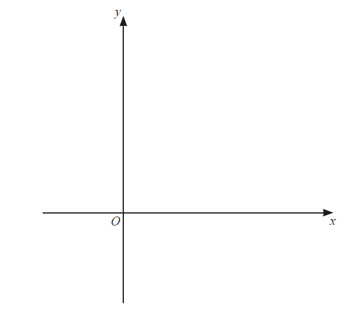

# Exam Questions — Logarithmic & Exponential Functions
**Algebra & Functions** · Cambridge (CIE) IGCSE further-maths (0606)
> Source: [https://www.savemyexams.com/igcse/further-maths/cie/additional-maths/25/topic-questions/](https://www.savemyexams.com/igcse/further-maths/cie/additional-maths/25/topic-questions/) · 24 questions across 1 sets

## Exam Questions (24 questions)

### Q1 — hard — 6 marks

**Q1** [6 marks]

A mathematical model is used to predict the population of an island, $P$, over time, $t$ years.

A plot of $\mathrm{ln}P$ against $\mathrm{ln}t$ gives a straight line that is the **perpendicular bisector **of the points $( 0 , 11 )$ and $( 6 , 7 )$, as shown.

Find and simplify a formula for $P$ in terms of $t$.

### Q2 — medium — 6 marks

**Q2** [4 marks]

Solve the following equation.

$\frac{1+3e^{x}}{e^{x}+e^{-x}}=1$

Give your answer(s) in the form $p\mathrm{ln}q$ where $p$ and $q$ are integers.

**Q2** [2 marks]

Given that $\mathrm{log}_{2}y=c$, express $log_{2} ( 2 y ) - log_{y} 2$ in terms of $c$ only.

### Q3 — very_hard — 4 marks

**Q3** [4 marks]

Find the exact solution of $3^{2x}-3^{x+1}-4=0$.

*Source: March 2020 0606/22 Q3*

### Q4 — medium — 3 marks

**Q4** [3 marks]

The function$f$ is defined by$f(x)=\mathrm{ln}(2x+1)\mathrm{for}x\geq0$.

Sketch the graph of $y=f(x)$ and hence sketch the graph of $y=f^{-1}(x)$ on the axes below.

*Source: june 2020 0606/21 Q11A*

### Q5 — hard — 8 marks

**Q5** [4 marks]

The population $P$, in millions, of a country is given by $P=A\timesb^{t}$, where $t$ is the number of years after January 2000 and $A$ and $b$ are constants. In January 2010 the population was 40 million and had increased to 45 million by January 2013.

Show that $b=$1.04 to 2 decimal places and find $A$ to the nearest integer.

*Source: Nov 2020 0606/21 Q8A*

**Q5** [1 mark]

**Extract:**

The population P, in millions, of a country is given by P = A × b^t, where t is the number of years after January 2000 and A and b are constants. In January 2010 the population was 40 million and had increased to 45 million by January 2013.

b = 1.04 to 2 decimal places and A = 27 to the nearest integer.

Find the population in January 2020, giving your answer to the nearest million.

*Source: Nov 2020 0606/21 Q8B*

**Q5** [3 marks]

**Extract:**

The population P, in millions, of a country is given by P = A × b^t, where t is the number of years after January 2000 and A and b are constants. In January 2010 the population was 40 million and had increased to 45 million by January 2013.

From the solution: b = 1.04 and A = 27

In January of which year will the population be over 100 million for the first time?

*Source: Nov 2020 0606/21 Q8C*

### Q6 — very_hard — 5 marks

**Q6** [5 marks]

$\mathrm{log}_{a}\sqrt{b}-\frac{1}{2}=\mathrm{log}_{b}a,\mathrm{where}a>0\mathrm{and}b>0$.

Solve this equation for $b$, giving your answers in terms of $a$.

*Source: june 2020 0606/22 Q9B*

### Q7 — hard — 8 marks

**Q7** [4 marks]

The number, $b$, of bacteria in a sample is given by $b=P+Qe^{2t}$ , where $P$ and $Q$ are constants and $t$ is time in weeks. Initially there are 500 bacteria which increase to 600 after 1 week.

Find the value of $P$ and of $Q$.

*Source: Nov 2020 0606/22 Q10A*

**Q7** [1 mark]

**Extract:**

The number, b, of bacteria in a sample is given by b = P + Q*e^(2t), where P and Q are constants and t is time in weeks. Initially there are 500 bacteria which increase to 600 after 1 week.

Find the value of P and of Q.

Find the number of bacteria present after 2 weeks.

*Source: Nov 2020 0606/22 Q10B*

**Q7** [3 marks]

**Extract:**

The number, b, of bacteria in a sample is given by b = P + Qe^(2t), where P and Q are constants and t is time in weeks. Initially there are 500 bacteria which increase to 600 after 1 week.

From the mark scheme:
Q = 100/(e² - 1) = 15.651... = 15.7 (3 sf)
P = 500 - 15.65... = 484.34... = 484 (3 sf)

Find the first week in which the number of bacteria is greater than 1 000 000.

*Source: Nov 2020 0606/22 Q10C*

### Q8 — very_hard — 6 marks

**Q8** [6 marks]

Solve the simultaneous equations.

$log_{3} ( x + y ) = 2$

$2 log_{3} ( x + 1 ) = log_{3} ( y + 2 )$

*Source: Nov 2020 0606/22 Q4*

### Q9 — very_hard — 10 marks

**Q9** [4 marks]

$log_{2} ( y + 1 ) = 3 - 2 log_{2} x$

$log_{2} ( x + 2 ) = 2 + log_{2} y$

Show that $x^{3}+6x^{2}-32=0$.

*Source: Nov 2020 0606/23 Q8A*

**Q9** [4 marks]

Find the roots of $x^{3}+6x^{2}-32=0$.

*Source: Nov 2020 0606/23 Q8B*

**Q9** [2 marks]

**Extract:**

log₂(y+1) = 3 - 2log₂x

log₂(x+2) = 2 + log₂y

The roots to the equation x³ + 6x² - 32 = 0 are:

x = 2,    x = -4,    x = -4

Give a reason why only one root is a valid solution of the logarithmic equations. Find the value of $y$ corresponding to this root.

*Source: Nov 2020 0606/23 Q8C*

### Q10 — hard — 8 marks

**Q10** [2 marks]

Variables $x$ and $y$ are connected by the relationship $y=Ax^{n}$, where $A$ and $n$ are constants.

Transform the relationship $y=Ax^{n}$ to straight line form.

*Source: june 2020 0606/23 Q7A*

**Q10** [4 marks]

**Extract:**

Variables x and y are connected by the relationship y = Ax^n, where A and n are constants.

Transform the relationship y = Ax^n to straight line form.

Take the natural logarithm of both sides.
ln y = ln(Ax^n)

Use logarithm laws to rewrite.
ln y = ln A + ln x^n

Use the logarithm power rule to rewrite in the form Y = mX + c
ln y = n ln x + ln A

When $\mathrm{ln}y$ is plotted against $\mathrm{ln}x$ a straight line graph passing through the points (0, 0.5) and (3.2, 1.7) is obtained.

Find the value of $n$ and of $A$.

*Source: june 2020 0606/23 Q7B*

**Q10** [2 marks]

**Extract:**

Variables x and y are connected by the relationship y = Ax^n, where A and n are constants.

When ln y is plotted against ln x a straight line graph passing through the points (0, 0.5) and (3.2, 1.7) is obtained.

From the mark scheme for part b:
ln A = 0.5
A = e^0.5
n = (1.7 - 0.5)/(3.2 - 0) = 3/8

Find the value of $y$ when $x=11$.

*Source: june 2020 0606/23 Q7C*

### Q11 — medium — 2 marks

**Q11** [2 marks]

Given that $\mathrm{log}_{a}p+\mathrm{log}_{a}5--\mathrm{log}_{a}4=\mathrm{log}_{a}20$, find the value of$p$.

*Source: Specimen 2025 Paper 1 Q5A*

### Q12 — hard — 4 marks

**Q12** [4 marks]

Variables $x$ and $y$ are such that, when $\mathrm{lg}y$ is plotted against $x^{3}$, a straight line graph passing through the points (6,7) and (10,9) is obtained. Find $y$ as a function of $x$.

*Source: March 2020 0606/22 Q2*

### Q13 — very_hard — 4 marks

**Q13** [4 marks]

Solve the simultaneous equations

$10^{x+2y}=5$,

$10^{3x+4y}=50$ ,

giving $x$ and $y$ in exact simplified form.

*Source: june 2020 0606/21 Q7A*

### Q14 — medium — 4 marks

**Q14** [4 marks]

Using the substitution $y=2^{x}$ , or otherwise, solve $2^{2x+1}-2^{x+1}-2^{x}+1=0$.

*Source: june 2020 0606/13 Q2B*

### Q15 — medium — 3 marks

**Q15** [3 marks]

Solve the equation $\frac{9^{5x}}{27^{x-2}}=243$

*Source: june 2020 0606/22 Q9A*

### Q16 — medium — 3 marks

**Q16** [3 marks]

Write $3\mathrm{lg}x+2-\mathrm{lg}y$ as a single logarithm.

*Source: Nov 2020 0606/21 Q3*

### Q17 — very_hard — 3 marks

**Q17** [3 marks]

Solve the equation$4\mathrm{log}_{y}2+\mathrm{log}_{2}y=4$ .

*Source: Specimen 2025 Paper 1 Q5C*

### Q18 — hard — 4 marks

**Q18** [4 marks]

For variables $x$ and $y$, plotting $\mathrm{ln}y$ against $\mathrm{ln}x$ gives a straight-line graph passing through the points $(6,5)$ and $(8,9)$. 
Show that $y$ = $e^{p}x^{q}$ where $p$ and $q$ are integers to be found.

*Source: Specimen 2025 Paper 2 Q2*

### Q19 — hard — 3 marks

**Q19** [3 marks]

Given that $\mathrm{log}_{2}x+2\mathrm{log}_{4}y=8$, find the value of $xy$.

*Source: june 2020 0606/13 Q2A*

### Q20 — very_hard — 3 marks

**Q20** [3 marks]

Solve the equation $3^{2x+1}+8(3^{x})--3=0$.

*Source: Specimen 2025 Paper 1 Q5B*

### Q21 — very_hard — 4 marks

**Q21** [4 marks]

Write the expression $\mathrm{log}_{a}9+(\mathrm{log}_{a}b)(\mathrm{log}_{\sqrt{b}}9a)$ in the form $c+d\mathrm{log}_{a}9$, where $c$ and $d$ are integers.

*Source: june 2021 paper 21 Q8B*

### Q22 — medium — 4 marks

**Q22** [4 marks]

In this question, $a,b,c$ and $d$ are positive constants.

(i) It is given that $y = log_{a} ( x + 3 ) + log_{a} ( 2 x - 1 )$. Explain why $x$ must be greater than $\frac{1}{2}$.

(ii) Find the exact solution of the equation $\frac{log_{a} 6}{log_{a} ( y + 3 )} = 2$

*Source: june 2021 paper 21 Q8A*

### Q23 — very_hard — 8 marks

**Q23** [4 marks]

It is known that $y=A\times10^{bx^{2}}$, where $A$ and $b$ are constants. When $\mathrm{lg}y$ is plotted against $x^{2}$, a straight line passing through the points (3.63, 5.25) and (4.83, 6.88) is obtained.

Find the value of $A$ and of $b$.

*Source: Nov 2020 0606/13 Q6A*

**Q23** [2 marks]

**Extract:**

`It is known that y = A x 10 ^ b x ^2 , where A and b are constants. When lg y is plotted against x ^2, a line passing through the points (3.63, 5.25) and (4.83, 6.88) is obtained.`

From the mark scheme:
A equals 2.09
b equals 1.36

Using your values of $A$ and $b$, find the value of $y$ when $x=2$,

*Source: Nov 2020 0606/13 Q6B*

**Q23** [2 marks]

**Extract:**

It is known that y = A × 10^(bx²), where A and b are constants.

A = 2.09
b = 1.36

Using these values of A and b:
y = 2.09 × 10^(1.36x²)

Find the positive value of $x$ when $y=4$.

*Source: Nov 2020 0606/13 Q6C*

### Q24 — hard — 3 marks

**Q24** [3 marks]

$f(x)=3+e^{x}\mathrm{for}x\inℝ$
 $g(x)=9x-5\mathrm{for}x\inℝ$

Find the exact solution of $f^{-1}(x)=g'(x)$ .

*Source: june 2020 0606/13 Q1B*

