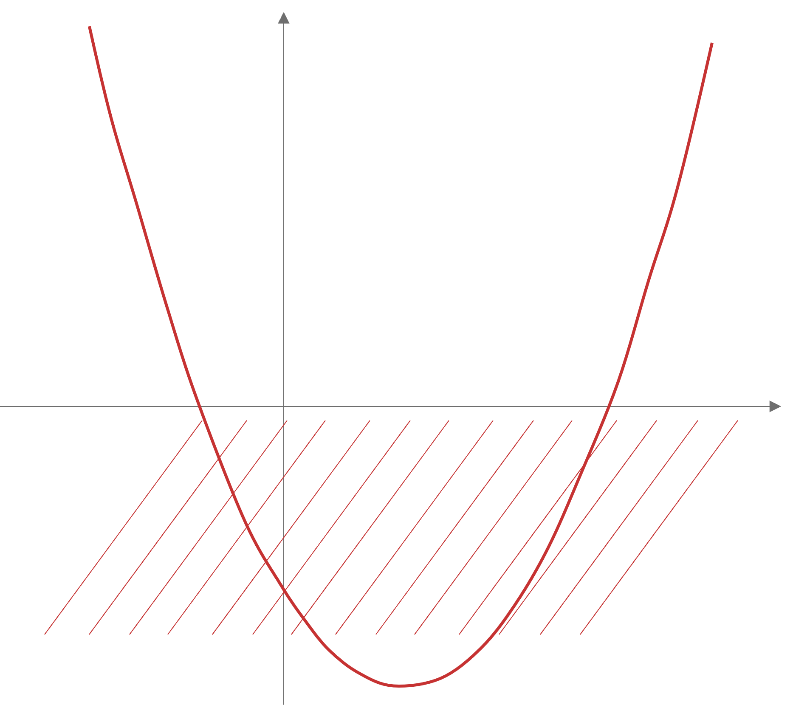
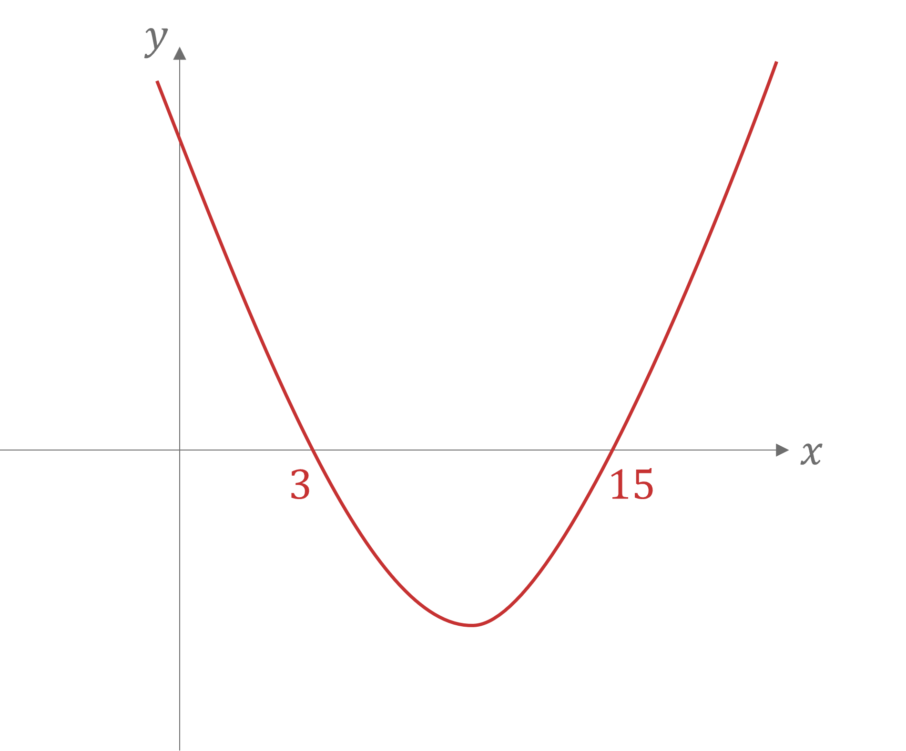
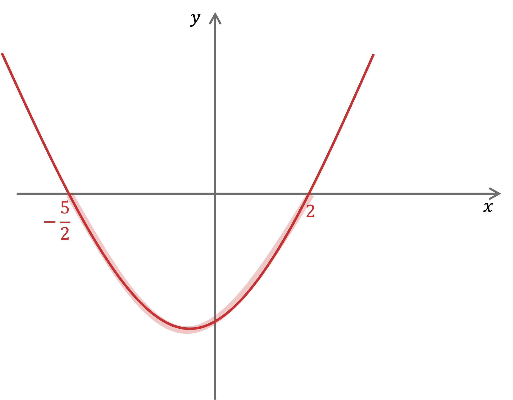

# Mark Schemes — Quadratic Functions
**Algebra & Functions** · Cambridge (CIE) IGCSE further-maths (0606)

## Exam Questions (16 questions)

### Q1
> *No real solutions means the discriminant is negative, *$b^{2}-4ac<0$

$( k - 6 )^{2} - 4 ( 2 k ) ( - 4 ) < 0$

**[M1]**

> *Expand and simplify, remember *$( k - 6 )^{2} = ( k - 6 ) ( k - 6 )$

$\begin{gathered} k^{2} - 12 k + 36 + 32 k & < 0 \\ k^{2} + 20 k + 36 & < 0 \end{gathered}$

**[A1]**

> *Solve this quadratic inequality*

> *First finding the critical points, e.g. by factorising*

$k^{2} + 20 k + 36 = 0
( k + 18 ) ( k + 2 ) = 0$

**[M1]**

$k=-18$* or *$k=-2$

**[A1]**

> $y=k^{2}+20k+36$* is a positive quadratic (U-shape) so state the *$k$* values for where it is below *$x$*-axis (*$y<0$*)*

$-18<k<-2$

**[A1]**
> *The 'hence' means you need to relate this question to part (a)*

> *Find the *$x$*-coordinates of the points of intersection (e.g. by setting the *$y$*'s equal to each other)*

$2kx^{2}+kx-4=6x$

> *Rearrange to the quadratic in part (a)*

$2 k x^{2} + ( k - 6 ) x - 4 = 0$

> *You know this quadratic has no real solutions for *$-18<k<-2$* (the line and curve never intersect)*

> *At the endpoints, *$k=-18$* or *$k=-2$*, the line will be a tangent to the curve*

> *However *$k>0$* is outside this range completely, so they must intersect twice*

**Final answer:** **The straight line **$y=6x$** intersects the curve **$y=2kx^{2}+kx-4$** twice when **$k>0$

**[B1]**

### Q2
> *Setting the two equations equal to each other*

$3x^{2}+8x+5=kx-7$

**[1]**

> *Collecting all terms to the left to set the quadratic equal to 0*

$3x^{2}+8x-kx+12=0$

$3 x^{2} + ( 8 - k ) x + 12 = 0$

**[1]**

> *If the line and the curve do not intersect, then there are no solutions so the discriminant must be less than 0.*

$b^{2}-4ac<0$

$a = 3 , b = ( 8 - k ) , c = 12$

$( 8 - k )^{2 } - 4 ( 3 ) ( 12 ) < 0$

**[1]**

> *Expanding the brackets and simplifying gives*

$64-16k+k^{2}-144<0$

$k^{2}-16k-80<0$

**[1]**

> *Factorising to find critical values *

$( k + 4 ) ( k - 20 ) < 0$

*Critical values are* $k=-4,k=20$

**[1]**

> *To determine the correct region that satisfies the inequality, sketch a graph of the quadratic.*

> *The region that satisfies the inequality is less than 0 so the correct region is below the x axis.*

$-4<k<20$ **[1]**

### Q3
> *Method 1*

> *Put the equations equal to each other and simplify.*

$4x^{2}+kx+k-2=2x+1$

**[1]**

$4 x^{2} + ( k - 2 ) x + ( k - 3 ) = 0$

**[1]**

> $y=2x+1$* and *$y=4x^{2}+kx+k-2$* only intersect once (because *$y=2x+1$*is a tangent to the curve) and so *$4 x^{2} + ( k - 2 ) x + ( k - 3 ) = 0$* must have only one real root and therefore *$b^{2}-4ac=0$

$( k - 2 )^{2} - ( 4 ) ( 4 ) ( k - 3 ) = 0$

**[1]**

$k^{2}-20k+52=0$

**[1]**

> *Solve using the quadratic formula.*

$k = \frac{- ( - 20 ) + \sqrt{( - 20 )^{2} - ( 4 ) ( 1 ) ( 52 )} }{2 ( 1 )}$

**[1]**

$k=10+4\sqrt{3}$* **and** *$k=10-4\sqrt{3}$* ***[1]**

> *Method 2*

> *Put the equations equal to each other.*

$4x^{2}+kx+k-2=2x+1$

> *The gradients of the curve and the line are equal because the line is a tangent to the curve, so differentiate both sides.*

$8x+k=2$

**[1]**

> *Rearrange to get an equation for *$k$*.*

$k=2-8x$

> *Substitute this into the original equation, simplify and rearrange.*

$4 x^{2} + ( 2 - 8 x ) x + ( 2 - 8 x ) - 2 = 2 x + 1$

**[1]**

$4x^{2}+8x+1=0$

**[1]**

> *Solve using the quadratic formula.*

$x = \frac{- ( 8 ) + \sqrt{( 8 )^{2} - ( 4 ) ( 4 ) ( 1 )} }{2 ( 4 )}$

**[1]**

$x=-1\pm\frac{\sqrt{48}}{8}$

**[1]**

> *Substitute into *$8x+k=2$* and solve to find *$k$*.*

$8 ( - 1 \pm \frac{ \sqrt{48} }{8} ) + k = 2$

$k=10+4\sqrt{3}$** ****and **$k=10-4\sqrt{3}$** ****[1]**

### Q4
> *A quadratic has no real roots when the discriminant is negative, since we cannot take the square root of a negative number.*

> *Substitute the values from the equation into *$b^{2}-4ac<0$

> *   *

$( - 4 k )^{2} - ( 4 ) ( 4 ) ( 2 k + 3 ) < 0$

**[1]**

> *Expand and simplify.*

$16k^{2}-32k-48<0$

**[1]**

> *Divide through by 16.*

$k^{2}-2k-3<0$

> *  *

> *Factorise and solve *$k^{2}-2k-3=0$* to find critical values.*

> *   *

$( k + 1 ) ( k - 3 ) = 0$

**[1]**

$k=-1$* **and** *$k=3$

**[1]**

> *We are solving a quadratic inequality, therefore we need to examine the graph of *$y=k^{2}-2k-3$* to determine which inequality signs are needed. Since we want the equation to be smaller than 0, we want the part of the graph **under **the *$x$* axis, between the two critical values.*

> *Therefore,*

$-1<k<3$* ***[1]**

### Q5
> *Expand the double bracket*

$x^{2}-10x-8x+80>35$

> *Collect the like terms on the left hand side of the inequality*

$x^{2}-18x+80>35$

> *Subtract 35 from both sides to make the right hand side 0*

$x^{2}-18x+45>0$

**[1]**

> *We want to find where the quadratic graph is greater than 0*

> *Consider *$y=x^{2}-18x+45$* and draw a sketch*

> *Identify the roots by factorising (or using the quadratic formula)*

$( x - 15 ) ( x - 3 ) = 0$

**[1]**

$x=15\mathrm{and}x=3$

**[1]**

> *The quadratic is greater than 0 when the graph is above the *$x$*-axis*

$x<3\mathrm{or}x>15$ **[1]**

** **$( - \infty , 3 ) \cup ( 15 , \infty )$** ***is also accepted*

### Q6
> *Expand the right-hand side of the inequality*

$12 x^{2} - 20 x + 5 < ( 2 x + 1 ) ( x - 1 )$

$12x^{2}-20x+5<2x^{2}-2x+x-1$

> *Simplify*

$12x^{2}-20x+5<2x^{2}-x-1$

**[1]**

> *Make the quadratic inequality equal to 0 on one side*

$10x^{2}-19x+6<0$

> *Find the roots of the quadratic equation using the quadratic formula*

$x=\frac{2}{5}\mathrm{or}x=\frac{3}{2}$

**factorise or solve quadratic equation**** [1]**

**for correct values**** [1]**

> *We have a positive quadratic and we are trying to see where the quadratic is strictly less than 0 (i.e. below the *$x$*-axis)*

$\frac{2}{5}<x<\frac{3}{2}$ **[1]**

### Q7
> *Dividing the first two terms by the coefficient of *$x^{2}$

$9 ( x^{2 } - \frac{4}{3} x ) + 5$

> *Completing the square inside the bracket*

$9 [ ( x - \frac{2}{3} )^{2} - \frac{4}{9} ] + 5$

> *Expanding the square bracket gives*

$9 ( x - \frac{2}{3} )^{2 } - 4 + 5$

$9(x-\frac{2}{3})^{2}+1$

**1 mark for each correct of p, q, and r**** [3]**
> *If *$y = p ( x - q )^{2} + r$* then the turning point is at *$( q , r )$

$(\frac{2}{3},1)$ **[1]**

### Q8
> *This is a hidden quadratic equation which is easier to solve if we let *$y=x^{\frac{1}{3}}$*. This means that the quadratic becomes*

$6y^{2}-5y+1=0$

> *To factorise this quadratic, we know that the final terms in the brackets must both be -1, as they must have a product of +1. The first terms in the brackets must have a product of 6, so this must be 3 and 2, or 1 and 6. Upon inspection we see that the brackets must be*

$( 3 y - 1 ) ( 2 y - 1 ) = 0$

**[1]**

> *Solving these by setting each bracket equal to 0 gives*

$3y-1=02y-1=0$

$y=\frac{1}{3}y=\frac{1}{2}$

> *Using our previous substitution we have*

$x^{\frac{1}{3}}=\frac{1}{3}x^{\frac{1}{3}}=\frac{1}{2}$* *

**[1]**

> *Cubing both sides of each equation gives us the final solutions*

$x=\frac{1}{27},x=\frac{1}{8}$ **[1] **

### Q9
*A quadratic equation has real roots if *$b^{2}-4ac\geq0$ $a=2k-1$*, *$b=6$* and *$c=k+1$

$6 ^{2} - 4 ( 2 k - 1 ) ( k + 1 ) \ge 0$

**[1]**

> *Solve for **k*

$\begin{array}{cc}36 - 4 ( 2 k ^{2} + k - 1 ) & \ge 0 \\ 36 - 8 k ^{2} - 4 k + 4 & \ge 0 \\ 8 k ^{2} + 4 k - 40 & \le 0\end{array}$

**[1]**

> *Factorise or use the quadratic formula to solve and find the critical values*

$\begin{gathered} 2 k^{2} + k - 10 & \text{less} \text{or} \text{equal} \text{than} 0 \\ \text{let} 2 k^{2} + k - 10 & = 0 \\ ( k - 2 ) ( 2 k + 5 ) & = 0 \end{gathered}$

**[1]**

> *   *$\begin{gathered} k = 2 , k = - \frac{5}{2} \end{gathered}$

**both critical values found ****[1]**

*To decide which way the inequalities go, draw a very quick sketch of the graph of *$\begin{gathered} 8 k^{2} + 4 k - 40 & \text{less} \text{or} \text{equal} \text{than} 0 \end{gathered}$* with the critical values marked; it's a positive quadratic and we're looking for the values below the **x**-axis* *(or sketch *$\begin{gathered} - 8 k^{2} - 4 k + 40 & \text{greater} \text{or} \text{equal} \text{than} 0 \end{gathered}$* as a negative parabola, and look for the region above the **x**-axis)*

$-\frac{5}{2}\leqk\leq2$** [1]**

### Q10
> *Rewrite the equation, using *$\sqrt{x}=x^{\frac{1}{2}}$

$2x-11x^{\frac{1}{2}}+12=0$

> *Let *$u=x^{\frac{1}{2}}$

$2u^{2}-11u+12=0$

> *Factorise and solve.*

$( 2 u - 3 ) ( u - 4 ) = 0$

**[1]**

$u=\frac{3}{2}$* **and *$u=4$

> *Replace *$u$* with *$x^{\frac{1}{2}}$*.*

$x^{\frac{1}{2}}=\frac{3}{2}$*   **and    *$x^{\frac{1}{2}}=4$

**[1]**

> *Solve.*

$x = ( \frac{3}{2} )^{2}$

$x = ( 4 )^{2}$

$x=\frac{9}{4}$**and**** **$x=16$* ***[1]**

### Q11
> *When an equation has two real roots, the discriminant is positive.*

$\begin{gathered} b^{2} - 4 a c & > 0 \\ \\ ( k + 9 )^{2} - ( 4 ) ( 1 ) ( 9 ) & > 0 \end{gathered}$

**[1]**

> *Expand and simplify.*

$\begin{gathered} k^{2} + 18 x + 81 - 36 & > 0 \\ k^{2} + 18 x + 45 & > 0 \end{gathered}$

**[1]**

> *Factorise and solve *$k^{2}+18x+45=0$* to find critical values.*

> *  *

$( k + 15 ) ( k + 3 ) = 0$

$k=-15,k=-3$

**[1]**

> *Since we want where the positive quadratic is greater than 0, we want *$k$* values to the left of -15, and to the right of -3.*

> *  *

$k<-15\mathrm{or}k>-3$* ***[1]**

### Q12
> *If the line meets the curve, they will have the same *$x$* and *$y$*-coordinate at one point. Set the curve equal to the line.*

$2x^{2}+4x+k-1=kx+3$

[1]

> *Bring all the terms to one side to equal the equation to 0:*

$2x^{2}+4x-kx+k-1-3=0$

[1]

> *Simplify:*

$2 x^{2} + ( 4 - k ) x + k - 4 = 0$

> *If the line is tangent to the curve, they meet once, therefore this quadratic equation will have 1 solution only. Use that the discriminant *$b^{2}-4ac$* is equal to 0.*

$b^{2} - 4 a c = ( 4 - k )^{2} - 4 ( 2 ) ( k - 4 ) = 0$

[1]

$16-8k+k^{2}-8k+32=0$

$k^{2}-16k+48=0$

> *Solve the quadratic equation using the quadratic formula:*

$k = \frac{- ( - 16 ) \pm \sqrt{( - 16 )^{2} - 4 ( 1 ) ( 48 )} }{2 ( 1 )}$

$k=12,k=4$** ****[2]**

### Q13
> *Since they intersect, set the line equal to the curve *

$x-3=k^{2}x^{2}+5kx+1$

**[1]**

> *Rearrange the equation to make it equal to 0*

> *Subtract *$x$*from both sides*

$- 3 = k^{2} x^{2} + ( 5 k - 1 ) x + 1$

> *Add 3 to both sides*

$0 = k^{2} x^{2} + ( 5 k - 1 ) x + 4$

**[1]**

> *The line meets the curve twice (at 2 distinct points) so the discriminant, *$b^{2}-4ac>0$

> *Work out the discriminant*

$( 5 k - 1 )^{2} - 4 ( k^{2} ) ( 4 ) > 0$

**[1]**

$( 5 k - 1 )^{2} - 16 k^{2} > 0$

> *Expand the double bracket*

$25k^{2}-10k+1-16k^{2}>0$

> *Simplify*

$9k^{2}-10k+1>0$

**[1]**

> *Solve the quadratic inequality*

> *Find the critical values using the quadratic formula (or by factorisation)*

$k = \frac{- ( - 10 ) \pm \sqrt{( - 10 )^{2} - 4 ( 9 ) ( 1 )} }{2 ( 9 )}$

$k=1\mathrm{or}\frac{1}{9}$

**[1]**

> *We are trying to find where the (positive) quadratic is greater than zero, so consider where the graph is above the *$x$*-axis*

$k<\frac{1}{9}\mathrm{or}k>1$ **[1]**

### Q14
> *Substitute *$y = ( k + 4 ) x$* into *$y=2x^{2}+k+4$

$( k + 4 ) x = 2 x^{2} + k + 4$

> *Rearrange.*

$2 x^{2} - ( k + 4 ) x + k + 4 = 0$

**[1]**

> *Since the lines intersect at two distinct points, this means the discriminant of this equation must be greater than 0.*

> *Substitute values from the equation into *$b^{2}-4ac>0$

> *  *

$( - ( k + 4 ) )^{2} - ( 4 ) ( 2 ) ( k + 4 ) > 0$

**[1]**

> *Simplify.*

$\begin{gathered} k^{2} + 8 k + 16 - 8 k - 32 & > 0 \\ k^{2} - 16 & > 0 \end{gathered}$

> *  *

> *Factorise and solve to find critical values.*

$( k + 4 ) ( k - 4 ) = 0$

$k=-4$* **and *$k=4$

**[1]**

*  *

> *Since we want where the graph is greater than 0, we want values to the left of the negative root, and to the right of the positive root.*

$k<-4$** ****and **$k>4$** ****[1]**

### Q15
> *To complete the square, *$x^{2} + b x + c = ( x - \frac{b}{2} )^{2} - ( \frac{b}{2} ) + c$

$x^{2} - 6 x + 1 = ( x - 3 )^{2} - ( 3 )^{2} + 1$

**correct squared term **$( x - 3 )^{2}$** ****[1]**

> *Simplify.*

$= ( x - 3 )^{2} - 9 + 1$

$(x-3)^{2}-8$ **[1]**
> *The minimum point on the curve *$y = ( x + a )^{2} + b$*  is  *$( - a , b )$*.*

> *For *$y = ( x - 3 )^{2} - 8$* is *

$(3,-8)$* ***[1]**

### Q16
> *Let *$y=x^{\frac{1}{3}}$*, then*

$2y^{2}-y-10=0$

$( 2 y - 5 ) ( y + 2 ) = 0$

**[1]**

> *Solving the quadratic gives*

$y=\frac{5}{2}\mathrm{and}y=-2$

> *Substituting *$y=x^{\frac{1}{3}}$

$x^{\frac{1}{3}}=\frac{5}{2}\mathrm{and}x^{\frac{1}{3}}=-2$

**[1]**

> *Cubing both sides of each equation gives*

$x=\frac{125}{8},x=-8$ **[1]**
