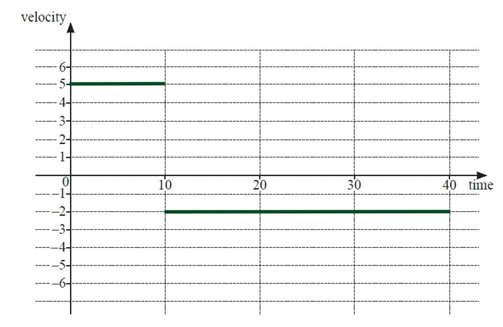
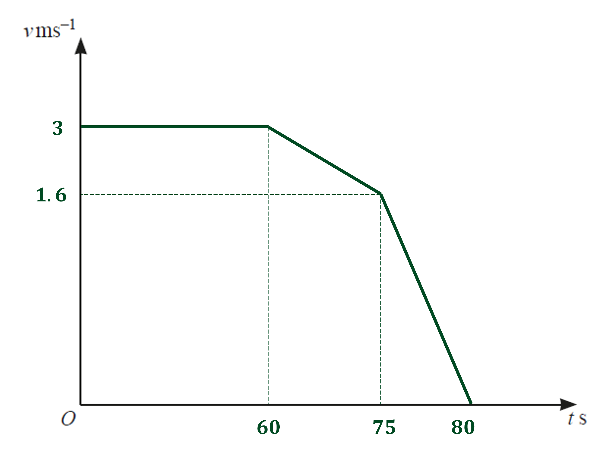

# Mark Schemes — Calculus for Kinematics
**Calculus** · Cambridge (CIE) IGCSE further-maths (0606)

## Exam Questions (14 questions)

### Q1
> *Differentiate velocity to find acceleration*

**Method 1**

> *Expand and simplify the velocity first*

`table row v equals cell 6 open parentheses t squared minus 1 half t minus 1 half t plus 1 fourth close parentheses plus 5 over 2 end cell row v equals cell 6 open parentheses t squared minus t plus 1 fourth close parentheses plus 5 over 2 end cell row v equals cell 6 t squared minus 6 t plus 3 over 2 plus 5 over 2 end cell row v equals cell 6 t squared minus 6 t plus 4 end cell end table`

**[M1]**

> *Then differentiate *$v$* to find *$a$

$a=12t-6$

**[M1 A1]**

> *Substitute in *$t=2$

$a=12\times2-6$

**Final answer:** **18 ms****-2**

**[A1]**

**Method 2**

> *Use the chain rule, *$a=\frac{dv}{dt}=\frac{dv}{du}\frac{du}{dt}$* where *$u=t-\frac{1}{2}$

`table row v equals cell 6 u squared plus 5 over 2 space space space space space space space space space u equals t minus 1 half end cell row cell fraction numerator straight d v over denominator straight d u end fraction end cell equals cell 12 u space space space space space space space space space space space space fraction numerator straight d u over denominator straight d t end fraction equals 1 end cell end table`

**[M1]**

> *This gives*

`table row a equals cell 12 u cross times 1 end cell row a equals cell 12 open parentheses t minus 1 half close parentheses end cell end table`

**[A1 A1]**

> **[mark-scheme]**
> **A1:** For an answer at least in the form `k open parentheses t minus 1 half close parentheses`.
> 
> **A1:** For `12 open parentheses t minus 1 half close parentheses` or $12t-6$.

> *Substitute in *$t=2$

`a equals 12 open parentheses 2 minus 1 half close parentheses`

**Final answer:** **18 ms****-2**

**[A1]**
**Method 1**

> *Integrate *$v=6t^{2}-6t+4$* to get displacement *$s$* and add a constant of integration*

$s=\frac{6t^{3}}{3}-\frac{6t^{2}}{2}+4t+c$

**[M1]**

> **[mark-scheme]**
> This mark is for at least two correct terms in $t$ (can be unsimplified).

> *Simplify*

$s=2t^{3}-3t^{2}+4t+c$

**[A1]**

> *The initial displacement is *$-1$* so substitute in *$s=-1$* when *$t=0$* to find *$c$

`table row cell negative 1 end cell equals cell 0 minus 0 plus 0 plus c end cell row c equals cell negative 1 end cell end table`

> *Substitute this value of *$c$* back into the expression for *$s$

$s=2t^{3}-3t^{2}+4t-1$

**[A1]**

> *Substitute in *$t=2$

`s equals 2 open parentheses 2 close parentheses cubed minus 3 open parentheses 2 close parentheses squared plus 4 open parentheses 2 close parentheses minus 1`

**Final answer:** **11  m**

**[A1]**

**Method 2**

> *Integrate *`v equals 6 open parentheses t minus 1 half close parentheses squared plus 5 over 2`* using *`integral open parentheses a x plus b close parentheses to the power of n space straight d x equals 1 over a cross times fraction numerator 1 over denominator n plus 1 end fraction open parentheses a x plus b close parentheses to the power of n plus 1 end exponent plus c`* to get displacement *$s$* *

> *Add a constant of integration*

`s equals 6 cross times 1 over 1 cross times 1 third open parentheses t minus 1 half close parentheses cubed plus 5 over 2 t plus c`

**[M1 A1]**

> *Simplify*

`s equals 2 open parentheses t minus 1 half close parentheses cubed plus 5 over 2 t plus c`

> *The initial displacement is *$-1$* so substitute in *$s=-1$* when *$t=0$* to find *$c$

`table row cell negative 1 end cell equals cell 2 open parentheses 0 minus 1 half close parentheses cubed plus 0 plus c end cell row cell negative 1 end cell equals cell negative 1 fourth plus c end cell row c equals cell negative 3 over 4 end cell end table`

> *Substitute this value of *$c$* back into the expression for *$s$

`s equals 2 open parentheses t minus 1 half close parentheses cubed plus 5 over 2 t minus 3 over 4`

**[A1]**

> *Substitute in *$t=2$

`s equals 2 open parentheses 2 minus 1 half close parentheses cubed plus 5 over 2 open parentheses 2 close parentheses minus 3 over 4`

**Final answer:** **11  m**

**[A1]**
> *Speed is the positive part of the velocity, *`vertical line v vertical line`

**Method 1**

> *Use algebra to show that *`v equals 6 open parentheses t minus 1 half close parentheses squared plus 5 over 2`* is always positive*

> *Start by noting that *`open parentheses t minus 1 half close parentheses squared greater or equal than 0`* as it is a squared expression*

`table row cell open parentheses t minus 1 half close parentheses squared end cell greater or equal than 0 row cell 6 open parentheses t minus 1 half close parentheses squared end cell greater or equal than 0 row cell 6 open parentheses t minus 1 half close parentheses squared plus 5 over 2 end cell greater than 0 end table`

> *This expression is actually positive for all *$t$* values, but you need just *$t\geq0$

**Final answer:** `v equals 6 open parentheses t minus 1 half close parentheses squared plus 5 over 2`** is always positive for **$t\geq0$** so the velocity-time graph and speed-time graph are the same**

**[B1]**

> **[mark-scheme]**
> Your answer must refer to the fact that `v equals 6 open parentheses t minus 1 half close parentheses squared plus 5 over 2` is always positive for $t\geq0$ (or all $t$) to score the mark.

**Method 2**

> *The velocity-time graph of *`v equals 6 open parentheses t minus 1 half close parentheses squared plus 5 over 2`* is a U-shaped quadratic with a minimum point of *`open parentheses 1 half comma space 5 over 2 close parentheses`* above the *$t$*-axis*

**Final answer:** `v equals 6 open parentheses t minus 1 half close parentheses squared plus 5 over 2`** is always positive for **$t\geq0$** so the velocity-time graph and speed-time graph are the same**

**[B1]**

> **[mark-scheme]**
> Your answer must refer to `v equals 6 open parentheses t minus 1 half close parentheses squared plus 5 over 2` always being positive for $t\geq0$ (or all $t$)  to score the mark.
> 
> The graph sketch is not necessary for the mark.

> **[exam-tip]**
> Even though the graph sketch is not awarded any marks here, it is still a good idea to include it.

### Q2
> *The particle moves in a straight line so we have a linear relationship between the initial and final velocity, which is dependent upon the acceleration*

> *Form a linear equation*

$v=-6t+c$

**[1]**

> *The constant is the initial velocity which is 18*

$v=-6t+18$

**[1]**

> *Substitute the final velocity, because we know the particle is at rest*

$0=-6t+18$

`0 equals open parentheses negative 6 close parentheses t plus 18`

> *Solve to find *$t$

$t=\frac{18}{6}=3$

$t=3$ **[1]**
> *Displacement (*$s$*) is the integral of velocity.  From part (a), *$v=18-6t$*.*
* The third second is between *$t=2$* and *$t=3$*.*

`s equals integral subscript 2 superscript 3 open parentheses 18 minus 6 t close parentheses space straight d t equals open square brackets 18 t minus 3 t squared close square brackets subscript 2 superscript 3`

**[1]**

> *Apply the limits.*

`table row s equals cell open square brackets 18 cross times 3 minus 3 cross times 3 squared close square brackets minus open square brackets 18 cross times 2 minus 3 cross times 2 squared close square brackets end cell row s equals cell 27 minus 24 end cell end table`

**[1]**

> *As positive, distance will be the same as displacement.*

**P**** travels a distance of 3 metres in the third second** **[1]**

### Q3
> *To find the expression for velocity, *$v$*, integrate the expression for acceleration.*

> *Integrate using reverse chain rule.*

`integral open parentheses 2 t plus 1 close parentheses to the power of negative 1 half end exponent space straight d t space equals space fraction numerator open parentheses 2 t plus 1 close parentheses to the power of 1 half end exponent over denominator 1 half end fraction cross times 1 half plus C`

`v equals open parentheses 2 t plus 1 close parentheses to the power of 1 half end exponent plus C`

`open square brackets 1 close square brackets`

> *To find C, substitute *$t=0$* and *$v=8$* into the equation.*

> `8 equals open parentheses 2 open parentheses 0 close parentheses plus 1 close parentheses to the power of 1 half end exponent plus C`*  *

> *Simplify, then rearrange, to find C.*

$8=\sqrt{1}+C$

$C=7$

`open square brackets 1 close square brackets`

> *Substitute *$C=7$* into the equation for velocity.*

> $v=(2t+1)^{\frac{1}{2}}+7$* *`open square brackets 1 close square brackets`
> *To find the expression for displacement, *$s$*, integrate the expression for velocity.  *

`integral open parentheses open parentheses 2 t plus 1 close parentheses to the power of 1 half end exponent space plus 7 close parentheses space straight d t`

> *Break up the integral.*

`integral open parentheses 2 t plus 1 close parentheses to the power of 1 half end exponent space straight d t space plus integral 7 space straight d t`

> *Integrate *`open parentheses 2 t plus 1 close parentheses to the power of 1 half end exponent`* with respect to *$t$* using reverse chain rule.*

`integral open parentheses 2 t plus 1 close parentheses to the power of 1 half end exponent space straight d t space equals fraction numerator space open parentheses 2 t plus 1 close parentheses to the power of 3 over 2 end exponent over denominator 3 over 2 end fraction cross times 1 half plus d`

`equals 1 third open parentheses 2 t plus 1 close parentheses to the power of 3 over 2 end exponent plus d`

> *Hence,*

`s equals 1 third open parentheses 2 t plus 1 close parentheses to the power of 3 over 2 end exponent plus 7 t plus d`

**for an attempt to integrate answer to part **$a$`open square brackets 1 close square brackets`

**for correct result **`open square brackets 1 close square brackets`

> *To find *$d$*, substitute *$s=4$* and *$t=0$* into the equation.*

`4 equals open parentheses 2 open parentheses 0 close parentheses plus 1 close parentheses to the power of 3 over 2 end exponent over 3 plus 7 open parentheses 0 close parentheses plus d`

> *Simplify, then rearrange, to find *$d$*.*

$4=\frac{1}{3}+d$

$d=\frac{11}{3}$

`open square brackets 1 close square brackets`

> *Substitute *$d=\frac{11}{3}$*into the equation for displacement.*

$s=\frac{1}{3}(2t+1)^{\frac{3}{2}}+7t+\frac{11}{3}$ `open square brackets 1 close square brackets`** **

### Q4
> *To find an expression for velocity, **v**, integrate the acceleration function *
*We can use *`integral open parentheses a x plus b close parentheses to the power of n space straight d x equals fraction numerator space 1 over denominator a end fraction times fraction numerator 1 over denominator n plus 1 end fraction open parentheses a x plus b close parentheses to the power of n plus 1 end exponent plus c`

`v equals integral open parentheses 3 t plus 2 close parentheses to the power of negative 1 third end exponent straight d t equals fraction numerator space 1 over denominator 3 end fraction cross times 3 over 2 open parentheses 3 t plus 2 close parentheses to the power of 2 over 3 end exponent plus c`

**[1]**

> *                         *`equals 1 half open parentheses 3 t plus 2 close parentheses to the power of 2 over 3 end exponent plus c`

> *To find the constant of integration, substitute *$t=2$* and *$v=8$*the limits of integration*

`8 equals 1 half open parentheses 3 cross times 2 plus 2 close parentheses to the power of 2 over 3 end exponent plus c`

**[1]**

> *Solve*

`8 equals 1 half open parentheses 8 close parentheses to the power of 2 over 3 end exponent plus c
8 equals 1 half cross times 4 plus c
8 equals 2 plus c
c equals 6`

> *Don't forget to write out the full expression at the end for the final mark*

$v=\frac{1}{2}(3t+2)^{\frac{2}{3}}+6$  **[1]**
**Because the formula for the velocity is **$v=\frac{1}{2}(3t+2)^{\frac{2}{3}}+6$** and we are told that **$t\geq0$**, so the velocity will always be positive** **[1]**

**In actual fact the velocity will always be greater than 6**
> *To find an expression for displacement, **s**, integrate the velocity function Again, we can use *`integral open parentheses a x plus b close parentheses to the power of n space straight d x equals fraction numerator space 1 over denominator a end fraction times fraction numerator 1 over denominator n plus 1 end fraction open parentheses a x plus b close parentheses to the power of n plus 1 end exponent plus c`

`s equals integral open parentheses 1 half open parentheses 3 t plus 2 close parentheses to the power of 1 third end exponent plus 6 close parentheses straight d t equals fraction numerator space 1 over denominator 2 end fraction open parentheses 1 third cross times 3 over 5 open parentheses 3 t plus 2 close parentheses to the power of 5 over 3 end exponent close parentheses plus 6 t plus c`

**[1]**

> *                         *`equals 1 over 10 open parentheses 3 t plus 2 close parentheses to the power of 5 over 3 end exponent plus 6 t plus c`

> *To find the constant of integration, substitute *$t=2$* and *$s=-4.8$

`negative 4.8 equals 1 over 10 open parentheses 3 cross times 2 plus 2 close parentheses to the power of 5 over 3 end exponent plus 6 cross times 2 plus c`

**[1]**

> *Solve*

`table row cell negative 4.8 end cell equals cell 1 over 10 open parentheses 8 close parentheses to the power of 5 over 3 end exponent plus 12 plus c end cell row cell negative 4.8 end cell equals cell fraction numerator space 1 over denominator 10 end fraction cross times 32 plus 12 plus c end cell row cell negative 4.8 end cell equals cell 3.2 plus 12 plus c end cell row cell negative 4.8 end cell equals cell 15.2 plus c end cell row cell negative 20 end cell equals c end table`

> *Therefore *

`s equals 1 over 10 open parentheses 3 t plus 2 close parentheses to the power of 5 over 3 end exponent plus 6 t minus 20`

**[1]**

> *Substitute *$t=\frac{25}{3}$* into *$s$

`t equals 25 over 3 comma space s equals 1 over 10 open parentheses 3 open parentheses 25 over 3 close parentheses plus 2 close parentheses to the power of 5 over 3 end exponent plus 6 open parentheses 25 over 3 close parentheses minus 20`

`equals 1 over 10 open parentheses 27 close parentheses to the power of 5 over 3 end exponent plus 150 over 3 plus 20
equals 1 over 10 cross times 243 plus 50 plus 20
equals 24.3 plus 50 minus 20`

**54.3**  **[1]**

### Q5
(i) *To find velocity, *$v$*, divide displacement, *$x$*, by time, *$t$*.*

> *For *$0\leqt\leq50$

$100\div50=2$

> *For *$50\leqt\leq65$

$0\div15=0$

> *  *

> *For *$65\leqt\leq85$

$50\div20=2.5$

> *  *

> *For *$85\leqt\leq125$

$-150\div40=-3.75$

> * *

> *Draw the lines on the given axes.*

**for correct line at **$v=2$** **`open square brackets 1 close square brackets`

**for correct line at **$v=2.5$** **`open square brackets 1 close square brackets`

**for correct line at  **$v=3.75$** and **$v=0$** **`open square brackets 1 close square brackets`

(ii) $0\leqt\leq50$*, the distance covered is 100m.*

> $50\leqt\leq65$*, the distance covered is 0m.*

> $65\leqt\leq85$*, the distance covered is 50m.*

> $85\leqt\leq125$*, the distance covered is 150m.*

$100+0+50+150=300$

$300m$ `open square brackets 1 close square brackets`

### Q6
(i) *To find the expression for velocity, **v,** integrate the expression for acceleration.   *

`integral open parentheses 6 space cos space 2 t close parentheses space straight d t space equals 3 space sin space 2 t plus C`

$v=3\mathrm{sin}2t+C$

`open square brackets 1 close square brackets`

> *To find C, substitute *$t=0$* and *$v=10$* into the equation.*

> *  *

> `10 equals 3 space sin space open parentheses 2 cross times 0 close parentheses plus C`*  *

> *Simplify, then rearrange, to find C.*

$C=10$

`open square brackets 1 close square brackets`

> *Substitute *$C=10$* into the equation for velocity.*

> $v=3\mathrm{sin}2t+10$* *`open square brackets 1 close square brackets`

ii) *To find the expression for displacement, *$s$*, integrate the expression for velocity.  *

`integral open parentheses 3 space sin space 2 t space plus space 10 close parentheses space straight d t`

> *Break up the integral.*

`integral open parentheses 3 space sin space 2 t close parentheses space straight d t space plus integral 10 space straight d t`

> *Integrate *$3\mathrm{sin}2t$* with respect to *$t$*.*

`integral open parentheses 3 space sin space 2 t close parentheses space straight d t space equals fraction numerator space minus 3 space cos space 2 t over denominator 2 end fraction plus d`

`equals negative 3 over 2 open parentheses cos space 2 t close parentheses plus d`

> *Combine with the integral of 10.*

`s equals negative 3 over 2 open parentheses cos space 2 t close parentheses plus 10 t plus d`

`open square brackets 1 close square brackets`

> *To find *$d$*, substitute *$s=0$* and *$t=0$* into the equation.*

> *  *

`table row 0 equals cell negative 3 over 2 open parentheses cos space 0 close parentheses plus 10 open parentheses 0 close parentheses plus d end cell row d equals cell 3 over 2 end cell end table`

`open square brackets 1 close square brackets`

> *Substitute *$d=\frac{3}{2}$*into the equation for displacement.*

**Final answer:** $s=-\frac{3}{2}(cos2t)+10t+\frac{3}{2}$** **`open square brackets 1 close square brackets`

### Q7
i) $0-10$ *seconds, the runner travels *$50$*m.*
* *$10-40$* seconds, the runner travels *$60$*m.  *

$50+60$

> $110$*m *`open square brackets 1 close square brackets`

ii) *Work out the gradient for each line to find velocity. *
*For *$0-10$* seconds*

$\frac{50}{10}=5$* **m/s*

> *For *$10-40$* seconds*

$\frac{-60}{30}=-2$ *m/s*

> *Draw on the axes provided.*

> *   *

**for a line joining **`open parentheses 0 comma space 5 close parentheses`** and **`open parentheses 10 comma space 5 close parentheses`** **`open square brackets 1 close square brackets`

**for a line joining **`open parentheses 10 comma space minus 2 close parentheses`** and **`open parentheses 40 comma space minus 2 close parentheses`** **`open square brackets 1 close square brackets`

### Q8
> *Velocity is the change in speed with respect to time, therefore differentiate to get*

$v=\frac{ds}{dt}=2e^{2t}-10e^{t}-12$

$2e^{2t}$** [1]**

** fully correct expression**** [1]**

> *Acceleration is the change in velocity with respect to time, therefore we differentiate to get*

$a=\frac{dv}{dt}=4e^{2t}-10e^{t}$ **[1]**
> *If the particle is at rest, this means that the velocity is 0.*

$0=2e^{2t}-10e^{t}-12$

> *This is a hidden quadratic which is easier to solve if we let *$e^{t}=x$

$0=2x^{2}-10x-12$

> *Dividing through by 2 gives*

$0=x^{2}-5x-6$

> *We can factorise this by looking for a factor pair of -6 that has a sum of -5. This would be -6 and +1.*

`0 space equals space open parentheses x space minus space 6 close parentheses open parentheses x space plus thin space 1 close parentheses`

**[1]**

> *This means that the solutions are*

$x=6\Rightarrowe^{t}=6$

**[1]**

$x=-1\Rightarrowe^{t}=-1$* **which has no solutions*

> *Taking natural log of both sides of the first solution gives*

$t=\mathrm{ln}6(\mathrm{seconds})$  **[1]**
> *Substituting *$t=\mathrm{ln}6$* into the equation for *$a$* gives*

$a=4e^{2\mathrm{ln}6}-10e^{\mathrm{ln}6}$

** ****correct substitution ****[1]**

$a=84(\mathrm{ms}^{-2})$ **[1]**

### Q9
(i) *The area under the line on a velocity-time graph is equal to the displacement of the object.*

> *Since we are given the displacement, 2775m, we can find the final velocity, **V**, by finding the area under the graph. equating it to 2775 and then solving to find **V**.*

> *  *

> *Split the area under the graph into two trapeziums, find their areas, add them together and equate to 2775.*

`1 half open parentheses 60 plus 40 close parentheses open parentheses 30 close parentheses plus 1 half open parentheses 30 plus V close parentheses open parentheses 30 close parentheses equals 2775`

**for an attempt to find the area under the graph **`open square brackets 1 close square brackets`

**for equating to 2775 **`open square brackets 1 close square brackets`

> *Rearrange and solve for **V**.*

`table row cell 1500 plus 15 open parentheses 30 plus V close parentheses end cell equals 2775 row cell 15 open parentheses 30 plus V close parentheses end cell equals 1275 row cell 30 plus V end cell equals 85 row V equals 55 end table`

> *   *

> $V=55\mathrm{ms}^{-1}$* *`open square brackets 1 close square brackets`

(ii) *Examine the graph.*

> *When *$t=40$*, the graph is a horizontal line with a gradient of 0. Therefore, the acceleration at this time is 0.*

> *   *

$0$** **`open square brackets 1 close square brackets`

### Q10
i) *The differential of displacement is velocity*

`open parentheses v equals close parentheses fraction numerator straight d x over denominator straight d t end fraction equals 20 cos 2 t`

> *At time *$t=π$

`v equals 20 cos space open parentheses 2 straight pi close parentheses equals 20 cross times 1 equals 20`

> *As this is positive, speed will be the same*

**Speed of particle ****P**** at time **$π$** seconds is **$20ms^{-1}$ **[1]**

ii) *When **P** is at rest, *$v=0$

> *Use the equation from part (i)*

$20\mathrm{cos}2t=0$

**[1]**

$\mathrm{cos}2t=0$

`2 t equals cos to the power of negative 1 end exponent open parentheses 0 close parentheses equals straight pi over 2`

> *Divide by 2 to find **t*

$t=\frac{π}{4}$

$\frac{π}{4}s$* ***[1]**

iii) *To find the acceleration, differentiate the velocity*

$v=20\mathrm{cos}2t$

$\frac{dv}{dt}=-40\mathrm{sin}2t$

**[1]**

> *Calculate the acceleration when *$t=\frac{π}{4}$

`fraction numerator straight d v over denominator straight d t end fraction equals negative 40 sin open parentheses 2 cross times straight pi over 4 close parentheses equals negative 40`

$-40\mathrm{ms}^{-2}$ **[1]**

### Q11
i) *Use the first section of the graph when the particle is accelerating*

> *The acceleration is the gradient of the graph*

$\mathrm{acceleration}=\frac{\mathrm{final} \mathrm{speed}-\mathrm{initial} \mathrm{speed}}{\mathrm{time}}$

$3.5=\frac{V-0}{10}$

$V=35\mathrm{ms}^{-1}$

$35$ **[1]**

ii) *Use the area of the trapezium to find the unknown velocity*

> *The area of the trapezium = distance travelled = 112.5 m*

`Area space of space trapezium equals 1 half open parentheses a plus b close parentheses h`

`112.5 equals 1 half open parentheses 35 plus b close parentheses 5`

`225 equals open parentheses 35 plus b close parentheses 5`

$45=35+b$

$b=10\mathrm{ms}^{-1}$

$10$ **[1]**

iii) *Find the deceleration of the particle *

> *Initial velocity = 35*

> *Final velocity = 10*

> *Time = 5*

$\mathrm{deceleration}=\frac{\mathrm{final} \mathrm{speed}-\mathrm{initial} \mathrm{speed}}{\mathrm{time}}$

$\mathrm{deceleration}=\frac{35-10}{5}=5\mathrm{ms}^{-2}$

**[1]**

> *Use the gradient of the last section of the graph*

$5=\frac{35}{t-20}$

**[1]**

$t-20=\frac{35}{5}$

$t-20=7$

$t=27s$

$27$ **[1]**

### Q12
i) *To find the expression for velocity, integrate the expression for acceleration. Integrate using reverse chain rule.*

`integral open parentheses 2 t plus 4 close parentheses to the power of negative 1 half end exponent space straight d t space equals space fraction numerator open parentheses 2 t plus 4 close parentheses to the power of 1 half end exponent over denominator 1 half end fraction cross times 1 half plus C`

`V equals open parentheses 2 t plus 4 close parentheses to the power of 1 half end exponent plus C`

`open square brackets 1 close square brackets`

> *To find C, substitute *$t=6$* and *$V=9$* into the equation.*

> `9 equals open parentheses 2 open parentheses 6 close parentheses plus 4 close parentheses to the power of 1 half end exponent plus C`*  *

> *Simplify, then rearrange, to find C.*

$9=\sqrt{16}+C$

$C=5$

`open square brackets 1 close square brackets`

> *Substitute *$C=5$*into the equation for velocity.*

> $V=(2t+4)^{\frac{1}{2}}+5$* *`open square brackets 1 close square brackets`

ii) *To find the expression for displacement, integrate the expression for velocity.  *

`integral open parentheses open parentheses 2 t plus 4 close parentheses to the power of 1 half end exponent space plus 5 close parentheses space straight d t`

> *Break up the integral.*

`integral open parentheses 2 t plus 4 close parentheses to the power of 1 half end exponent space straight d t space plus integral 5 space straight d t`

> *Integrate *$5$* with respect to *$t$*.*

`integral 5 space straight d t space equals space 5 t space plus space d`

> *Integrate *`open parentheses 2 t plus 4 close parentheses to the power of 1 half end exponent`* with respect to *$t$* using reverse chain rule.*

`integral open parentheses 2 t plus 4 close parentheses to the power of 1 half end exponent space straight d t space equals fraction numerator space open parentheses 2 t plus 4 close parentheses to the power of 3 over 2 end exponent over denominator 3 over 2 end fraction cross times 1 half plus d`

`equals 1 third open parentheses 2 t plus 4 close parentheses to the power of 3 over 2 end exponent plus d`

> *Combine both results.*

`s equals 1 third open parentheses 2 t plus 4 close parentheses to the power of 3 over 2 end exponent plus 5 t plus d`

`open square brackets 1 close square brackets`

> *To find *$d$*, substitute *$s=\frac{1}{3}$* and *$t=6$* into the equation.*

`1 third equals 1 third open parentheses 2 open parentheses 6 close parentheses plus 4 close parentheses to the power of 3 over 2 end exponent plus 5 open parentheses 6 close parentheses plus d`

> *Simplify, then rearrange, to find d.*

$\frac{1}{3}=\frac{64}{3}+30+d$

$d=-51$

`open square brackets 1 close square brackets`

> *Substitute *$d=-51$*into the equation for displacement.*

$\frac{1}{3}(2t+4)^{\frac{3}{2}}+5t-51$ `open square brackets 1 close square brackets`

### Q13
> *If the graph is travelling at a constant velocity, this would be a horizontal line on the graph. A deceleration would have a negative gradient. The final section of the graph should have a steeper negative gradient as the particle has stopped after 5 seconds.*

**correct shape with three distinct sections ****[1]**

**3 and 1.6 on vertical axis ****[1]**

** ****60, 75 and 80 on horizontal axis**** [1]**
> *The distance is the area under the graph. *
*Finding the area of the first section of the graph, the rectangle*

$60\times3=180$

> *Finding the area of the second section of the graph, the trapezium*

`1 half open parentheses 3 space plus thin space 1.6 close parentheses space cross times space 15 space equals space 34.5`

> *Finding the area of the third section of the graph, the triangle*

$\frac{1}{2}\times1.6\times5=4$

**attempting at least two areas** **[1]**

**all areas calculated correctly ****[1]**

> *Finding the sum of these three areas*

$218.5m$ **[1]**
> *To find the deceleration, calculate the gradient of the line*

$\frac{1.6}{5}$

$0.32\mathrm{ms}^{-2}$ **[1]**

### Q14
> *We need to differentiate *`6 space cos open parentheses 3 t plus pi over 3 close parentheses`* twice.*

> *Differentiate once to find velocity, **v**.*

`fraction numerator straight d x over denominator straight d t end fraction equals negative 18 space sin space open parentheses 3 t plus pi over 3 close parentheses`

`open square brackets 1 close square brackets`

> *Differentiate again to find acceleration, **a**.*

`fraction numerator straight d squared x over denominator straight d t squared end fraction equals negative 54 space cos space open parentheses 3 t plus pi over 3 close parentheses`

`open square brackets 1 close square brackets`

> *Substitute *$t=\frac{2π}{3}$* into the equation.*

`a equals negative 54 space cos space open parentheses 3 open parentheses fraction numerator 2 pi over denominator 3 end fraction close parentheses plus pi over 3 close parentheses

a equals negative 54 space cos space open parentheses fraction numerator 7 pi over denominator 3 end fraction close parentheses`

> $a=-27$* *`open square brackets 1 close square brackets`
