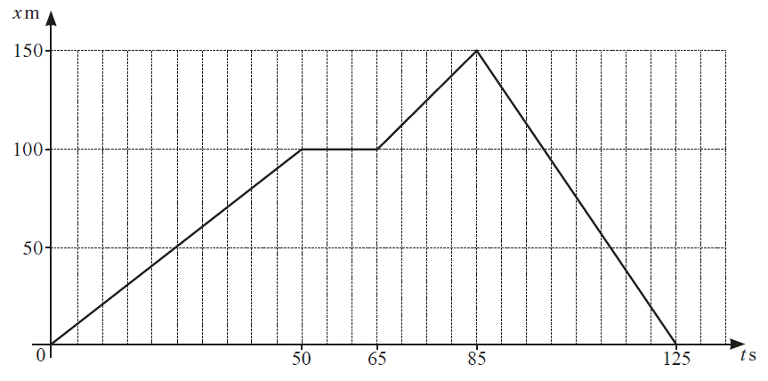
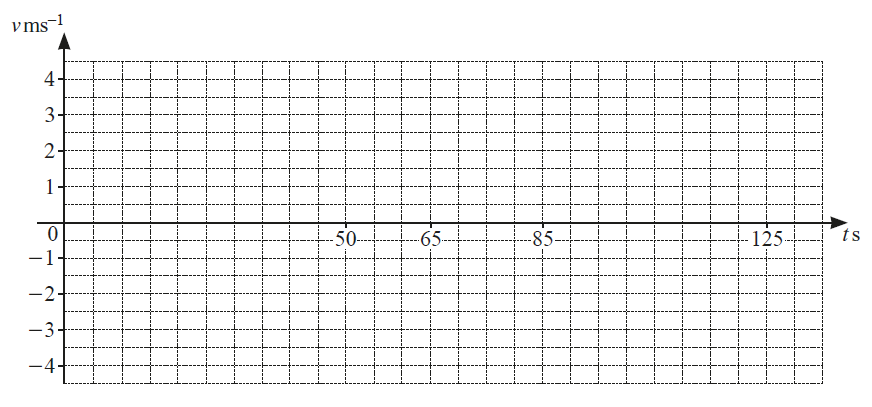
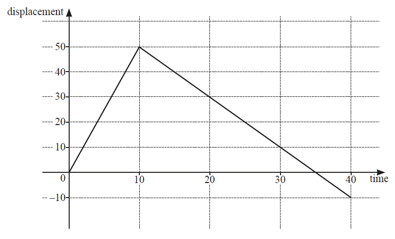
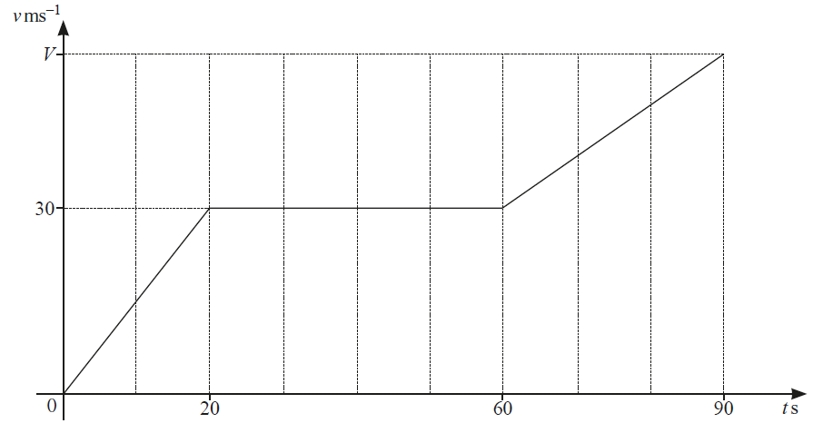
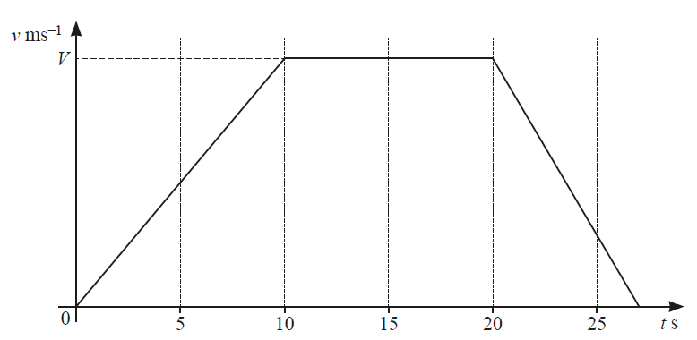
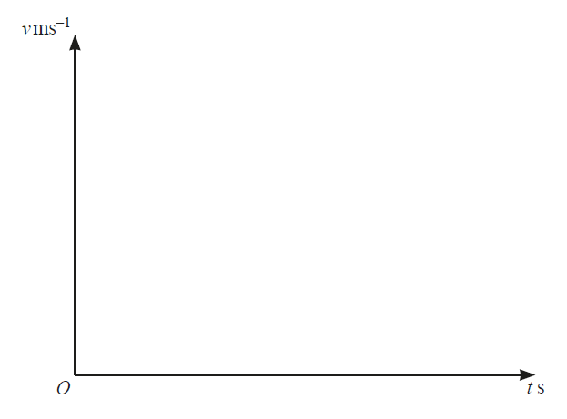

# Exam Questions — Calculus for Kinematics
**Calculus** · Cambridge (CIE) IGCSE further-maths (0606)
> Source: [https://www.savemyexams.com/igcse/further-maths/cie/additional-maths/25/topic-questions/](https://www.savemyexams.com/igcse/further-maths/cie/additional-maths/25/topic-questions/) · 14 questions across 1 sets

## Exam Questions (14 questions)

### Q1 — hard — 9 marks

**Q1** [4 marks]

A particle travels along a straight line with a velocity, $v$ ms-1, given by

`v equals 6 open parentheses t minus 1 half close parentheses squared plus 5 over 2`

for  $t\geq0$ where $t$ is time in seconds. The particle has an initial displacement of $-1$ metres.

Find the acceleration after 2 seconds.

**Q1** [4 marks]

Find the displacement after 2 seconds.

**Q1** [1 mark]

Explain why a velocity-time graph and a speed-time graph will always be the same for this particle.

### Q2 — medium — 6 marks

**Q2** [3 marks]

A particle $P$ moves in a straight line such that, $t$ seconds after passing through a fixed point $O$, its acceleration, $a\mathrm{ms}^{-2}$, is given by $a=-6$. When $t=0$, the velocity of $P$ is $18\mathrm{ms}^{-1}$.

Find the time at which $P$ comes to instantaneous rest.

*Source: March 2020 0606/22 Q12A*

**Q2** [3 marks]

**Extract:**

A particle P moves in a straight line such that, t seconds after passing through a fixed point O, its acceleration, a ms^-2, is given by a = -6. When t = 0, the velocity of P is 18 ms^-1.

Find the distance travelled by $P$ in the 3rd second.

*Source: March 2020 0606/22 Q12B*

### Q3 — hard — 7 marks

**Q3** [3 marks]

At time $ts$, a particle travelling in a straight line has acceleration `open parentheses 2 t plus 1 close parentheses to the power of negative 1 half end exponent space ms to the power of negative 2 end exponent`. When $t=0$, the particle is $4m$ from a fixed point $O$ and is travelling with velocity $8\mathrm{ms}^{-1}$ away from $O$.

Find the velocity of the particle at time $ts$.

*Source: june 2020 0606/13 Q3A*

**Q3** [4 marks]

**Extract:**

At time t s, a particle travelling in a straight line has acceleration (2t+1)^(-1/2) ms^(-2). When t = 0, the particle is 4 m from a fixed point O and is travelling with velocity 8 ms^(-1) away from O.

Find the displacement of the particle from $O$ at time $ts$.

*Source: june 2020 0606/13 Q3B*

### Q4 — hard — 8 marks

**Q4** [3 marks]

In this question, the units are metres and seconds. A particle $P$ is travelling in a straight line. Its acceleration, $a$, away from a fixed point $O$, at time $t$, is given by `a space equals space open parentheses 3 t space plus space 2 close parentheses to the power of negative 1 third end exponent`, where `t space greater-than or slanted equal to space 0`. When$t=2$, $P$ is travelling with a velocity of 8 and has a displacement of $--4.8$ from $O$.

Find an expression for the velocity of $P$ at time $t$.

*Source: Specimen 2025 Paper 1 Q9A*

**Q4** [1 mark]

**Extract:**

In this question, the units are metres and seconds. A particle P is travelling in a straight line. Its acceleration, a, away from a fixed point O, at time t, is given by a = (3t + 2)^(-1/3), where t ≥ 0. When t = 2, P is travelling with a velocity of 8 and has a displacement of -4.8 from O.

The velocity of P at time t is:
v = (1/2)(3t + 2)^(2/3) + 6

Explain why $P$ is never at rest.

*Source: Specimen 2025 Paper 1 Q9B*

**Q4** [4 marks]

**Extract:**

In this question, the units are metres and seconds. A particle P is travelling in a straight line. Its acceleration, a, away from a fixed point O, at time t, is given by a = (3t + 2)^(-1/3), where t ≥ 0. When t = 2, P is travelling with a velocity of 8 and has a displacement of -4.8 from O.

The velocity of P at time t is: v = 1/2(3t + 2)^(2/3) + 6

Find the displacement of $P$ from $O$ when $t=\frac{25}{3}$ .

*Source: Specimen 2025 Paper 1 Q9C*

### Q5 — hard — 4 marks

**Q5** [4 marks]

The diagram shows the $x--t$ graph for a runner, where displacement, $x$, is measured in metres and time, $t$, is measured in seconds.

(i) On the axes below, draw the $v--t$ graph for the runner.

[3]

(ii) Find the total distance covered by the runner in 125 s.

[1]

*Source: Nov 2020 0606/13 Q4A*

### Q6 — medium — 6 marks

**Q6** [6 marks]

The acceleration, $a\mathrm{ms}^{-2}$, of a particle $Q$ travelling in a straight line, is given by $a=6\mathrm{cos}2t$ at time $ts$. When $t=0$ the particle is at point $O$ and is travelling with a velocity of $10\mathrm{ms}^{-1}$.

(i) Find the velocity of $Q$ at time $t$.

[3]

(ii) Find the displacement of $Q$ from $O$ at time $t$.

[3]

*Source: Nov 2020 0606/12 Q12B*

### Q7 — hard — 3 marks

**Q7** [3 marks]

In this question, all lengths are in metres and time, $t$, is in seconds.

The diagram shows the displacement–time graph for a runner, for `0 space less-than or slanted equal to space t space less-than or slanted equal to space 40`.

(i) Find the distance the runner has travelled when $t=40$.

(ii) On the axes, draw the corresponding velocity–time graph for the runner, for `0 space less-than or slanted equal to space t space less-than or slanted equal to space 40.`

*Source: june 2021 paper 11 Q7A*

### Q8 — very_hard — 8 marks

**Q8** [3 marks]

A particle moves in a straight line such that, $t$ seconds after passing a fixed point $O$, its displacement from $O$ is $sm$, where $s=e^{2t}-10e^{t}-12t+9$.

Find expressions for the velocity and acceleration at time $t$.

*Source: Nov 2020 0606/21 Q9A*

**Q8** [3 marks]

**Extract:**

A particle moves in a straight line such that, t seconds after passing a fixed point O, its displacement from O is s m, where s = e^(2t) - 10e^t - 12t + 9.

Velocity is the change in speed with respect to time, therefore differentiate to get

v = ds/dt = 2e^(2t) - 10e^t - 12

Find the time when the particle is instantaneously at rest.

*Source: Nov 2020 0606/21 Q9B*

**Q8** [2 marks]

**Extract:**

A particle moves in a straight line such that, t seconds after passing a fixed point O, its displacement from O is s m, where s = e^(2t) - 10e^t - 12t + 9.

Acceleration is a = 4e^(2t) - 10e^t

The time when the particle is instantaneously at rest is t = ln 6 (seconds)

Find the acceleration at this time.

*Source: Nov 2020 0606/21 Q9C*

### Q9 — medium — 4 marks

**Q9** [4 marks]

The diagram shows the velocity–time graph of a particle $P$ that travels 2775 m in 90 s, reaching a final velocity of $V\mathrm{ms}^{-1}$.

(i) Find the value of $V$.

[3]

(ii) Write down the acceleration of $P$ when $t=40$.

[1]

*Source: Nov 2020 0606/12 Q12A*

### Q10 — hard — 5 marks

**Q10** [5 marks]

A particle $P$ moves in a straight line such that its displacement, $xm$, from a fixed point $O$ at time $ts$ is given by  $x=10\mathrm{sin}2t-5$.

(i) Find the speed of $P$ when $t=π$.

[1]

(ii) Find the value of $t$ for which $P$ is first at rest.

[2]

(iii) Find the acceleration of $P$ when it is first at rest.

[2]

*Source: june 2020 0606/12 Q9A*

### Q11 — medium — 7 marks

**Q11** [7 marks]

The diagram shows the velocity–time graph for a particle $Q$ travelling in a straight line with velocity $v\mathrm{ms}^{-1}$ at time $ts$. The particle accelerates at $3.5\mathrm{ms}^{-2}$ for the first 10 s of its motion and then travels at constant velocity, $V\mathrm{ms}^{-1}$, for $10s$. The particle then decelerates at a constant rate and comes to rest. The distance travelled during the interval $20\leqt\leq25is112.5m$.

(i) Find the value of $V$.

[1]

(ii) Find the velocity of $Q$ when $t=25$.

[3]

(iii) Find the value of $t$ when $Q$ comes to rest.

[3]

*Source: june 2020 0606/12 Q9B*

### Q12 — hard — 6 marks

**Q12** [6 marks]

A particle, $P$, moves in a straight line such that its displacement from a fixed point at time $t$ is s.

The acceleration of $P$ is given by `open parentheses 2 t space plus space 4 close parentheses to the power of negative 1 half end exponent comma space for space t greater than 0`

(i) Given that $P$ has a velocity of 9 when $t=6$, find the velocity of $P$ at time $t$.

(ii) Given that s = $\frac{1}{3}$ when $t=6$, find the displacement of $P$ at time $t$.

*Source: june 2021 paper 11 Q7B*

### Q13 — hard — 7 marks

**Q13** [3 marks]

A particle travels in a straight line. As it passes through a fixed point $O$, the particle is travelling at a velocity of $3\mathrm{ms}^{--1}$. The particle continues at this velocity for 60 seconds then decelerates at a constant rate for 15 seconds to a velocity of $1.6\mathrm{ms}^{--1}$. The particle then decelerates again at a constant rate for 5 seconds to reach point $A$, where it stops.

Sketch the velocity-time graph for this journey on the axes below.

*Source: june 2020 0606/21 Q9A*

**Q13** [3 marks]

**Extract:**

A particle travels in a straight line. As it passes through a fixed point O, the particle is travelling at a velocity of 3 m/s. The particle continues at this velocity for 60 seconds then decelerates at a constant rate for 15 seconds to a velocity of 1.6 m/s. The particle then decelerates again at a constant rate for 5 seconds to reach point A, where it stops.

Find the distance between $O$ and $A$.

*Source: june 2020 0606/21 Q9B*

**Q13** [1 mark]

**Extract:**

A particle travels in a straight line. As it passes through a fixed point O, the particle is travelling at a velocity of 3 ms^-1. The particle continues at this velocity for 60 seconds then decelerates at a constant rate for 15 seconds to a velocity of 1.6 ms^-1. The particle then decelerates again at a constant rate for 5 seconds to reach point A, where it stops.

Find the deceleration in the last 5 seconds.

*Source: june 2020 0606/21 Q9C*

### Q14 — medium — 3 marks

**Q14** [3 marks]

The displacement,$xm$, of a particle from a fixed point at time$ts$ is given by `x equals space 6 space cos open parentheses 3 t plus straight pi over 3 close parentheses`.
 Find the acceleration of the particle when $t=\frac{2π}{3}$.

*Source: Nov 2020 0606/13 Q4B*

