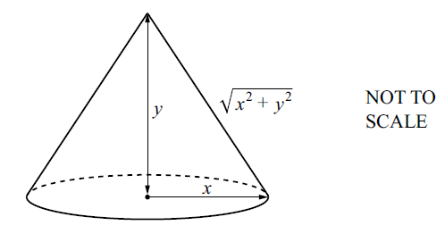
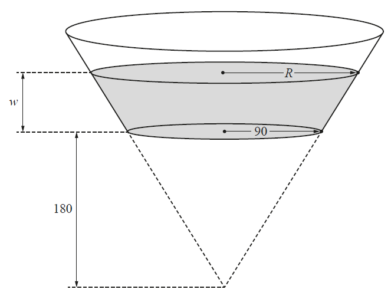
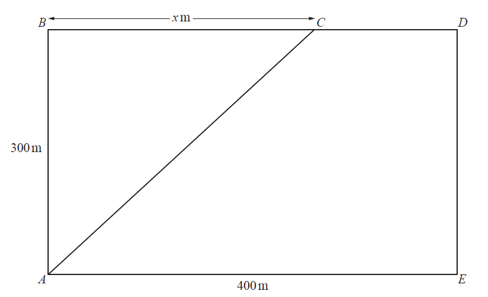
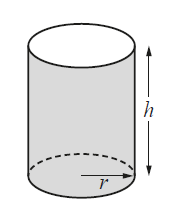
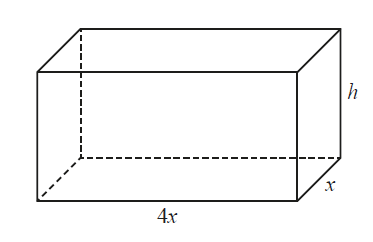

# Exam Questions — Differentiation
**Calculus** · Cambridge (CIE) IGCSE further-maths (0606)
> Source: [https://www.savemyexams.com/igcse/further-maths/cie/additional-maths/25/topic-questions/](https://www.savemyexams.com/igcse/further-maths/cie/additional-maths/25/topic-questions/) · 32 questions across 1 sets

## Exam Questions (32 questions)

### Q1 — hard — 4 marks

**Q1** [4 marks]

A curve is given by `y equals ln open parentheses 1 plus x to the power of 4 close parentheses`.

Use calculus to find the approximate change in $y$ as $x$ increases from $-1$ to $-1+k$ where $k$ is small.

### Q2 — hard — 10 marks

**Q2** [3 marks]

A sector from a circle of radius $r$ has an internal angle of $θ$ radians, as shown below.

The perimeter of the sector is 4 units and the area of the sector is $A$ square units.

Show that `A equals fraction numerator 8 theta over denominator open parentheses 2 plus theta close parentheses squared end fraction`.

**Q2** [3 marks]

Show that `fraction numerator straight d A over denominator straight d theta end fraction equals fraction numerator p open parentheses q minus theta close parentheses over denominator open parentheses 2 plus theta close parentheses cubed end fraction` where $p$ and $q$ are constants to be found.

**Q2** [4 marks]

Find the maximum area of the sector. You must show that this area is a maximum.

### Q3 — very_hard — 8 marks

**Q3** [2 marks]

A curve has the equation `y equals straight e to the power of open parentheses 4 x minus x squared close parentheses end exponent`.

Find and factorise an expression for $\frac{dy}{dx}$.

**Q3** [2 marks]

Hence find `integral fraction numerator open parentheses 2 minus x close parentheses straight e to the power of 4 x end exponent over denominator straight e to the power of x squared end exponent end fraction straight d x`.

**Q3** [4 marks]

Show that the second derivative of the curve `y equals straight e to the power of open parentheses 4 x minus x squared close parentheses end exponent` satisfies the relationship

`fraction numerator straight d squared y over denominator straight d x squared end fraction equals open parentheses p plus q x plus r x squared close parentheses y`

where $p$, $q$ and $r$ are constants to be found.

### Q4 — hard — 4 marks

**Q4** [4 marks]

A sphere of radius $r$ cm and volume $V$ cm3  is increasing in size with time $t$ seconds. The volume increases at a constant rate of 24 cm3 s-1.

Find the exact rate at which the radius is increasing when the sphere reaches a volume of $\frac{32π}{3}$ cm3.

### Q5 — medium — 8 marks

**Q5** [5 marks]

A curve has equation $y=(2x-1)\sqrt{4x+3}$.

Show that `fraction numerator straight d y over denominator straight d x end fraction equals fraction numerator 4 open parentheses A x plus B close parentheses over denominator square root of 4 x plus 3 end root end fraction`, where $A$ and $B$ are constants.

*Source: Nov 2020 0606/12 Q9A*

**Q5** [1 mark]

**Extract:**

A curve has equation y = (2x-1)√(4x+3).

Show that dy/dx = 4(Ax+B)/√(4x+3), where A and B are constants.

From the mark scheme: dy/dx = 4(3x+1)/√(4x+3)

Hence write down the $x$-coordinate of the stationary point of the curve.

*Source: Nov 2020 0606/12 Q9B*

**Q5** [2 marks]

**Extract:**

A curve has equation y space equals space left parenthesis 2 x minus 1 right parenthesis space square root of 4 x plus 3 end root.

fraction numerator straight d y over denominator straight d x end fraction equals fraction numerator 4 open parentheses 3 x plus 1 close parentheses over denominator square root of 4 x plus 3 end root end fraction

The x-coordinate of the stationary point of the curve is x equals negative 1 third.

Determine the nature of this stationary point.

*Source: Nov 2020 0606/12 Q9C*

### Q6 — medium — 11 marks

**Q6** [6 marks]

The equation of a curve is $y=x\sqrt{16-x^{2}}\mathrm{for}0\leqx\leq4$.

Find the exact coordinates of the stationary point of the curve.

*Source: Nov 2020 0606/21 Q11A*

**Q6** [5 marks]

Find `fraction numerator straight d over denominator straight d x end fraction open parentheses 16 minus x squared close parentheses to the power of 3 over 2 end exponent`and hence evaluate the area enclosed by the curve $y=x\sqrt{16-x^{2}}$ and the lines $y=0,x=1\mathrm{and}x=3$.

*Source: Nov 2020 0606/21 Q11B*

### Q7 — very_hard — 8 marks

**Q7** [3 marks]

In this question, all lengths are in centimetres.

The diagram shows a cone of base radius $x$, height $y$ and sloping edge $\sqrt{x^{2}+y^{2}}$. The volume of the cone is $10π\mathrm{cm}^{3}$.

Show that the curved surface area, $S$, of the cone is given by $S=\frac{π\sqrt{x^{6}+900}}{x}$.

*Source: Specimen 2025 Paper 2 Q11A*

**Q7** [5 marks]

**Extract:**

In this question, all lengths are in centimetres.

The diagram shows a cone of base radius x, height y and sloping edge √(x² + y²). The volume of the cone is 10π cm³.

Show that the curved surface area, S, of the cone is given by S = (π√(x^6 + 900))/x.

Given that $x$ can vary and that $S$ has a minimum value, find the value of $x$ for which $S$ is a minimum.

*Source: Specimen 2025 Paper 2 Q11B*

### Q8 — hard — 6 marks

**Q8** [3 marks]

It is given that $y=\mathrm{ln}(\mathrm{sin}x+3\mathrm{cos}x)\mathrm{for}0<x<\frac{π}{2}$.

Find $\frac{dy}{dx}$.

*Source: Nov 2020 0606/21 Q4A*

**Q8** [3 marks]

**Extract:**

y = ln(sin x + 3 cos x) for 0 < x < π/2

dy/dx = (cos x - 3 sin x)/(sin x + 3 cos x)

Find the value of $x$ for which $\frac{dy}{dx}=-\frac{1}{2}$.

*Source: Nov 2020 0606/21 Q4B*

### Q9 — medium — 10 marks

**Q9** [5 marks]

Given that `y equals open parentheses x squared minus 1 close parentheses square root of 5 x plus 2 end root`, show that $\frac{dy}{dx}=\frac{Ax^{2}+Bx+C}{2\sqrt{5x+2}}$, where $A,B$ and $C$ are integers.

*Source: june 2020 0606/12 Q7A*

**Q9** [3 marks]

**Extract:**

Given that y equals open parentheses x squared minus 1 close parentheses square root of 5 x plus 2 end root, show that fraction numerator straight d y over denominator straight d x end fraction equals fraction numerator A x squared plus B x plus C over denominator 2 square root of 5 x plus 2 end root end fraction, where A comma space B and C are integers.

The derivative is: fraction numerator straight d y over denominator straight d x end fraction equals fraction numerator 25 x squared plus 8 x minus 5 over denominator 2 square root of 5 x plus 2 end root end fraction

Find the coordinates of the stationary point of the curve `y equals open parentheses x squared minus 1 close parentheses square root of 5 x plus 2 end root space for space x greater than 0`. Give each coordinate correct to 2 significant figures.

*Source: june 2020 0606/12 Q7B*

**Q9** [2 marks]

**Extract:**

Given that y equals open parentheses x squared minus 1 close parentheses square root of 5 x plus 2 end root, from part (a): fraction numerator straight d y over denominator straight d x end fraction equals fraction numerator 25 x squared plus 8 x minus 5 over denominator 2 square root of 5 x plus 2 end root end fraction

From part (b): The stationary point of the curve y equals open parentheses x squared minus 1 close parentheses square root of 5 x plus 2 end root space for space x greater than 0 occurs at x equals 0.315 and y equals minus 1.70 (coordinates to 2 significant figures).

Determine the nature of this stationary point.

*Source: june 2020 0606/12 Q7C*

### Q10 — medium — 6 marks

**Q10** [2 marks]

A curve has equation $y=x\mathrm{cos}x$.

Find $\frac{dy}{dx}$.

*Source: Nov 2020 0606/23 Q7A*

**Q10** [4 marks]

**Extract:**

A curve has equation y = x cos x.

dy/dx = -x sin x + cos x

Find the equation of the normal to the curve at the point where $x=π$, giving your answer in the form $y=mx+c$.

*Source: Nov 2020 0606/23 Q7B*

### Q11 — medium — 4 marks

**Q11** [4 marks]

The radius, $r\mathrm{cm}$, of a circle is increasing at the rate of $5\mathrm{cms}^{--1}$. Find, in terms of $π$, the rate at which the area of the circle is increasing when $r=3$.

*Source: June 2020 0606/11 Q3*

### Q12 — hard — 7 marks

**Q12** [7 marks]

A curve has equation $y=\mathrm{ln}(5--3x)$ where $x<\frac{5}{3}$. The normal to the curve at the point where $x=--5$ , cuts the $x$-axis, at the point $P$. 
Find the equation of the normal and the $x$-coordinate of $P$.

*Source: Specimen 2025 Paper 2 Q6*

### Q13 — hard — 10 marks

**Q13** [5 marks]

$y=x\sqrt{x+2}$ Given that , show that $\frac{dy}{dx}=\frac{Ax+B}{2\sqrt{x+2}}$, where $A$ and $B$ are constants.

*Source: june 2020 0606/13 Q10A*

**Q13** [3 marks]

**Extract:**

y = x√(x+2)

From part (a): dy/dx = (3x+4)/(2√(x+2))

Find the exact coordinates of the stationary point of the curve $y=x\sqrt{x+2}$.

*Source: june 2020 0606/13 Q10B*

**Q13** [2 marks]

**Extract:**

y = x√(x+2)

dy/dx = (3x + 4)/(2√(x+2))

Stationary point occurs at x = -4/3

Determine the nature of this stationary point.

*Source: june 2020 0606/13 Q10C*

### Q14 — medium — 4 marks

**Q14** [4 marks]

The volume, $V$, of a sphere of radius $r$ is given by $V=\frac{4}{3}\mathrm{πr}^{3}$. The radius, $r\mathrm{cm}$, of a sphere is increasing at the rate of $0.5\mathrm{cms}^{-1}$. Find, in terms of $π$, the rate of change of the volume of the sphere when $r=0.25$.

*Source: june 2020 0606/12 Q2*

### Q15 — hard — 6 marks

**Q15** [6 marks]

The tangent to the curve `y equals ln open parentheses 3 x squared minus 4 close parentheses minus x cubed over 6`, at the point where $x=2$, meets the $y$-axis at the point $P$. Find the exact coordinates of $P$.

*Source: March 2020 Paper 12 Q4*

### Q16 — hard — 6 marks

**Q16** [6 marks]

Variables $x$ and $y$ are such that $y=e^{\frac{x}{2}}+x\mathrm{cos}2x$ , where $x$ is in radians. Use differentiation to find the approximate change in $y$ as $x$ increases from 1 to $1+h$, where $h$ is small.

*Source: June 2021 Paper 21 Q6*

### Q17 — very_hard — 6 marks

**Q17** [6 marks]

Variables $x$ and $y$ are such that $y=\frac{e^{3x}\mathrm{sin}x}{x^{2}}$ .Use differentiation to find the approximate change in $y$as $x$ increases from $0.5\mathrm{to}0.5+h$, where $h$is small.

*Source: March 2020 0606/22 Q9*

### Q18 — medium — 3 marks

**Q18** [3 marks]

Find the $x$-coordinate of the stationary point on the curve `y space equals open parentheses 2 minus space square root of 3 close parentheses x squared space plus space x minus 1`, giving your answer in the form $a+b\sqrt{3}$,where $a$ and $b$ are rational numbers.

*Source: june 2021 paper 11 Q8B*

### Q19 — medium — 4 marks

**Q19** [4 marks]

Variables $x$ and $y$ are such that $y=\mathrm{sin}x+e^{-x}$. Use differentiation to find the approximate change in $y$ as $x$increases from $\frac{π}{4}\mathrm{to}\frac{π}{4}+h$, where h is small.

*Source: june 2020 paper 22 Q1*

### Q20 — very_hard — 7 marks

**Q20** [3 marks]

In this question all lengths are in centimetres. The volume, $V$, of a cone of height $h$ and base radius $r$ is given by $V=\frac{1}{3}πr^{2}h$

The diagram shows a large hollow cone from which a smaller cone of height 180 and base radius 90 has been removed. The remainder has been fitted with a circular base of radius 90 to form a container for water. The depth of water in the container is w and the surface of the water is a circle of radius $R$.

Find an expression for $R$ in terms of $w$ and show that the volume $V$ of the water in the container is given by `V equals space straight pi over 12 open parentheses w plus 180 close parentheses cubed space minus 486000 straight pi`.

*Source: june 2020 0606/23 Q11A*

**Q20** [4 marks]

**Extract:**

The diagram shows a large hollow cone from which a smaller cone of height 180 and base radius 90 has been removed. The remainder has been fitted with a circular base of radius 90 to form a container for water. The depth of water in the container is w and the surface of the water is a circle of radius R.

Find an expression for R in terms of w and show that the volume V of the water in the container is given by V = (π/12)(w + 180)³ - 486000π.

Water is poured into the container at a rate of $10000\mathrm{cm}^{3}s^{-1}$. Find the rate at which the depth of the water is increasing when $w=10$.

*Source: june 2020 0606/23 Q11B*

### Q21 — medium — 9 marks

**Q21** [4 marks]

Find the equation of the tangent to the curve $y=x^{3}-6x^{2}+3x+10$ at the point where $x=1$.

*Source: Nov 2020 0606/22 Q5A*

**Q21** [5 marks]

**Extract:**

Find the equation of the tangent to the curve y = x³ - 6x² + 3x + 10 at the point where x = 1.

The equation of the tangent is y = -6x + 14

Find the coordinates of the point where this tangent meets the curve again.

*Source: Nov 2020 0606/22 Q5B*

### Q22 — medium — 3 marks

**Q22** [3 marks]

Given that $y=\mathrm{tan}x$, use calculus to find the approximate change in $y$ as $x$ increases from $-\frac{π}{4}$ to $h-\frac{π}{4}$, where $h$ is small.

*Source: Specimen 2025 Paper 2 Q5*

### Q23 — very_hard — 9 marks

**Q23** [3 marks]

The rectangle $ABCDE$ represents a ploughed field where $AB=300m$ and $AE=400m$. Joseph needs to walk from $A$ to $D$ in the least possible time. He can walk at $0.9\mathrm{ms}^{-1}$ on the ploughed field and at $1.5\mathrm{ms}^{-1}$ on any part of the path $BCD$ along the edge of the field. He walks from $A$ to $C$ and then from $C$ to $D$. The distance $BC=xm$.

Find, in terms of $x$, the total time, $Ts$, Joseph takes for the journey.

*Source: Nov 2020 0606/23 Q9A*

**Q23** [6 marks]

**Extract:**

The rectangle ABCDE represents a ploughed field where AB = 300 m and AE = 400 m. Joseph needs to walk from A to D in the least possible time. He can walk at 0.9 ms⁻¹ on the ploughed field and at 1.5 ms⁻¹ on any part of the path BCD along the edge of the field. He walks from A to C and then from C to D. The distance BC = x m.

T equals 10 over 9 square root of 90 space 000 plus x squared end root plus fraction numerator 2 open parentheses 400 minus x close parentheses over denominator 3 end fraction

Given that $x$ can vary, find the value of $x$ for which $T$ is a minimum and hence find the minimum value of $T$.

*Source: Nov 2020 0606/23 Q9B*

### Q24 — hard — 8 marks

**Q24** [2 marks]

Differentiate $y=\mathrm{tan}(x+4)-3\mathrm{sin}x$ with respect to $x$.

*Source: june 2020 0606/23 Q8A*

**Q24** [6 marks]

Variables $x$ and $y$ are such that `y equals fraction numerator ln open parentheses 2 x plus 5 close parentheses over denominator 2 e to the power of 3 x end exponent end fraction`. Use differentiation to find the approximate change in $y$ as $x$ increases from $1\mathrm{to}1+h$, where $h$ is small.

*Source: june 2020 0606/23 Q8B*

### Q25 — hard — 8 marks

**Q25** [8 marks]

A container is a circular cylinder, open at one end, with a base radius of $r$ cm and a height of $h$ cm. The volume of the container is 1000 cm3. Given that $r$ and $h$ can vary and that the total outer surface area of the container has a minimum value, find this value.

*Source: March 2020 0606/22 Q11*

### Q26 — very_hard — 7 marks

**Q26** [6 marks]

A curve has equation `y equals fraction numerator ln open parentheses 3 x squared minus 5 close parentheses over denominator 2 x plus 1 end fraction space for space 3 x squared greater than 5`

Find the equation of the normal to the curve at the point where $x=\sqrt{2}$.

*Source: Nov 2020 0606/12 Q7A*

**Q26** [1 mark]

**Extract:**

A curve has equation y equals fraction numerator ln open parentheses 3 x squared minus 5 close parentheses over denominator 2 x plus 1 end fraction space for space 3 x squared greater than 5

At the point where x space equals space square root of 2:

fraction numerator straight d y over denominator straight d x end fraction equals fraction numerator 6 square root of 2 over denominator 2 square root of 2 plus 1 end fraction

Find the approximate change in $y$ as $x$ increases from $\sqrt{2}\mathrm{to}\sqrt{2}+h$, where $h$ is small.

*Source: Nov 2020 0606/12 Q7B*

### Q27 — hard — 7 marks

**Q27** [4 marks]

It is given that $y=\frac{\mathrm{tan}3x}{\mathrm{sin}x}$.

Find the exact value of $\frac{dy}{dx}$ when $x=\frac{π}{3}$.

*Source: Nov 2020 0606/11 Q4A*

**Q27** [1 mark]

**Extract:**

It is given that y equals fraction numerator tan space 3 x over denominator sin space x end fraction.

Find the exact value of fraction numerator straight d y over denominator straight d x end fraction when x equals straight pi over 3.

At x = π/3, dy/dx = 2√3

Hence find the approximate change in $y$ as $x$ increases from $\frac{π}{3}\mathrm{to}\frac{π}{3}+h,$ where $h$ is small.

*Source: Nov 2020 0606/11 Q4B*

**Q27** [2 marks]

**Extract:**

It is given that y equals fraction numerator tan space 3 x over denominator sin space x end fraction.

Find the exact value of fraction numerator straight d y over denominator straight d x end fraction when x equals straight pi over 3.

Given that $x$ is increasing at the rate of 3 units per second, find the corresponding rate of change in $y$ when $x=\frac{π}{3}$ , giving your answer in its simplest surd form.

*Source: Nov 2020 0606/11 Q4C*

### Q28 — medium — 9 marks

**Q28** [2 marks]

It is given that $y=\mathrm{ln}(1+\mathrm{sin}x)$ for $0<x<π$ .

Find $\frac{dy}{dx}$

*Source: Nov 2020 0606/23 Q4A*

**Q28** [2 marks]

**Extract:**

It is given that y = ln(1 + sin x) for 0 < x < π.

Find dy/dx

To differentiate y = ln(1 + sin x), we can use the fact that the differential of ln x is 1/x and chain rule.

dy/dx = 1/(1 + sin x) × cos x

dy/dx = (cos x)/(1 + sin x)

Find the value of $\frac{dy}{dx}$ when $x=\frac{π}{6}$, giving your answer in the form $\frac{1}{\sqrt{a}}$, where $a$ is an integer.

*Source: Nov 2020 0606/23 Q4B*

**Q28** [5 marks]

**Extract:**

It is given that y = ln(1 + sin x) for 0 < x < π.

Find dy/dx

dy/dx = cos x / (1 + sin x)

Find the values of $x$ for which $\frac{dy}{dx}=\mathrm{tan}x$.

*Source: Nov 2020 0606/23 Q4C*

### Q29 — hard — 13 marks

**Q29** [6 marks]

Find the $x$-coordinates of the stationary points of the curve $y=e^{3x}(2x+3)^{6}$.

*Source: june 2020 0606/21 Q12A*

**Q29** [2 marks]

A curve has equation $y=f(x)$ and has exactly two stationary points. Given that $f^{"}(x)=4x-7$, $f'(0.5)=0\mathrm{and}f'(3)=0$, use the second derivative test to determine the nature of each of the stationary points of this curve.

*Source: june 2020 0606/21 Q12B*

**Q29** [5 marks]

In this question all lengths are in centimetres.

The diagram shows a solid cuboid with height $h$ and a rectangular base measuring $4x$ by $x$. The volume of the cuboid is $40\mathrm{cm}^{3}$. Given that $x$ and $h$ can vary and that the surface area of the cuboid has a minimum value, find this value.

*Source: june 2020 0606/21 Q12C*

### Q30 — medium — 6 marks

**Q30** [6 marks]

Find the equation of the tangent to the curve `y equals fraction numerator ln open parentheses 3 x squared minus 1 close parentheses over denominator x plus 2 end fraction` at the point where $x=1$. Give your answer in the form$y=mx+c$, where $m$ and $c$ are constants correct to 3 decimal places.

*Source: june 2020 0606/11 Q5*

### Q31 — hard — 6 marks

**Q31** [3 marks]

Given that $y=\frac{e^{2x-3}}{x^{2}+1}$, find $\frac{dy}{dx}$.

*Source: Nov 2020 0606/13 Q2A*

**Q31** [3 marks]

**Extract:**

Given that y equals fraction numerator straight e to the power of 2 x minus 3 end exponent over denominator x squared plus 1 end fraction, find fraction numerator straight d y over denominator straight d x end fraction.

Differentiate the equation using the quotient rule and chain rule.

u equals straight e to the power of 2 x minus 3 end exponent    v equals x squared plus 1

fraction numerator straight d u over denominator straight d x end fraction equals 2 straight e to the power of 2 x minus 3 end exponent  fraction numerator straight d v over denominator straight d x end fraction equals 2 x

Substitute into the quotient rule, fraction numerator straight d y over denominator straight d x end fraction equals fraction numerator open parentheses v close parentheses open parentheses fraction numerator straight d u over denominator straight d x end fraction close parentheses minus open parentheses u close parentheses open parentheses fraction numerator straight d v over denominator straight d x end fraction close parentheses over denominator v squared end fraction.

fraction numerator straight d y over denominator straight d x end fraction equals fraction numerator open parentheses x squared plus 1 close parentheses open parentheses 2 straight e to the power of 2 x minus 3 end exponent close parentheses minus open parentheses 2 x close parentheses open parentheses straight e to the power of 2 x minus 3 end exponent close parentheses over denominator open parentheses x squared plus 1 close parentheses squared end fraction

Hence, given that $y$ is increasing at the rate of 2 units per second, find the exact rate of change of $x$ when $x=2$.

*Source: Nov 2020 0606/13 Q2B*

### Q32 — hard — 7 marks

**Q32** [5 marks]

Find the equation of the tangent to the curve $2y=\mathrm{tan}2x+7$ at the point where $x=\frac{π}{8}$. 
Give your answer in the form $ax-y=\frac{π}{b}+c$, where $a,b$ and $c$ are integers.

*Source: june 2020 0606/22 Q6A*

**Q32** [2 marks]

**Extract:**

Find the equation of the tangent to the curve 2y = tan 2x + 7 at the point where x = π/8.

The equation of the tangent is 2x - y = π/4 - 4

This tangent intersects the $x$-axis at $P$ and the $y$-axis at $Q$. Find the length of $PQ$.

*Source: june 2020 0606/22 Q6B*

