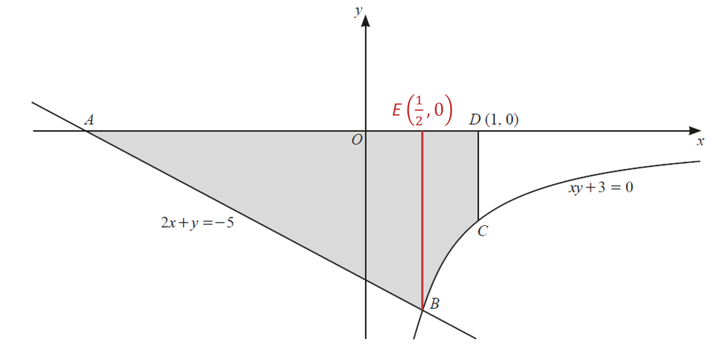
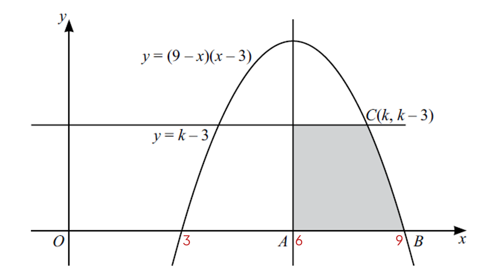
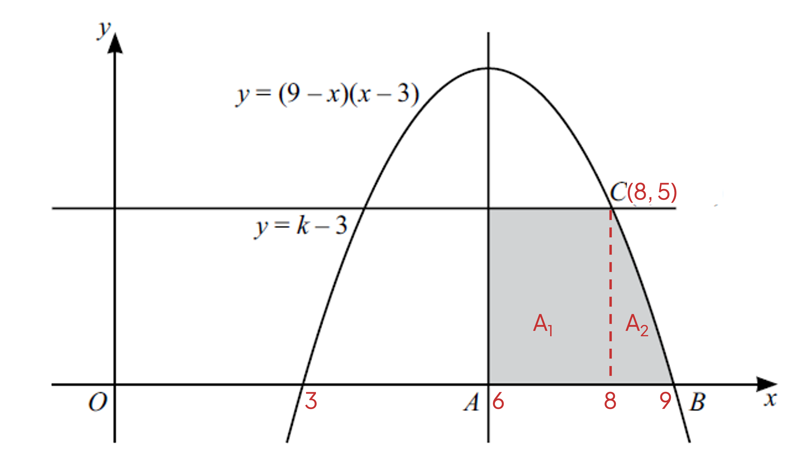

# Mark Schemes — Integration
**Calculus** · Cambridge (CIE) IGCSE further-maths (0606)

## Exam Questions (19 questions)

### Q1
> *The area enclosed between the top curve *$y = 2 + \cos ( 2 x )$* and the bottom curve *$y=\mathrm{sec}^{2}x$* between  *$x=-\frac{π}{4}$* and *$x=\frac{π}{4}$* is*

$\int_{- \frac{\pi }{4} }^{ \frac{\pi }{4} } ( 2 + \cos ( 2 x ) - \sec ^{2} x ) d x$

**[M1 A1]**

> **[mark-scheme]**
> **M1:** For either $\int ( 2 + \cos ( 2 x ) - \sec ^{2} x ) \mathrm{d} x$ or  $\int ( 2 + \cos ( 2 x ) ) \mathrm{d} x - \int \sec ^{2} x \mathrm{d} x$.
> 
> **A1:** For either statement in M1 with the correct limits.

> *Integrate the second term using *$\int \cos ( a x ) \mathrm{d} x = \frac{1}{a} \sin ( a x ) + c$

> *Integrate the last term by reversing the fact that *$\mathrm{tan}x$* differentiates to *$\mathrm{sec}^{2}x$

$= [ 2 x + 1 \frac{1}{2} \sin 2 x - \tan x ]_{- \frac{\pi }{4} }^{ \frac{\pi }{4} }$

**[M1 A1]**

> **[mark-scheme]**
> **M1:** For seeing either $\mathrm{tan}x$ or $k\mathrm{sin}2x$.
> 
> **A1:** For all 3 terms integrated correctly.

> *Substitute in the limits*

$= ( 2 ( \frac{\pi }{4} ) + 1 \frac{1}{2} \sin ( \frac{2 \pi }{4} ) - \tan \frac{\pi }{4} ) - ( 2 ( - \frac{\pi }{4} ) + 1 \frac{1}{2} \sin ( - \frac{2 \pi }{4} ) - \tan ( - \frac{\pi }{4} ) )$

**[M1]**

> *Simplify using your calculator*

$= ( \frac{\pi }{2} + 1 \frac{1}{2} - 1 ) - ( - \frac{\pi }{2} - 1 \frac{1}{2} - ( - 1 ) )
= \frac{\pi }{2} - 1 \frac{1}{2} + \frac{\pi }{2} - 1 \frac{1}{2}
= \pi - 1$

**Final answer:** $( \pi - 1 )$** square units**

**[A1]**

### Q2
(a)

> *Substitute in *$m=2$

$\int \frac{1}{( 7 x + 4 )^{2}} \mathrm{d} x$

> *Write it in the form *$( a x + b )^{n}$* using negative indices*

$\int ( 7 x + 4 )^{- 2} \mathrm{d} x$

> *Use the rule *$\int ( a x + b )^{n \mathrm{d} x = \frac{1}{a} \times \frac{1}{n + 1} ( a x + b )^{n} + 1} + c$

$\int ( 7 x + 4 )^{- 2} \mathrm{d} x = \frac{1}{7} \times \frac{1}{- 2 + 1} ( 7 x + 4 )^{- 2 + 1} + c$

> *Simplify*

$\begin{gathered} = \frac{1}{7} \times \frac{1}{- 1} ( 7 x + 4 )^{- 1} + c \\ = - \frac{1}{7} ( 7 x + 4 )^{- 1} + c \end{gathered}$

> *Present the final answer (including *$+c$*)*

$\begin{gathered} \int ( 7 x + 4 )^{- 2} \mathrm{d} x & = - \frac{1}{7} ( 7 x + 4 )^{- 1} + c \end{gathered}$

**[B2]**

> **[mark-scheme]**
> **B1: **For at least $- \frac{1}{7} ( 7 x + 4 )^{- 1}$ (may not have $+c$).
> 
> **B1:** $- \frac{1}{7} ( 7 x + 4 )^{- 1} + c$ (must have $+c$).

(b)

> *Substitute in *$m=1$

$\int \frac{1}{7 x + 4} \mathrm{d} x$

> *Use the rule *$\int \frac{1}{a x + b} \mathrm{d} x = \frac{1}{a} \ln \vert a x + b \vert + c$

$\int \frac{1}{7 x + 4} \mathrm{d} x = \frac{1}{7} \ln \vert 7 x + 4 \vert + c$

**[B2]**

> **[mark-scheme]**
> **B1:** For at least $\frac{1}{7} \ln \vert 7 x + 4 \vert$ (may not have $+c$).
> 
> **B2:** For $\frac{1}{7} \ln \vert 7 x + 4 \vert + c$ (must have $+c$).

### Q3
> *Differentiate using the chain rule. *

$\begin{gathered} \frac{d}{d x} ( 16 - x^{2} )^{ \frac{3}{2} } & = \frac{3}{2} ( 16 - x^{2} )^{1 \frac{1}{2}} \times ( - 2 x ) \\ = - 3 x ( 16 - x^{2} )^{1 \frac{1}{2}} \end{gathered}$

** ****attempt at chain rule ****[1]**
** ****fully correct**** [1]**

> *The area required is given by the integral*

$\int_{1}^{3} x ( 16 - x^{2} )^{1 \frac{1}{2}} d x$

> *We have just found that the differential of *$( 16 - x^{2} )^{ \frac{3}{2} }$* is *$- 3 x ( 16 - x^{2} )^{1 \frac{1}{2}}$*. This is almost the integrand for the area required - but is "-3" times bigger, so divide the integrand by -3.*

$\begin{gathered} \int_{1}^{3} x ( 16 - x^{2} )^{1 \frac{1}{2}} d x & = - 1 \frac{1}{3} \int_{1}^{3} x ( 16 - x^{2} )^{1 \frac{1}{2}} d x \\ = - 1 \frac{1}{3} [ ( 16 - x^{2} )^{ \frac{3}{2} } ]_{1}^{3} \end{gathered}$

** ****for **$-\frac{1}{3}$**[1]**

**for **$k ( 16 - x^{2} )^{ \frac{3}{2} }$** [1]**

> *Apply the limits.*

$( - 1 \frac{1}{3} ( 16 - 3^{2} )^{ \frac{3}{2} } ) - ( - 1 \frac{1}{3} ( 16 - 1^{2} )^{ \frac{3}{2} } )$

**Area is **$13.2\mathrm{units}^{2}$* ***[1]**

### Q4
> *Expand the numerator.*

$\frac{( x + 1 )^{2}}{x^{2}} = \frac{x^{2} + x + x + 1}{x^{2}}$

**[1]**

> *Simplify the numerator.*

$\frac{( x + 1 )^{2}}{x^{2}} = \frac{x^{2} + 2 x + 1}{x^{2}}$

> *The single term on the denominator means this can be rewritten as three separate terms.*

$\frac{( x + 1 )^{2}}{x^{2}} = \frac{x^{2}}{x^{2}} + \frac{2 x}{x^{2}} + \frac{1}{x^{2}}$

> *Simplify each of these terms.*

$\frac{( x + 1 )^{2}}{x^{2}} = 1 + \frac{2}{x} + \frac{1}{x^{2}}$

**[1]**

> *Rewrite the integral and integrate using the usual rules for powers and *$\frac{1}{x}$*.*

`integral _ 2 ^ 4 ( 1 + 2 x ^ - 1 + x ^ - 2 ) d x = [ | x + 2 ln x - x ^ - 1 | | ] _ 2 end _ ^ 4 end ^`

**two terms correct term**** [1]**

**fully correct ****[1]**

> *Apply the limits.*

$[ \begin{gathered} x + 2 \ln x - x^{- 1} \end{gathered} ]_{ 2}^{ 4} = ( 4 + 2 \ln 4 - 1 \frac{1}{4} ) - ( 2 + 2 \ln 2 - 1 \frac{1}{2} )$

**[1]**

> *Simplify and rewrite *$2\mathrm{ln}4$* as *$2\mathrm{ln}2^{2}$*.*

$= \frac{15}{4} + 2 \ln ( 2^{2} ) - \frac{3}{2} - 2 \ln 2$

> *Simplify using the laws of logarithms.*

$\begin{gathered} = \frac{9}{4} + 4 \ln 2 - 2 \ln 2 \\ = \frac{9}{4} + 2 \ln 2 \end{gathered}$

`equation` **[1]**

### Q5
> *Point **A** has *$y$* coordinate 0. *
*Substitute *$y=0$* into *$2x+y=-5$* to find *$x$*.*

$2x+y=-5$

$2x+0=-5$

$x=-\frac{5}{2}$

*A** *$(-\frac{5}{2},0)$* ***[1]**

> *Point **B **occurs when the straight line and curve intersect. Rearrange the equation of the straight line to make *$y$* the subject.*

$2x+y=-5$

$y=-5-2x$

> *Substitute *$y=-5-2x$* into the curve.*

$xy+3=0$

$x ( - 5 - 2 x ) + 3 = 0$

> *Expand the bracket.*

$-5x-2x^{2}+3=0$

> *Rearrange the equation so that the *$x^{2}$* term is positive.*

$2x^{2}+5x-3=0$

> *Solve the quadratic equation using the quadratic formula.*

$x=\frac{1}{2},-3$

**[1]**

> *From the graph, *$x$* is positive when they intersect.*

$x=\frac{1}{2}$

> *Find *$y$* by substituting *$x=\frac{1}{2}$* into *$y=-5-2x$*.*

$y = - 5 - 2 ( 1 \frac{1}{2} )$

$y=-6$

**B**** **$(\frac{1}{2},-6)$** ****[1]**
> *Work out the area of the shaded area in 2 sections - a triangle and the area 'under' the curve. *
*Let point **E**  be *$( 1 \frac{1}{2} , 0 )$

> *Shaded area = area of triangle **ABE** + area 'under' the curve between **E** and **D**.*

`| Area of \Delta | = 1 half x ( 5 / 2 + 1 half ) x 6 | | _ = 9 |`

**[1]**

> *Find the area of the remaining section using integration. Rearrange the curve to make *$y$* the subject.*

$xy+3=0$

$y=-\frac{3}{x}$

> *Integrate with respect to *$x$* from *$x=\frac{1}{2}$* to *$x=1$*.*

$\int_{1 \frac{1}{2}}^{1} - \frac{3}{x} \mathrm{d} x = [ \begin{gathered} - 3 \ln x \end{gathered} ]_{1 \frac{1}{2}}^{1}$

**[1]**

> *Apply the limits.*

$\int_{1 \frac{1}{2}}^{1} - \frac{3}{x} \mathrm{d} x = ( - 3 \ln 1 ) - ( - 3 \ln ( 1 \frac{1}{2} ) )$

$\int_{1 \frac{1}{2}}^{1} - \frac{3}{x} \mathrm{d} x = 0 + 3 \ln 1 \frac{1}{2}$

$\int_{1 \frac{1}{2}}^{1} - \frac{3}{x} \mathrm{d} x = 3 \ln ( 1 \frac{1}{2} )$

**[1]**

> *Rewrite *$\frac{1}{2}$* as *$2^{-1}$*.*

$\int_{1 \frac{1}{2}}^{1} - \frac{3}{x} \mathrm{d} x = 3 \ln ( 2^{- 1} )$

$\int_{1 \frac{1}{2}}^{1} - \frac{3}{x} \mathrm{d} x = - 3 \ln 2$

**[1]**

> *The answer is negative because the area is below the *$x$*-axis so remember to use the positive area to work out the total area of the shaded region.*

**realisation that value of integral is negative and making the adjustment ****[1]**

$\begin{gathered} \text{Total} \text{area} & = 9 + 3 \ln 2 \\ \text{Total} \text{area} & = 9 + \ln 2^{3} \end{gathered}$

$\mathrm{Area}=9+\mathrm{ln}8$ **[1]**

### Q6
> *The root of the equation *$y = ( x - 3 )^{2}$* is at *$x=3$*.*

$\thereforea=3$

> *Substitute the **y**-coordinate of **B** into the equation *$y = ( x - 3 )^{2}$*.*

$4 = ( x - 3 )^{2}$

> *Square root both sides.*

$\pm2=x-3$

$x=5\mathrm{or}x=1$

> *Looking at the graph, *$x=5$* cannot be the **x** co-ordinate of **B** so disregard this solution.*

$a=3$ [1**]**
**  **$b=1$**[1]**
> *To find the shaded area, integrate under each curve.*

$\int_{0}^{1} 4 x^{ \frac{2}{3} } d x + \int_{1}^{3} ( x - 3 )^{2} d x$

**[1]**

> *Integrate the first part normally and use reverse chain rule on the second part.*

`[ (4 x ^ 5 / 3 )/(5 / 3) ] _ 0 ^ 1 + [ ( x - 3 ) ^3 / 3 x 1 / 1 ] _ 1 ^ 3`

**[2]**

> *Apply the limits.*

$( \frac{12}{5} - 0 ) + ( 0 - - \frac{8}{3} )$

**[1]**

$\mathrm{Shaded} \mathrm{area}=\frac{76}{15}\mathrm{units}^{2}$** [1]**

### Q7
> *Substitute *$y=5x-3$* into *$xy=2$*, rearrange and solve by factorisation to find the *$x$*coordinate where the two lines intersect.*

$\begin{array}{rcl} x ( 5 x - 3 ) & = 2 \\ 5 x^{2} - 3 x - 2 & = 0 \\ \\ ( 5 x + 2 ) ( x - 1 ) & = 0 \end{array}$

$x=-\frac{2}{5}$* **and *$x=1$

**for attempt at a three term quadratic equation with solution ****[1]*** ***correct working and solution of **$x=1$** ****[1]**

> *The graph is in the first quadrant, therefore the intersection we need is when *$x=1$*.*

> *Find the *$y$*-coordinate when *$x=1$*.*

$\begin{array}{rcl} ( 1 ) ( y ) & = 2 \\ y = 2 \end{array}$

> *Therefore,*

*Point A = *$( 1 , 2 )$

**[1]**

> *Point B is where the line *$y=5x-3$* crosses the *$x$*axis.*

$\begin{gathered} 0 = 5 x - 3 \\ x = \frac{3}{5} \end{gathered}$

> *Therefore,*

*Point B = *$( \frac{3}{5} , 0 )$

**[1]**

> *The shaded area can be split into a triangle and the area under the curve *$xy=2$* between *$x=1$* and *$x=3$*. *
*Find the area of the triangle.*

`Area = (( x coordinate of A - x coordinate of B ) x 2)/(2) Area = stretchy ( 1 - 3 / 5 stretchy ) Area = 2 / 5`

**[1]**

> *Integrate and apply limits to find the area under the curve between *$x=1$*and *$x=3$*.*

$\int_{1}^{3} ( \frac{2}{x} ) d x = [ 2 \ln x ]_{1}^{3}$

**[1]**

$= [ 2 \ln ( 3 ) ] - [ 2 \ln ( 1 ) ]
= 2 \ln ( 3 )$

**[1]**

> *Add together the area under the curve and the area of the triangle for the total area.*

$\frac{2}{5} + 2 \ln ( 3 )$

> *Use the logarithm power law to rewrite in the required way.*

$\frac{2}{5} + \ln ( 3^{2} )$

$\frac{2}{5}+\mathrm{ln}(9)$**[1]**

### Q8
> *Integrate the left-hand side of the equation.*

$\int_{1}^{a} ( \frac{1}{x} - \frac{1}{2 x + 3} ) d x = [ \ln x - 1 \frac{1}{2} \ln ( 2 x + 3 ) ]_{1}^{a}$

** ****  **$\ln ( x )$** ****[1]**

** **$- 1 \frac{1}{2} \ln ( 2 x + 3 )$** [1]**

> *Apply the limits.*

$( \ln a - 1 \frac{1}{2} \ln ( 2 a + 3 ) ) - ( \ln ( 1 ) - 1 \frac{1}{2} \ln ( 5 ) )$

**[1]**

> *Expand the brackets and set equal to the right-hand side.*

$\ln a - 1 \frac{1}{2} \ln ( 2 a + 3 ) + 1 \frac{1}{2} \ln ( 5 ) = \ln 3$

> *Apply the law of logarithms, *$\ln a - \ln b = \ln ( \frac{a}{b} )$* .*

$\ln a + 1 \frac{1}{2} \ln ( \frac{5}{2 a + 3} ) = \ln 3$

> *Subtract *$\mathrm{ln}a$* from both sides and apply the same law again.*

$1 \frac{1}{2} \ln ( \frac{5}{2 a + 3} ) = \ln ( \frac{3}{a} )$

> *Apply the log law *$a\mathrm{ln}b=\mathrm{ln}b^{a}$*.*

$\ln [ ( \frac{5}{2 a + 3} )^{1 \frac{1}{2}} ] = \ln ( \frac{3}{a} )$

**[1]**

> *Take exponentials of both sides.*

$( \frac{5}{2 a + 3} )^{1 \frac{1}{2}} = \frac{3}{a}$

> *Square both sides.*

$\frac{5}{2a+3}=\frac{9}{a^{2}}$

> *Multiply through by the denominators.*

$5 a^{2 } = 9 ( 2 a + 3 )$

> *Expand the brackets and then rearrange to make the equation equal to 0.*

$5a^{2}-18a-27=0$

**[1]**

> *Use the quadratic formula (and/or a calculator) with *$a=5,b=-18,c=-27$*. Disregard the negative solution since *$a>0$*.*

$a=\frac{9+6\sqrt{6}}{5}$ **[1]**
> *Integrate using reverse chain rule - i.e. *$\sin ( a x + b )$* integrates to *$- \frac{1}{a} \cos ( a x + b )$*.*

`[ - 1 half cos ( 2 x + pi / 3 ) - x + 1 half sin 2 x ] _ 0 ^ pi / 3 end ^`

** **`- 1 half cos ( 2 x + pi / 3 )`** ****[1]**
** **$+\frac{1}{2}\mathrm{sin}2x$** [1]**
** **$-x$** [1]**

> *Apply the limits.*

`( - 1 half cos ( 2 ( pi / 3 ) + pi / 3 ) - ( pi )/(3) + 1 half sin 2 ( pi / 3 ) ) - ( - 1 half cos ( pi / 3 ) )`

**[1]**

> *Evaluate.*

$\frac{1}{2}-\frac{π}{3}+\frac{\sqrt{3}}{4}+\frac{1}{4}$

> *Simplify.*

$\frac{3}{4}+\frac{\sqrt{3}}{4}-\frac{π}{3}$ **[1]**

### Q9
> *The gradient of the tangent is the negative reciprocal of the gradient of the normal, thereffore,*

$\frac{d y}{d x} = - \frac{( x + 1 )}{x} = - 1 - \frac{1}{x}$

** using negative reciprocal ****[1] **
**correct derivative**** [1]**

> *Integrate to find y.*

$y = \int ( - 1 - \frac{1}{x} ) d x$

$y=-x-\mathrm{ln}x+c$

$\mathrm{ln}x$**[1]**
** ****all part correct and + c**** [1]**

> *Substitute the coordinates of the given point.*

$4=-1-\mathrm{ln}1+c$

$5=c$

> *Now we can write the equation of the curve.*

$y=-x-\mathrm{ln}x+5$

$y=5-\mathrm{ln}x-x$** ****as required ****[1]**
> *To find the **y**-coordinate, substitute **x** = 3 into the equation for **y** found in part (a).*

$y=5-\mathrm{ln}3-3=2-\mathrm{ln}3$

> *To find the gradient at this point, substitute **x** = 3 into the equation for the gradient.*

$\frac{dy}{dx}=-1-\frac{1}{3}=-\frac{4}{3}$

**[1]**

> *We now have a point and the gradient of the tangent line so can find its equation using the point-gradient form, *$y - y_{1} = m ( x - x_{1} )$*.*

$y - ( 2 - \ln 3 ) = - \frac{4}{3} ( x - 3 )$

**[1]**

> *Expand the brackets.*

$y-2+\mathrm{ln}3=-\frac{4}{3}x+4$

> *Collect like terms and write in the required form.*

$y=-\frac{4}{3}x+6-\mathrm{ln}3$* ***[1]**

### Q10
> *Start by integrating each fraction separately. *
*To integrate *$\frac{1}{x-1}$*, use the result *$\int \frac{1}{a x + b} d x = \frac{1}{a} \ln \left| a x + b \right| + C$

$\int \frac{1}{x - 1} \mathrm{d} x = \ln \left| x - 1 \right| + C$

> *For *$\frac{1}{( x - 1 )^{2}} = ( x - 1 )^{- 2}$*, use reverse chain rule.*

$\begin{gathered} \int ( x - 1 )^{- 2} \mathrm{d} x & = \frac{1}{- 1} ( x - 1 )^{- 1} + C \\ = - \frac{1}{x - 1} + C \end{gathered}$

> *This means that*

$\begin{gathered} \int ( \frac{1}{x - 1} - \frac{1}{( x - 1 )^{2}} ) \mathrm{d} x & = \ln \left| x - 1 \right| - - \frac{1}{x - 1} + C \\ = \ln \left| x - 1 \right| + \frac{1}{x - 1} + C \end{gathered}$

> *Now apply the limits (and so no need for "+**C**".)*

$[ \ln \left| x - 1 \right| + \frac{1}{x - 1} ]_{3}^{5}$

`ln open vertical bar x minus 1 close vertical bar`** ****[1]**

** **$\frac{1}{x-1}$** ****[1]**

> *Substitute *$x=5$* into the function.*

$\ln \left| 5 - 1 \right| + \frac{1}{5 - 1} = \ln 4 + 1 \frac{1}{4}$

> *Substitute *$x=3$* into the function.*

$\ln \left| 3 - 1 \right| + \frac{1}{3 - 1} = \ln 2 + 1 \frac{1}{2}$

> *Subtract the bottom limit value from the top limit value.*

$( \ln 4 + 1 \frac{1}{4} ) - ( \ln 2 + 1 \frac{1}{2} )$

**[1]**

> *Expand the brackets, being careful with the negative before the second bracket.*

$\mathrm{ln}4-\mathrm{ln}2+\frac{1}{4}-\frac{1}{2}$

> *Use logarithm laws to simplify *$\mathrm{ln}4-\mathrm{ln}2$*.*

$\ln ( \frac{4}{2} ) - 1 \frac{1}{4}$

> *Finally, simplify.*

$-\frac{1}{4}+\mathrm{ln}2$* ***[2]**

### Q11
> *Using *$y=0$* we can find the *$x$*-intercepts of the parabola.*

$( 9 - x ) ( x - 3 ) = 0
 x = 9 , x = 3$

> *And using the symmetry of the curve we see that the **x**-coordinate of **A** is 6. (We could also find this by rewriting *$y$* as *$y=-x^{2}+12x-27$* and using the axis of symmetry, *$x=\frac{-b}{2a}$*.)*

**B = 9 ****[1]**
 **A = 6**** [1]**

> *Now to find *$k$*, substitute the point *$( k , k - 3 )$* into the equation for *$y$*.*

$k - 3 = ( 9 - k ) ( k - 3 )$

**[1]**

> *And solve for **k.*

$\begin{gathered} k - 3 & = 9 k - 27 - k^{2} + 3 k \\ k^{2} - 11 k + 24 & = 0 \\ ( k - 3 ) ( k - 8 ) & = 0 \\ k \text{eq} 3 , k = 8 \end{gathered}$

> *(These are the two **x**-values where *$y = ( 9 - x ) ( x - 3 )$* intersects *$y=k-3$* but **C** is the larger (furthest right) of the two so we know *$k\neq3$*.)*

**k**** = 8 [1]**

> *Adding this information to the diagram, we see that we can split the shaded area into two areas; A**1** which is a rectangle with width 2 (from 8 − 6) and height 5, and A**2**.*

*A**1** = 2 × 5 = 10*

**[1]**

> *To find A**2**, find the definite integral of *$y = ( 9 - x ) ( x - 3 )$* between 8 and 9.*

$\begin{gathered} \mathrm{A}_{2} & = \int_{8}^{9} ( ( 9 - x ) ( x - 3 ) ) d x \\ = \int_{8}^{9} ( - x^{2} + 12 x - 27 ) d x \\ = [ \frac{- x^{3}}{3} + \frac{12 x^{2}}{2} - 27 x ]_{8}^{9} \\ = [ \frac{- x^{3}}{3} + 6 x^{2} - 27 x ]_{8}^{9} \end{gathered}$

**one mark for two correct terms and two marks for all three terms correct ****[2]**

> *Therefore the total shaded area is *

$\mathrm{A}_{1} + \mathrm{A}_{2} = 10 + ( - \frac{9^{3}}{3} + 6 ( 9 )^{2} - 27 ( 9 ) ) - ( - \frac{8^{3}}{3} + 6 ( 8 )^{2} - 27 ( 8 ) )$

**[1]**

$\begin{gathered} = 10 + 0 - ( - 2 \frac{2}{3} ) \\ = 10 + 2 \frac{2}{3} \end{gathered}$

** **$\mathrm{Area}=12\frac{2}{3}\mathrm{units}^{2}$ **[1]**

### Q12
> *Write the two fractions as one with a single denominator of *$( x + 1 ) ( 3 x + 10 )$*.*

$\frac{1 ( 3 x + 10 ) + 2 ( x + 1 )}{( x + 1 ) ( 3 x + 10 )}$

> *Expand and simplify.*

$= \frac{( 3 x + 10 ) + 2 ( x + 1 )}{( x + 1 ) ( 3 x + 10 )} 
= \frac{3 x + 2 x + 10 + 2}{3 x^{2} + 10 x + 3 x + 10} 
= \frac{5 x + 12}{3 x^{2} + 13 x + 10}$

**[1]**
> *Find the *$y$*-intercept of the line, point **P**, by substituting *$x=0$* into the equation of the curve.*

$\begin{gathered} y = \frac{5 ( 0 ) + 12}{3 ( 0 )^{2} + 13 ( 0 ) + 10} \\ y = \frac{12}{10} \\ y = \frac{6}{5} \end{gathered}$

> *Therefore,*

**P  **$( 0 , \frac{6}{5} )$

> *The line segment **PQ **has a gradient of 1, and a *$y$*-intercept of *$\frac{6}{5}$*. Substitute these values into the equation of line, *$y=mx+c$*, to find the equation of the line.*

$y=x+\frac{6}{5}$

> *The line crosses the *$x$*-axis when *$y=0$*.*

$0=x+\frac{6}{5}\,x=-\frac{6}{5}$

> *Therefore,*

**Q **$( - \frac{6}{5} , 0 )$

**for both points correct  ****[1]**

> *Find the area of the triangle **PQO**.*

$\begin{gathered} \text{Area} \Delta & = 1 \frac{1}{2} \times \frac{6}{5} \times \frac{6}{5} \\ = \frac{18}{25} \end{gathered}$

**[1]**

> *Integrate the curve between 0 and 2 to find the area under the curve, using the (reverse of the) result in part (a).*

$\int_{0}^{2} ( \frac{1}{x + 1} + \frac{2}{3 x + 10} ) \mathrm{d} x$

**using part (a) ****[1]**

$\int_{0}^{2} ( \frac{1}{x + 1} + \frac{2}{3 x + 10} ) \mathrm{d} x = [ \ln ( x + 1 ) + \frac{2}{3} \ln ( 3 x + 10 ) ]_{0}^{2}$

** one for each term*** [2]*

> *Apply the limits.*

$[ \ln ( 3 ) + \frac{2}{3} \ln ( 16 ) ] - [ \ln ( 1 ) + \frac{2}{3} \ln ( 10 ) ] = \ln ( 3 ) + \frac{2}{3} \ln ( 16 ) - \frac{2}{3} \ln ( 10 )$

**[1]**

> *Use the laws of logarithms to rewrite the first term, creating a factor of *$\frac{2}{3}$* in every term, and then to combine all three terms as a single logarithm.*

$\begin{gathered} \frac{2}{3} \ln ( 3 )^{ \frac{3}{2} } + \frac{2}{3} \ln ( 16 ) - \frac{2}{3} \ln ( 10 ) & = \frac{2}{3} \ln ( 3 \sqrt{3} ) + \frac{2}{3} \ln ( 16 ) - \frac{2}{3} \ln ( 10 ) \\ = \frac{2}{3} ( \ln ( \frac{48 \sqrt{3} }{10} ) ) \end{gathered}$

** ****rewriting the first term**** [1] **
**simplify to a single term**** [1]**

> *Simplify so this part of the shaded area is in the correct form.*

> $\frac{2}{3} \ln ( \frac{24 \sqrt{3} }{5} )$* *

> *Add together the area of the triangle and the area under the curve.*

$\frac{18}{25}+\frac{2}{3}\mathrm{ln}(\frac{24\sqrt{3}}{5})$*  ***[1]**

### Q13
> *Take 10 out of the integral as a constant.*

$\int_{0}^{4} \frac{10}{5 x + 2} \mathrm{d} x = 10 \int_{0}^{4} \frac{1}{5 x + 2} \mathrm{d} x$

> *Integrate the fraction using reverse chain rule.*

$= 10 [ \begin{gathered} 1 \frac{1}{5} \ln ( 5 x + 2 ) \end{gathered} ]_{ 0}^{ 4}$

$k\timesln(5x+2)$**[1]**

> *Take *$\frac{1}{5}$* as a factor.*

$= 10 \times 1 \frac{1}{5} [ \begin{gathered} \ln ( 5 x + 2 ) \end{gathered} ]_{ 0}^{ 4}$

$= 2 [ \begin{gathered} \ln ( 5 x + 2 ) \end{gathered} ]_{ 0}^{ 4}$

**[1]**

> *Apply the limits.*

$= 2 ( \ln 22 - \ln 2 )$

**[1]**

$=2\mathrm{ln}\frac{22}{2}$

$=2\mathrm{ln}11$

$2\mathrm{ln}11$ **[1]**
> *Use the law of logarithms, *$( a^{m )^{n} = a^{m} n}$*.*

$\begin{gathered} \int_{0}^{\ln 2} ( \mathrm{e}^{4 x + 2} )^{2} \mathrm{d} x & = \int_{0}^{\ln 2} ( \mathrm{e}^{2 ( 4 x + 2 )} ) \mathrm{d} x \\ = \int_{0}^{\ln 2} \mathrm{e}^{8 x + 4} \mathrm{d} x \end{gathered}$

**[1]**

> *Integrate.*

$= [ \begin{gathered} \frac{1}{8} \mathrm{e}^{8 x + 4} \end{gathered} ]_{ 0}^{ \ln 2}$

**[1]**

> *Apply the limits.*

$=\frac{1}{8}e^{8\mathrm{ln}2+4}-\frac{1}{8}e^{4}$

> *Factorise *$\frac{1}{8}$*.*

$= \frac{1}{8} ( \mathrm{e}^{8 \ln 2 + 4} - \mathrm{e}^{4} )$

**[1]**

> *Rewrite the first exponential term as a product of 2 terms.*

$= \frac{1}{8} ( \mathrm{e}^{8 \ln 2} \times \mathrm{e}^{4} - \mathrm{e}^{4} )$

$= \frac{1}{8} ( \mathrm{e}^{ \ln 2^{8} } \times \mathrm{e}^{4} - \mathrm{e}^{4} )$

**[1]**

> *The exponential and natural log are inverses so cancel each other out.*

$= \frac{1}{8} ( 256 \mathrm{e}^{4} - \mathrm{e}^{4} )$

> *Factorise *$e^{4}$*.*

$= \frac{1}{8} \mathrm{e}^{4} ( 256 - 1 )$

$=\frac{255}{8}e^{4}$

$\frac{255}{8}e^{4}$ **[1]**

### Q14
> *Integrate *$\sin ( 6 x - \frac{\pi }{2} )$* using reverse chain rule to find *$\frac{dy}{dx}$*.*

$\frac{ \mathrm{d} y}{ \mathrm{d} x} = \int \sin ( 6 x - \frac{\pi }{2} ) \mathrm{d} x$

$\frac{ \mathrm{d} y}{ \mathrm{d} x} = - \frac{ \text{cos} ( 6 x - \frac{pi}{2} ) }{6} + C$

**[2]**

> *Substitute *$\frac{dy}{dx}=\frac{1}{2}$*and the given *$x$*-coordinate value.*

$1 \text{half} = - \frac{ \text{cos} ( 6 ( \frac{pi}{4} ) - \frac{pi}{2} ) }{6} + C$

$1 \frac{1}{2} = - \frac{\cos ( \frac{6 \pi }{4} - \frac{\pi }{2} )}{6} + C$

**[1]**

> *Rearrange and solve to find *$C$*.*

$C=\frac{1}{3}$

> *Substitute into the equation for *$\frac{dy}{dx}$*.*

$\frac{ \mathrm{d} y}{ \mathrm{d} x} = - \frac{ \text{cos} ( 6 x - \frac{pi}{2} ) }{6} + 1 \text{third}$

> *Integrate *$\frac{dy}{dx}$* using reverse chain rule to find the equation of the curve.*

$y = \text{integral} ( - \frac{ \text{cos} ( 6 x - \frac{pi}{2} ) }{6} + 1 \text{third} ) \mathrm{d} x$

$y = - \frac{ \text{sin} ( 6 x - \frac{pi}{2} ) }{36} + 1 \text{third} x + A$

**[2]**

> *Substitute the given coordinate into the equation of the curve to work out *$A$*.*

$\frac{13 pi}{12} = - \frac{ \text{sin} ( 6 ( \frac{pi}{4} ) - \frac{pi}{2} ) }{36} + 1 \text{third} ( \frac{pi}{4} ) + A$

**[1]**

$A=π$

> *Substitute into the equation of the curve.*

$y=-\frac{1}{36}\mathrm{sin}(6x-\frac{π}{2})+\frac{1}{3}x+π$* ***[1]**

### Q15
(i) $\frac{1}{\cos x} = ( \cos x )^{- 1}$*. *
*Differentiate *$y = ( \cos x )^{- 1}$* with respect to *$x$* using the chain rule.*

$\frac{ \mathrm{d} y}{ \mathrm{d} x} = - ( \cos x )^{- 2} \times \sin x$

**[2]**

> *Simplify.*

$\frac{dy}{dx}=\frac{\mathrm{sin}x}{\mathrm{cos}x}\times\frac{1}{\mathrm{cos}x}$

$\frac{dy}{dx}=\mathrm{tan}x\mathrm{sec}x$* ***[1]**

(ii) *Rewrite *$\sqrt[4]{ \mathrm{e}^{3 x} }$* as a power of e.*

$e^{\frac{3x}{4}}$

**[1]**

> *Integrate using reverse chain rule.*

$\int \mathrm{e}^{\frac{3 x}{4}} = \frac{4}{3} \mathrm{e}^{\frac{3 x}{4}} + C$

> *From part (i), we know that *$\int ( \tan x \sec x ) \mathrm{d} x = \frac{ 1}{\cos x} + C$*.*

> *Therefore,*

$\int ( 3 \tan x \sec x ) \mathrm{d} x = \frac{ 3}{\cos x} + C$

**[1]**

> *Combine to answer the original question.*

`equation`* ***[1]**
> *Integrate *$\frac{p}{px+10}$*using reverse chain rule - it is of the form *$\frac{ \mathrm{f}^{' } ( x )}{ \mathrm{f} ( x )}$*.*

$\int \frac{p}{p x + 10} \mathrm{d} x = \ln ( p x + 10 ) + C$

> *Rewrite using the limits given in the question, and put equal to *$\mathrm{ln}2$*.*

$[ \ln ( p x + 10 ) ]_{2}^{5} = \ln 2$

**[1]**

> *Apply the limits on the left-hand side.*

$\ln ( 5 p + 10 ) - \ln ( 2 p + 10 ) = \ln 2$

**[1]**

> *Use logarithm laws to rewrite.*

$\ln ( \frac{5 p + 10}{2 p + 10} ) = \ln 2$

**[1]**

> *Therefore,*

$\frac{5p+10}{2p+10}=2$

> *Rearrange and solve.*

$5 p + 10 = 2 ( 2 p + 10 )$

**[1]**

$5p-4p=20-10$

> $p=10$* [1]*

### Q16
> *Integrate both sides of the equation.*

$\frac{d y}{d x} = \int 5 \cos 2 x d x = \frac{5}{2} \sin 2 x + c$

** **$k\mathrm{sin}2x$** [1]**

**fully correct integration ****[1]**

> *The gradient is given as *$\frac{3}{4}$*, so,*

$\frac{3}{4}=\frac{5}{2}\mathrm{sin}2x+c$

> *Divide each term by *$\frac{5}{2}$*.*

$\frac{3}{10}=\mathrm{sin}2x+\frac{2}{5}c$

> *Substitute in *$x=-\frac{π}{12}$*.*

$\frac{3}{10}=-\frac{1}{2}+\frac{2}{5}c$

**[1]**

$\frac{4}{5}=-\frac{2}{5}c$

$c=2$

**[1]**

> *Substitute this value of **c** into the expression for *$\frac{dy}{dx}$*. *

$\frac{dy}{dx}=\frac{5}{2}\mathrm{sin}2x+2$

> *Integrate both sides again.*

> * *$y=-\frac{5}{4}\mathrm{cos}2x+2x+d$

**any attempt to integrate ****[1]**

**fully correct integration ****[1]**

> *Substitute in *$y=\frac{5π}{4}$* and *$x=-\frac{π}{12}$*.*

`(5 pi)/(4) = - 5 / 4 cos ( 2 ( - pi / 12 ) ) + 2 ( - pi / 12 ) + d`

**[1]**

$\frac{5π}{4}=-\frac{5\sqrt{3}}{8}-\frac{π}{6}+d$

> *Collect like terms.*

$d=\frac{17π}{12}+\frac{5\sqrt{3}}{8}$

> *Substitute this into the expression for *$y$*.*

$y=-\frac{5}{4}\mathrm{cos}2x+2x+\frac{17π}{12}+\frac{5\sqrt{3}}{8}$ **[1]**

### Q17
> *To add together two fractions, we need a common denominator. *
*Find the lowest common denominator by multiplying *$2x-3$* by *$2x+3$*.*

*lowest common denominator is** *$( 2 x + 3 ) ( 2 x - 3 )$

> *Write each fraction with a common denominator.*

$\frac{3}{2 x - 3} + \frac{3}{2 x + 3} = \frac{ 3 ( 2 x + 3 )}{( 2 x - 3 ) ( 2 x + 3 )} + \frac{ 3 ( 2 x - 3 )}{ ( 2 x - 3 ) ( 2 x + 3 )}$

> *Write as a single fraction.*

$\frac{3 ( 2 x + 3 ) + 3 ( 2 x - 3 )}{( 2 x - 3 ) ( 2 x + 3 )}$

**[1]**

> *Expand the brackets.*

$\frac{6x+9+6x-9}{4x^{2}+6x-6x-9}$

> *Collecting like terms.*

$\frac{12x}{4x^{2}-9}$ **[1]**
> *Using part (a) to write the integral as two separate fractions.*

$\int \frac{3}{2 x - 3} + \frac{3}{2 x + 3} \mathrm{d} x$

**1 mark for each correct term**** [1]**

> *Use the result *$\int \frac{f ' ( x )}{f ( x )} \mathrm{d} x = \ln \left| f ( x ) \right| + c$*.*

$\frac{3}{2} \ln ( 2 x - 3 ) + \frac{3}{2} \ln ( 2 x + 3 ) + c$

> *Use the logarithm law *$\ln ( m ) + \ln ( n ) = \ln ( m \times n )$*.*

$\frac{3}{2} \ln ( 2 x - 3 ) ( 2 x + 3 ) + c$

$\frac{3}{2}\mathrm{ln}(4x^{2}-9)+c$ **[1]**
> *Using the answer to part (b).*

$\int_{2}^{a} \frac{12}{4 x^{2 } - 9} d x = [ \frac{3}{2} \ln ( 4 x^{2} - 9 ) ]_{2}^{a}$

> *Apply the limits.*

$\frac{3}{2} \ln ( 4 a^{2} - 9 ) - \frac{3}{2} \ln ( 4 ( 2 )^{2 } - 9 ) = \frac{3}{2} \ln ( 4 a^{2} - 9 ) - \frac{3}{2} \ln ( 7 )$

> *The right hand side of the equation, *$\mathrm{ln}5\sqrt{5}$* can be written as *$\mathrm{ln}5^{\frac{3}{2}}$*.*

> *Use the logarithm law *$\ln ( a )^{m} = m \ln ( a )$*.*

$\frac{3}{2} \ln ( 4 a^{2} - 9 ) - \frac{3}{2} \ln ( 7 ) = \frac{3}{2} \ln ( 5 )$

**[1]**

> *Collect like terms and divide each term by *$\frac{3}{2}$*.*

$\ln ( 4 a^{2} - 9 ) = \ln ( 5 ) + \ln ( 7 )$

> *Using the logarithm law *$\ln ( m ) + \ln ( n ) = \ln ( m \times n )$*.*

$\ln ( 4 a^{2} - 9 ) = \ln ( 35 )$

> *Taking exponentials of both sides will cancel out the logarithm.*

$4a^{2}-9=35$

**[1]**

$4a^{2}=44$

$a^{2}=11$

> *The question states that *$a>2$*, therefore,*

$a=\sqrt{11}$ **[2]**

### Q18
> *From the given information,*

$\int ( - x \sin x + \cos x ) \mathrm{d} x = x \cos x + C$

**[1]**

> *Therefore,*

$\int ( x \sin x - \cos x ) \mathrm{d} x = - x \cos x + C$

> *Since the question is only asking us to integrate *$x\mathrm{sin}x$*, we need to account for the *$-\mathrm{cos}x$*. As we can integrate term by term we can negate the *$-\mathrm{cos}x$* by adding the integral of *$\mathrm{cos}x$*.*

$\int \cos x = \sin x$

**[1]**

> *Therefore,*

$\int ( x \sin x ) \mathrm{d} x = - x \cos x + C + \sin x$

**[1]**

> *Apply the limits (and so ignore "+**C**").*

$[ - x \cos x + \sin x ]_{0}^{bevelled \frac{\pi }{6} } = [ - \frac{\pi }{6} \cos ( \frac{\pi }{6} ) + \sin ( \frac{\pi }{6} ) ] - [ 0 ]$

**[1]**

> *Simplify.*

$( - \frac{\pi }{6} ) ( \frac{ \sqrt{3} }{2} ) + 1 \frac{1}{2}$

$\frac{1}{2}-\frac{π\sqrt{3}}{12}$* ***[1]**

### Q19
> *First find the definite integral *$\int_{1}^{a} ( \frac{2}{2 x + 3} + \frac{3}{3 x - 1} - \frac{1}{x} ) \mathrm{d} x$*. Remember that *$\int ( \frac{a}{a x + b} ) \mathrm{d} x = \ln ( a x + b ) + C$* (though we don't need *$C$*, the constant of integration, here as it's definite integration).*

$\int_{1}^{a} ( \frac{2}{2 x + 3} + \frac{3}{3 x - 1} - \frac{1}{x} ) \mathrm{d} x = [ \ln ( 2 x + 3 ) + \ln ( 3 x - 1 ) - \ln x ]_{1}^{a}$

**one correct term ****[1] **
**all terms correct ****[1]**

> *Substitute the limits of integration.*

$= \ln ( 2 a + 3 ) + \ln ( 3 a - 1 ) - \ln a - ( \ln ( 2 + 3 ) + \ln ( 3 - 1 ) - \ln 1 )$

**[1]**

> *Remember that "ln1" is 0.*

$= \ln ( 2 a + 3 ) + \ln ( 3 a - 1 ) - \ln a - ( \ln 5 + \ln 2 )$

> *Apply the laws of indices.*

$= \ln ( 2 a + 3 ) ( 3 a - 1 ) - \ln a - \ln 10
= \ln ( 2 a + 3 ) ( 3 a - 1 ) - ( \ln a + \ln 10 )
= \ln ( 2 a + 3 ) ( 3 a - 1 ) - \ln ( 10 a )
= \ln ( \frac{( 2 a + 3 ) ( 3 a - 1 )}{10 a} )$

> *Now equate this to ln 2.4, as we are told in the question that *$\int_{1}^{a} ( \frac{2}{2 x + 3} + \frac{3}{3 x - 1} - \frac{1}{x} ) \mathrm{d} x = \ln 2.4$

$\ln ( \frac{( 2 a + 3 ) ( 3 a - 1 )}{10 a} ) = \ln 2.4$

**[1]**

> *We can now equate the arguments, or "remove the ln's".*

$\frac{( 2 a + 3 ) ( 3 a - 1 )}{10 a} = 2.4$

> *Rearrange to a quadratic equation in the form **ax**2** + **bx** + **c** = 0.*

$\begin{gathered} ( 2 a + 3 ) ( 3 a - 1 ) & = 24 a \\ 6 a^{2} + 7 a - 3 & = 24 a \\ 6 a^{2} - 17 a - 3 & = 0 \end{gathered}$

**[1]**

> *Solve by factorising or using the quadratic formula.*

$\begin{gathered} 6 a^{2} - 17 a - 3 & = 0 \\ ( a - 3 ) ( 6 a + 1 ) & = 0 \end{gathered}$

$\begin{gathered} a = 3 , a = - \frac{1}{6} \end{gathered}$

**any one solution ****[1]**

> *Remember that *$a>1$* therefore discount *$a=-\frac{1}{6}$* as a solution.*

$a=3$** **
**only**** **$a=3$** [1]**
i)$\begin{gathered} \\ \end{gathered}$ *We can differentiate *$6\mathrm{sin}^{3}kx$* using the chain rule, *$\frac{dy}{dx}=\frac{dy}{du}\times\frac{du}{dx}$*. First define **y** in terms of **u** and **u** in terms of **x.*

$y=6u^{3},u=\mathrm{sin}kx$

> *Now differentiate **y** with respect to **u** and **u** with respect to **x** . (It's helpful to know that *$\frac{d}{d x} ( \sin k x ) = k \cos k x$* but if you need to, differentiate *$\mathrm{sin}kx$* separately using the chain rule again to get this result.)*

$\frac{dy}{dx}=18u^{2},\frac{du}{dx}=k\mathrm{cos}kx$

> *Multiply the derivatives.*

$\frac{ \mathrm{d} y}{ \mathrm{d} x} = 18 u^{2} \times k \cos k x$

> *And replace *$u$* with *$\mathrm{sin}kx$*.*

> *              *$= 18 \sin ^{2} k x \times k \cos k x$

> *Simplify to the final answer.*

$\frac{dy}{dx}=18k\mathrm{sin}^{2}kx\mathrm{cos}kx$  **[2]**

**one mark for any multiply of **$k$** multiplied by**** **$\mathrm{sin}^{2}kx\mathrm{cos}kx$** ****and both marks for fully correct answer**** **

ii) *"Hence" and the fact that the integrand looks suspiciously like the answer to part (i) tells us that this is a problem to be solved using Reverse Chain Rule.*

$\int ( \sin ^{2} 2 x \cos 2 x ) \mathrm{d} x = \int ( \sin ^{2} k x \cos k x ) \mathrm{d} x$* where *$k=2$

> *However we need *$\int ( 18 k \sin ^{2} k x \cos k x ) \mathrm{d} x$*. Therefore, as *$k=2$*, *$\int ( 36 \sin ^{2} k x \cos k x ) \mathrm{d} x$*.*

$\begin{gathered} \int ( \sin ^{2} 2 x \cos 2 x ) \mathrm{d} x & = \frac{1}{36} \int ( 36 \sin ^{2} 2 x \cos 2 x ) \mathrm{d} x \\ = \frac{1}{36} \int ( 18 k \sin ^{2} k x \cos k x ) \mathrm{d} x \text{where} k = 2 \end{gathered}$

> *Therefore,*

$\int ( \sin ^{2} 2 x \cos 2 x ) \mathrm{d} x = \frac{1}{36} ( 6 \sin ^{3} k x + c )$

> *Simplify for the final answer.*

$\frac{1}{6}\mathrm{sin}^{3}kx+c$  **[2] **
**one mark for "**$\frac{1}{6}\mathrm{sin}^{3}kx$**" and both marks if " **$+c$**" is included**

**Note that we don't write "**$+\frac{1}{36}c$**" as **$c$** is just some unknown constant**
