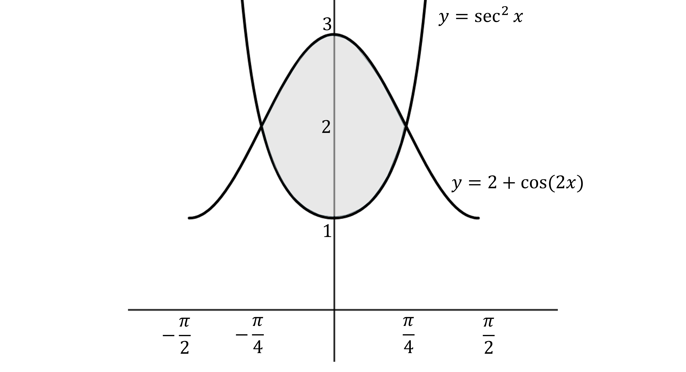
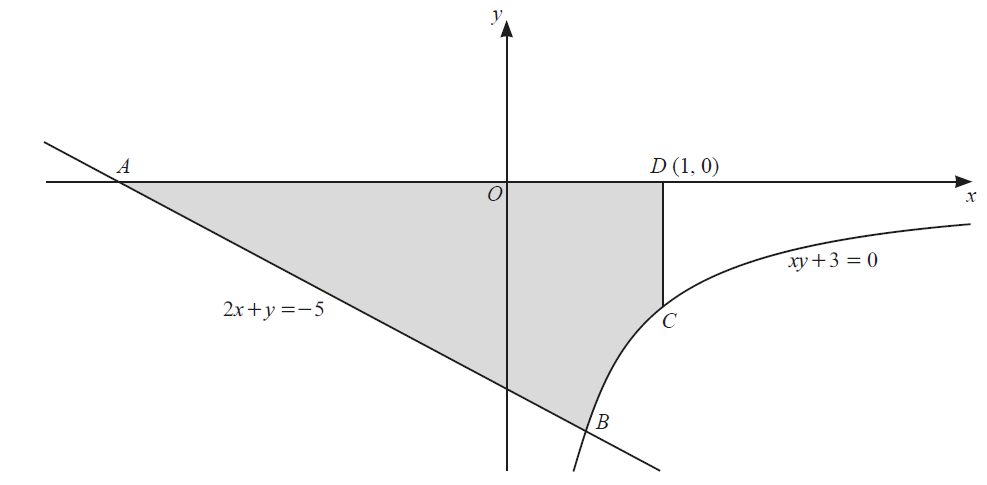
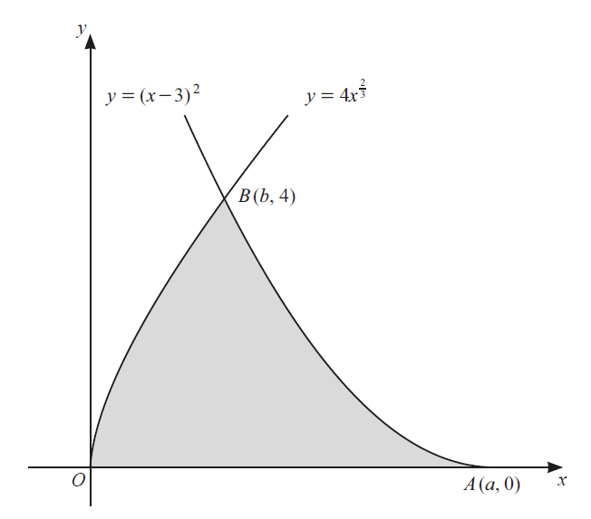
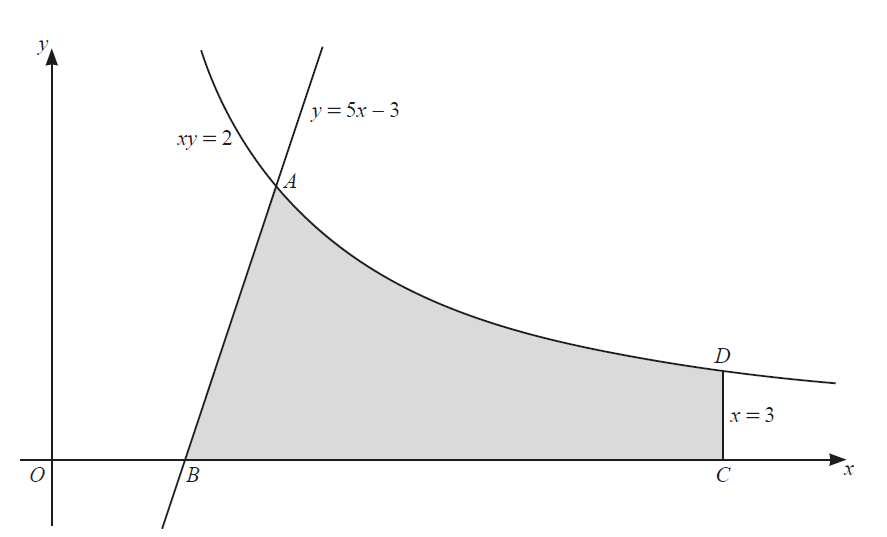
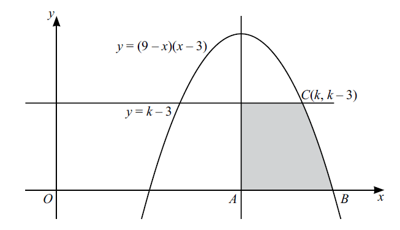
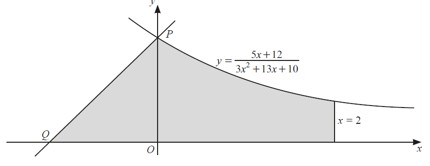

# Exam Questions — Integration
**Calculus** · Cambridge (CIE) IGCSE further-maths (0606)
> Source: [https://www.savemyexams.com/igcse/further-maths/cie/additional-maths/25/topic-questions/](https://www.savemyexams.com/igcse/further-maths/cie/additional-maths/25/topic-questions/) · 19 questions across 1 sets

## Exam Questions (19 questions)

### Q1 — hard — 6 marks

**Q1** [6 marks]

Throughout this question, $x$ is measured in radians.

The curves $y=\mathrm{sec}^{2}x$ and $y = 2 + \cos ( 2 x )$ intersect at the points $( - \frac{\pi }{4} , 2 )$ and $( \frac{\pi }{4} , 2 )$, as shown.

Find the exact area of the shaded region enclosed.

### Q2 — medium — 4 marks

**Q2** [4 marks]

Find $\int \frac{1}{( 7 x + 4 )^{m}} \mathrm{d} x$ in the following cases.

(a) $m=2$

(b) $m=1$

### Q3 — medium — 5 marks

**Q3** [5 marks]

Find $\frac{ \mathrm{d} }{ \mathrm{d} x} ( 16 - x^{2} )^{ \frac{3}{2} }$and hence evaluate the area enclosed by the curve $y=x\sqrt{16-x^{2}}$ and the lines $y=0,x=1\mathrm{and}x=3$.

*Source: Nov 2020 0606/21 Q11B*

### Q4 — hard — 6 marks

**Q4** [6 marks]

Find the exact value of $\int_{2}^{4} \frac{( x + 1 )^{2}}{x^{2}} \mathrm{d} x$.

*Source: Nov 2020 0606/22 Q6*

### Q5 — hard — 9 marks

**Q5** [3 marks]

The diagram shows the straight line $2x+y=-5$ and part of the curve $xy+3=0$. The straight line intersects the $x$-axis at the point $A$ and intersects the curve at the point $B$. The point $C$ lies on the curve. The point $D$ has coordinates (1, 0). The line $CD$ is parallel to the $y$-axis.

Find the coordinates of each of the points $A$ and $B$.

*Source: june 2020 0606/12 Q6A*

**Q5** [6 marks]

**Extract:**

The diagram shows the straight line 2x + y = -5 and part of the curve xy + 3 = 0. The straight line intersects the x-axis at the point A and intersects the curve at the point B. The point C lies on the curve. The point D has coordinates (1, 0). The line CD is parallel to the y-axis.

A (-5/2, 0)
B (1/2, -6)

Find the area of the shaded region, giving your answer in the form $p+\mathrm{ln}q$, where $p$ and $q$ are positive integers.

*Source: june 2020 0606/12 Q6B*

### Q6 — hard — 7 marks

**Q6** [2 marks]

The diagram shows part of the graphs of $y=4x^{\frac{2}{3}}$ and $y=(x-3)^{2}$ .The graph of $y=(x-3)^{2}$ meets the $x$-axis at the point $A(a,0)$ and the two graphs intersect at the point $B(b,4)$.

Find the value of $a$ and of $b$.

*Source: june 2020 0606/21 Q10A*

**Q6** [5 marks]

**Extract:**

The diagram shows part of the graphs of y = 4x^(2/3) and y = (x - 3)^2. The graph of y = (x - 3)^2 meets the x-axis at the point A(a, 0) and the two graphs intersect at the point B(b, 4).

From part a: a = 3 and b = 1

Find the area of the shaded region.

*Source: june 2020 0606/21 Q10B*

### Q7 — hard — 8 marks

**Q7** [8 marks]

The diagram shows part of the curve $xy=2$ intersecting the straight line $y=5x-3$ at the point $A$. 
The straight line meets the $x$-axis at the point $B$. The point $C$ lies on the $x$-axis and the point $D$ lies on the curve such that the line $CD$ has equation $x=3$. Find the exact area of the shaded region, giving your answer in the form $p+\mathrm{ln}q$, where $p$ and $q$ are constants.

*Source: june 2020 0606/13 Q9*

### Q8 — hard — 11 marks

**Q8** [6 marks]

Given that $\int_{1}^{a} ( \frac{1}{x} - \frac{1}{2 x + 3} ) \mathrm{d} x = \ln 3$, where $a>0$, find the exact value of $a$, giving your answer in simplest surd form.

*Source: Nov 2020 0606/11 Q9A*

**Q8** [5 marks]

Find the exact value of `integral _ 0 ^ pi / 3 end ^ ( sin ( 2 x + pi / 3 ) - 1 + cos 2 x ) d x`.

*Source: Nov 2020 0606/11 Q9B*

### Q9 — very_hard — 8 marks

**Q9** [5 marks]

The gradient of the normal to a curve at the point $(x,y)$ is given by $\frac{x}{x+1}$

Given that the curve passes through the point $(1,4)$, show that its equation is $y=5-\mathrm{ln}x-x$.

*Source: Nov 2020 0606/21 Q10A*

**Q9** [3 marks]

**Extract:**

The gradient of the normal to a curve at the point (x, y) is given by x/(x+1). Given that the curve passes through the point (1, 4), the equation of the curve is y = 5 - ln x - x.

The gradient of the tangent is the negative reciprocal of the gradient of the normal, therefore:
dy/dx = -(x + 1)/x = -1 - 1/x

Find, in the form $y=mx+c$, the equation of the tangent to the curve at the point where $x=3$.

*Source: Nov 2020 0606/21 Q10B*

### Q10 — hard — 5 marks

**Q10** [5 marks]

Find  $\int_{3}^{5} ( \frac{1}{x - 1} - \frac{1}{( x - 1 )^{2}} ) \mathrm{d} x$, giving your answer in the form $a+\mathrm{ln}b$, where $a$ and $b$ are rational numbers.

*Source: June 2021 Paper 11 Q2*

### Q11 — very_hard — 9 marks

**Q11** [9 marks]

The diagram shows part of the curve $y=(9--x)(x--3)$ and the line $y=k--3$, where $k>3$. 
The line through the maximum point of the curve, parallel to the $y$-axis, meets the $x$-axis at $A$. 
The curve meets the $x$-axis at $B$, and the line $y=k--3$ meets the curve at the point $C(k,k--3)$ .

Find the area of the shaded region.

*Source: Specimen 2025 Paper 2 Q12*

### Q12 — very_hard — 10 marks

**Q12** [1 mark]

Show that $\frac{1}{x+1}+\frac{2}{3x+10}$ can be written as $\frac{5x+12}{3x^{2}+13x+10}$

*Source: Nov 2020 0606/13 Q10A*

**Q12** [9 marks]

**Extract:**

Show that 1/(x+1) + 2/(3x+10) can be written as (5x+12)/(3x²+13x+10)

The diagram shows part of the curve $y=\frac{5x+12}{3x^{2}+13x+10}$, the line $x=2$ and a straight line of gradient 1. The curve intersects the $y$-axis at the point $P$. The line of gradient 1 passes through $P$ and intersects the $x$-axis at the point $Q$. Find the area of the shaded region, giving your answer in the form $a + \frac{2}{3} \ln ( b \sqrt{3} )$, where $a$ and $b$ are constants.

*Source: Nov 2020 0606/13 Q10B*

### Q13 — medium — 9 marks

**Q13** [4 marks]

Giving your answer in its simplest form, find the exact value of

$\int_{0}^{4} \frac{10}{5 x + 2} d x$

*Source: june 2020 paper 22 Q7A*

**Q13** [5 marks]

$\int_{0}^{\ln 2} ( \mathrm{e}^{4 x + 2} )^{2} \mathrm{d} x$

*Source: june 2020 0606/22 Q7B*

### Q14 — hard — 7 marks

**Q14** [7 marks]

A curve is such that $\frac{ \mathrm{d}^{2} y}{ \mathrm{d} x^{2}} = \sin ( 6 x - \frac{\pi }{2} )$. Given that $\frac{dy}{dx}=\frac{1}{2}$ at the point $( \frac{\pi }{4} , \frac{13 \pi }{12} )$ on the curve, find the equation of the curve.

*Source: june 2021 paper 21 Q9*

### Q15 — hard — 11 marks

**Q15** [6 marks]

(i) Given that $\mathrm{f} ( x ) = \frac{1}{\cos x}$, show that $f'(x)=\mathrm{tan}x\mathrm{sec}x$.

[3]

(ii) Hence find $\int ( 3 \tan x \sec x - \sqrt[4]{e^{3 x} } ) \mathrm{d} x$.

[3]

*Source: june 2020 0606/23 Q12A*

**Q15** [5 marks]

Given that $\int_{2}^{5} \frac{p}{p x + 10} \mathrm{d} x = \ln 2$, find the value of the positive constant $p$.

*Source: june 2020 0606/23 Q12B*

### Q16 — very_hard — 8 marks

**Q16** [8 marks]

A curve is such that $\frac{d^{2}y}{dx^{2}}=5\mathrm{cos}2x$. This curve has a gradient of $\frac{3}{4}$ at the point `( - pi / 12 , (5 pi)/(4) )`. Find the equation of this curve.

*Source: june 2020 0606/11 Q11*

### Q17 — very_hard — 9 marks

**Q17** [2 marks]

Show that $\frac{3}{2x-3}+\frac{3}{2x+3}$ can be written as $\frac{12x}{4x^{2}-9}$.

*Source: june 2020 0606/11 Q8A*

**Q17** [3 marks]

**Extract:**

$\frac{3}{2 x - 3} + \frac{3}{2 x + 3} \text{can} \text{be} \text{written} \text{as} \frac{12 x}{4 x^{2} - 9}$

Hence find $\int \frac{12 x}{4 x^{2} - 9} \mathrm{d} x$, giving your answer as a single logarithm and an arbitrary constant.

*Source: june 2020 0606/11 Q8B*

**Q17** [4 marks]

**Extract:**

`Hence find integral (12 x)/(4 x ^2 - 9) d x, giving your answer as a single logarithm and an arbitrary constant.`

$Answer: \frac{3}{2} \ln ( 4 x^{2 } - 9 ) + \text{thin} c$

Given that $\int_{2}^{a} \frac{12 x}{4 x^{2} - 9} \mathrm{d} x = \ln 5 \sqrt{5}$, where $a>2$, find the exact value of $a$.

*Source: june 2020 0606/11 Q8C*

### Q18 — hard — 5 marks

**Q18** [5 marks]

Given

$\frac{ \mathrm{d} }{ \mathrm{d} x} ( x \cos x ) = - x \sin x + \cos x$

find the exact value of `integral _ 0 ^ pi / 6 end ^ x sin x d x`.

*Source: Nov 2020 0606/23 Q7C*

### Q19 — hard — 11 marks

**Q19** [7 marks]

Given that $\int_{1}^{a} ( \frac{2}{2 x + 3} + \frac{3}{3 x - 1} - \frac{1}{x} ) \mathrm{d} x = \ln 2.4$ where $a>1$ , find the value of $a$.

*Source: Specimen 2025 Paper 1 Q8A*

**Q19** [4 marks]

(i) Find $\frac{ \mathrm{d} }{ \mathrm{d} x} ( 6 \sin ^{3} k x )$, where $k$ is a constant.

(ii) Hence find $\int ( \sin ^{2} 2 x \cos 2 x ) d x.$

*Source: Specimen 2025 Paper 1 Q8B*

