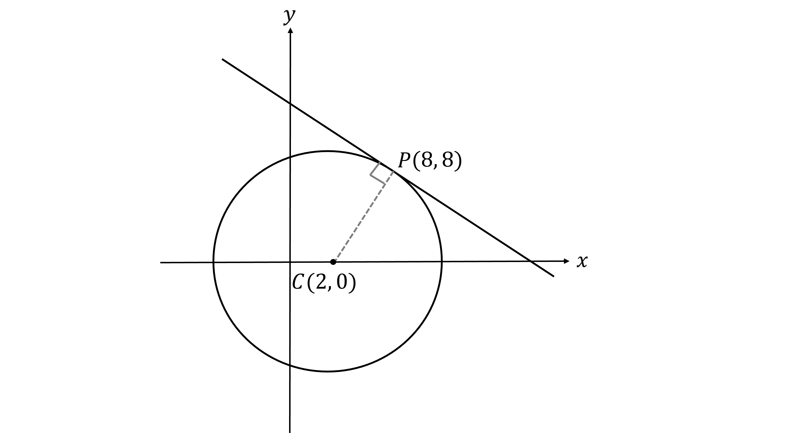
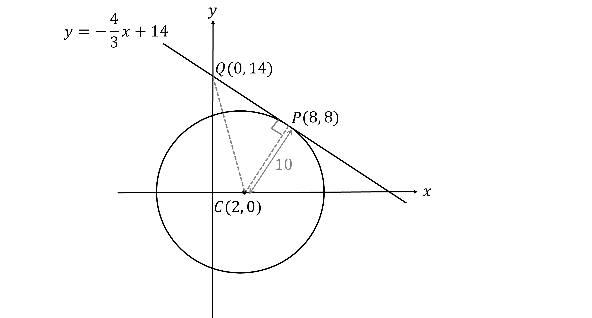
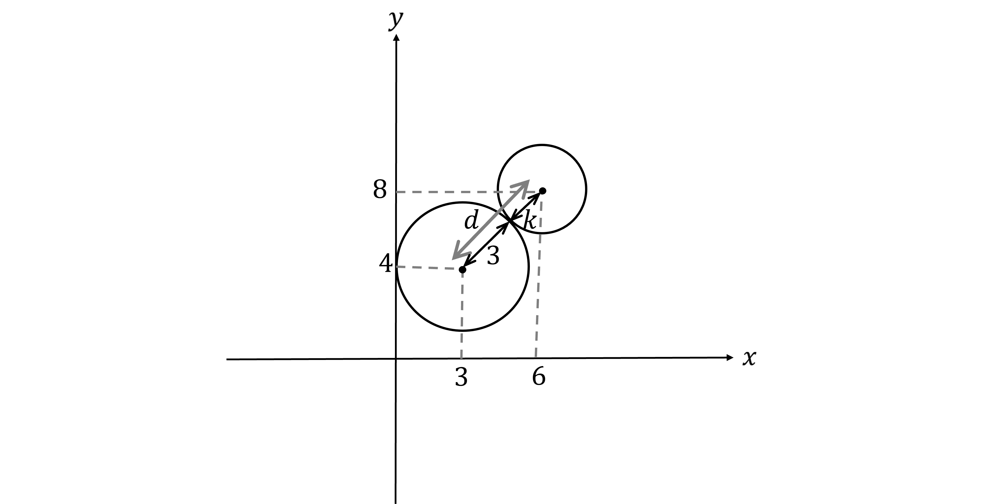
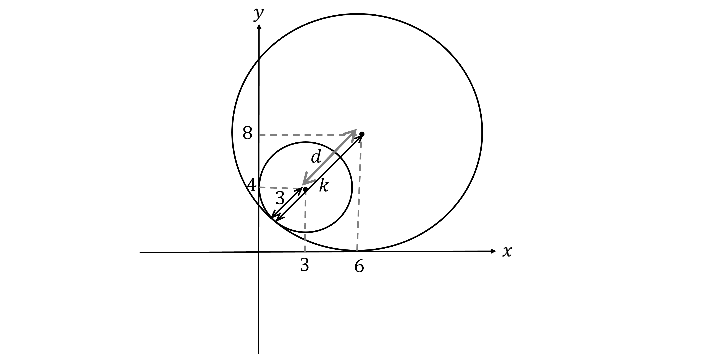
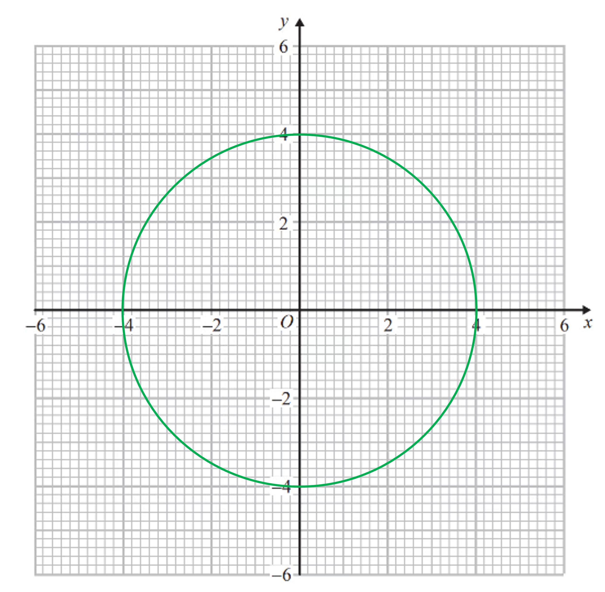
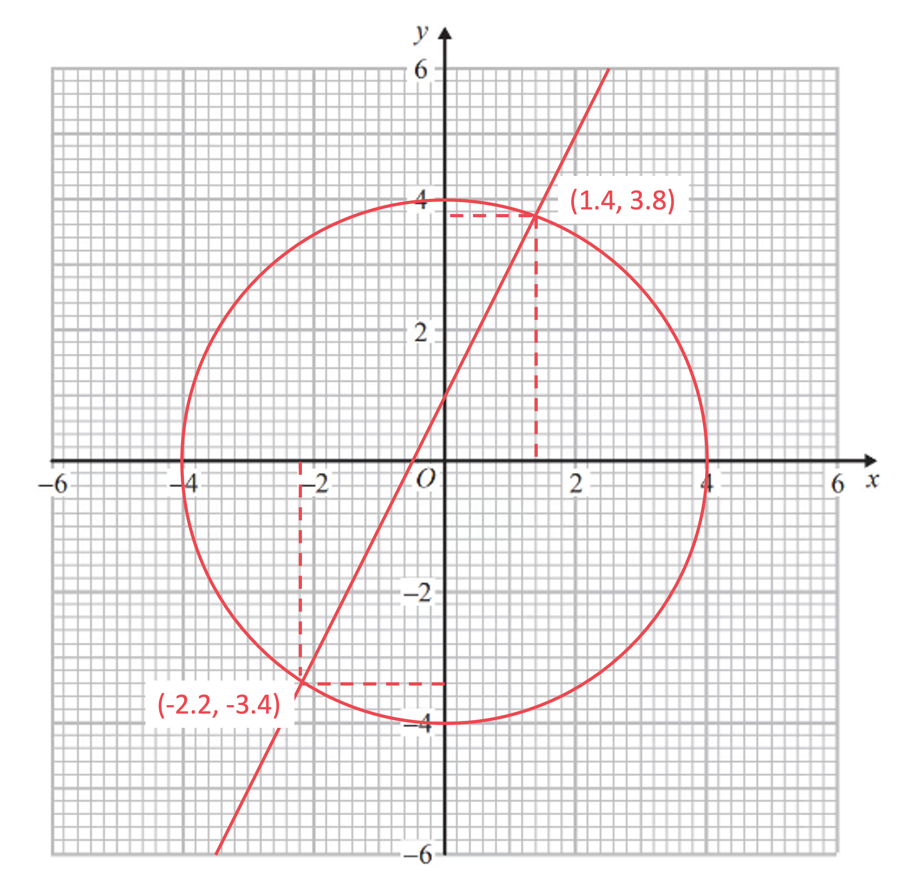
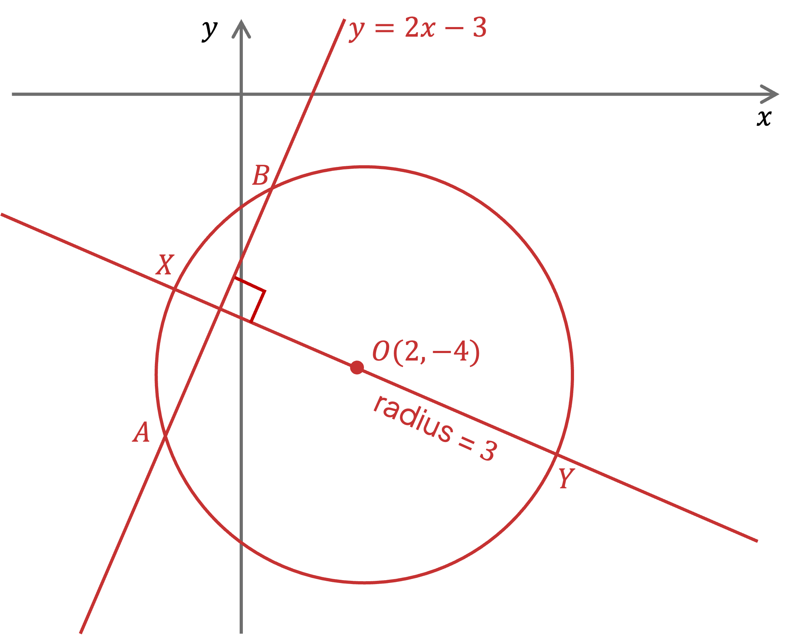
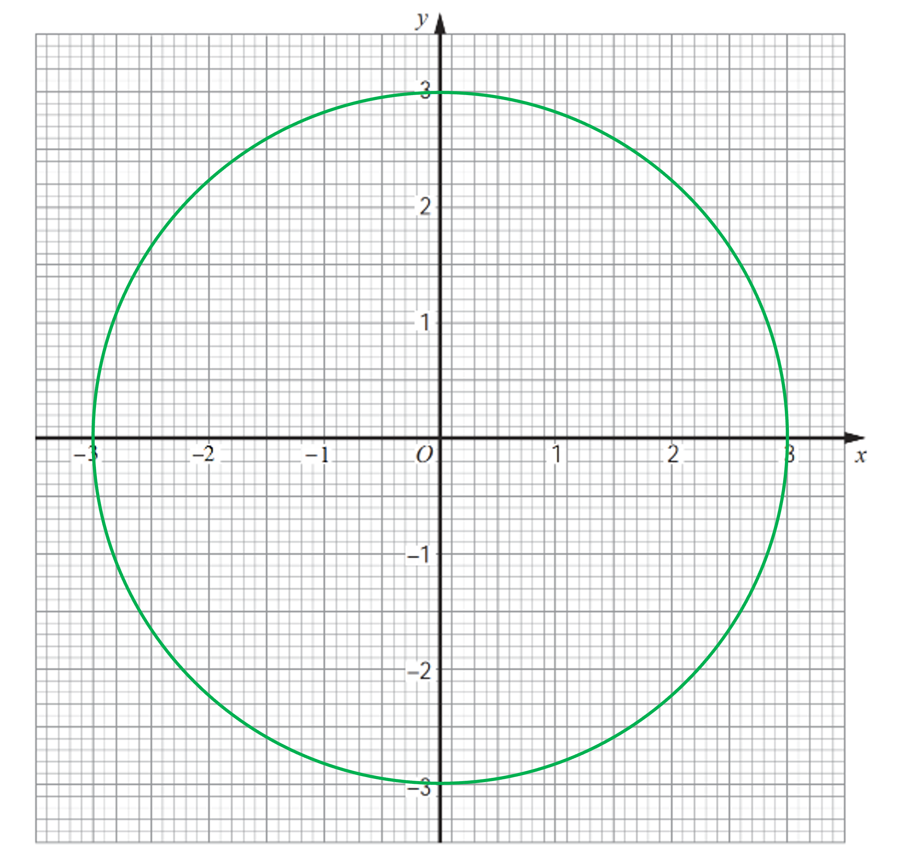
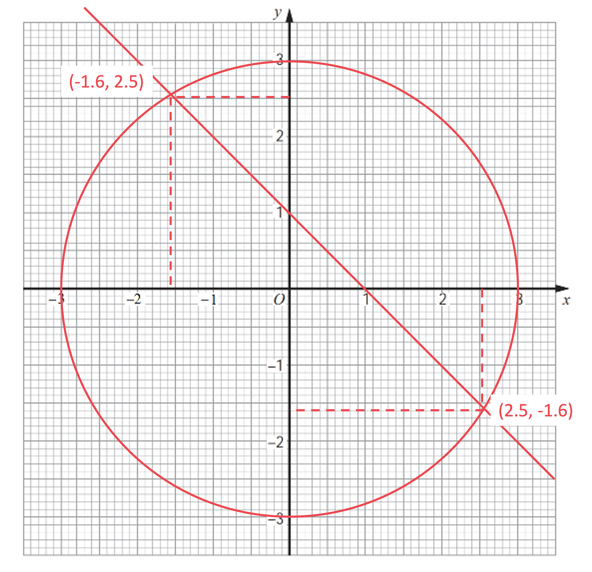

# Mark Schemes — Coordinate Geometry of the Circle
**Coordinate Geometry** · Cambridge (CIE) IGCSE further-maths (0606)

## Exam Questions (6 questions)

### Q1
> *The tangent at *$P$* is perpendicular to the radius *$CP$

> *Find the coordinates of *$C$* from *$( x - a )^{2} + ( y - b )^{2} = r^{2}$* having centre *$( a , b )$

$C ( 2 , 0 )$

**[B1]**

> *The gradient of the tangent is perpendicular to the gradient of the radius *$CP$

> *Find the gradient of the radius *$CP$

$\begin{gathered} m_{C P} & = \frac{8 - 0}{8 - 2} \\ = \frac{4}{3} \end{gathered}$

> *Find the gradient perpendicular to the radius *$CP$* (i.e. the negative reciprocal)*

$m=-\frac{3}{4}$

**[M1]**

> **[exam-tip]**
> A quick check of the diagram confirms to you that this gradient is meant to be negative!

> *Substitute *$( 8 , 8 )$* and *$m=-\frac{3}{4}$* into *$y - y_{1} = m ( x - x_{1} )$* for the equation of the tangent*

$y - 8 = - \frac{3}{4} ( x - 8 )$

> *Rearrange into the form *$y=mx+c$

$\begin{gathered} y - 8 & = - \frac{3}{4} x + 6 \end{gathered}$

$\begin{gathered} y = - \frac{3}{4} x + 14 \end{gathered}$

**[A1 A1]**

> **[mark-scheme]**
> **B1:** For the correct coordinates of the centre of the circle.
> 
> **M1: **For attempting to find the perpendicular gradient of your radius gradient.
> 
> **A1**: For $y=mx+c$ with the correct gradient.
> 
> **A1:** For $y=mx+c$ with the correct $y$-intercept.
> *The point *$Q$* has coordinates *$( 0 , 14 )$* from the answer in part (a)*

$Q ( 0 , 14 )$

> *Find the length of the radius *$CP$* from the equation *$( x - 2 )^{2} + y^{2} = 100 = 10^{2}$

$CP=10$

**[B1]**

> *Sketch triangle *$PCQ$* on the diagram and include all the information above*

> *Triangle *$PCQ$* is right-angled so find its area using *$\frac{1}{2}\times\mathrm{base}\times\mathrm{height}$* (where *$CP$* is the base and *$PQ$* is the height)*

> *To find *$PQ$* use the length formula (or Pythagoras on the horizontal and vertical differences)*

$\begin{gathered} P Q & = \sqrt{( x_{2} - x_{1} )^{2} + ( y_{2} - y_{1} )^{2}} \\ = \sqrt{( 8 - 0 )^{2} + ( 8 - 14 )^{2}} \end{gathered}$

**[M1]**

> **[mark-scheme]**
> This mark is attempting to find the length $PQ$ using your $Q$ coordinates.

> *Simplify*

$\begin{gathered} P Q & = \sqrt{100} \\ = 10 \end{gathered}$

**[A1]**

> *Use *$\frac{1}{2}\times\mathrm{base}\times\mathrm{height}$* to find the area of triangle *$PCQ$

$\frac{1}{2}\times10\times10$

**Final answer:** **50**

**[A1]**

### Q2
> $( x - a )^{2} + ( y - b )^{2} = r^{2}$* is the equation of a circle at centre *$( a , b )$* with radius *$r$

$( x - 3 )^{2} + ( y - 4 )^{2} = 9$

**[B1]**
> *First find the centre and radius of *$C_{2}$* by completing the square*

$\begin{gathered} x^{2} - 12 x + y^{2} - 16 y & = k^{2} - 100 \\ ( x - 6 )^{2} - 36 + ( y - 8 )^{2} - 64 & = k^{2} - 100 \\ ( x - 6 )^{2} + ( y - 8 )^{2} & = k^{2} \end{gathered}$

**[M1 A1]**

> *This has centre *$( 6 , 8 )$* and radius *$k$

> *Calculate *$d$*, the distance between centres of *$C_{1}$* and *$C_{2}$*,  *$( 3 , 4 )$* and *$( 6 , 8 )$

$d = \sqrt{( 6 - 3 )^{2} + ( 8 - 4 )^{2}}$

> *Simplify to find *$d$

$\begin{gathered} d = \sqrt{3^{2} + 4^{2}} \\ = \sqrt{9 + 16} \\ = \sqrt{25} \\ = 5 \end{gathered}$

**[B1]**

(i)

> *It helps to sketch the two circles touching side-by-side (not one inside the other)*

> *The sum of the two radii must equal *$d$

$d=3+k$

**[M1]**

> **[mark-scheme]**
> This mark is for identifying the correct arrangement of the touching circles and attempting to equate the correct lengths.

> *Substitute in *$d=5$* and solve for *$k$

$5=3+k$

$k=2$

**[A1]**

(ii)

> *Draw another sketch of the circles touching but this time with *$C_{1}$* inside *$C_{2}$

> *The sum of the smaller radius and *$d$* must equal the bigger radius*

$3+d=k$

**[M1]**

> **[mark-scheme]**
> This mark is for identifying the correct arrangement of the touching circles and attempting to equate correct lengths.

> *Substitute in *$d=5$* and solve for *$k$

$3+5=k$

$k=8$

**[A1]**
> *The equation of the common chord is the equation of the line connecting the two points of intersection*

> *The quickest method to find *$w$* is to say *$( w , 7 )$* lies on *$x+y=10$

$w+7=10$

> *Then solve for *$w$

$w=3$

**[B1]**

### Q3
i) *Complete the square for *$x$* and for *$y$* in the given equation of the circle*

$x^{2} - 16 x + y^{2} - 10 y + 73 = 0
( x - 8 )^{2} - 64 + ( y - 5 )^{2} - 25 + 73 = 0$

**[1]**

$( x - 8 )^{2} + ( y - 5 )^{2} = 16$

> * *

> *Remember that the equation of a circle is  where *$( p , q )$* is the centre and *$r$* is the radius. *
*Therefore the centre of the circle is *

**Centre: (8, 5)**  **[1]**

> *The radius is the square root of 16*

**r**** = 4**** **** [1]**

ii) *Find the distance between (10, 6.5) and the centre of the circle, (8, 5) found in part (i) *

$\sqrt{( 10 - 8 )^{2} + ( 6.5 - 5 )^{2}}$

**[1]**

$=\sqrt{6.25}\,=2.5$

> *This is less than the radius of the circle, which was identified as 4 in part (i)*

**2.5 < 4 (therefore (10, 6.5) is within the circle)*** ***[1]**
> *The centre of this circle is (10, 6.5) and in part (a) we found that the distance from (10, 6.5) to the centre of the first circle is 2.5. Therefore **d**, the distance between centres, is 2.5*

> *The radius of this new circle is *

$\sqrt{2.25}=1.5$

> *Two circles touch if *$d=r_{1}+r_{2}$* or *$d=r_{1}-r_{2}$

`equation`** [1]**

### Q4
> *We should recognise the equation as the **equation of a circle** *$x^{2}+y^{2}=r^{2}$* where *$r$* is the radius and the centre is (0, 0) *
*From this we can find the radius*

$\begin{array}{rcl} r^{2} & = 16 \\ r = 4 \end{array}$

> *Now, using a pair of compasses, draw a circle with centre (0, 0) and radius 4. The circumference should pass through  (4, 0), (0, 4), (-4, 0) and (0, -4) *

**circle with centre (0, 0) ****[1] **
**circle with radius 4**** [1]**
> *First we need to plot *$y=2x+1$*. Using your knowledge of **linear graphs **y** = **mx** + **c**, draw a straight line through 1 on the **y**-axis with a gradient of 2*

**correct straight line**** [1]**

> *Read the coordinates of where your straight line intersects with the circle drawn in part (a). Write these coordinates down as two pairs of **x** and **y** values*
* There is some margin of error allowed, but your answers must be consistent with your graph*

**x**** = 1.4, ****y**** = 3.8**** ****[1] **
**x**** = −2.2, ****y**** = ****−****3.4**** ****[1] **
**±0.2 is permitted for the above x and y values**

### Q5
> *It helps to visualise the problem if you sketch the information given*

> *First write the equation of the circle using the information given. *$( x - h )^{2} + ( y - k )^{2} = r^{2}$* where *$( h , k )$* is the centre and *$r$* is the radius*

$( x - 2 )^{2} + ( y + 4 )^{2} = 3^{2}$

**[1]**

> *Now substitute *$y=2x-3$* into the equation of the circle to find the two possible *$x$* values of the intersection of the line and circle*

$\begin{array}{rcl} ( x - 2 )^{2} + ( 2 x - 3 + 4 )^{2} & = 3^{2} \end{array}$

**[1]**

> *Solve for *$x$

$\begin{gathered} x^{2} - 4 x + 4 + ( 2 x + 1 )^{2} & = 9 \\ x^{2} - 4 x + 4 + 4 x^{2} + 4 x + 1 & = 9 \\ 5 x^{2} + 5 & = 9 \\ 5 x^{2} & = 4 \\ x^{2} & = \frac{4}{5} \\ x = \pm \frac{2}{ \sqrt{5} } \end{gathered}$

> *Substitute both possible values into the equation of the straight line in order to find pairs of coordinate points for **A **and **B*

> $\begin{gathered} y = 2 ( \frac{2}{ \sqrt{5} } ) - 3 \\ = \frac{4}{ \sqrt{5} } - 3 \\ A = ( \frac{2}{ \sqrt{5} } , \frac{4}{ \sqrt{5} } - 3 ) \end{gathered}$*           *$\begin{gathered} y = 2 ( - \frac{2}{ \sqrt{5} } ) - 3 \\ = \frac{- 4}{ \sqrt{5} } - 3 \\ B = ( \frac{- 2}{ \sqrt{5} } , \frac{- 4}{ \sqrt{5} } - 3 ) \end{gathered}$

**one mark for each correct pair of coordinates**** [2]**

> *(Note that **A** and **B** here correspond to the diagram we drew at the beginning of the question but are of course interchangeable depending on your diagram)*

> *Find **AB** using Pythagoras' theorem*

$\begin{gathered} A B & = \sqrt{( \frac{2}{ \sqrt{5} } - \frac{- 2}{ \sqrt{5} } )^{2} + ( \frac{4}{ \sqrt{5} } - 3 - ( \frac{- 4}{ \sqrt{5} } - 3 ) )^{2}} \end{gathered}$

**[1]**

`table columnalign right center left columnspacing 0px end | _ = sqrt( ( (4)/(sqrt( 5) ) ^2 + ( (8)/(sqrt( 5) ) ^2 ) | | _ = sqrt( 16 / 5 + 64 / 5 ) | | _ = sqrt( 16 | | _ = 4 |`

** ****[1]**

> *XY** is a perpendicular bisector of **AB** which is a chord. Therefore **XY** passes through the centre and therefore it is the diameter of the circle, so no real working is required! The radius is 3 so*

$\begin{gathered} X Y & = 6 \end{gathered}$

**[1]**

> *The area of the kite is*

*Area *$\begin{gathered} = 1 \frac{1}{2} \times 4 \times 6 \end{gathered}$

**12** **[1]**

### Q6
> *We should recognise the equation as the **equation of a circle** *$x^{2}+y^{2}=r^{2}$* where *$r$* is the radius and the centre is (0, 0) *
*From this we can find the radius*

$\begin{array}{rcl} r^{2} & = 9 \\ r = 3 \end{array}$

> *Now, using a pair of compasses, draw a circle with centre (0, 0) and radius 3. The circumference should pass through  (3, 0), (0, 3), (-3, 0) and (0, -3) *

**circle with centre (0, 0) ****[1] **
**circle with radius 3**** [1]**
> *First we need to plot *$x+y=1$* *
*Rearrange to *$y=-x+1$* and using your knowledge of **linear graphs **y** = **mx** + **c**, draw a straight line through 1 on the **y**-axis with a gradient of −1*

**correct straight line**** [1]**

> *Read the coordinates of where your straight line intersects with the circle drawn in part (a). Write these coordinates down as two pairs of **x** and **y** values There is some margin of error allowed, but your answers must be consistent with your graph*

**x**** = 2.5, ****y**** = −1.6**** ****[1] **
**x**** = −1.6, ****y**** = 2.5**** ****[1] **
**±0.2 is permitted for the above x and y values**
