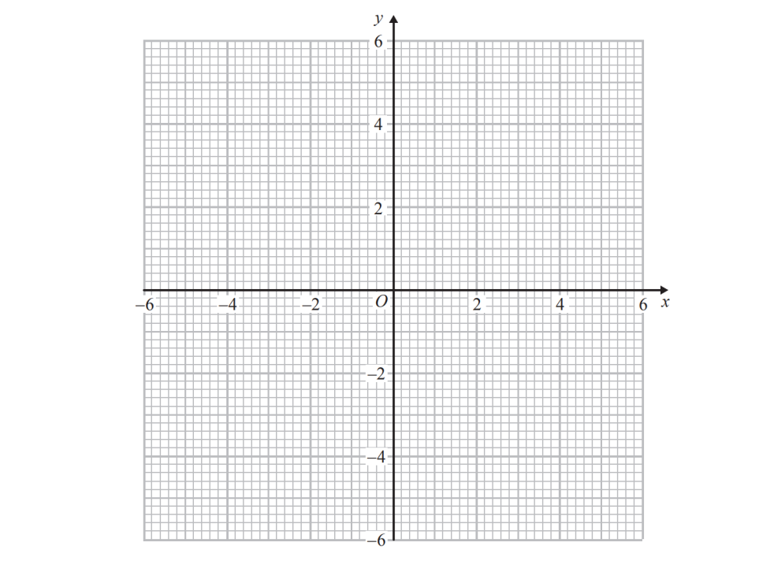
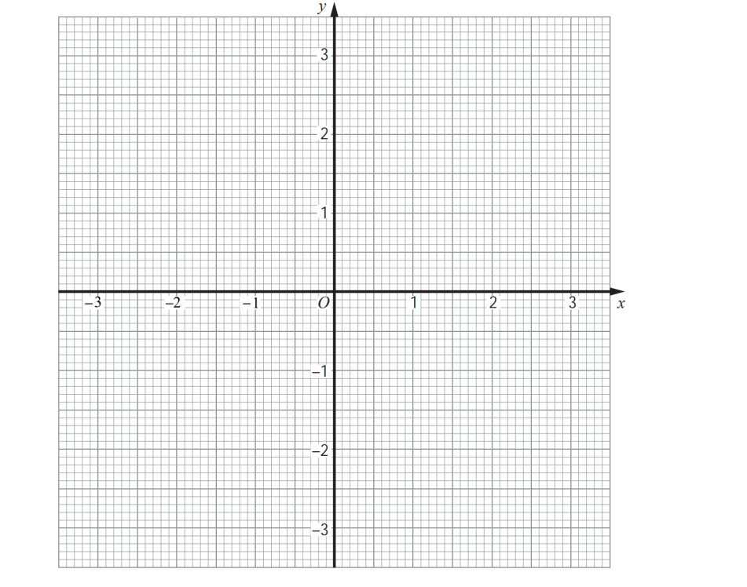

# Exam Questions — Coordinate Geometry of the Circle
**Coordinate Geometry** · Cambridge (CIE) IGCSE further-maths (0606)
> Source: [https://www.savemyexams.com/igcse/further-maths/cie/additional-maths/25/topic-questions/](https://www.savemyexams.com/igcse/further-maths/cie/additional-maths/25/topic-questions/) · 6 questions across 1 sets

## Exam Questions (6 questions)

### Q1 — hard — 8 marks

**Q1** [4 marks]

The point $P ( 8 , 8 )$ lies on the circle $( x - 2 )^{2} + y^{2} = 100$ with centre $C$.

The circle and the tangent to the circle at $P$ are shown below.

Find the equation of the tangent to the circle at $P$, giving your answer in the form $y=mx+c$.

**Q1** [4 marks]

The tangent intersects the $y$-axis at the point $Q$.

Find the area of triangle $PCQ$.

### Q2 — hard — 9 marks

**Q2** [1 mark]

The circle $C_{1}$ has a centre at $( 3 , 4 )$ and a radius of $3$.

Write down the equation of $C_{1}$.

**Q2** [7 marks]

The circle $C_{2}$ has the equation

$x^{2}+y^{2}-12x-16y+100-k^{2}=0$

where $k>0$.

Given that $C_{2}$ is tangent to $C_{1}$, find the value of $k$ in each of the following cases:

(i) The circles touch each other once and neither circle lies inside the other.

(ii) The circles touch each other once and $C_{1}$ lies inside $C_{2}$.

**Q2** [1 mark]

A different circle, $C_{3}$, intersects $C_{1}$ at two distinct points, one of which has the coordinates $( w , 7 )$.

The equation of the common chord to $C_{1}$ and $C_{3}$ is $x+y=10$.

Find $w$.

### Q3 — hard — 6 marks

**Q3** [5 marks]

**Solutions to this question by accurate drawing will not be accepted.** A circle has equation $x^{2}+y^{2}--16x--10y+73=0$.

(i) Find the coordinates of the centre of the circle and the length of the radius.

(ii) Hence show that the point (10, 6.5) lies inside the circle.

*Source: Specimen 2025 Paper 2 Q7*

**Q3** [1 mark]

**Extract:**

A circle has equation x squared space plus space y squared space – space 16 x space – space 10 y space plus space 73 space equals space 0.

(i) Find the coordinates of the centre of the circle and the length of the radius.

(ii) Hence show that the point (10, 6.5) lies inside the circle.

Mark scheme:
(i) Centre: (8, 5)
r = 4

(ii) Distance from (10, 6.5) to centre (8, 5):
square root of open parentheses 10 minus 8 close parentheses squared plus open parentheses 6.5 minus 5 close parentheses squared end root equals square root of 6.25 end root equals 2.5

2.5 < 4 (therefore (10, 6.5) is within the circle)

A different circle has equation $(x--10)^{2}+(y--6.5)^{2}=2.25$. 
Show that the two circles touch. You are not required to find the coordinates of the common point.

*Source: Specimen 2025 Paper 2 Q7B*

### Q4 — medium — 5 marks

**Q4** [2 marks]

On the grid, construct the graph of $x^{2}+y^{2}=16$

*Source: 2015	June 1MA0/2H Q28A*

**Q4** [3 marks]

**Extract:**

x² + y² = 16

Find estimates for the solutions of the simultaneous equations

$\begin{gathered} x^{2} + y^{2} & = 16 \\ y & = 2 x + 1 \end{gathered}$

*Source: 2015	June 1MA0/2H Q28B*

### Q5 — very_hard — 8 marks

**Q5** [8 marks]

A circle has a centre $(2,--4)$ and radius $3$.
 The line$y=2x--3$ intersects the circle at points $A$ and $B$. The perpendicular bisector of line $AB$ intersects the circle at points $X$ and $Y$.

Find the area of kite $AXBY$.

*Source: Specimen 2025 Paper 1 Q10*

### Q6 — medium — 5 marks

**Q6** [2 marks]

Construct the graph of $x^{2}+y^{2}=9$

*Source: 2010	November 1380/3H Q28A*

**Q6** [3 marks]

**Extract:**

Construct the graph of  space x squared space plus space y squared equals space 9

By drawing the line $x+y=1$ on the grid, solve the equations $x^{2}+y^{2}=9\,x+y=1$

*Source: 2010	November 1380/3H Q28B*

