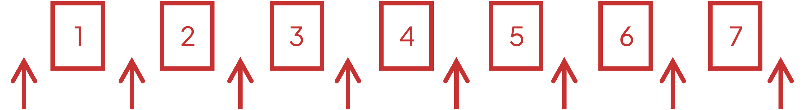

# Mark Schemes — Permutations & Combinations
**Sequences & Series** · Cambridge (CIE) IGCSE further-maths (0606)

## Exam Questions (17 questions)

### Q1
(i)

**Method 1**

> *There are 7 possibilities for the first digit (3, 4, 5, 6, 7, 8 or 9)*

> *There are 6 possible choices left for the second digit*

> *There are 5 possible choices left for the third digit*

> *There are 4 possible choices left for the fourth digit*

$7\times6\times5\times4$

**Final answer:** **840**

**[B1]**

**Method 2**

> *Choose 4 digits out of a possible 7 different digits (3, 4, 5, 6, 7, 8 or 9) with no repeats and where order does matter (i.e. use permutations, not combinations)*

$^{7} \mathrm{P}_{4} = \frac{7 factorial}{( 7 - 4 ) factorial} = \frac{7 factorial}{3 factorial}$

**Final answer:** **840**

**[B1]**

(ii)

**Method 1**

> *Numbers less than 9000 has a first digit that is less than 9*

> *So there are 6 possible choices for the first digit (3, 4, 5, 6, 7 or 8)*

> *The 9 is allowed in the remaining digits*

> *So there are 6 possible choices left for the second digit (out of 3, 4, 5, 6, 7, 8 and 9 but with one choice taken away for the first digit)*

> *There are 5 possible choices left for the third digit*

> *There are 4 possible choices left for the fourth digit*

$6\times6\times5\times4$

**[M1]**

**Final answer:** **720**

**[A1]**

**Method 2**

> *The same first digit as Method 1, then using *$^{6}P_{3}$* to select the next 3 digits out of the remaining 6 digits (3, 4, 5, 6, 7, 8 and 9 but with one choice taken away for the first digit)*

$6\times^{6}P_{3}$

**[M1]**

**Final answer:** **720**

**[A1]**

**Method 3**

> *Count how many numbers are 9000 or above then subtract this from the total number in part (i)*

> *Numbers above 9000 start with a 9*

> *There is 1 possible choice for the first digit (a 9)*

> *There are 6 possible choices left for the second digit (out of 3, 4, 5, 6, 7 and 8)*

> *There are 5 possible choices left for the third digit*

> *There are 4 possible choices left for the fourth digit*

$1\times6\times5\times4$

> *Subtract this from 840*

$840-1\times6\times5\times4$

**[M1]**

**Final answer:** **720**

**[A1]**
> *Order does not matter in this question (i.e. use combinations, not permutations)*

(i)

> *An equal number of each type means 2 horrors, 2 romances and 2 travel books*

> *Out of 5 horror books select 2*

$^{5}C_{2}$

> *Out of 6 romance books select 2*

$^{6}C_{2}$

> *Out of 4 travel books select 2*

$^{4}C_{2}$

> *Multiply the combinations together*

$^{5}C_{2}\times^{6}C_{2}\times^{4}C_{2}$

**[M1]**

**Final answer:** **900**

**[A1]**

(ii)

**Method 1**

> *Split into separate cases then add the separate cases together*

> *Case 1: select 4 horror books out of 5, then 1 romance book out of 6, then 1 travel book out of 4*

$^{5}C_{4}\times^{6}C_{1}\times^{4}C_{1}$

**[M1]**

> *Case 2: select 4 horror books out of 5, then 0 romance book out of 6, then 2 travel books out of 4*

$^{5}C_{4}\times^{6}C_{0}\times^{4}C_{2}$

**[M1]**

> **[mark-scheme]**
> $^{5}C_{4}\times^{4}C_{2}$ is also correct (without the middle term) as $^{6}C_{0}=1$.

> *Add these separate cases together*

$=^{5}C_{4}\times^{6}C_{1}\times^{4}C_{1}+^{5}C_{4}\times^{6}C_{0}\times^{4}C_{2}\,=120+30$

**Final answer:** **150**

**[A1]**

**Method 2**

> *Out of 5 horror books select 4*

$^{5}C_{4}$

**[M1]**

> *Then combine the romance and travel books into 6 + 4 = 10 books and select the remaining 2 books from these*

$^{10}C_{2}$

> *But you don't want any of the cases with '2 romance + 0 travel' so subtract these combinations*

$^{10}C_{2}-^{6}C_{2}\times^{4}C_{0}$

**[M1]**

> *Multiply this by the selection of 4 horror books*

$^{5} \mathrm{C}_{4} (^{10} \mathrm{C}_{2} -^{6} \mathrm{C}_{2} \times^{4} \mathrm{C}_{0} )$

**Final answer:** **150**

**[A1]**

### Q2
> *We know that *$( \begin{gathered} n \\ r \end{gathered} ) = \frac{n factorial}{( n - r ) \text{factorial} r factorial}$* and here we are interested in the number of combinations of n items taken 3 at a time.*

> *We do not know what n is, but we know we are choosing 3 at a time so *$r=3$

$\frac{n factorial}{( n - 3 ) \text{factorial} 3 factorial} = 92 n$

**[1]**

$\frac{n \times ( n - 1 ) \times ( n - 2 ) \times ( n - 3 ) \times ( n - 4 )...}{( n - 3 ) \times ( n - 4 ) \times ( n - 5 ) \times... \times 3 \times 2 \times 1} = 92 n$

> *Now we can simplify by cancelling the *$( n - 3 ) \times ( n - 4 ) \times...$* terms from the numerator and denominator which leaves us with*

$\frac{n \times ( n - 1 ) \times ( n - 2 )}{6} = 92 n$

> *Multiplying both sides by 6 we get*

$n ( n - 1 ) ( n - 2 ) = 552 n$

**[1]**

> *Make the equation equal to 0*

$n ( n - 1 ) ( n - 2 ) - 552 n = 0$

> *Now expand the double bracket*

$n ( n^{2} - 3 n + 2 ) - 552 n = 0$

$n ( n^{2} - 3 n + 2 - 552 ) = 0$

$n ( n^{2} - 3 n - 550 ) = 0$

> *Factorise the double bracket now that you have simplified*

$n ( n - 25 ) ( n + 22 ) = 0$

**[1]**

$\mathrm{Either}n=0,n=25\mathrm{or}n=-22$

> *But because the combinations are taken 3 at a time, **n** cannot be less than 3.*

$n=25$ **[1]**

### Q3
> *i) If we are trying to create a 4 digit number, using each of the available digits only once, this means we have 6 choices for the first number, 5 choices for the second number, 4 choices for the third number, and 3 choices for the fourth number. *

> *Therefore*

$6\times5\times4\times3$

$360$**[1]**

ii) *We need to consider the two cases, the first case being that we use the 6 for the first number, which means we cannot use it to make the number even, and the second case being that we do not use 6 for the first number.*

> *Case 1: Using 6 for the first number means that we have 1 choice for the first number (6), and 1 choice for the final number (4) in order to make the number even. This leaves us with 4 choices and 3 choices for the second and third numbers.*

> *Therefore*

$1\times4\times3\times1=12$

**[1]**

> *So there are 12 choices for the first case.*

> *Case 2: Using 7 or 9 for the first number means we have 2 choices for the first number (7 or 9) and 2 choices for the final number (6 or 4). This also leaves us with 4 choices and 3 choices for the second and third numbers. *

> *Therefore*

$2\times4\times3\times2=48$

**[1]**

> *The total number of choices is given by *

$12+48$

$60$ **[1]**

**Correct answer could also be obtained from considering use of 4 or 6 as the final number**

### Q4
> *Make the information in the question into an equation*

$( \begin{gathered} n \\ 3 \end{gathered} ) = 6 ( \begin{gathered} n \\ 2 \end{gathered} )$

> *Use *$( \begin{gathered} n \\ r \end{gathered} ) = \frac{n factorial}{( n - r ) \text{factorial} r factorial}$

$\frac{n factorial}{( n - 3 ) \text{factorial} 3 factorial} = 6 ( \frac{n factorial}{( n - 2 ) \text{factorial} 2 factorial} )$

**[1]**

> *Expand the factorials*

$\frac{n ( n - 1 ) ( n - 2 )...}{( n - 3 ) ( n - 4 )... \times 3 factorial} = 6 ( \frac{n ( n - 1 ) ( n - 2 )...}{( n - 2 ) ( n - 3 )... \times 2 factorial} )$

> *Cancel some of the brackets*

$\frac{n ( n - 1 ) ( n - 2 )}{3 factorial} = \frac{6 n ( n - 1 )}{2 factorial}$

**[1]**

> *Rearrange to make the equation equal to 0*

$\frac{n ( n - 1 ) ( n - 2 )}{3 factorial} - \frac{6 n ( n - 1 )}{2 factorial} = 0$

> *There is a common factor of *$n ( n - 1 )$* so factorise*

$n ( n - 1 ) [ \frac{n - 2}{3 factorial} - \frac{6}{2 factorial} ] = 0$

**[1]**

> *Solve to find *$n$

$n=0,n-1=0\mathrm{or}\frac{n-2}{6}-3=0$

> *n** cannot be 0 or 1 because the question says we are taking **n** items 3 at a time*

$\frac{n-2}{6}=3$

$n=20$

**20**** ****[1]**

### Q5
> *There are 12 people in total, and we want 3 of them for the first group. Order doesn't matter. Therefore the number of options is:*

$\mathrm{C} pre^{12}_{3} = 220$

> *There are now 9 people left, and from those 9 we want to form a group of 4.*

$\mathrm{C} pre^{9}_{4} = 126$

> *There are 5 people left over, which automatically gives us our last group.*

> *The total number of combinations is therefore*

$\mathrm{C} pre^{12}_{3} \times \mathrm{C} pre^{9}_{4}$

**for one correct combination in a product **$[ 1 ]$

**for two correct combinations in a product **$[ 1 ]$

$220\times126$

> $27720$* *$[ 1 ]$

### Q6
i) *There are 6 digits and 5 spaces and order does not matter*

$6P5$

*or*

$6\times5\times4\times3\times2$

**720** **[1]**

ii) *Find how many numbers are divisible by 5*

> *Since we have no 0, it is just numbers that end in 5*

> *So we now have 5 choices for the first digit, 4 for the second, 3 for the third, 2 for the fourth and only 1 for the fifth (as it has to be a 5)*

> * *

$5\times4\times3\times2\times1=120$

*(or *$5P4=120$*)*

* *

> *Subtract the numbers that are divisible by 5 from part i)*

> * *

$720-120=600$

**600**** [1]**

iii) *Numbers that are even will end in 2 or 8 (from the numbers we are given)*

> *Numbers that are greater than 30,000 will start with a 3, 5, 7 or 8*

** ****plan for adding numbers ending in 2 and numbers ending in 8 ****[1]**

> * *

> *Case 1: ends in 2, starts in 3, 5, 7 or 8*

> *There are 4 choices for the first digit, 1 choice for the last digit, 4 choices left for the second digit, 3 choices for the third digit and 2 choices for the fourth digit*

> * *

$4\times4\times3\times2\times1=96$

**[1]**

> *Case 2: ends in 8, starts in 3, 5, or 7*

> *There are 3 choices for the first digit, 1 choice for the last digit, 4 choices left for the second digit, 3 choices for the third digit and 2 choices for the fourth digit*

> * *

$3\times4\times3\times2\times1=72$

**[1]**

> *Work out the total*

$96+72=168$

**168**** ***[1]*

### Q7
> *The candidate has 5 options and must choose 2 for section A, and has 8 options and must choose 4 for section B, therefore*

$C pre^{5}_{2} \times C pre^{8}_{4}$

**[1]**

$700$ **[1]**

### Q8
i) *Imagine picking the first photograph. It must be of a sunset so there are 3 ways this can happen*

$3\times...$

> *Ignore the middle 10 photographs for now; the last photograph must be of an ocean so there are 4 ways this can happen*

$3\times...\times4$

> *The middle 10 photographs are made up of the remaining 10 photographs. So there are 10 photographs for the first of these to be chosen from, 9 remaining for the next one to be chosen from, 8 remaining for the next one, and so on*

$3\times10!\times4$

**[1]**

**43 545 600 ****[1]**

ii) *First consider the five mountain photographs that can be placed next to each other. This can happen in 5! ways*

$5!\times...$

> *Think of the 5 mountain photographs as one 'block' of photographs. They could be placed in 8 different ways in between the 7 remaining photographs. The arrows diagram below illustrates the possible placements of the mountain 'block' around the 7 other photographs*

$5!\times8\times...$

> *Ignoring where between them the block of mountain photographs are placed, the 7 remaining photographs can be arranged in 7! ways*

$5!\times8\times7!$

**[1]**

**4 838 400 ****[1]**
i) *If no sunset photographs are included, only the 4 ocean photographs and 5 mountain photographs are to be chosen from, so 9 in total. And as it doesn't matter whether they are ocean or mountain, we're just choosing 3 photographs from 9. Hence*

*9**C**3*

**[1]**

> *Evaluating this gives*

**84 ****[1]**

ii) *One photograph is to be chosen from the 3 sunsets, so there are 3 ways to do this. For each of these 3 ways, there are 4 ways to choose an ocean photograph giving *

*3 × 4*

> *And for each of these 12 ways of choosing 1 sunset and one ocean, there are another 5 ways to choose one from the mountain photographs. So the answer can be calculated by*

*3 × 4 × 5*

**[1] ****note that this is the same as ****3****C****1**** × ****4****C****1**** × ****5****C****1**** **

> *Evaluate*

**60 ****[1]**

### Q9
> *For there to be **at least **three women, there could either be two women and one man, or three women.*

> *To work out the number of different teams that have two women and one man:*

$C pre^{4}_{1} \times C pre^{5}_{2}$

> *   *

> *To work out the number of different teams that have three women:*

`C _ 3 ^ 5`

> *Add together to work out the number of teams that have two women and one man **or **three women.*

`C ^ 4 _ 1 x C ^ 5 _ 2 + C _ 3 ^ 5`

$[ 1 ]$

$50 [ 1 ]$

### Q10
i) *There are *$6$* digits to choose from, and we need a *$5$* digit number.  *

`P _ 5 ^ 6 = (6 factorial)/(( 6 - 5 ) factorial)`

$=6\times5\times4\times3\times2$

$720$ $[ 1 ]$

ii) $\frac{2}{3}$* of the digits are odd.*

$720\times\frac{2}{3}$

> $480$* *$[ 1 ]$

iii) *For the number to be greater than *$60000$* and odd, the first digit can be either 6, 8 or 9 and the last digit must be odd.*

> *If the first digit is either a 6 or an 8, there are *$4$* options for the last digit *$( 1 , 3 , 5 , 9 )$*.*

> * *

$4 \times ( 4 \times 3 \times 2 )$

> $=96$* *

> *This is the case when the first digit is *$6$* or** when it is *$8$* (2 possibilities).  *

$96\times2$

$=192$* numbers*

$[ 1 ]$

> *If the first digit is a 9, there are only *$3$* options for the last digit *$( 1 , 3 , 5 )$* because the *$9$* has already been used.   *

$3 \times ( 4 \times 3 \times 2 )$

$=72$* **numbers*

**[1]**

> *If the first digit is 6, 8 or 9*

$192+72$

> $264$* *$[ 1 ]$

### Q11
> *For the first digit, there are 9 options to choose from. For the second digit, there are 8 options to choose from. For the third digit, there are 7 options to choose from. For the fourth digit, there are 6 options to choose from.*

> *Therefore, if there are no restrictions, the number of different codes that can be formed can be found by:*

> * *

$9\times8\times7\times6=3024$

*  *

> *Because there are 9 numbers to choose from, and we want 4, this can also be written as:*

> *  *

$\mathrm{P} pre^{9}_{4} = 3024$

$3024$* *$[ 1 ]$
> *There are 4 prime numbers in the list.*

> *Therefore, for the first digit, there are 4 options to choose from. For the second digit, there are 3 options to choose from. For the third digit, there are 2 options to choose from, and for the fourth digit, there is only 1 options to choose from.*

> *To work out the number of different codes,*

$4\times3\times2\times1=24$

> * *

> *Because there are 4 numbers to choose from, and we want 4, this can also be written as:*

> *  *

$\mathrm{P} pre^{4}_{4} = 24$

> $24$* *$[ 1 ]$
> *There are 4 even numbers, and 5 odd.*

> *To make the first two digits even, the first digit has 4 options, and the second digit has 3 options.*

> *To make the last two digits odd, the third digit has 5 options, and the fourth has 4.*

> *Therefore,*

$4\times3\times5\times4=240$

> * *

> *This can also be written as:*

$\mathrm{P} pre^{4}_{2} \times \mathrm{P} pre^{5}_{2} = 240$

**for multiplication from either method **$[ 1 ]$

> * *$240$* *$[ 1 ]$
> *For the code to be an even number, it must end in either a 2, 4, 6 or 8.*

> *For the first digit, there 8 options, because we are saving an even number for the last digit. For the second digit, there are 7. For the third there and 6. For the last digit, we have 4 options.*

> *  *

$8\times7\times6\times4=1344$

> *  *

> *This can also be written as:*

$\mathrm{P} pre^{8}_{3} \times \mathrm{P} pre^{4}_{1} = 1344$

**for multiplication from either method **$[ 1 ]$

$1344$ $[ 1 ]$

### Q12
(i) *If there are no restrictions:*

> *For the first digit there are 5 options, for the second digit there are 4 options, for the third digit there are 3 options, and for the fourth digit there are 2 options.*

$5\times4\times3\times2$

> *This could also be written as*

$\mathrm{P} pre^{5}_{4}$

> $120$* *$[ 1 ]$

(ii) *Method 1*

> * *

> *For the number to be even, the number has to end in either a 2 or an 8.*

> *This is 2 out of our 5 numbers, which means *$\frac{2}{5}$* of the four digit numbers will be even.*

$120\times\frac{2}{5}$

> $48$* *$[ 1 ]$

> *Method 2*

> * *

> *For the number to be even, the number has to end in either a 2 or an 8.*

> *The numbers that end with the digit 2 have 4 choices for the first digit, 3 for the second, 2 for the third and 1 for the fourth.*

$4\times3\times2\times1=24$

> *Similarly, for the numbers ending in 8:*

$4\times3\times2\times1=24$

> *  *

> *Add together.*

$24+24=48$

> $48$* *$[ 1 ]$

(iii) *For the number to be greater than 7000, it must start with either 7, 8 or 9. For the number to be odd it must end in an odd number.*

> *If the number starts with a 7, there are 2 other odd numbers left for the last digit. There are 3 options for the second digit and two options for the third digit.*

$3\times2\times2=12$

> *Similarly, if the number starts with a 9,*

$3\times2\times2=12$

$[ 1 ]$

> *  *

> *If the number starts with an 8, there are three options for the last digit, 3, 7 and 9 so that the number will be odd. There are 3 options for the second digit, 2 for the third, and 3 options for the last digit.*

> *  *

$3\times2\times3=18$

$[ 1 ]$

> *    *

> * Add together.*

$12+12+18=42$

> $42$* *$[ 1 ]$

### Q13
> *Substitute *$n=n$* and *$r=4$* into the formula *`C _ r ^ n`

$\frac{n factorial}{( n - 4 ) \text{factorial} 4 factorial}$

> *Substitute *$n = ( n + 1 )$* and *$r=5$* into the formula *`C _ r ^ n`

$\frac{( n + 1 ) factorial}{( ( n + 1 ) - 5 ) \text{factorial} 5 factorial}$

> *Substitute into the given equation.*

$45 \times \frac{n factorial}{( n - 4 ) \text{factorial} 4 factorial} = \frac{( n + 1 ) ( n + 1 ) factorial}{( ( n + 1 ) - 5 ) \text{factorial} 5 factorial}$

$[ 1 ]$

> *Simplify.*

$\frac{45 n factorial}{24 ( n - 4 ) factorial} = \frac{( n + 1 ) ( n + 1 ) factorial}{120 ( n - 4 ) factorial}$

> *Multiply both sides by *$24 ( n - 4 ) \text{factorial}$

$45 n \text{factorial} = \frac{24 ( n + 1 ) ( n + 1 ) \text{factorial} ( n - 4 ) factorial}{120 ( n - 4 ) factorial}$

> *Cancel *$( n - 4 ) \text{factorial}$* from top and bottom.*

$45 = \frac{24 ( n + 1 ) ( n + 1 ) factorial}{120 n factorial}$

$\frac{( n + 1 ) factorial}{n factorial} = n + 1$*,* *simplify.*

$45 = \frac{( n + 1 )^{2}}{5}$

> *Rearrange to achieve a quadratic equation.*

$n^{2}+2n-224=0$

$[ 1 ]$

> *Factorise.*

$( n + 16 ) ( n - 14 ) = 0$

$[ 1 ]$

> *Solve.*

$n=-16$ *and *$n=14$

> $n$* cannot be negative.*

$n=14$* *$[ 1 ]$

### Q14
i) *Consider how many choices there are for each digit, if no numbers can be repeated. As there are 6 numbers altogether, there would be 6 choices for the first digit, then 5 choices for the second digit, 4 choices for the third digit and 3 choices for the fourth digit. *

> *Multiply these choices together*

$6\times5\times4\times3$

> *(alternatively type 6P4 into your calculator)*

$360$ **[1]**

ii) *A number is only divisible by 5 if it ends in a 0 or a 5. However, we do not have a zero in our list of numbers, therefore we will only get a number divisible by 5 if the fourth and final digit is itself a 5.*

> *If no digits can be repeated, we could not use the 5 anywhere else in the number. So we could pick out of a 2, 3, 7, 8 or 9 for the first 3 digits and the final digit would have to be a 5.*

> *We would have a choice of 5 numbers for the 1st digit now, 4 numbers for the 2nd digit, 3 numbers for the 3rd digit and only 1 choice for the last digit (because it has to be a 5).*

> *This would be*

$5\times4\times3\times1$

$60$** ****[1]**

iii) *To be greater than 7000, the 1st digit would have to be a 7, 8 or 9 (3 choices).*

> *To be an odd number, the 4th digit would have to be a 3, 5, 7 or 9 (4 choices).*

** for a complete plan for dealing with odd numbers and numbers greater than 7000 [1]**

> *However, we have to remember that we cannot repeat digits, so if we use a 7 or 9 as the 1st digit, we could not use it at the 4th digit too. Lets consider the cases:*

> *Starts with an 8 and ends in odd*

$1\times3\times4\times4=48$

**[1]**

> *Starts with 7 or 9 and ends in odd (would remove a choice from the last digit) so*

$2\times4\times3\times3=72$

**[1]**

$120$** ****[1]**

### Q15
> *If the number has to be even, then the final digit must be even. There are 3 even digits to choose from and the remaining 6 digits can be in any order, therefore*

$3\times6!$

**[1]**

$2160$** [1]**

### Q16
i) *There are 13 people to choose from for five spots on the committee, therefore *

$C pre^{13}_{5}$

$1287$ **[1]**

ii) *To ensure that the committee contains at least one doctor, we need to subtract the committees that would only comprise of dentists and nurses, i.e. the committees that would contain no doctors*

$C pre^{7}_{5} = 21$

> *Therefore, the number of committees that would have at least one doctor would be*

$1287-21$

**[1]**

$1266$** [1]**

iii) *To ensure that the committee contains all 3 of the nurses, it means we have to choose the remaining 2 people for the committee from the 6 doctors and 4 dentists. *

$C pre^{10}_{2} = 45$

$45$ **[1]**

$C pre^{3}_{3}$** is not required as **$C pre^{3}_{3} = 1$** **

### Q17
i) *There are *$8$* digits to choose from, and we need a *$5$* digit number.  *

`P _ 5 ^ 8 = (8 factorial)/(( 8 - 5 ) factorial)`

$=8\times7\times6\times5\times4$

$[ 1 ]$

$6720 [ 1 ]$

ii) *For the number to be greater than *$60000$*, the first digit can be either 6, 7 or 8.*

> *For the first digit, we have three options. For the other digits, there are seven options, of which we want four.*

> * *

$3 \times P pre^{7}_{4}$

$[ 1 ]$

> $2520$* *$[ 1 ]$
