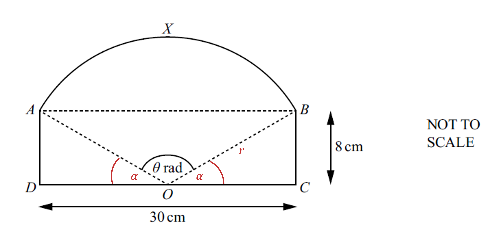
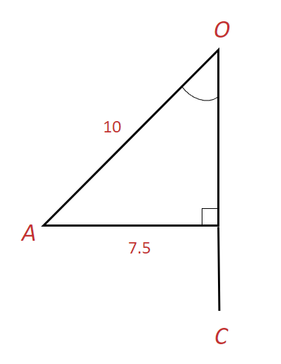
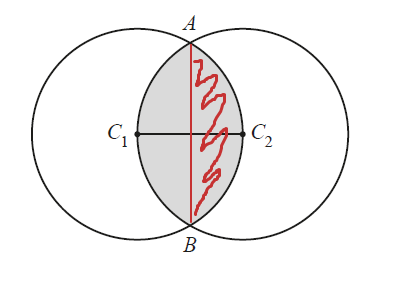
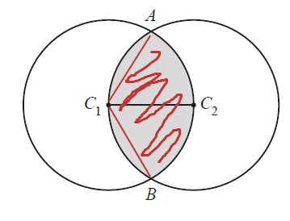
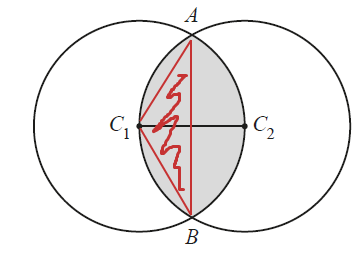
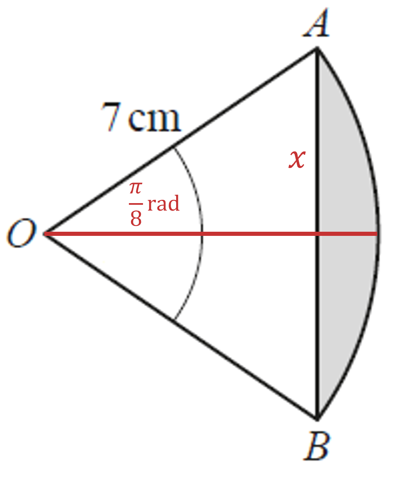

# Mark Schemes — Circular Measure
**Trigonometry** · Cambridge (CIE) IGCSE further-maths (0606)

## Exam Questions (11 questions)

### Q1
> *The formula for the length of the arc in radians is *$rθ$

> *Find an expression for the total perimeter and set it equal to 4*

`table row cell r plus r theta plus r end cell equals 4 row cell 2 r plus r theta end cell equals cell 4 space space space space space space space space space space circle enclose 1 end cell end table`

**[B1]**

> **[mark-scheme]**
> This mark is for any correct perimeter equation that uses 4 and $rθ$.

> *The formula for the area of the arc in radians is *$\frac{1}{2}r^{2}θ$

> *Find an expression for the area *$A$

`A equals 1 half r squared theta table row blank blank space end table table row blank blank space end table table row blank blank space end table table row blank blank space end table table row blank blank space end table table row blank blank space end table table row blank blank space end table table row blank blank space end table table row blank blank space end table table row blank blank space end table table row blank blank cell circle enclose 2 end cell end table`

> *Eliminate *$r$*, e.g. make *$r$* the subject of equation 1 by first factorising it out*

`table row cell r open parentheses 2 plus theta close parentheses end cell equals 4 row r equals cell fraction numerator 4 over denominator 2 plus theta end fraction end cell end table`

**[M1]**

> *Then substitute this into equation 2*

`A equals 1 half open parentheses fraction numerator 4 over denominator 2 plus theta end fraction close parentheses squared cross times theta`

> *Simplify*

`A equals 1 half cross times 16 over open parentheses 2 plus theta close parentheses squared cross times theta`

`A equals fraction numerator 8 theta over denominator open parentheses 2 plus theta close parentheses squared end fraction`

**[A1]**

> **[mark-scheme]**
> The last mark is for showing the steps that get you from the substitution of $r$ into $A$ to the answer given (not for writing out the "show that" answer).

### Q2
> *Since arc length, in radians, is *$rθ$* and we are told that the arc length **BC **is *$1.5r$

> *  *

$\mathrm{Angle}BOC=1.5\mathrm{radians}$

**[1]**

> *Use trigonometry to find an expression for the length **BC **in terms of *$r$*.*

> *  *

`sin space open parentheses 0.75 close parentheses equals fraction numerator bevelled fraction numerator B C over denominator 2 end fraction over denominator r end fraction`

**[1]**

> *Rearrange to make *$BC$* the subject.*

`B C equals 2 r space cross times space sin space open parentheses 0.75 close parentheses`

**[1]**

> *Add together the lengths around the perimeter of the shaded area.*

`2 r space plus space 4 r space plus space 1.5 r space plus space open parentheses 2 r space sin space open parentheses 0.75 close parentheses close parentheses`

**[1]**

> *Simplify.*

`7.5 r plus 2 r space sin space open parentheses 0.75 close parentheses`

> *Factorise by pulling out a factor of *$r$*.*

$(7.5+2\mathrm{sin}0.75)r$* ***[1]**
> *Find the area of the rectangle by adding together the lengths **AB, BC** and **CD**, and multiplying it by **DE**.*

> *  *

`Area space open parentheses rectangle close parentheses equals open parentheses r plus 2 r space sin space 0.75 plus r close parentheses cross times r`

> *Simplify.*

`equals open parentheses 2 r plus 2 r space sin space 0.75 close parentheses r`

**[1]**

> *Write in terms of *$r^{2}$

`equals 2 r squared plus 2 r squared open parentheses sin space 0.75 close parentheses
equals r squared open parentheses 2 plus 2 space sin space 0.75 close parentheses
equals 3.36 r squared`

> *Find the area of the segment by subtracting the area of triangle **BOC **from the area of the sector.*

> *  *

`table row cell Area space open parentheses sector close parentheses end cell equals cell 1 half r squared theta end cell row blank equals cell 1 half r squared open parentheses 1.5 close parentheses end cell end table`

`table row cell Area space open parentheses triangle close parentheses end cell equals cell 1 half a b space sin space C end cell row blank equals cell 1 half r squared open parentheses sin space 1.5 close parentheses end cell end table`

`Area space open parentheses segment close parentheses equals 1 half r squared open parentheses 1.5 close parentheses minus 1 half r squared open parentheses sin space 1.5 close parentheses`

> *Factorise by pulling out a factor of *$\frac{1}{2}r^{2}$* and simplify to write in terms of *$r^{2}$

`table row cell Area space open parentheses segment close parentheses end cell equals cell 1 half r squared open parentheses 1.5 minus sin space 1.5 close parentheses end cell row blank equals cell 0.251 r squared end cell end table`

**[1]**

> *Subtract the area of the segment from the area of the rectangle.*

> *  *

`table row cell Area space open parentheses shaded close parentheses end cell equals cell 3.36 r squared minus 0.251 r squared end cell end table`

**[1]**

$3.11r^{2}$* ***[1]**

### Q3
> *Let's label the radius of the sector as *$r$* and angles *$BOC$* and *$DOC$* as *$α$*. *$DO=OC=\frac{30}{2}=15$* cm*

> *We can find *$r$* using Pythagoras theorem*

$r=\sqrt{8^{2}+15^{2}}$

**[1]**

$=17$

> *We can find *$α$* using right-angle trigonometry. *$θ$* is in radians so remember to set your calculator to radians*

`alpha equals tan to the power of negative 1 end exponent open parentheses 8 over 15 close parentheses equals 0.489957326...`

> *Now find *$θ$* by subtracting *$2α$* from *$π$

`theta equals pi minus 2 open parentheses 0.489957326... close parentheses`

**[1]**

$=2.16167800...$

**[1]**

> *(It's worth saving this result in your calculator as it will be used more than once in this question)*

> *Now find the length of the arc using arc length = *$θr$* (or *`fraction numerator theta over denominator 2 pi end fraction open parentheses 2 pi r close parentheses`* )*

*arc length = *$2.16167800...\times17$

> *And finally find the perimeter of *$ADOCBX$* by adding the 3 straight lengths to the arc length*

`table row cell perimeter space end cell equals cell space 8 plus 8 plus 30 plus 2.16167800... cross times 17 end cell end table`

**[1]**

`table row blank equals cell space 82.748560... end cell end table`

**Final answer:** ** 82.7 cm (3 s.f.) ****[1]**
> *We know from part (a) that *$θ=2.16167800...$

> *Find the area of the sector **OAXB*

$\frac{1}{2}\times17^{2}\times2.16167800...=312.362...$

> *Find the area of the triangle **OBC** (and **OAD**) *

$\frac{1}{2}\times15\times8=60$

> *Add together the area of the sector and the area of the two triangles*

`table row cell Total space area end cell equals cell 1 half cross times 17 squared cross times 2.16167800... plus 60 plus 60 end cell row blank equals cell 432.362471... end cell end table`

** ****[1]**

> *Round the final answer to at least 3 significant figures*

**Final answer:** **432 cm****2**** (3 s.f.) ****[1]**

### Q4
> *Angle *$ACB$* is a right angle because *$CB$* is a tangent to the circle, and the angle between a tangent and a radius is a right-angle. It is also a Pythagorean triple 3, 4, 5 so we know it must be a right-angled triangle. Angle *$CAB$* can be found by*

$\mathrm{tan}θ=\frac{4}{3}$

**[1]**

> *Using the inverse tan function*

`theta space equals space tan to the power of negative 1 end exponent open parentheses 4 over 3 close parentheses`

$θ=0.927$ **[1]**
> *To find the perimeter, we need to use the formula for arc length, *$l=r\timesθ$*.*

> *Angle *$ABC$* can be found by *

$\mathrm{tan}θ=\frac{3}{4}$

`theta space equals space tan to the power of negative 1 end exponent open parentheses 3 over 4 close parentheses space equals space 0.6435...`

**[1]**

> *The angle of the larger arc can be found by subtracting angle *$CBD$* from *$2π$

> *Angle *$CBD$* is twice angle *$ABC$*, so*

$θ=2π-2\times0.644=4.995...$

> *The length of the larger arc can be found by *

$4\times4.995=19.98...\mathrm{cm}$

**[1]**

> *The angle of the smaller arc can be found by *

$θ=2π-2\times0.927=4.429...$

> *The length of the smaller arc can be found by *

$3\times4.429=13.288...\mathrm{cm}$

**[1]**

> *The perimeter is the sum of the two lengths*

$33.3\mathrm{cm}$* ***[1]**

> * *
> *The area of a sector is given by *$A=\frac{1}{2}r^{2}θ$*. *

> *The area of the larger sector is *

`A space equals 1 half space cross times space 4 squared space cross times space open parentheses 2 straight pi space minus space 2 space cross times space 0.644 close parentheses space equals space 39.96... cm squared`

> *The area of the smaller sector is*

`A space equals 1 half space cross times space 3 squared space cross times space open parentheses 2 straight pi space minus space 2 space cross times space 0.927 close parentheses space equals space 19.93... cm squared`

**for either sector correct ****[1]**

> *The area of the right-angled triangle is*

$A=\frac{1}{2}\times4\times3=6\mathrm{cm}^{2}$

**[1]**

> *There are two right-angled triangles (the second being a reflection of the original in the line AB), so finding the sum of the two sectors and the two triangles gives*

$39.96+19.93+6+6$

**[1]**

$71.9\mathrm{cm}^{2}$* ***[1]**

### Q5
> *Arc length *$=r\timesθ$

> *Therefore,*

`table row cell 1.45 r end cell equals cell r cross times theta end cell row theta equals cell 1.45 end cell end table`

> *  *

**Angle ****AOB**$=1.45$** ****radians*** ***[1]**
> *Find the area of the sector.*

`table row Area equals cell 1 half r squared theta end cell row blank blank blank row blank equals cell 1 half open parentheses r squared close parentheses open parentheses 1.45 close parentheses end cell end table`

**[1]**

> *Find the area of triangle **COA **using *$\frac{1}{2}ab\mathrm{sin}C$*.*

> *Angle **COA** sits on a straight line with Angle AOB. Therefore,*

> *  *

$\mathrm{Angle}COA=π-1.45$

> *  *

> *Length **OA** is a radius of the circle, *$r$*. Length **CO **is *$0.5r$*.*

> *Therefore,*

`Area space triangle space equals 1 half open parentheses r close parentheses open parentheses 0.5 r close parentheses open parentheses sin open parentheses pi minus 1.45 close parentheses close parentheses`

**[1]**

`Area space triangle space equals open parentheses 0.25 close parentheses open parentheses sin open parentheses pi minus 1.45 close parentheses close parentheses r squared`

> *Add together the area of the sector and the area of the triangle.*

`table row cell Total space area end cell equals cell 1 half open parentheses 1.45 close parentheses r squared plus open parentheses 0.25 close parentheses open parentheses sin open parentheses pi minus 1.45 close parentheses close parentheses r squared end cell row blank blank blank row blank equals cell 0.973178... r squared end cell end table`

$0.973r^{2}$* ***[1]**
> *Find the length **AC **using the Cosine rule.*

`A C squared equals open parentheses r close parentheses squared plus open parentheses 0.5 r close parentheses squared minus open parentheses 2 close parentheses open parentheses r close parentheses open parentheses 0.5 r close parentheses open parentheses cos open parentheses pi minus 1.45 close parentheses close parentheses`

**[1]**

`A C squared equals r squared plus 0.25 r squared minus r squared open parentheses negative 0.1205 close parentheses

A C squared equals 1.3705 r squared

A C equals square root of 1.3705 r squared end root

A C equals 1.17 r`

**[1]**

> *Add together the four lengths to find the perimeter of **ABC**.*

$0.5r+r+1.45r+1.17r=4.12r$

**[1]  **

> *We are told that the perimeter of **ABC **is 12cm. Therefore,*

> *  *

`table row cell 4.12 r end cell equals 12 row r equals cell fraction numerator 12 over denominator 4.12 end fraction end cell end table`

$r=2.91\mathrm{cm}$* ***[1]**

### Q6
> *Find angle **AOC** using trigonometry.*

$\mathrm{Angle}AOC=\mathrm{sin}^{-1}(\frac{7.5}{10})$

**[1]**

$\mathrm{Angle}AOC=0.84806$

> *Angle **AOB** is double angle **AOC**.*

$\mathrm{Angle}AOB=2\times0.848$

$\mathrm{Angle}AOB=1.696$

$AOB=1.70\mathrm{to}2\mathrm{dp}$* ***[1]**
> *Use the Cosine rule to work out the length **AC**.*

`table row cell A C squared end cell equals cell 10 squared plus 25 squared minus stretchy left parenthesis 2 cross times 10 cross times 25 cross times cos space stretchy left parenthesis A O C stretchy right parenthesis stretchy right parenthesis end cell row blank equals cell 725 minus stretchy left parenthesis 500 cross times cos space stretchy left parenthesis 0.848 stretchy right parenthesis stretchy right parenthesis end cell end table`

**[1]**

$AC^{2}=394.281$

$AC=19.857$

**[1]**

> *Work out the length of major arc **AB**.*

$πd\times\frac{\mathrm{angle} \mathrm{of} \mathrm{sector}}{2π}$

`20 pi cross times fraction numerator open parentheses 2 pi minus 1.7 close parentheses over denominator 2 pi end fraction space equals space 45.832`

** ****[1]**

> *Add together the length of major arc **AB**, and *$2\times$*length **AC** (since **AC** = **BC**).  *

`45.832 plus open parentheses 2 cross times 19.857 close parentheses space equals space 85.546`

$=85.55\mathrm{to}2\mathrm{dp}$ **[1]**

**answers which round to 85.5 or 85.6 are accepted**
> *Find the area of major sector AOB.*

$πr^{2}\times\frac{\mathrm{angle} \mathrm{of} \mathrm{sector}}{2π}$

`pi cross times open parentheses 10 close parentheses squared cross times fraction numerator open parentheses 2 pi minus 1.7 close parentheses over denominator 2 pi end fraction`

**[1]**

$=229.159$

**[1]**

> *Find the area of kite AOBC.*

$\frac{15\times25}{2}=187.5$

**[1]**

> *Add together the area of the major sector and the area of the kite.*

$229.159+187.5$

**[1]**

$416.659$* ***[1]**

**answers which round to 417 are accepted**

### Q7
> *The total perimeter is *$4π$* so the perimeter of one arc *$AB$* is *$2π$

> *Find the angle *$AC_{1}C_{2}$

> $AC_{1}$* is a radius and *$AC_{2}$* is also a radius, and *$C_{1}C_{2}$* is a radius too meaning that triangle *$AC_{1}C_{2}$* is an equilateral triangle so *

$\mathrm{angle}AC_{1}C_{2}=60^{\circ}=\frac{π}{3}$

> *Use this to find angle *$ACB$

$\mathrm{angle}ACB=2\times\frac{π}{3}$

$\mathrm{angle}ACB=\frac{2π}{3}$

**[1]**

> *Apply the formula for arc length using half of the perimeter*

$\mathrm{arc} \mathrm{length}=rθ$

$2π=r\times\frac{2π}{3}$

**correct arc length 2π**** [1]**

**correct equation ****[1]**

> *Multiply by 3*

$2πr=6π$

> *Divide by *$2π$

$r=3$

$r=3$ **[1]**
> *From part (a) *$r=3\mathrm{and} \mathrm{angle}ACB=\frac{2π}{3}$

> *Split the area in half by drawing a line connecting **A** and **B*

> *Find the red shaded area by first working out the area of the sector below*

> *Use the area of a sector formula, *$\mathrm{area} \mathrm{of} \mathrm{sector}=\frac{1}{2}r^{2}θ$

$\mathrm{area} \mathrm{of} \mathrm{sector}AC_{1}B=\frac{1}{2}\times3^{2}\times\frac{2π}{3}$

**[1]**

$\mathrm{area} \mathrm{of} \mathrm{sector}AC_{1}B=3π$

> *Now find the area of the triangle using *$\mathrm{area}=\frac{1}{2}ab\mathrm{sinC}$

`area space of space triangle equals 1 half cross times 3 cross times 3 cross times sin open parentheses fraction numerator 2 straight pi over denominator 3 end fraction close parentheses`

**[1]**

$\mathrm{area} \mathrm{of} \mathrm{triangle}=\frac{9\sqrt{3}}{4}$

> *Subtract the triangle from the sector to get the shaded area in the first diagram*

$3π-\frac{9\sqrt{3}}{4}$

**[1]**

> *We need 2 of these so double your answer to get the total shaded area*

`2 open parentheses 3 straight pi minus fraction numerator 9 square root of 3 over denominator 4 end fraction close parentheses`

$6π-\frac{9\sqrt{3}}{2}$ **[1]**

### Q8
> *In radians, *$\mathrm{Area} \mathrm{of} \mathrm{sector}=\frac{1}{2}r^{2}θ$

> *Substitute known values into the equation.*

`35 equals 1 half open parentheses 10 close parentheses squared cross times theta`

> *Rearrange and solve for *$θ$*.*

`table row 35 equals cell 50 cross times theta end cell row theta equals cell 35 over 50 end cell row theta equals cell 0.7 end cell end table`

$0.7$** [1]**
> *Find the arc length *$CD$*.*

$CD=rθ\,CD=10\times0.7\,CD=7cm$

**[1]**

> *Work out length** *$\frac{AB}{2}$* **by using trigonometry.*

`table row cell sin open parentheses 0.35 close parentheses end cell equals cell fraction numerator bevelled fraction numerator A B over denominator 2 end fraction over denominator 12 end fraction end cell row cell fraction numerator A B over denominator 2 end fraction end cell equals cell 4.11477 end cell end table`

**[1]**

> *Double to find *$AB$*.*

`table row cell A B end cell equals cell 8.229547 c m end cell end table`

> *  *

**[1]**

> *Add the sides to find the perimeter.*

$\mathrm{Perimeter}=7+8.23+2+2$

$19.2\mathrm{cm}$**[1]**
> *Area of shaded region = Area of triangle - Area of sector*

> *We are told the area of the sector is *$35cm^{2}$*.*

> *Find the area of the triangle **AOB.*

`Area space equals 1 half a b space sin space C
Area space equals fraction numerator space 1 over denominator 2 end fraction open parentheses 12 close parentheses squared space cross times sin space open parentheses 0.7 close parentheses`

**[1]**

$\mathrm{Area}=46.38$

**[1]**

> *Subtract the area of the sector from the area of the triangle.*

> *  *

$46.38-35=11.38$

$11.4\mathrm{cm}^{2}$** [1]**

### Q9
> *Using the formula *$l=rθ$

$9.6=12θ$

> *Solve to find *$θ$

$\frac{9.6}{12}=θ$

$0.8$**[1]**
> *Using the formula for the area of a sector *$A=\frac{1}{2}r^{2}θ$

$A=\frac{1}{2}\times12^{2}\times0.8=57.6\mathrm{cm}^{2}$

**[1]**

> *Calculating the length of the base of the right-angled triangle OAM, using the fact that the length of the radius would also be the length of the perpendicular height, and the angle is half of 0.8,*

`tan open parentheses 0.4 close parentheses space equals space fraction numerator A M over denominator 12 end fraction`

$AM=5.074$

**[1]**

*Therefore,*** **$AO=2\times5.074=10.148$

> *Calculating the area of triangle OAB*

`1 half open parentheses 10.148 close parentheses space cross times space 12 space equals space 60.88`

**[1]**

> *Subtracting the area of the sector from the area of the triangle*

$60.88-57.6$

$3.28\mathrm{cm}^{2}$ **[1]**
> *Calculating the length of OA*

`cos open parentheses 0.4 close parentheses space equals space fraction numerator 12 over denominator O A end fraction`

**[1]**

$OA=13.028$

> *Subtracting OC from OA gives*

$AC=1.028$

> *Finding the perimeter of the shaded region*

$\mathrm{Perimeter}=1.028+1.028+9.6+5.07+5.07$

**[1]**

$21.8cm$ **[1]**

### Q10
> *Use the formula *$\mathrm{arc} \mathrm{length}=rθ$* to find the length of the arc*

$\mathrm{arc} \mathrm{length}=7\times\frac{π}{4}$

$\mathrm{arc} \mathrm{length}=\frac{7π}{4}$

> *Use trigonometry to find the length of the chord*

> *Bisect **AB **and draw a right-angled triangle*

> *Use the sin ratio to find length *$x$

`sin open parentheses straight pi over 8 close parentheses equals x over 7`

`x equals 7 sin open parentheses straight pi over 8 close parentheses`

> *The length of the chord is double this so multiply by 2*

`chord space length equals 14 sin open parentheses straight pi over 8 close parentheses`

**[1]**

> *The perimeter of the shaded region is the arc length added to the chord length*

`perimeter space of space shaded space region equals 14 sin open parentheses straight pi over 8 close parentheses plus fraction numerator 7 straight pi over denominator 4 end fraction`

** ****[1]**

**10.9 cm**** [1]**

### Q11
> *The circle has radius = 6cm*

> *Calculate the length of the arc*

`arc space length equals 2 open parentheses 6 plus 5 straight pi close parentheses minus open parentheses 2 cross times 6 close parentheses`

$\mathrm{arc} \mathrm{length}=12+10π-12$

$\mathrm{arc} \mathrm{length}=10π$

**[1]**

> *Calculate the circumference of the circle*

$C=2\timesπ\times6$

$C=12π$

> *Work out the fraction of the area that we want*

$\frac{10π}{12π}=\frac{5}{6}$

**[1]**

> *Calculate the area of the sector*

$\mathrm{area} \mathrm{of} \mathrm{sector}=\frac{5}{6}\timesπ\times6^{2}$

**[1]**

$\mathrm{area} \mathrm{of} \mathrm{sector}=30π$

$30π\mathrm{cm}^{2}$ **[1]**
