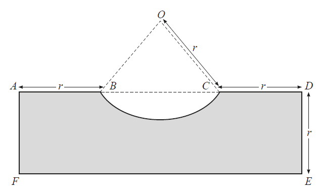
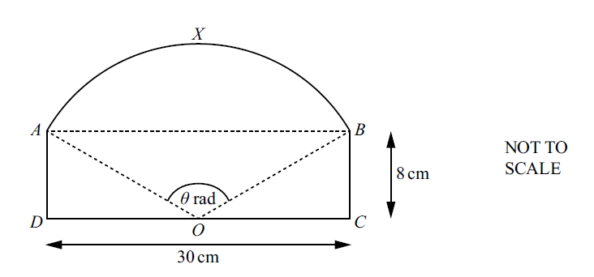
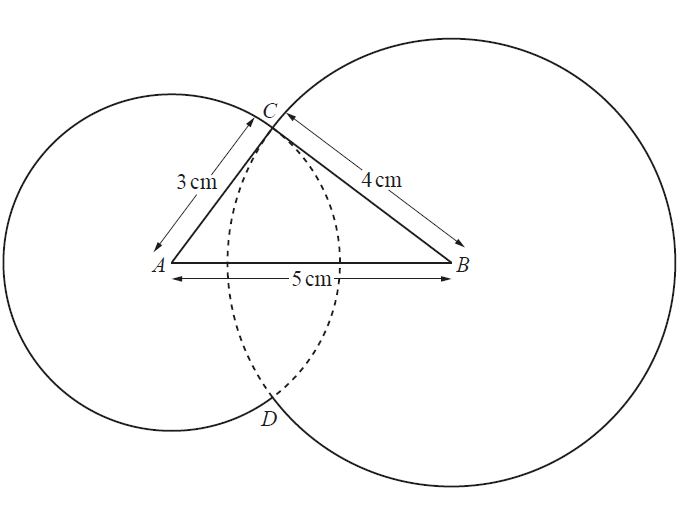
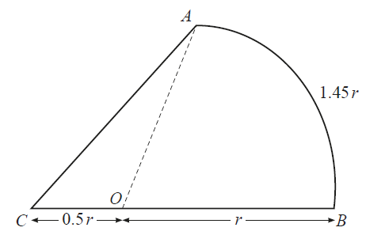
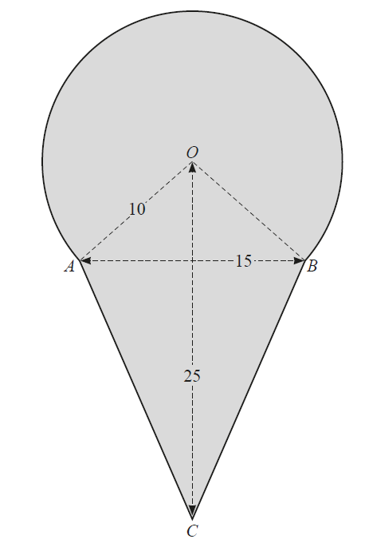
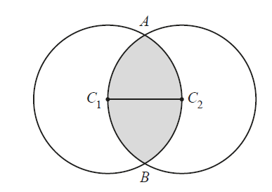
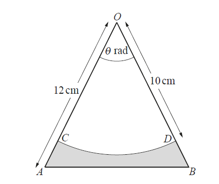
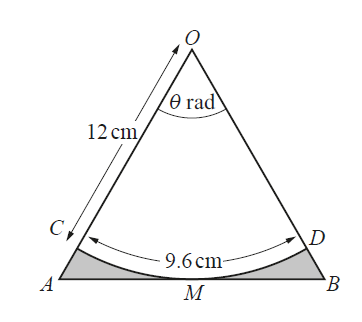
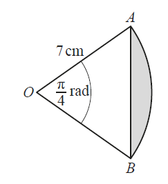

# Exam Questions — Circular Measure
**Trigonometry** · Cambridge (CIE) IGCSE further-maths (0606)
> Source: [https://www.savemyexams.com/igcse/further-maths/cie/additional-maths/25/topic-questions/](https://www.savemyexams.com/igcse/further-maths/cie/additional-maths/25/topic-questions/) · 11 questions across 1 sets

## Exam Questions (11 questions)

### Q1 — hard — 3 marks

**Q1** [3 marks]

A sector from a circle of radius $r$ has an internal angle of $θ$ radians, as shown below.

The perimeter of the sector is 4 units and the area of the sector is $A$ square units.

Show that $A = \frac{8 \\theta }{( 2 + \\theta )^{2}}$.

### Q2 — hard — 9 marks

**Q2** [5 marks]

In this question all lengths are in centimetres and all angles are in radians.

The diagram shows the rectangle $ADEF$, where $AF=DE=r$. The points $B$ and $C$ lie on $AD$ such that $AB=CD=r$ . The curve $BC$ is an arc of the circle, centre $O$, radius $r$ and has a length of $1.5r$.

Show that the perimeter of the shaded region is $(7.5+2\mathrm{sin}0.75)r$ .

*Source: Nov 2020 0606/12 Q11A*

**Q2** [4 marks]

**Extract:**

In this question all lengths are in centimetres and all angles are in radians.

The diagram shows the rectangle A D E F, where A F = D E = r. The points B and C lie on A D such that A B = C D = r. The curve B C is an arc of the circle, centre O, radius r and has a length of 1.5 r.

Angle B O C equals 1.5 radians

Find the area of the shaded region, giving your answer in the form $kr^{2}$, where $k$ is a constant correct to 2 decimal places.

*Source: Nov 2020 0606/12 Q11B*

### Q3 — hard — 7 marks

**Q3** [5 marks]

The diagram shows a rectangle $ABCD$ and an arc $AXB$ of a circle with centre at $O$, the midpoint of $DC$. 
The length of $BC$ is $8\mathrm{cm}$ and the length of $DC$ is $30\mathrm{cm}$. Angle $AOB$ is $θ$ radians.

Find the perimeter of the shape $ADOCBX$.

*Source: Specimen 2025 Paper 2 Q9A*

**Q3** [2 marks]

**Extract:**

The diagram shows a rectangle ABCD and an arc AXB of a circle with centre at O, the midpoint of DC. The length of BC is 8 cm and the length of DC is 30 cm. Angle AOB is theta radians.

From part (a):
DO = OC = 30/2 = 15 cm
r = square root of (8^2 + 15^2) = 17 cm
theta = 2.16167800... radians

Find the area of the shape $ADOCBX$.

*Source: Specimen 2025 Paper 2 Q9B*

### Q4 — very_hard — 10 marks

**Q4** [2 marks]

The diagram shows a shape consisting of two circles of radius 3 cm and 4 cm with centres $A$ and $B$ which are 5 cm apart. The circles intersect at $C$ and $D$ as shown. The lines $AC$ and $BC$ are tangents to the circles, centres $B$ and $A$ respectively. Find the angle $CAB$ in radians.

*Source: Nov 2020 0606/21 Q12A*

**Q4** [4 marks]

**Extract:**

The diagram shows a shape consisting of two circles of radius 3 cm and 4 cm with centres A and B which are 5 cm apart. The circles intersect at C and D as shown. The lines AC and BC are tangents to the circles, centres B and A respectively.

Find the perimeter of the whole shape.

*Source: Nov 2020 0606/21 Q12B*

**Q4** [4 marks]

**Extract:**

The diagram shows a shape consisting of two circles of radius 3 cm and 4 cm with centres A and B which are 5 cm apart. The circles intersect at C and D as shown. The lines AC and BC are tangents to the circles, centres B and A respectively.

Angle CAB = 0.927 radians (from part a)

Angle ABC = 0.6435... ≈ 0.644 radians (from part b)

Find the area of the whole shape.

*Source: Nov 2020 0606/21 Q12C*

### Q5 — very_hard — 8 marks

**Q5** [1 mark]

In this question all lengths are in centimetres.

The diagram shows the figure $ABC$. The arc $AB$ is part of a circle, centre $O$, radius $r$, and is of length $1.45r$. The point $O$ lies on the straight line $CB$ such that $CO=0.5r$.

Find, in radians, the angle $AOB$.

*Source: Nov 2020 0606/13 Q8A*

**Q5** [3 marks]

**Extract:**

In this question all lengths are in centimetres.

The diagram shows the figure ABC. The arc AB is part of a circle, centre O, radius r, and is of length 1.45 r. The point O lies on the straight line CB such that CO = 0.5 r.

Angle AOB = 1.45 radians

Find the area of $ABC$, giving your  in the form $kr^{2}$, where $k$ is a constant.

*Source: Nov 2020 0606/13 Q8B*

**Q5** [4 marks]

**Extract:**

The diagram shows the figure ABC. The arc AB is part of a circle, centre O, radius r, and is of length 1.45 r. The point O lies on the straight line CB such that CO = 0.5 r.

Given that the perimeter of $ABC$ is $12\mathrm{cm}$, find the value of $r$.

*Source: Nov 2020 0606/13 Q8C*

### Q6 — hard — 11 marks

**Q6** [2 marks]

In this question all lengths are in centimetres.

The diagram shows a shaded shape. The arc $AB$ is the major arc of a circle, centre $O$, radius 10. The line $AB$ is of length 15, the line $OC$ is of length 25 and the lengths of $AC$ and $BC$ are equal.

Show that the angle $AOB$ is 1.70 radians correct to 2 decimal places.

*Source: june 2021 paper 11 Q10A*

**Q6** [4 marks]

**Extract:**

In this question all lengths are in centimetres.

The diagram shows a shaded shape. The arc AB is the major arc of a circle, centre O, radius 10. The line AB is of length 15, the line OC is of length 25 and the lengths of AC and BC are equal.

Show that the angle AOB is 1.70 radians correct to 2 decimal places.

Find the perimeter of the shaded shape.

*Source: june 2021 paper 11 Q10B*

**Q6** [5 marks]

**Extract:**

The diagram shows a shaded shape. The arc AB is the major arc of a circle, centre O, radius 10. The line AB is of length 15, the line OC is of length 25 and the lengths of AC and BC are equal.

Show that the angle AOB is 1.70 radians correct to 2 decimal places.

Find the area of the shaded shape.

*Source: june 2021 paper 11 Q10C*

### Q7 — very_hard — 8 marks

**Q7** [4 marks]

The circles with centres $C_{1}$ and $C_{2}$ have equal radii of length $r\mathrm{cm}$. The line $C_{1}C_{2}$ is a radius of both circles. The two circles intersect at $A$ and $B$.

Given that the perimeter of the shaded region is $4π\mathrm{cm}$, find the value of $r$. [4]

*Source: june 2020 0606/22 Q11A*

**Q7** [4 marks]

**Extract:**

The circles with centres C₁ and C₂ have equal radii of length r cm. The line C₁C₂ is a radius of both circles. The two circles intersect at A and B.

Given that the perimeter of the shaded region is 4π cm, find the value of r.

From the solution to part (a): r = 3 and angle ACB = 2π/3

Find the exact area of the shaded region.

*Source: june 2020 0606/22 Q11B*

### Q8 — medium — 8 marks

**Q8** [1 mark]

The diagram shows an isosceles triangle $OAB$ such that $OA=OB=12\mathrm{cm}$ and angle $AOB=θ\mathrm{radians}$. 
Points $C$ and $D$ lie on $OA$ and $OB$ respectively such that $CD$ is an arc of the circle, centre $O$, radius $10\mathrm{cm}$. 
The area of the sector $OCD=35\mathrm{cm}^{2}$ .

Show that $θ=0.7$.

*Source: june 2020 0606/13 Q7A*

**Q8** [4 marks]

**Extract:**

The diagram shows an isosceles triangle OAB such that OA = OB = 12 cm and angle AOB = θ radians.

Points C and D lie on OA and OB respectively such that CD is an arc of the circle, centre O, radius 10 cm.

The area of the sector OCD = 35 cm².

θ = 0.7

Find the perimeter of the shaded region.

*Source: june 2020 0606/13 Q7B*

**Q8** [3 marks]

**Extract:**

The diagram shows an isosceles triangle OAB such that OA = OB = 12 cm and angle AOB = θ radians. Points C and D lie on OA and OB respectively such that CD is an arc of the circle, centre O, radius 10 cm. The area of the sector OCD = 35 cm squared. θ = 0.7

Find the area of the shaded region.

*Source: june 2020 0606/13 Q7C*

### Q9 — very_hard — 8 marks

**Q9** [1 mark]

The diagram shows an isosceles triangle $OAB$ such that $OA=OB$ and angle $AOB=θ$ radians. The points $C$ and $D$ lie on $OA$ and $OB$ respectively. $CD$ is an arc of length 9.6 cm of the circle, centre $O$, radius 12 cm. The arc $CD$ touches the line $AB$ at the point $M$.

Find the value of $θ$.

*Source: june 2020 0606/11 Q7A*

**Q9** [4 marks]

**Extract:**

The diagram shows an isosceles triangle OAB such that OA = OB and angle AOB = θ radians. The points C and D lie on OA and OB respectively. CD is an arc of length 9.6 cm of the circle, centre O, radius 12 cm. The arc CD touches the line AB at the point M.

From part a: θ = 0.8

Find the total area of the shaded regions.

*Source: june 2020 0606/11 Q7B*

**Q9** [3 marks]

**Extract:**

The diagram shows an isosceles triangle OAB such that OA = OB and angle AOB = θ radians. The points C and D lie on OA and OB respectively. CD is an arc of length 9.6 cm of the circle, centre O, radius 12 cm. The arc CD touches the line AB at the point M.

θ = 0.8

Calculating the length of the base of the right-angled triangle OAM, using the fact that the length of the radius would also be the length of the perpendicular height, and the angle is half of 0.8,

tan(0.4) = AM/12

AM = 5.074

Find the total perimeter of the shaded regions.

*Source: june 2020 0606/11 Q7C*

### Q10 — medium — 3 marks

**Q10** [3 marks]

The diagram shows the sector $AOB$ of a circle with centre $O$ and radius 7 cm. 
Angle $AOB=\frac{π}{4}$ radians. Find the perimeter of the shaded region.

*Source: March 2020 0606/22 Q6B*

### Q11 — medium — 4 marks

**Q11** [4 marks]

A circle has a radius of 6 cm. A sector of this circle has a perimeter of $2 ( 6 + 5 \pi ) \text{cm}$. Find the area of this sector.

*Source: March 2020 0606/22 Q6A*

