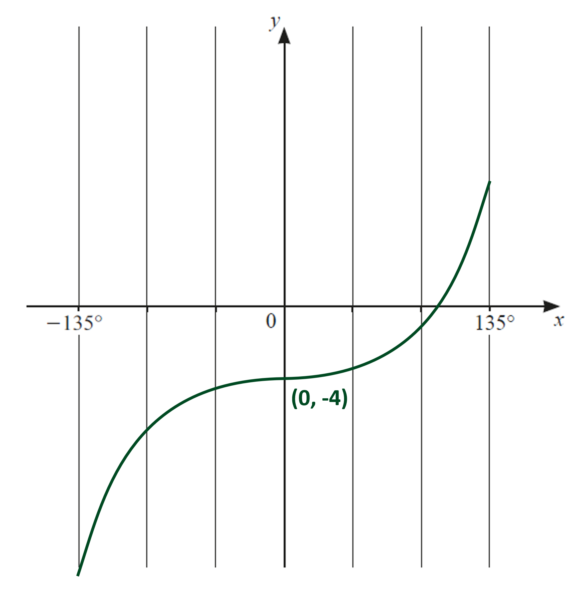
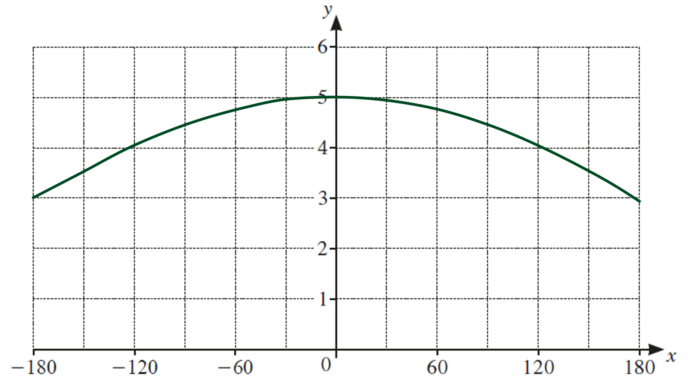
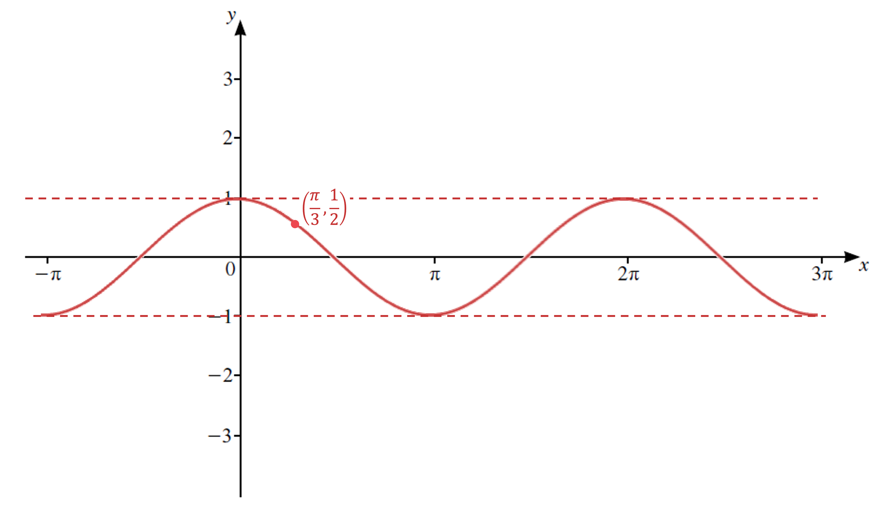
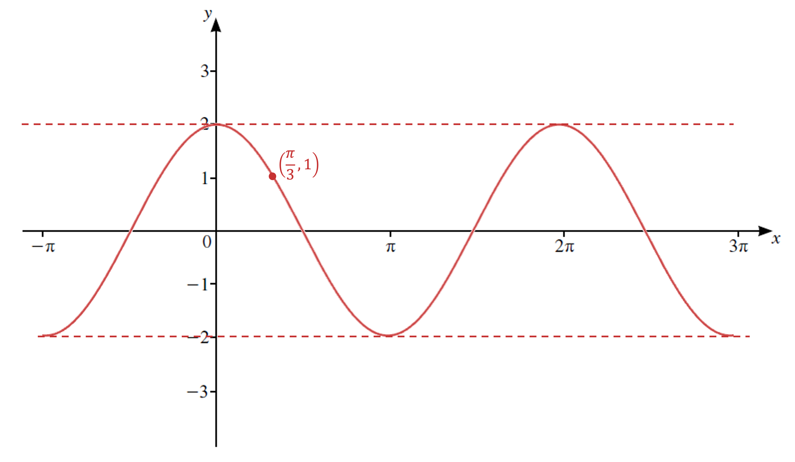
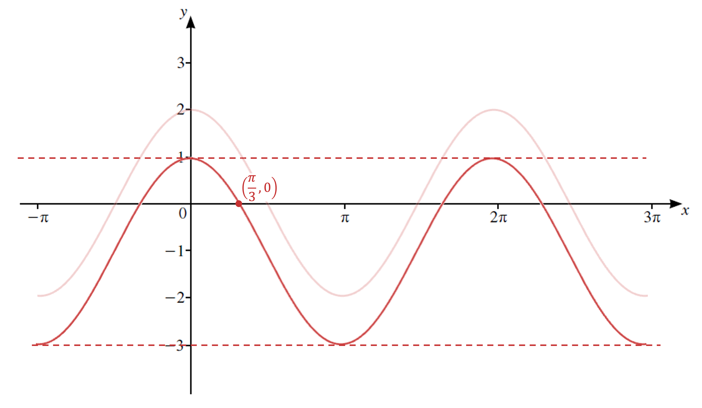
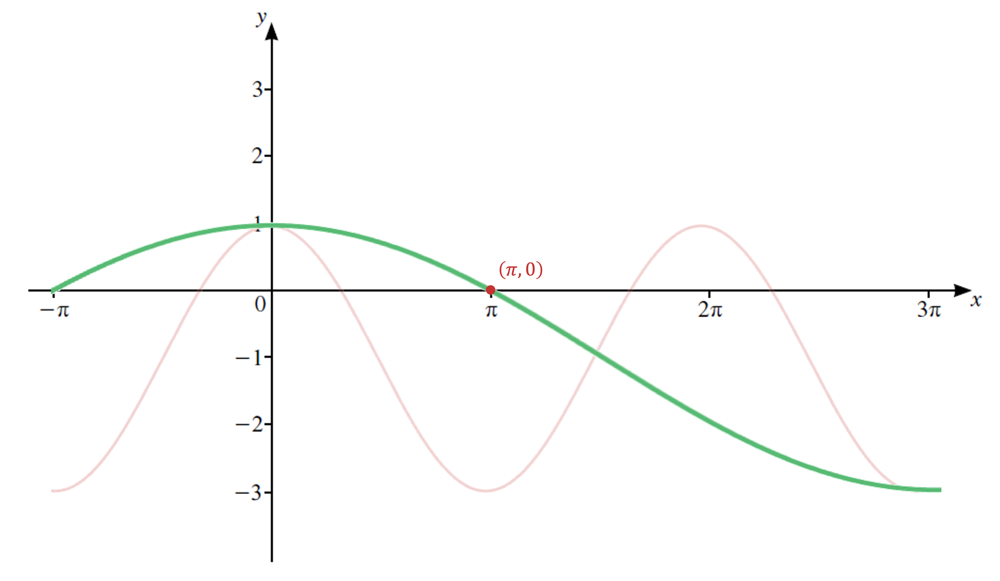
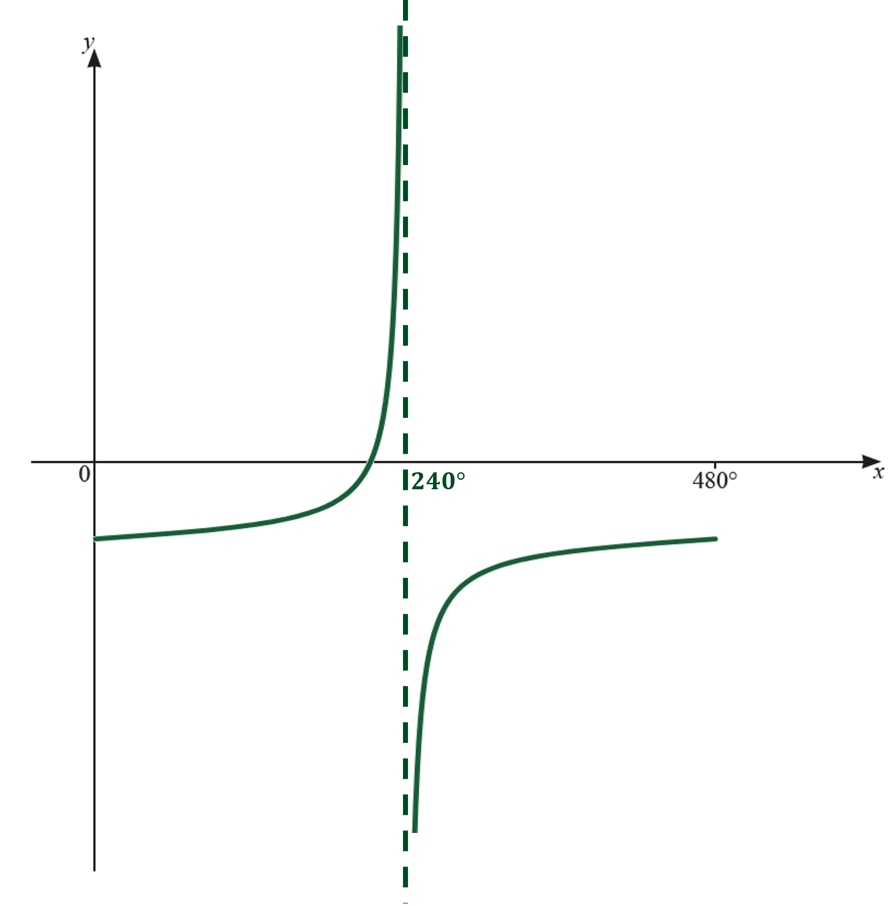
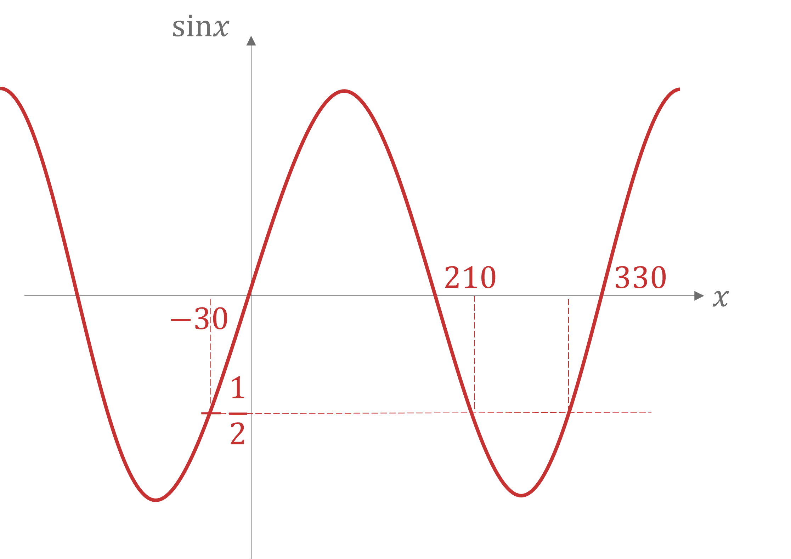
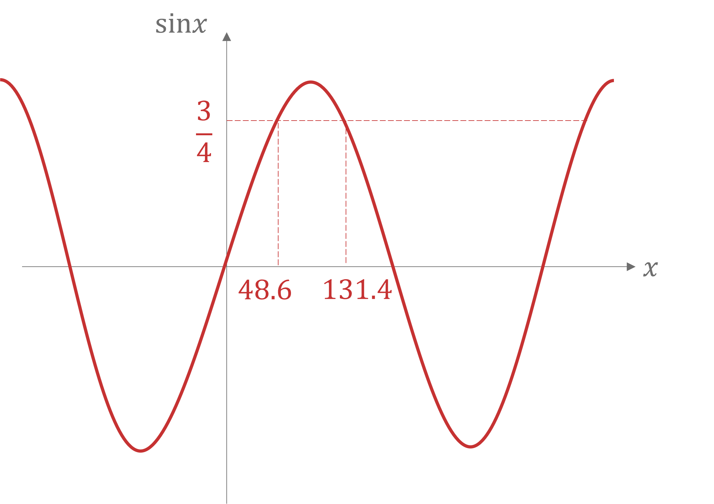
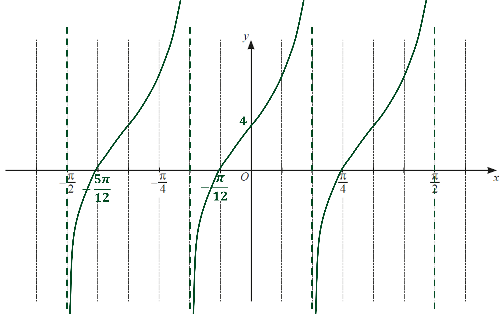

# Mark Schemes — Trigonometry
**Trigonometry** · Cambridge (CIE) IGCSE further-maths (0606)

## Exam Questions (27 questions)

### Q1
> *Multiply *$A$* and *$B$* together*

$A B = ( \frac{\tan x}{1 + \sec x} ) ( \frac{\tan x}{1 - \sec x} )$

> *Expand out the brackets in the numerator and the denominator (using the difference between two squares)*

$AB=\frac{\mathrm{tan}^{2}x}{1-\mathrm{sec}^{2}x}$

**Method 1**

> *Use the identity *$1+\mathrm{tan}^{2}x=\mathrm{sec}^{2}x$* in the denominator and simplify*

$\begin{gathered} A B & = \frac{\tan ^{2} x}{1 - ( 1 + \tan ^{2} x )} \\ = \frac{\tan ^{2} x}{1 - 1 - \tan ^{2} x} \\ = \frac{\tan ^{2} x}{- \tan ^{2} x} \\ = - 1 \end{gathered}$

$AB=-1$

**[M1 A1]**

> **[mark-scheme]**
> **M1: **For attempting to use $1+\mathrm{tan}^{2}x=\mathrm{sec}^{2}x$ to simplify the algebraic fraction.
> 
> **A1: **For the correct final answer of $-1$.

**Method 2**

> *Use the identity *$\mathrm{tan}x=\frac{\mathrm{sin}x}{\mathrm{cos}x}$* and that *$\mathrm{sec}x=\frac{1}{\mathrm{cos}x}$*, then multiply top and bottom by *$\mathrm{cos}^{2}x$

$A B = \frac{( \frac{\sin ^{2} x}{\cos ^{2} x} )}{1 - \frac{1}{\cos ^{2} x}} 
= \frac{( \frac{\sin ^{2} x}{\cos ^{2} x} ) \times \cos ^{2} x}{( 1 - \frac{1}{\cos ^{2} x} ) \times \cos ^{2} x} 
= \frac{\sin ^{2} x}{\cos ^{2} x - 1}$

> *Then use the identity *$\mathrm{cos}^{2}x=1-\mathrm{sin}^{2}x$* in the denominator*

$\begin{gathered} A B & = \frac{\sin ^{2} x}{( 1 - \sin ^{2} x ) - 1} \\ = \frac{\sin ^{2} x}{- \sin ^{2} x} \\ = - 1 \end{gathered}$

$AB=-1$

**[M1 A1]**

> **[mark-scheme]**
> **M1: **For attempting to use $\mathrm{sin}^{2}x+\mathrm{cos}^{2}x=1$ to simplify the algebraic fraction.
> 
> **A1: **For the correct final answer of $-1$.
**Method 1**

> *Add *$A$* and *$B$* together*

$A+B=\frac{\mathrm{tan}x}{1+\mathrm{sec}x}+\frac{\mathrm{tan}x}{1-\mathrm{sec}x}$

> *Add the algebraic fractions on the right-hand side (by putting them over the lowest common denominator)*

$\begin{gathered} A + B & = \frac{\tan x ( 1 - \sec x )}{( 1 + \sec x ) ( 1 - \sec x )} + \frac{\tan x ( 1 + \sec x )}{( 1 + \sec x ) ( 1 - \sec x )} \\ = \frac{\tan x ( 1 - \sec x ) + \tan x ( 1 + \sec x )}{( 1 + \sec x ) ( 1 - \sec x )} \end{gathered}$

**[M1 A1]**

> *Expand out the brackets in the numerator and the denominator (using the difference between two squares)*

$\begin{gathered} A + B & = \frac{\tan x \cancel{- \tan x \sec x} + \tan x + \cancel{\tan x \sec x} }{1 - \sec ^{2} x} \\ = \frac{2 \tan x}{1 - \sec ^{2} x} \end{gathered}$

**[M1]**

> *Use the identity *$1+\mathrm{tan}^{2}x=\mathrm{sec}^{2}x$* in the denominator and simplify*

$\begin{gathered} A + B & = \frac{2 \tan x}{1 - ( 1 + \tan ^{2} x )} \\ = \frac{2 \tan x}{1 - 1 - \tan ^{2} x} \\ = \frac{2 \tan x}{- \tan ^{2} x} \\ = - \frac{2}{\tan x} \\ = - 2 \cot x \end{gathered}$

$A+B=-2\mathrm{cot}x$

**[A1]**

> **[mark-scheme]**
> The last mark comes from showing how the identity leads to the answer given in the question (no marks are awarded for just writing down the "show that" answer).

**Method 2**

> *Use the identity *$\mathrm{tan}x=\frac{\mathrm{sin}x}{\mathrm{cos}x}$* and that *$\mathrm{sec}x=\frac{1}{\mathrm{cos}x}$

$A+B=\frac{\frac{\mathrm{sin}x}{\mathrm{cos}x}}{1+\frac{1}{\mathrm{cos}x}}+\frac{\frac{\mathrm{sin}x}{\mathrm{cos}x}}{1-\frac{1}{\mathrm{cos}x}}$

> *Then multiply top and bottom of each fraction by *$\mathrm{cos}x$

$A+B=\frac{\mathrm{sin}x}{\mathrm{cos}x+1}+\frac{\mathrm{sin}x}{\mathrm{cos}x-1}$

> *Add the algebraic fractions on the right-hand side (by putting them over the lowest common denominator)*

$\begin{gathered} A + B & = \frac{\sin x ( \cos x - 1 )}{( \cos x + 1 ) ( \cos x - 1 )} + \frac{\sin x ( \cos x + 1 )}{( \cos x + 1 ) ( \cos x - 1 )} \\ = \frac{\sin x ( \cos x - 1 ) + \sin x ( \cos x + 1 )}{( \cos x + 1 ) ( \cos x - 1 )} \end{gathered}$

**[M1 A1]**

> *Expand out the brackets in the numerator and the denominator (using the difference between two squares)*

$\begin{gathered} A + B & = \frac{\sin x \cos x \cancel{- \sin x} + \sin x \cos x + \cancel{\sin x} }{\cos ^{2} x - 1} \\ = \frac{2 \sin x \cos x}{\cos ^{2} x - 1} \end{gathered}$

**[M1]**

> *Then use the identity *$\mathrm{cos}^{2}x=1-\mathrm{sin}^{2}x$* in the denominator*

$\begin{gathered} A + B & = \frac{2 \sin x \cos x}{( 1 - \sin ^{2} x ) - 1} \\ = \frac{2 \sin x \cos x}{- \sin ^{2} x} \\ = \frac{2 \cos x}{\sin x} \end{gathered}$

> *Now use the identity that *$\mathrm{cot}x=\frac{\mathrm{cos}x}{\mathrm{sin}x}$

$A+B=-2\mathrm{cot}x$

**[A1]**

> **[mark-scheme]**
> The last mark comes from showing how the identity leads to the answer given in the question (no marks are awarded for just writing down the "show that" answer).
> *Start by simplifying *$( A + 1 ) ( B + 1 )$*, e.g. expand the brackets*

$( A + 1 ) ( B + 1 ) = A B + A + B + 1$

> *Substitute in *$AB=-1$* from part (a) and *$A+B=-2\mathrm{cot}x$* from part (b) and simplify*

$\begin{gathered} ( A + 1 ) ( B + 1 ) & = - 1 + ( - 2 \cot x ) + 1 \\ = - 2 \cot x \end{gathered}$

**[M1 A1]**

> *This gives the following identity*

$( \frac{\tan x}{1 + \sec x} + 1 ) ( \frac{\tan x}{1 - \sec x} + 1 ) = - 2 \cot x$

> *Change the arguments in the identity from *$x$* to *$( x - 60 )$* (this does not affect the identity)*

$( \frac{\tan ( x - 60 )}{1 + \sec ( x - 60 )} + 1 ) ( \frac{\tan ( x - 60 )}{1 - \sec ( x - 60 )} + 1 ) = - 2 \cot ( x - 60 )$

> *Use this new identity to simplify the left-hand side of the equation given in the question*

$- 2 \cot ( x - 60 ) = 2 \sqrt{3}$

> *Solve this equation by first making *$\tan ( x - 60 )$* the subject*

$\begin{gathered} - \frac{2}{\tan ( x - 60 )} & = 2 \sqrt{3} \\ - \frac{1}{ \sqrt{3} } & = \tan ( x - 60 ) \end{gathered}$

**[A1]**

> *Note that *$\frac{1}{\sqrt{3}}=\frac{1}{\sqrt{3}}\times\frac{\sqrt{3}}{\sqrt{3}}=\frac{\sqrt{3}}{3}$* and that *$\tan ( - 30 ) = - \frac{ \sqrt{3} }{3}$* (an exact trig value)*

$\begin{gathered} x - 60 & = - 30 , - 30 \pm 180 , - 30 \pm 2 \times 180 , ... \\ x - 60 & = - 30 , - 210 , 150 , ... \\ x = - 30 + 60 , - 210 + 60 , 150 + 60 , ... \\ x = 30 , - 150 , 210 , ... \end{gathered}$

> *Find the solutions in the range *$-180^{\circ}<x<180^{\circ}$

**Final answer:** $x=30^{\circ}$** and **$x=-150^{\circ}$

**[A1 A1]**

### Q2
> *For the graph *$y=a\mathrm{sin}bx+c$* the amplitude is *$a$

$a=10$

**[B1]**

> *For the graph *$y=a\mathrm{sin}bx+c$* the period is *$\frac{2π}{b}$* (when using radians)*

$\frac{2π}{b}=16π$

> *Solve for *$b$

$\begin{gathered} 2 = 16 b \\ b = \frac{1}{8} \end{gathered}$

**[B1]**

> *Substitute *$x=12π$* and *$y=4$* into *$y = 10 \sin ( \frac{x}{8} ) + c$

$4 = 10 \sin ( \frac{12 \pi }{8} ) + c$

**[M1]**

> **[mark-scheme]**
> This mark is for substituting $x=12π$ and $y=4$ into your $y=a\mathrm{sin}bx+c$ ($a$, $b$ and $c$ do not have to be correct to get this mark).

> *Simplify and use the exact trig value that *$\sin ( \frac{3 \pi }{2} ) = - 1$

$\begin{gathered} 4 = 10 \sin ( \frac{3 \pi }{2} ) + c \\ 4 = 10 ( - 1 ) + c \\ 14 = c \end{gathered}$

**[A1]**

> *Present all the solutions from above*

**Final answer:** $a=10$**, **$b=\frac{1}{8}$** and **$c=14$
> *The graph of *$y = \tan ( \frac{x}{2} )$* is the graph of *$y=\mathrm{tan}x$* after a horizontal stretch of scale factor 2 (i.e. has asymptotes at *$x=\pmπ$*)*

> *The graph of *$y = \tan ( \frac{x}{2} ) + 1$* is the graph of *$y = \tan ( \frac{x}{2} )$* translated upwards by 1 unit (asymptotes are not affect)*

> *Sketch the graph of *$y = \tan ( \frac{x}{2} ) + 1$

> *Find the coordinate of the *$x$*-intercept (by setting *$y=0$* and solving)*

$\begin{gathered} \tan ( \frac{x}{2} ) + 1 & = 0 \\ \tan ( \frac{x}{2} ) & = - 1 \end{gathered}$

**[M1]**

> *Use the exact trig value *$\tan ( - \frac{\pi }{4} ) = - 1$* to solve for *$x$

$\begin{gathered} \frac{x}{2} & = - \frac{\pi }{4} \\ x = - \frac{\pi }{2} \end{gathered}$

**[A1]**

> *Apply the modulus transformation to *$y = \tan ( \frac{x}{2} ) + 1$* (reflecting any part below the axis)*

**[B1 B1]**

> **[mark-scheme]**
> **B1: **For drawing the correct shape between 2 vertical asymptotes (the numerical values may be incorrect for this mark).
> 
> **B1:** For drawing the  shape between two vertical asymptotes with all numerical values labelled clearly and correctly.

### Q3
i) *Looking at the left hand side and finding a common denominator gives  *

$\frac{1}{\sec \\theta - 1} - \frac{1}{\sec \\theta + 1} = \frac{\sec \\theta + 1 - ( \sec \\theta - 1 )}{( \sec \\theta - 1 ) ( \sec \\theta + 1 )}$

**[1]**

> *Expanding the brackets and simplifying  *

> $\frac{2}{\mathrm{sec}^{2}θ-1}$*  *

> *Using the trigonometric identity *$\mathrm{sec}^{2}θ=1+\mathrm{tan}^{2}θ$* we have  *

$\frac{2}{\mathrm{tan}^{2}θ}$

**[1]**

> *Using the trigonometric identity *$\frac{1}{\mathrm{tan}θ}=\mathrm{cot}θ$* we have an expression which is equal to the right hand side, as required  *

$\frac{2}{\mathrm{tan}^{2}θ}=2\mathrm{cot}^{2}θ$

$2\mathrm{cot}^{2}θ$** ****[1]**

ii) *Comparing to part (i) but with *$θ=2x$* we have  *

$2\mathrm{cot}^{2}2x=6$

**[1]**

> $\mathrm{cot}^{2}2x=3$*   *

> *Taking the square root of both sides   *

$\mathrm{cot}2x=\pm\sqrt{3}$

> *Using the trigonometric identity *$\mathrm{cot}x=\frac{1}{\mathrm{tan}x}$* we have   *

$\frac{1}{\mathrm{tan}2x}=\pm\sqrt{3}$

$\pm\frac{1}{\sqrt{3}}=\mathrm{tan}2x$

**[1]**

> *Using a calculator to find the solutions   *

$\tan ^{- 1} ( \frac{1}{ \sqrt{3} } ) = 30 , \tan ^{- 1} ( - \frac{1}{ \sqrt{3} } ) = - 30$

**[1]**

> *  *

> *Using the tan graph, finding the solutions for *$2x$* means using the interval *$-180^{\circ}<2x<180^{\circ}$*. *

> *In general, if *$x^{\circ}$* is an angle that solves *$\tan ( x ) = k$*, then** *$x^{\circ}\pm180^{\circ}$* is another angle that solves the same equation, therefore*

$2x=-150^{\circ},-30^{\circ},30^{\circ},150^{\circ}$

$x=-75^{\circ},-15^{\circ},15^{\circ},75^{\circ}$

**1 mark for each correct pair of solutions**** [2]**

### Q4
i) *Find a common denominator which will be *$( \sin \\theta - 1 ) ( \sin \\theta + 1 )$

> *To write the two fractions over this common denominator, we will need to multiply the numerator and denominator of the first fraction by *$( s i n \\theta + 1 )$* and the numerator and the denominator of the second fraction by *$( \sin \\theta - 1 )$* giving*

$\frac{\sin \\theta + 1}{( \sin \\theta - 1 ) ( \sin \\theta + 1 )} - \frac{\sin \\theta - 1}{( \sin \\theta + 1 ) ( \sin \\theta - 1 )}$

> *Combine the two separate fractions into one fraction now, since they have the same denominator*

$= \frac{\sin \\theta + 1 - ( \sin \\theta - 1 )}{( \sin \\theta - 1 ) ( \sin \\theta + 1 )}$

**[1]**

> *Simplify the numerator by expanding the bracket*

$= \frac{\sin \\theta + 1 - \sin \\theta + 1}{( \sin \\theta - 1 ) ( \sin \\theta + 1 )}$

> *Now we can cancel the *$\mathrm{sin}θ$* terms*

$= \frac{2}{( \sin \\theta - 1 ) ( \sin \\theta + 1 )}$

> *Now we can notice that the denominator is the difference of two squares. Use that *$( a - b ) ( a + b ) = a^{2} - b^{2}$

$=\frac{2}{\mathrm{sin}^{2}θ-1}$

> *Since *$\mathrm{sin}^{2}θ+\mathrm{cos}^{2}θ=1$*, *$\mathrm{sin}^{2}θ-1=-\mathrm{cos}^{2}θ$

$=\frac{2}{-\mathrm{cos}^{2}θ}$

**[1]**

$=-2\mathrm{sec}^{2}θ$

$a=-2$** [1]**

ii) *Use part (a) with *$θ=3ϕ$

$\frac{1}{\mathrm{sin}3ϕ-1}-\frac{1}{\mathrm{sin}3ϕ+1}=-2\mathrm{sec}^{2}3ϕ$

> *The right-hand side is equal to -8 (from the question) so*

$-2\mathrm{sec}^{2}3ϕ=-8$

> *Solve*

$\mathrm{sec}^{2}3ϕ=4$

> *Square root *

$\mathrm{sec}3ϕ=\pm2$

**[1]**

> *Recall that *$\mathrm{sec}x=\frac{1}{\mathrm{cos}x}$

$\frac{1}{\mathrm{cos}3ϕ}=\pm2$

$\mathrm{cos}3ϕ=\pm\frac{1}{2}$

**[1]**

> *Use cos inverse on your calculator in radian mode and use a CAST diagram to find all the angles required. Remember that we will still need to divide by 3 and they should remain in the given range.*

$3ϕ=-\frac{2π}{3},-\frac{π}{3},\frac{π}{3},\frac{2π}{3}$

**[1]**

> *Divide by 3*

$ϕ=-\frac{2π}{9},-\frac{π}{9},\frac{π}{9},\frac{2π}{9}$

$-\frac{2π}{9},-\frac{π}{9},\frac{π}{9},\frac{2π}{9}$ **[2]**

### Q5
> *Start with the left hand side and factorise the difference of two squares*

$\frac{\sin ^{4} y - \cos ^{4} y}{\cot y} = \frac{( \sin ^{2} y - \cos ^{2} y ) ( \sin ^{2} y + \cos ^{2} y )}{\cot y}$

**[1]**

> $\mathrm{cot}y\equiv\frac{1}{\mathrm{tan}y}$* so*

$= ( \sin ^{2} y - \cos ^{2} y ) ( \sin ^{2} y + \cos ^{2} y ) \times \tan y$

**[1]**

> $\mathrm{sin}^{2}y+\mathrm{cos}^{2}y\equiv1$* so*

$= ( \sin ^{2} y - \cos ^{2} y ) \times \tan y$

**[1]**

$= ( ( 1 - \cos ^{2} y ) - \cos ^{2} y ) \times \tan y$

$= ( 1 - 2 \cos ^{2} y ) \frac{\sin y}{\cos y}$

> *Expand the bracket*

$=\frac{\mathrm{sin}y}{\mathrm{cos}y}-2\mathrm{sin}y\mathrm{cos}y$

$=\mathrm{tan}y-2\mathrm{sin}y\mathrm{cos}y$

$\mathrm{tan}y-2\mathrm{sin}y\mathrm{cos}y$**[1]**

### Q6
> *The amplitude of the Sine graph is *`open vertical bar a close vertical bar`

> *Therefore:*

$a=20$* ***[1]**

> *The period of the Sine graph is *$\frac{360^{\circ}}{b}$* because *$bx$* is a horizontal stretch of scale factor *$\frac{1}{b}$

> *Therefore:*

$\frac{360^{\circ}}{b}=180^{\circ}$

$b=2$* ***[1]**

> *We now know that *$a=20$* and *$b=20$*. The graph of *$y = 20 \sin ( 2 x )$* will cross the *$x$* axis at *$( 90^{\circ} , 0 )$*.*

> *Since we are told the graph passes through *$( 90^{\circ} , - 3 )$*, we know that the graph has been translated vertically downwards by three units.*

> *Therefore:*

$c=-3$* ***[1]**

### Q7
> *Start with the left hand side and use *$\mathrm{tan}x=\frac{\mathrm{sin}x}{\mathrm{cos}x}$

$\frac{\mathrm{sin}x\mathrm{tan}x}{1-\mathrm{cos}x}=\frac{\mathrm{sin}x\times\frac{\mathrm{sin}x}{\mathrm{cos}x}}{1-\mathrm{cos}x}$

**[1]**

> *Multiply the numerator and denominator by *$\mathrm{cos}x$

$= \frac{\sin ^{2} x}{\cos x ( 1 - \cos x )}$

> *Use *$\mathrm{sin}^{2}x+\mathrm{cos}^{2}x\equiv1$* in the numerator*

$= \frac{1 - \cos ^{2} x}{\cos x ( 1 - \cos x )}$

**[1]**

> *Factorise the numerator as it is the difference of 2 squares*

$= \frac{( 1 - \cos x ) ( 1 + \cos x )}{\cos x ( 1 - \cos x )}$

**[1]**

$=\frac{1+\mathrm{cos}x}{\mathrm{cos}x}$

> *Separate the fraction into two fractions*

$=\frac{1}{\mathrm{cos}x}+\frac{\mathrm{cos}x}{\mathrm{cos}x}$

$=\mathrm{sec}x+1$

$\therefore\frac{\mathrm{sin}x\mathrm{tan}x}{1-\mathrm{cos}x}=1+\mathrm{sec}x$

**[1]**

### Q8
> *Adjust the range *$-\frac{π}{4}\leqB\leq\frac{π}{4}$* by multiplying the end points by 4 and subtracting *$\frac{π}{8}$*. This will help us decide if our answers will be in the range needed.*

$-3.53429\leq4B-\frac{π}{8}\leq2.74889$

> *Rearrange the equation in the question.*

$\sin ( 4 B - \frac{\pi }{8} ) = - \frac{2}{5}$

> *Inverse sine both sides.*

$4 B - \frac{\pi }{8} = \sin ^{- 1} ( - \frac{2}{5} )$

$[ 1 ]$

> *Work out *$\sin ^{- 1} ( - \frac{2}{5} )$

$\sin ^{- 1} ( - \frac{2}{5} ) = - 0.4115168$

**[1]**

> *This is within our adjusted range and so we can continue with this value.*

> *Therefore:*

$4B-\frac{π}{8}=-0.4115168$

> *Rearrange and solve.*

$B=-0.0047044$

> *  *

> *To find the other solution in the range, examine the Sine curve or use the CAST method.*

> *  *

$-π+0.4115168=-2.73008$

> *This is within our adjusted range and so we can continue with this value.*

$4B-\frac{π}{8}=-2.73008$

> *Rearrange and solve.*

$B=-0.584344$

$B=-0.00470$* ***[1]**

$B=-0.584$* ***[1]**

### Q9
> $\frac{x}{2}$* is a horizontal stretch of scale factor 2, therefore the asymptotes of *$\pm90^{\circ}$* are now at *$\pm180^{\circ}$* which is out of the given range. Because of this, we will only be drawing one continuous section.*

> *To get the *$y$* intercept, substitute *$x=0$* into the equation.*

$y = 3 \tan ( \frac{0}{2} ) - 4
y = - 4$

**for correct ****tan**** shape**** [1]**

**for correct **$y$** intercept **$( 0 , - 4 )$** [1]**

### Q10
> *The coefficient of cos will apply a stretch to *$y = \cos ( x )$*, scale factor *$a$*, parallel to the *$y$*-axis*

> *Compare the height of the cos graph to the graph in the question and notice that it is 3 times larger*

$a=3$

**[1]**

> *The coefficient of *$x$* will apply a stretch to *$y = \cos ( x )$*, scale factor *$\frac{1}{b}$*, parallel to the *$x$*-axis*

> *To find *$b$*, compare the period of 1 wave of the given graph, to the period of *$y = \cos ( x )$

$\frac{2π}{b}=\frac{8π}{3}$

**[1]**

$b=0.75$

**[1]**

> *This should mean that the point (0, 1) is now at (0, 3) but it is not so the graph has been translated 2 units down*

> *The constant will translate the graph of *$y = \cos ( x )$* through the vector *$( \begin{gathered} 0 \\ c \end{gathered} )$

$c=-2$

$a=3,b=0.75,c=-2$ **[1]**

### Q11
> *The amplitude of a trigonometric function is half the distance from the highest point of the curve to the bottom point of the curve.*

> *The graph of *$y = \cos ( x )$* has an amplitude of 1. The function has been translated in the y-direction, stretched in the x-direction, and stretched in the y-direction.*

> *The stretch in the x-direction and the translation will not affect the amplitude. The stretch in the y-direction by a scale factor of 4 means that there is now a distance of 8 units between the highest and the lowest point of the curve. This means we can halve this distance to work out the amplitude.*

**4**** [1]**
> *The period of *$y = \cos ( x )$* is 360 (how often it repeats itself).*

> *The period of the graph is only affected by any transformations in the x direction, transformations in the y direction can be ignored, as can any translations. *

> *The graph of *$y = \cos ( b x )$* has a period of *$\frac{360}{b}$*, and the graph of *$y = \cos ( \frac{x}{3} )$* is a stretch in the x-direction by scale factor 3, therefore*

$360\div\frac{1}{3}=1080^{\circ}$

$1080^{\circ}$** ****[1]**
> *To sketch the graph, we need to apply a vertical stretch of scale factor 4, a horizontal stretch by scale factor 3, then a vertical translation in the positive **y** direction by 1 unit*

> *Substituting x = ±180 into the equation gives y = 3*

$1 + 4 \cos ( \frac{\pm 180}{3} ) = 3$

**symmetrical shape ****[1]**

**correct y-intercept ****[1]**

**graph through **$( \pm 180^{\circ} , 3 )$** ****[1]**

### Q12
i) *Looking only at the left-hand side of the equation, and using the reciprocal trig function *$\mathrm{cosec}θ=\frac{1}{\mathrm{sin}θ}$*, we have*

$\frac{1}{( 1 + \frac{1}{\sin \\theta } ) ( \sin \\theta - \sin ^{2} \\theta )}$

**[1]**

> *Expanding the brackets gives*

$\frac{1}{\mathrm{sin}θ-\mathrm{sin}^{2}θ+1-\mathrm{sin}θ}$

**[1]**

> *Simplifying gives*

$\frac{1}{1-\mathrm{sin}^{2}θ}$

> *Using the identity *$1-\mathrm{cos}^{2}θ\equiv\mathrm{sin}^{2}θ$

$\frac{1}{\mathrm{cos}^{2}θ}$

**[1]**

*We know that *$\frac{1}{\mathrm{cos}θ}=\mathrm{sec}θ$*, therefore*

$\frac{1}{\mathrm{cos}^{2}θ}=\mathrm{sec}^{2}θ$

$\mathrm{sec}^{2}θ$** ****as required**** ****[1]**

ii) *Using part (i), and the reciprocal trig function *$\frac{1}{\mathrm{cos}^{2}θ}=\mathrm{sec}^{2}θ$*, we have*

$\mathrm{cos}^{2}θ=\frac{3}{4}$

**[1]**

> *Finding the square root of both sides*

$\mathrm{cos}θ=\frac{\pm\sqrt{3}}{2}$

**[1]**

> *Using a calculator to find the first solutions, we find that*

$θ=30^{\circ},150^{\circ}$

**[1]**

> *Using a CAST diagram, given that the required interval is *$-180^{\circ}\leqθ\leq180^{\circ}$*, we can find the other solutions*

** **$θ=-150^{\circ},-30^{\circ},30^{\circ},150^{\circ}$**[1]**

### Q13
> *Rewrite the equation as an equation in tan using *$\mathrm{cot}x=\frac{1}{\mathrm{tan}x}$

`| (1)/(tan ( y - pi / 2 )) | = sqrt( 3 | | therefore tan ( y - pi / 2 ) | = (1)/(sqrt( 3) | |`

**[1]**

> *Use the inverse tan button on your calculator to find *$y-\frac{π}{2}$*- make sure your calculator is in radians!*

`| y - pi / 2 | = tan ^ - 1 ( (1)/(sqrt( 3) ) | | _ = pi / 6 | |`

**[1]**

> *Check for other solutions. Adjust the domain*

$\begin{gathered} 0 & \text{less} \text{or} \text{equal} \text{than} y \text{less} \text{or} \text{equal} \text{than} \pi \\ - \frac{\pi }{2} & \text{less} \text{or} \text{equal} \text{than} y - \frac{\pi }{2} \text{less} \text{or} \text{equal} \text{than} \frac{\pi }{2} \end{gathered}$

`| pi / 6 + pi | greater than pi / 2 and pi / 6 - pi less than - pi / 2 therefore no other solutions within the domain | |`

> *So now we just need to solve *$y-\frac{π}{2}=\frac{π}{6}$

$\begin{gathered} y = \frac{\pi }{6} + \frac{\pi }{2} \end{gathered}$

** **$\frac{2π}{3}$** ****[1] **
**"2.09" or "2.09439510..." rounded correctly to at least 3 significant figures is accepted**

### Q14
> *For any function in the form *$a c o s ( b x ) + c$*, the amplitude is given by *$a$

**2** **[1]**
> *For any function in the form *$a c o s ( b x ) + c$*, the period is *$\frac{2π}{b}$* in radians or *$\frac{360^{\circ}}{b}$* in degrees. As the units (degrees or radians) is not specified in the question you can use either*

> *Radians:*

$\begin{gathered} \text{period} = \frac{2 \mathrm{\pi } }{1 \frac{1}{3}} \\ = 2 \mathrm{\pi } \times 3 \end{gathered}$

> *Degrees:*

$\begin{gathered} \text{period} = \frac{360^{\circ}}{1 \frac{1}{3}} \\ = 360^{\circ} \times 3 \end{gathered}$

$6π$** or ****1080°** **[1]**
> *Start by sketching the graph of *$y=\mathrm{cos}x$*. Note that when *$x=\frac{π}{3}$*, *$y=\frac{1}{2}$

> *We know from part (a) that the amplitude is 2, so stretch the graph in the **y**-axis by 2. Note that when *$x=\frac{π}{3},y=1$

> *The "-1" in *$2\mathrm{cos}\frac{x}{3}-1$* (or the *$c$* in *$a \cos ( b x ) + c$*) tells us that the graph of *$y=2\mathrm{cos}x$* is translated down 1. Note that now, when *$x=\frac{π}{3},y=0$

> *We know from part (b) that the period of the graph is *$6π$* rather than *$2π$*. Therefore the graph is stretched by a factor of 3 in the **x**-axis. In other words, the **y**-coordinates stay the same but the **x**-coordinates are multiplied by 3*

> *So *`( pi / 3 , 0 )`* becomes *$( \mathrm{\pi } , 0 )$*, and *$( \mathrm{\pi } , - 3 )$* becomes *$( 3 \mathrm{\pi } , - 3 )$

> *Note that due to the symmetry of the curve, if we know the curve passes through *$( \mathrm{\pi } , 0 )$* then we should also have it passing through *$( - \mathrm{\pi } , 0 )$

**curve passing through **$( - \mathrm{\pi } , 0 )$** and **$( 3 \mathrm{\pi } , - 3 )$** [1]**
 **correct shape with maximum point on ****y****-axis and a minimum at **$x=3π$** [1]** 
**passes through **$( 0 , 1 )$** and **$( \mathrm{\pi } , 0 )$** with no other positive ****x****-intercepts [1]**

### Q15
> *Use the trigonometric identity *$1+\mathrm{cot}^{2}x=\mathrm{cosec}^{2}x$* to rewrite the equation*

$3 ( cosec^{2} x - 1 ) - 14 \text{cosec} x - 2 = 0$

**[1]**

> *Expand the bracket*

$3\mathrm{cosec}^{2}x-3-14\mathrm{cosec}x-2=0$

$3\mathrm{cosec}^{2}x-14\mathrm{cosec}x-5=0$

**[1]**

> *Factorise the quadratic equation*

$( \text{cosec} x - 5 ) ( 3 \text{cosec} x + 1 ) = 0$

**[1]**

> *Solve the first bracket equal to 0*

*either *$\mathrm{cosec}x-5=0$

$\frac{1}{\mathrm{sin}x}=5$

$\mathrm{sin}x=\frac{1}{5}$

**[1]**

$x = \sin ^{- 1} ( 1 \frac{1}{5} ) = 11.536...$

> *Find other solutions in the range*

*or* $x = ( 180 - 11.536... ) = 168.463...$

> *Solve the first bracket equal to 0*

*or *$3\mathrm{cosec}x+1=0$

$\mathrm{cosec}x=-\frac{1}{3}$

$\frac{1}{\mathrm{sin}x}=-\frac{1}{3}$

$\mathrm{sin}x=-3$ *which has no solutions*

$11.5\mathrm{and}168.5$ **[1]**

### Q16
*Since the graph passes through *$( 0 , - 4 )$*, we know the the graph of *$\mathrm{tan}x$*has been* *translated 4 units down.*

> *Therefore,*

$a=-4$** [1]**

> *The period of *$y=\mathrm{tan}x$* is *$180^{\circ}$*. Since the graph of *$y=a+2\mathrm{tan}bx$* has a period of *$480^{\circ}$*,*

$\frac{180}{b}=480$

**[1]**

> *Solve to find *$b$*.*

$b=\frac{180}{480}$

$b=\frac{3}{8}$* ***[1]**
> *The graph passes through the point (0, -4) so use this as a starting point. The graph will be in the shape of a tan graph with a period of 480°, meaning it will have an asymptote at *$\frac{480}{2}=240^{\circ}$*.*

**correct shape ****[1]**

**correct asymptote ****[1]**

### Q17
> *Using the trigonometric identity *$\frac{1}{\mathrm{sin}θ}=\mathrm{cosec}θ$

$\text{cosec} ( y + \frac{\pi }{3} ) = 2$

> *Becomes*

$\sin ( y + \frac{\pi }{3} ) = 1 \frac{1}{2}$

**[1]**

> *Taking the inverse sine of both sides gives*

> * *$y+\frac{π}{3}=\frac{π}{6}$

> *Using a CAST diagram to find the rest of the solutions gives*

$y+\frac{π}{3}=\frac{π}{6},\frac{5π}{6},\frac{13π}{6}$

**[1]**

> *Subtracting *$\frac{π}{3}$* from each of these gives *

$y=-\frac{π}{6},\frac{π}{2},\frac{11π}{6}$

> *The interval is *$0\leqy\leq2π$*radians so we can eliminate the first solution*

$y=\frac{π}{2},\frac{11π}{6}$** **

**1 mark for each solution**** [2]**

### Q18
$5\mathrm{tan}x-3\mathrm{cot}x=2\mathrm{sec}x$

> *Replace tan, cot and sec*

$5\frac{\mathrm{sin}x}{\mathrm{cos}x}-3\frac{\mathrm{cos}x}{\mathrm{sin}x}=\frac{2}{\mathrm{cos}x}$

**[1]**

> *Multiply through by *$\mathrm{sin}x\mathrm{cos}x$* to get rid of the denominators*

$5\mathrm{sin}^{2}x-3\mathrm{cos}^{2}x=2\mathrm{sin}x$

> *Replace *$\mathrm{cos}^{2}x$* using *$\mathrm{sin}^{2}x+\mathrm{cos}^{2}x\equiv1$

$5 \sin ^{2} x - 3 ( 1 - \sin ^{2} x ) = 2 \sin x$

**[1]**

> *Multiply out the bracket*

$5\mathrm{sin}^{2}x-3+3\mathrm{sin}^{2}x=2\mathrm{sin}x$

> *Subtract *$2\mathrm{sin}x$* to make the quadratic equal to 0 and simplify*

$8\mathrm{sin}^{2}x-2\mathrm{sin}x-3=0$

**[1]**

> *Factorise*

$( 2 \sin x + 1 ) ( 4 \sin x - 3 ) = 0$

**[1]**

> *Solve the first bracket equal to 0*

$2\mathrm{sin}x+1=0$

$\mathrm{sin}x=-\frac{1}{2}$

$x = \sin ^{- 1} ( - 1 \frac{1}{2} ) = - 30^{\circ}$

> *Use a sketch of the sin graph to find all the angles in the required range*

$x=210^{\circ},330^{\circ}$* ***[1]**

> *Solve the second bracket equal to 0*

$4\mathrm{sin}x-3=0$

$\mathrm{sin}x=\frac{3}{4}$

$x = \sin ^{- 1} ( \frac{3}{4} ) = 48.590...^{\circ}$

> *Use a sketch of the sin graph to find all the angles in the required range *

$x=48.6^{\circ},131.4^{\circ}$ **[1]**

### Q19
i) *We can rewrite the numerator using the Pythagorean trig identity *$\mathrm{cos}^{2}A=1-\mathrm{sin}^{2}A$* (*$\mathrm{sin}^{2}A+\mathrm{cos}^{2}A=1$*is given on the formula sheet)*

$\frac{\mathrm{cos}^{2}2x}{1+\mathrm{sin}2x}=\frac{1-\mathrm{sin}^{2}2x}{1+\mathrm{sin}2x}$

**[1]**

> *We can rewrite the numerator using the difference of two squares and cancel the fraction*

$\frac{(1+\mathrm{sin}2x)(1-\mathrm{sin}2x)}{1+\mathrm{sin}2x}=1-\mathrm{sin}2x$**[1]**

ii)$\begin{gathered} \\ \end{gathered}$ *The left hand side of the equation is *$3 ( \frac{\cos ^{2} 2 x}{1 + \sin 2 x} )$*. Therefore*

$\frac{3 \cos ^{2} 2 x}{1 + \sin 2 x} = 3 ( 1 - \sin 2 x ) = 1$

> *Now solve*

$1-\mathrm{sin}2x=\frac{1}{3}\,\mathrm{sin}2x=\frac{2}{3}$

**[1]**

> *The domain is given in degrees so make sure your calculator is in degrees*

$2 x = \sin ^{- 1} ( \frac{2}{3} ) = 41.81031...^{\circ}$

> *Divide both sides by two to get the first solution*

$x_{1}=20.905157...$

**[1]**

> *The domain is for *$x$* so double it to get the domain for *$2x$

$0^{\circ}\leq2x\leq180^{\circ}$

> *Use the trig identity *$\sin A = \sin ( 180^{\circ} - A )$* to find the second solution*

$\begin{gathered} 2 x_{2} & = 180^{\circ} - 41.81031...^{\circ} = 138.189685...^{\circ} \end{gathered}$

> *Divide by 2*

$\begin{gathered} x_{2} & = 69.09484... \end{gathered}$

$20.9^{\circ},69.1^{\circ}(3s.f.)$ **[2]** 
**one mark for each correct answer correctly rounded to at least 3 significant figures**

### Q20
> *Substitute *$\mathrm{tan}x=\frac{\mathrm{sin}x}{\mathrm{cos}x}$* into the equation.*

$2 \cos x = 3 ( \frac{\sin x}{\cos x} )$

> *Multiply through by *$\mathrm{cos}x$*.*

$2\mathrm{cos}^{2}x=3\mathrm{sin}x$

**[1]**

> *Substitute *$\mathrm{cos}^{2}x=1-\mathrm{sin}^{2}x$* into the equation.*

$2 ( 1 - \sin ^{2} x ) = 3 \sin x$

**[1]**

> *Expand the brackets and rearrange.*

$\begin{gathered} 2 - 2 \sin ^{2} x & = 3 \sin x \\ - 2 \sin ^{2} x - 3 \sin x + 2 & = 0 \end{gathered}$

> *Multiply through by -1.*

$\begin{array}{cc} 2 \text{sin} ^{ } 2 x + 3 \text{sin} x - 2 & = 0\end{array}$*  ***[1]**
> *Factorise and solve *$2\mathrm{sin}^{2}x+3\mathrm{sin}x-2=0$

$( 2 \sin x - 1 ) ( \sin x + 2 ) = 0$

$\mathrm{sin}x=\frac{1}{2}$ *and *$\mathrm{sin}x=-2$

> *Only one of these solutions will give us an answer, since we cannot take the inverse sine of a number smaller than -1.*

> * *

> $x$* has been replaced with *$2α+\frac{π}{4}$

> *Therefore,*

`sin ( 2 alpha + pi / 4 ) = 1 half`

**[1]**

> *The range is given as *$0<α<π$*. Edit this to make *$α$* into *$2α+\frac{π}{4}$* by multiplying both sides of the inequality by 2 and adding *$\frac{π}{4}$*.*

$\frac{π}{4}<2α+\frac{π}{4}<\frac{9}{4}π$

> $\sin ^{- 1} ( - 1 \frac{1}{2} ) = - \frac{1}{6} \pi$*.*

> *By using the CAST method, or by examining the sine graph, identify other solutions. Discard any which are out of the adjusted range.*

$2α+\frac{π}{4}=\frac{5π}{6}\mathrm{and}2α+\frac{π}{4}=\frac{13π}{6}$

> *Subtract *$\frac{π}{4}$* from both.*

$2α=\frac{7π}{12}and2α=\frac{23π}{12}$

**[1]**

> *Divide by 2.*

$α=\frac{7π}{24}$*   ***[1]**

$α=\frac{23π}{24}$* *** [1]**

### Q21
> *Before starting, note that tan is negative. We will need to look for other solutions within the range, for when tan is negative, so it is worth making a mental note of this before we begin!*

> *Use the inverse button on your calculator to work out the principle angle*

$\\alpha + 45^{\circ} = \tan ^{- 1} ( - \frac{1}{ \sqrt{2} } )$

$α+45^{\circ}=-35.264...$

**[1]**

> *Use a CAST diagram to mark where tan is negative (in the sin and cos regions) and mark on the principle angle 35.264...*

> *Look at the range and identify how many solutions you will need, bearing in mind that you still need to subtract 45 off and stay within the range *$0^{\circ}\leqα\leq360^{\circ}$

$\\alpha + 45^{\circ} = ( 180 - 35.264... )^{\circ} o r ( 360 - 35.264... )^{\circ}$

$α+45^{\circ}=144.736...^{\circ}or324.736...^{\circ}$

**[1]**

> *Now subtract 45 and check that the solutions are within the range *$0^{\circ}\leqα\leq360^{\circ}$

$α=99.7^{\circ},279.7^{\circ}$ **[1]**

### Q22
> *Rewrite *$5\mathrm{sec}^{2}A$* using the identity *$1+\mathrm{tan}^{2}A=\mathrm{sec}^{2}A$

$5 ( 1 + \tan ^{2} A ) + 14 \tan A - 8 = 0$

**[1]**

> *Expand and simplify.*

$\begin{gathered} 5 + 5 \tan ^{2} A + 14 \tan A - 8 & = 0 \\ 5 \tan ^{2} A + 14 \tan A - 3 & = 0 \end{gathered}$

> *Factorise.*

$( 5 \tan A - 1 ) ( \tan A + 3 ) = 0$

**[1]**

> *Solve.*

$\mathrm{tan}A=\frac{1}{5}$* **and *$\mathrm{tan}A=-3$

$A = \tan ^{- 1} ( 1 \frac{1}{5} )$* and *$A = \tan ^{- 1} ( - 3 )$

$A=11.30993247$* and *$A=-71.56505118$

*  *

> *One of the solutions is in the range *$0^{\circ}\leqA\leq180^{\circ}$

> *The other is not in the correct range, and any other solutions are out of range.*

> *The graph of *$\mathrm{tan}A$* has a period of *$180^{\circ}$* and so*

$A=-71.6+180\,A=108.4^{\circ}$

$A=11.3^{\circ}$ **[1]**

$A=108.4^{\circ}$ **[1]**

### Q23
> *The tan ratio of a right angled triangle is given by *$\mathrm{tan}=\frac{\mathrm{opposite}}{\mathrm{adjacent}}$

$\mathrm{opposite}=5-\sqrt{3}$

$\mathrm{adjacent}=\frac{2+4\sqrt{3}}{2}=1+2\sqrt{3}$

$\mathrm{tan}ABC=\frac{5-\sqrt{3}}{1+2\sqrt{3}}$

> *Now rationalise the denominator by multiplying the numerator and denominator by *$1-2\sqrt{3}$* because this will eliminate the surd from the denominator*

$\mathrm{tan}ABC=\frac{5-\sqrt{3}}{1+2\sqrt{3}}\times\frac{1-2\sqrt{3}}{1-2\sqrt{3}}$

[1]

$\tan A B C = \frac{( 5 - \sqrt{3} ) ( 1 - 2 \sqrt{3} )}{( 1 + 2 \sqrt{3} ) ( 1 - 2 \sqrt{3} )}$

> *Expand the double brackets on the numerator and denominator*

$\tan A B C = \frac{5 - 10 \sqrt{3} - \sqrt{3} + ( 2 \times 3 )}{1 - 2 \sqrt{3} + 2 \sqrt{3} - ( 4 \times 3 )}$

$\mathrm{tan}ABC=\frac{5-11\sqrt{3}+6}{1-12}$

$\mathrm{tan}ABC=\frac{11-11\sqrt{3}}{-11}$

$\mathrm{tan}ABC=\sqrt{3}-1$

$\sqrt{3}-1$**[2]**
> *Recall that *$\mathrm{sec}^{2}x=\mathrm{tan}^{2}x+1$*and use your answer from part (b) to obtain the following*

$\mathrm{sec}^{2}ABC=\mathrm{tan}^{2}ABC+1$

$\sec ^{2} A B C = ( \sqrt{3} - 1 )^{2} + 1$

[1]

> *Expand the double bracket*

$\sec ^{2} A B C = ( \sqrt{3} - 1 ) ( \sqrt{3} - 1 ) + 1$

> *Multiply out the double bracket*

$\mathrm{sec}^{2}ABC=3-\sqrt{3}-\sqrt{3}+1+1$

> *Simplify*

$\mathrm{sec}^{2}ABC=5-2\sqrt{3}$

$5-2\sqrt{3}$** [1]**

### Q24
i) *Split the expression and factorise each part.  *

$6 x y + 3 y = 3 y ( 2 x + 1 )$

> $4 x + 2 = 2 ( 2 x + 1 )$*  *

> *Combine.*

> $3 y ( 2 x + 1 ) + 2 ( 2 x + 1 )$*  *

> *Simplify.*

** **$(3y+2)(2x+1)$** [1]**

ii) *Substitute *$x = \sin ( \\theta )$* and *$y = \cos ( \\theta )$* into the answer from part (i).  *

$( 3 \cos ( \\theta ) + 2 ) ( 2 \sin ( \\theta ) + 1 ) = 0$

> *Solve *$3 \cos ( \\theta ) + 2 = 0$*.*

$3 \cos ( \\theta ) = - 2$

$\\theta = \cos ^{- 1} ( - \frac{2}{3} )
 \\theta = 131.81^{\circ}$

** ****[1]**

> *By using the CAST method, or by examining the Cosine curve, work out other solutions in the range *$0^{\circ}<θ<360^{\circ}$*    *

$360-131.81$

$θ=228.19^{\circ}$

**[1]**

> *Solve *$2 \sin ( \\theta ) + 1 = 0$*.   *

$2 \sin ( \\theta ) = - 1$

$\\theta = \sin ^{- 1} ( - 1 \frac{1}{2} )$

$θ=-30^{\circ}$

**[1]**

> *By using the CAST method, or by examining the Sine curve, work out other solutions in the range *$0^{\circ}<θ<360^{\circ}$*   *

$180+30$

$θ=210^{\circ}$

$360-30$

$θ=330^{\circ}$

> *Give all solutions in the range.   *

$θ=131.8^{\circ},θ=228.2^{\circ},θ=210^{\circ},θ=330^{\circ}$* ***[1]**

### Q25
> *Using the identity that *$\frac{\mathrm{sin}θ}{\mathrm{cos}θ}=\mathrm{tan}θ$* and dividing both sides by *$\mathrm{cos}θ$* we have*

$\tan ( 3 ϕ + \frac{2 \pi }{3} ) = 1$

**[1]**

> *Taking the inverse of each side gives our first solution*

$3ϕ+\frac{2π}{3}=\frac{π}{4}$

> *We will need to expand our interval before using a CAST diagram, so we will multiply the interval by 3, then add *$\frac{2π}{3}$*. Using a CAST diagram with our new interval to find the solutions between *$\frac{2π}{3}\leq3ϕ+\frac{2π}{3}\leq\frac{8π}{3}$*, we get*

$3ϕ+\frac{2π}{3}=\frac{5π}{4},\frac{9π}{4}$

**[1]**

> *Subtracting *$\frac{2π}{3}$* and dividing by 3 gives*

$ϕ=\frac{7π}{36}$ **[1]**

$ϕ=\frac{19π}{36}$**[1]**

### Q26
$\mathrm{tan}3x=-1$

> *Note that tan is negative*

> *Use tan inverse to find the principle angle*

`3 x = tan ^ - 1 ( - 1 ) = - pi / 4`

> *Generate all angles, that when dividing by 3 will stay in the required range by adding and subtracting *$π$

$\frac{3π}{4},-\frac{π}{4},-\frac{5π}{4}$

**[1]**

> *Divide by 3*

$x=\frac{π}{4},-\frac{π}{12},-\frac{5π}{12}$

$\frac{π}{4}$ **[1]**

$-\frac{π}{12}$** [1]**

$-\frac{5π}{12}$** [1]**
> *Find where the graph crosses the *$x$*-axis*

*Graph crosses *$x$*-axis when *$y=0$

$0=4\mathrm{tan}3x+4$

$4\mathrm{tan}3x=-4$

$\mathrm{tan}3x=-1$

> *We solved this equation in part (a) so use the solutions which are *

$x=\frac{π}{4},-\frac{π}{12},-\frac{5π}{12}$

> *Find where the graph crosses the *$y$*-axis*

*Graph crosses *$y$*-axis when *$x=0$

$y = 4 \tan ( 3 \times 0 ) + 4 = 4$* *

1. *To find the asymptotes, consider how *$y=\mathrm{tan}3x$* differs from *$y=\mathrm{tan}x$* (the latter has a period of *$π$*)*

> $y=\mathrm{tan}x$* has asymptotes at *$\frac{π}{2},-\frac{π}{2},\frac{3π}{2},-\frac{3π}{2}$

> *The 3 will stretch the graph with scale factor *$\frac{1}{3}$* in the *$x$* direction so the period will get smaller (meaning the asymptotes are closer together)*

> *So multiply the asymptotes of tan by *$\frac{1}{3}$* to get the new asymptotes *

$\frac{π}{6},-\frac{π}{6},\frac{π}{2},-\frac{π}{2}$

**correct shape  ****[1]**

**correct **$x$**-coordinates ****[1]**

**correct **$y$**-coordinates ****[1]**

### Q27
> *Substitute *$\frac{1}{ \text{cos} ( 2 \phi + \frac{pi}{4} ) }$*  for  *$\sec ( 2 ϕ + \frac{\pi }{4} )$

`1 half x (1)/(cos ( 2 ϕ + pi / 4 )) = (1)/(sqrt( 3)`

> *Multiply the fractions on the left hand side.*

`(1)/(2 cos ( 2 ϕ + pi / 4 )) = (1)/(sqrt( 3)`

> *Multiply both sides by *$2$*.*

`(1)/(cos ( 2 ϕ + pi / 4 )) = (2)/(sqrt( 3)`

> *Take the reciprocal of both sides.*

$\cos ( 2 ϕ + \frac{\pi }{4} ) = \frac{ \sqrt{3} }{2}$

**[1]**

> *Take *$\mathrm{cos}^{-1}$* of both sides.*

$2 ϕ + \frac{\pi }{4} = \cos ^{- 1} ( \frac{ \sqrt{3} }{2} )$

$2ϕ+\frac{π}{4}=\frac{π}{6}$

> *Rearrange and solve to find one solution.*

$2ϕ=\frac{π}{6}-\frac{π}{4}$

$2ϕ=-\frac{π}{12}$

$ϕ=-\frac{π}{24}$

**[1]**

> *The range given in the question is *$-π<ϕ<π$*. If we rewrite this for *$2ϕ+\frac{π}{4}$*, our range will be*

$-\frac{7π}{4}<2ϕ+\frac{π}{4}<\frac{9ϕ}{4}$

> *By either using CAST method, or by examining the Cosine curve, find the other solutions to *$\cos ^{- 1} ( \frac{ \sqrt{3} }{2} )$*, ignoring the ones outside of our range.*

$\frac{13π}{6},\frac{11π}{6},-\frac{π}{6}$

> *Substitute each of these values into *$2 ϕ + \frac{\pi }{4} = \cos ^{- 1} ( \frac{ \sqrt{3} }{2} )$*, rearrange and solve.*

$2ϕ+\frac{π}{4}=\frac{13π}{6}$

$2ϕ=\frac{13π}{6}-\frac{π}{4}$

> $ϕ=\frac{23π}{24}$* *

**[1]**

$2ϕ=\frac{11π}{6}-\frac{π}{4}$

> $ϕ=\frac{19π}{24}$* *

**[1]**

$2ϕ+\frac{π}{4}=-\frac{π}{6}$

$2ϕ=-\frac{π}{6}-\frac{π}{4}$

> $ϕ=-\frac{5π}{24}$* *

$ϕ=-\frac{5π}{24},ϕ=-\frac{π}{24},ϕ=\frac{19π}{24},ϕ=\frac{23π}{24}$*  *** [1]**
