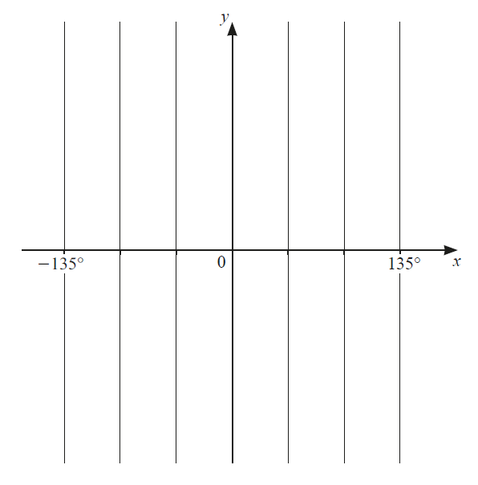
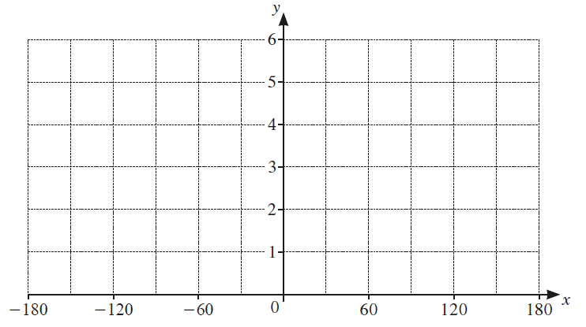
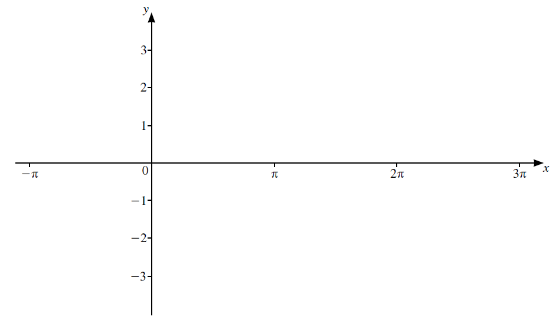
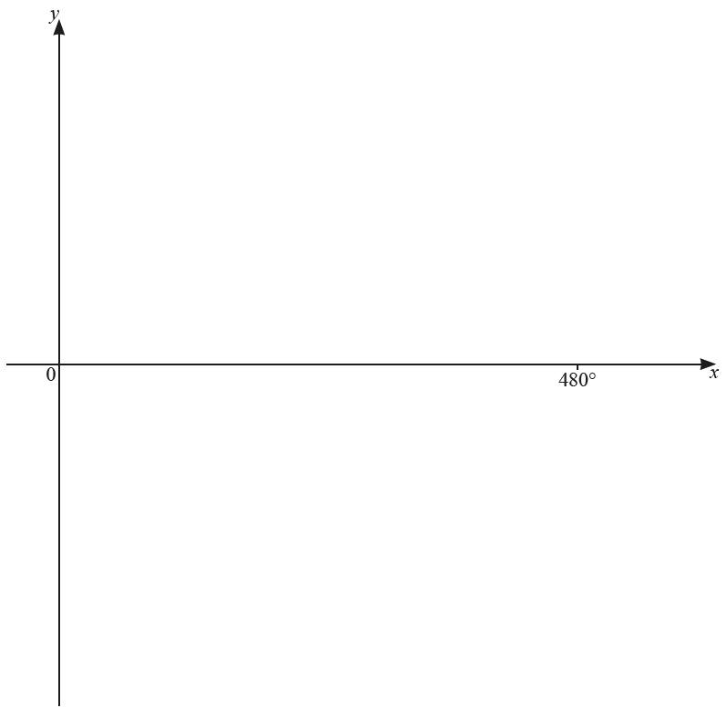
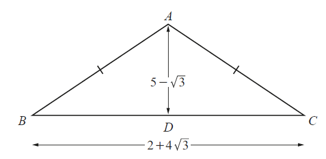
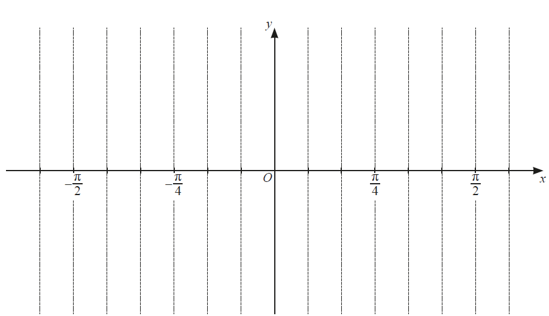

# Exam Questions — Trigonometry
**Trigonometry** · Cambridge (CIE) IGCSE further-maths (0606)
> Source: [https://www.savemyexams.com/igcse/further-maths/cie/additional-maths/25/topic-questions/](https://www.savemyexams.com/igcse/further-maths/cie/additional-maths/25/topic-questions/) · 27 questions across 1 sets

## Exam Questions (27 questions)

### Q1 — very_hard — 11 marks

**Q1** [2 marks]

Throughout this question, $A=\frac{\mathrm{tan}x}{1+\mathrm{sec}x}$ and $B=\frac{\mathrm{tan}x}{1-\mathrm{sec}x}$.

Show that $AB=k$ where $k$ is a constant to be found.

**Q1** [4 marks]

Show that $A+B=-2\mathrm{cot}x$.

**Q1** [5 marks]

Use your answers to part (a) and part (b) to simplify the expression `open parentheses A plus 1 close parentheses open parentheses B plus 1 close parentheses`.

Hence, or otherwise, solve

`open parentheses fraction numerator tan open parentheses x minus 60 close parentheses over denominator 1 plus sec open parentheses x minus 60 close parentheses end fraction plus 1 close parentheses open parentheses fraction numerator tan open parentheses x minus 60 close parentheses over denominator 1 minus sec open parentheses x minus 60 close parentheses end fraction plus 1 close parentheses equals 2 square root of 3`

for $-180^{\circ}<x<180^{\circ}$.

### Q2 — hard — 8 marks

**Q2** [4 marks]

In this question, all angles are measured in radians.

The graph of $y=a\mathrm{sin}bx+c$ has an amplitude of $10$, a period of $16π$ and passes through the point with coordinates `open parentheses 12 pi comma space 4 close parentheses`.

Find the constants $a$, $b$ and $c$.

**Q2** [4 marks]

Sketch the graph of `y equals open vertical bar tan open parentheses x over 2 close parentheses plus 1 close vertical bar` for $-π<x<π$.

Label clearly any points of intersection with the coordinate axes and any asymptotes.

### Q3 — very_hard — 8 marks

**Q3** [8 marks]

(i) Show that $\frac{1}{\mathrm{sec}θ-1}-\frac{1}{\mathrm{sec}θ+1}=2\mathrm{cot}^{2}θ$.

[3]

(ii) Hence solve $\frac{1}{\mathrm{sec}2x-1}-\frac{1}{\mathrm{sec}2x+1}=6$ for $-90^{\circ}<x<90^{\circ}$.

[5]

*Source: june 2020 0606/11 Q10A*

### Q4 — very_hard — 8 marks

**Q4** [8 marks]

(i) Show that $\frac{1}{\mathrm{sin}θ-1}-\frac{1}{\mathrm{sin}θ+1}=a\mathrm{sec}^{2}θ$, where $a$ is a constant to be found.

[3]

(ii) Hence solve $\frac{1}{\mathrm{sin}3ϕ-1}-\frac{1}{\mathrm{sin}3ϕ+1}=-8\mathrm{for}-\frac{π}{3}\leqϕ\leq\frac{π}{3}\mathrm{radians}.$

[5]

*Source: March 2020 0606/12 Q10B*

### Q5 — very_hard — 4 marks

**Q5** [4 marks]

Show that $\frac{\mathrm{sin}^{4}y-\mathrm{cos}^{4}y}{\mathrm{cot}y}=\mathrm{tan}y-2\mathrm{cos}y\mathrm{sin}y$.

*Source: june 2020 0606/22 Q8B*

### Q6 — medium — 3 marks

**Q6** [3 marks]

The curve $y=a\mathrm{sin}bx+c$ has a period of 180°, an amplitude of 20 and passes through the point $(90^{\circ},-3)$. Find the value of each of the constants $a,b\mathrm{and}c$.

*Source: june 2020 0606/23 Q6A*

### Q7 — very_hard — 4 marks

**Q7** [4 marks]

Show that $\frac{\mathrm{sin}x\mathrm{tan}x}{1-\mathrm{cos}x}=1+\mathrm{sec}x$.

*Source: Nov 2020 0606/22 Q11A*

### Q8 — medium — 4 marks

**Q8** [4 marks]

Solve the equation `5 space sin open parentheses 4 B minus straight pi over 8 close parentheses plus 2 equals 0 space for space minus straight pi over 4 less or equal than B less or equal than straight pi over 4 space radians`

*Source: june 2020 0606/23 Q10A*

### Q9 — medium — 2 marks

**Q9** [2 marks]

The function $g$ is defined, for$-135^{\circ}\leqx\leq135^{\circ},\mathrm{by}g(x)=3\mathrm{tan}\frac{x}{2}-4$. Sketch the graph of $y=g(x)$ on the axes below, stating the coordinates of the point where the graph crosses the $y$-axis.

*Source: june 2020 0606/23 Q6B*

### Q10 — medium — 4 marks

**Q10** [4 marks]

The diagram shows the graph of `straight f open parentheses x close parentheses equals a space cos space b x space plus c space for space 0 less or equal than x less or equal than fraction numerator 8 pi over denominator 3 end fraction`radians.

Find the value of each of the constants $a,b$ and $c$.

*Source: March 2020 0606/22 Q8C*

### Q11 — medium — 5 marks

**Q11** [1 mark]

Write down the amplitude of `1 plus 4 space cos open parentheses x over 3 close parentheses`

*Source: Nov 2020 0606/11 Q2A*

**Q11** [1 mark]

Write down the period of `1 plus 4 space cos open parentheses x over 3 close parentheses`

*Source: Nov 2020 0606/11 Q2B*

**Q11** [3 marks]

On the axes below, sketch the graph of `y equals 1 plus 4 space cos open parentheses x over 3 close parentheses space for space minus 180 degree less or equal than x degree less or equal than 180 degree`.

*Source: Nov 2020 0606/11 Q2C*

### Q12 — very_hard — 8 marks

**Q12** [8 marks]

(i) Show that `fraction numerator 1 over denominator open parentheses 1 plus cosec space theta close parentheses open parentheses sin space theta minus sin to the power of 2 space end exponent theta close parentheses end fraction equals sec squared space theta space`.

[4]

(ii) Hence solve `open parentheses 1 plus cosec space theta close parentheses open parentheses sin space theta minus sin squared theta close parentheses equals 3 over 4 space for space minus 180 degree less or equal than theta less or equal than 180 degree`.

[4]

*Source: Nov 2020 0606/11 Q8A*

### Q13 — hard — 3 marks

**Q13** [3 marks]

Solve the equation `cot open parentheses y minus pi over 2 close parentheses space equals space square root of 3`, where $y$ is in radians and `0 space less-than or slanted equal to space y space less-than or slanted equal to space pi` .

*Source: Specimen 2025 Paper 2 Q8B*

### Q14 — medium — 6 marks

**Q14** [1 mark]

In this question, all angles are in radians.

Write down the amplitude of $2\mathrm{cos}\frac{x}{3}-1$.

*Source: Specimen 2025 Paper 1 Q3A*

**Q14** [2 marks]

Write down the period of $2\mathrm{cos}\frac{x}{3}-1$.

*Source: Specimen 2025 Paper 1 Q3B*

**Q14** [3 marks]

**Extract:**

Write down the amplitude of 2 cos(x/3) - 1.

For any function in the form a cos(bx) + c, the amplitude is given by a.

2

Write down the period of 2 cos(x/3) - 1.

For any function in the form a cos(bx) + c, the period is 2π/b in radians or 360°/b in degrees.

6π or 1080°

On the axes below, sketch the graph of $y=2\mathrm{cos}\frac{x}{3}-1$ for `– pi space less-than or slanted equal to space x space less-than or slanted equal to space 3 pi` .

*Source: Specimen 2025 Paper 1 Q3C*

### Q15 — hard — 5 marks

**Q15** [5 marks]

Solve $3\mathrm{cot}^{2}x-14\mathrm{cosec}x-2=0\mathrm{for}0^{\circ}<x<360^{\circ}$.

*Source: june 2020 0606/22 Q8A*

### Q16 — medium — 5 marks

**Q16** [3 marks]

The graph of $y=a+2\mathrm{tan}bx$, where $a$ and $b$ are constants, passes through the point $(0,-4)$ and has period $480^{\circ}$.

Find the value of $a$ and of $b$.

*Source: June 2021 Paper 21 Q4A*

**Q16** [2 marks]

**Extract:**

The graph of y = a + 2 tan bx, where a and b are constants, passes through the point (0, -4) and has period 480°.

On the axes, sketch the graph of $y$ for values of $x$ between 0° and 480°.

*Source: June 2021 Paper 21 Q4B*

### Q17 — hard — 4 marks

**Q17** [4 marks]

Solve `cosec space open parentheses y plus straight pi over 3 close parentheses equals 2 space for space 0 less or equal than y less or equal than 2 straight pi` radians, giving your answers in terms of $π$.

*Source: june 2020 0606/11 Q10B*

### Q18 — very_hard — 6 marks

**Q18** [6 marks]

Solve the equation $5\mathrm{tan}x-3\mathrm{cot}x=2\mathrm{sec}x\mathrm{for}0^{\circ}\leqx\leq360^{\circ}$.

*Source: Nov 2020 0606/22 Q11B*

### Q19 — very_hard — 6 marks

**Q19** [6 marks]

(i) Show that $\frac{\mathrm{cos}^{2}2x}{1+\mathrm{sin}2x}=1-\mathrm{sin}2x$.

(ii) Hence solve the equation for $\frac{3\mathrm{cos}^{2}2x}{1+\mathrm{sin}2x}=1$ for `0 degree space less-than or slanted equal to space x space less-than or slanted equal to space 90 degree` .

*Source: Specimen 2025 Paper 2 Q8A*

### Q20 — very_hard — 7 marks

**Q20** [3 marks]

Given that $2\mathrm{cos}x=3\mathrm{tan}x$, show that $2\mathrm{sin}^{2}x+3\mathrm{sin}x-2=0$.

*Source: Nov 2020 0606/13 Q11A*

**Q20** [4 marks]

**Extract:**

Given that 2 cos x = 3 tan x, show that 2 sin²x + 3 sin x - 2 = 0.

Substitute tan x = sin x / cos x into the equation.
2 cos x = 3(sin x / cos x)

Multiply through by cos x.
2 cos²x = 3 sin x

Substitute cos²x = 1 - sin²x into the equation.
2(1 - sin²x) = 3 sin x

Expand the brackets and rearrange.
2 - 2 sin²x = 3 sin x
-2 sin²x - 3 sin x + 2 = 0

Multiply through by -1.
2 sin²x + 3 sin x - 2 = 0

Hence solve `2 space cos open parentheses 2 alpha plus straight pi over 4 close parentheses equals 3 space tan open parentheses 2 alpha plus straight pi over 4 close parentheses space for space 0 less than alpha less than straight pi` radians, giving your answers in terms of $π$.

*Source: Nov 2020 0606/13 Q11B*

### Q21 — medium — 3 marks

**Q21** [3 marks]

Solve `tan open parentheses alpha plus 45 to the power of degree close parentheses equals negative fraction numerator 1 over denominator square root of 2 end fraction space for space 0 to the power of degree less or equal than alpha less or equal than 360 to the power of degree`.

*Source: March 2020 0606/12 Q10A*

### Q22 — hard — 4 marks

**Q22** [4 marks]

Solve the equation

$5\mathrm{sec}^{2}A+14\mathrm{tan}A-8=0\mathrm{for}0^{\circ}\leqA\leq180^{\circ}$,

*Source: june 2020 0606/23 Q10A*

### Q23 — hard — 4 marks

**Q23** [2 marks]

In this question all lengths are in centimetres.

The diagram shows the isosceles triangle $ABC$, where $AB=AC$ and $BC=2+4\sqrt{3}$. The height, $AD$, of the triangle is $5-\sqrt{3}$.

Find tan $ABC$, giving your answer in the form$c+d\sqrt{3}$, where $c\mathrm{and}d$ are integers.

*Source: March 2020 0606/12 Q5B*

**Q23** [2 marks]

**Extract:**

The diagram shows the isosceles triangle ABC, where AB = AC and BC = 2 + 4√3. The height, AD, of the triangle is 5 - √3.

tan ABC = √3 - 1

Find $\mathrm{sec}^{2}ABC$, giving your answer in the form $e+f\sqrt{3}$, where $e\mathrm{and}f$ are integers.

*Source: March 2020 0606/12 Q5C*

### Q24 — medium — 5 marks

**Q24** [5 marks]

(i) Write $6xy+3y+4x+2$ in the form $(ax+b)(cy+d)$, where $a,b,c$ and $d$ are positive integers.

(ii) Hence solve the equation $6\mathrm{sin}θ\mathrm{cos}θ+3\mathrm{cos}θ+4\mathrm{sin}θ+2=0$ for $0^{\circ}<θ<360^{\circ}$.

*Source: June 2021 paper 11 Q9A*

### Q25 — hard — 4 marks

**Q25** [4 marks]

Solve `sin open parentheses 3 ϕ plus fraction numerator 2 straight pi over denominator 3 end fraction close parentheses equals cos open parentheses 3 ϕ plus fraction numerator 2 straight pi over denominator 3 end fraction close parentheses space for space 0 less or equal than ϕ less or equal than fraction numerator 2 straight pi over denominator 3 end fraction space radians`, giving your answers in terms of $π$.

*Source: Nov 2020 0606/11 Q8B*

### Q26 — hard — 7 marks

**Q26** [4 marks]

Solve $\mathrm{tan}3x=-1\mathrm{for}-\frac{π}{2}\leqx\leq\frac{π}{2}$ radians, giving your answers in terms of $π$.

*Source: june 2020 0606/12 Q10A*

**Q26** [3 marks]

**Extract:**

Solve tan 3x = -1 for -π/2 ≤ x ≤ π/2 radians, giving your answers in terms of π.

x = π/4, -π/12, -5π/12

Use your answers to part (a) to sketch the graph of $y=4\mathrm{tan}3x+4\mathrm{for}-\frac{π}{2}\leqx\leq\frac{π}{2}$ radians on the axes below. Show the coordinates of the points where the curve meets the axes.

*Source: june 2020 0606/12 Q10B*

### Q27 — hard — 5 marks

**Q27** [5 marks]

Solve the equation `1 half sec open parentheses 2 ϕ plus pi over 4 close parentheses space equals space fraction numerator 1 over denominator square root of 3 end fraction` for $-π<ϕ<π$, where $ϕ$ is in radians. Give your answers in terms of $π$.

*Source: june 2021 paper 11 Q9B*

