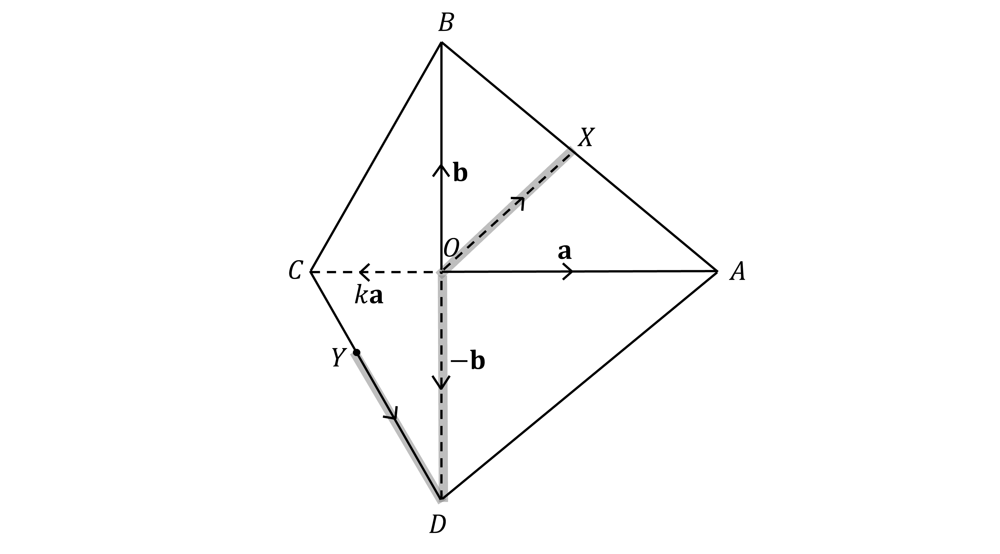
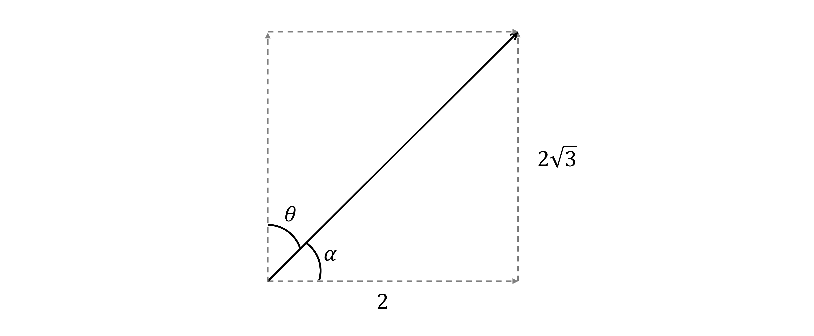
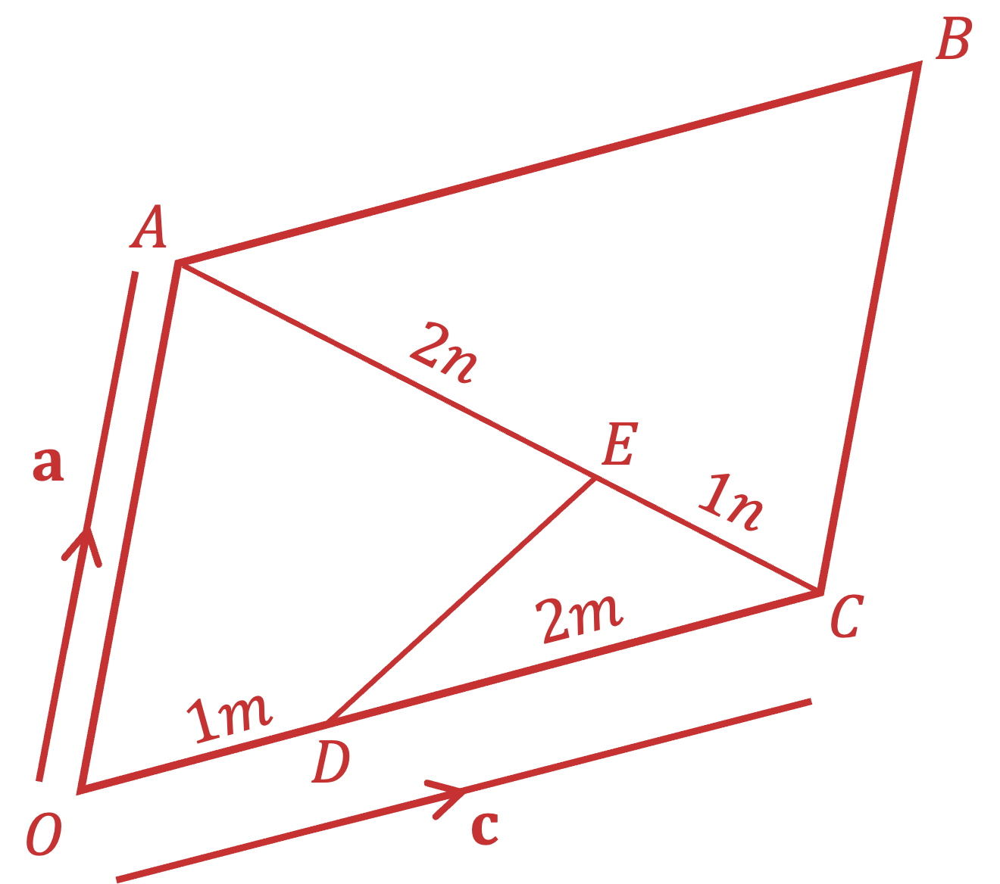

# Mark Schemes — Vectors in Two Dimensions
**Vectors** · Cambridge (CIE) IGCSE further-maths (0606)

## Exam Questions (12 questions)

### Q1
(i)

> *E.g. travel from **A** to **O** to **B*

$\begin{gathered} \vec{AB} & = \vec{AO} + \vec{OB} \\ = ( - \vec{OA} ) + \vec{OB} \\ = - a + b \end{gathered}$

$\begin{gathered} \vec{AB} & = - a + b \end{gathered}$

**[B1]**

(ii)

> *Use your answer from part (i) to help*

> *E.g. travel from **O** to **A** then **A** to **X** (which uses half of **A** to **B**)*

$\begin{gathered} \vec{OX} & = \vec{OA} + \vec{AX} \\ = \vec{OA} + 1 \frac{1}{2} \vec{AB} \\ = a + 1 \frac{1}{2} ( - a + b ) \end{gathered}$

$\begin{gathered} \vec{OX} & = 1 \frac{1}{2} a + 1 \frac{1}{2} b \end{gathered}$

**[B1]**

(iii)

> *E.g. travel from **C** to **O** then **O** to **D*

$\begin{gathered} \vec{CD} & = \vec{CO} + \vec{OD} \\ = ( - \vec{OC} ) + \vec{OD} \\ = - k a + ( - b ) \\ = - k a - b \end{gathered}$

$\begin{gathered} \vec{CD} & = - k a - b \end{gathered}$

**[B1]**
> *Add Y to the diagram*

> *You found vector *$\begin{gathered} \vec{CD} & = - k a - b \end{gathered}$* in part (a)(iii)*

> *If *$Y$* splits the line *$CD$* into the ratio *$1:2$* (1 + 2 = 3 parts to the ratio) then *$\overset{\rightarrow}{YD}$* is *$\frac{2}{3}$* of *$\overset{\rightarrow}{CD}$

$\begin{gathered} \vec{YD} & = \frac{2}{3} \vec{CD} \\ = \frac{2}{3} ( - k a - b ) \end{gathered}$

**[B1]**

> **[mark-scheme]**
> This mark is for either $\begin{gathered} \vec{YD} & = \frac{2}{3} ( - k a - b ) \end{gathered}$ or $\begin{gathered} \vec{YC} & = - 1 \frac{1}{3} ( - k a - b ) \end{gathered}$.

> *Now find *$\overset{\rightarrow}{YX}$* e.g. by going from **Y** to **D** then **D** to **O** then **O** to** X **(using part (a)(ii))*

$\begin{gathered} \vec{YX} & = \vec{YD} + \vec{DO} + \vec{OX} \\ = \vec{YD} + ( - \vec{OD} ) + \vec{OX} \\ = \frac{2}{3} ( - k a - b ) + ( - - b ) + 1 \frac{1}{2} a + 1 \frac{1}{2} b \end{gathered}$

**[M1]**

> *Expand and simplify, collecting into *$a$* and *$b$* components*

$\begin{gathered} \vec{YX} & = ( - \frac{2}{3} k + 1 \frac{1}{2} ) a + ( - \frac{2}{3} + 1 + 1 \frac{1}{2} ) b \\ = ( - \frac{2}{3} k + 1 \frac{1}{2} ) a + \frac{5}{6} b \end{gathered}$

**[A1]**

> *If *$\overset{\rightarrow}{YX}$* is meant to be parallel to *$a+b$* then the *$a$* and *$b$* components in the expression above must be equal*

$-\frac{2}{3}k+\frac{1}{2}=\frac{5}{6}$

> *Solve for *$k$

$\begin{gathered} - \frac{2}{3} k & = 1 \frac{1}{3} \end{gathered}$

$k=-\frac{1}{2}$

**[A1]**

> **[exam-tip]**
> A negative $k$ is expected as $\overset{\rightarrow}{OC}=ka$ is the opposite direction to $\overset{\rightarrow}{OA}=a$.

### Q2
> *For every one second, person A moves *$( 3 i - j )$* metres*

> *Add five lots of *$( 3 i - j )$* on to the original position *$( - 4 i + j )$

$- 4 i + j + 5 ( 3 i - j )$

> *Expand and collect each component*

$-4i+j+15i-5j$

**Final answer:** $( 11 i - 4 j )$** metres**

**[B1]**
> *It helps to sketch the velocity vector and the bearing (measured clockwise from due north)*

(i)

> *The speed is the magnitude of the vector (the hypotenuse of the triangle) so use Pythagoras' theorem*

$\sqrt{2^{2} + ( 2 \sqrt{3} )^{2}}$

**[M1]**

> *Simplify*

$\sqrt{4+4\times3}=\sqrt{16}$

**Final answer:** **4 metres per second**

**[A1]**

(ii)

> *One way to find the bearing is to first find angle *$α$* (using trigonometry)*

$\mathrm{tan}α=\frac{2\sqrt{3}}{2}=\sqrt{3}$

**[M1]**

> *Solving this using exact trig values*

$α=60^{\circ}$

**[A1]**

> *Hence find *$θ$* using *$θ=90^{\circ}-α$

$θ=30^{\circ}$

> *Write your final answer as a bearing (three digits needed)*

$030^{\circ}$

**[A1]**

> **[mark-scheme]**
> **M1:** For a correct trigonometric statement in sin, cos or tan.
> 
> **A1: **For finding either $α$ or $θ$ correctly using exact trig values.
> 
> **A1:** For presenting the correct angle as a 3-digit bearing.

### Q3
> *Find *$\overset{\rightarrow}{AB}$*.*

$\overset{\rightarrow}{AB}=\overset{\rightarrow}{AO}+\overset{\rightarrow}{OB}=\overset{\rightarrow}{OB}-\overset{\rightarrow}{OA}\,\overset{\rightarrow}{AB}=b-a$

**[1]**

> *We are told that *$AX:XB=3:1$*, therefore *$\vec{AX} = \frac{3}{4} ( \vec{AB} )$*.*

$\vec{AX} = \frac{3}{4} ( b - a )$

> *Now we can find *$\overset{\rightarrow}{OX}$*.*

$\vec{OX} = \vec{OA} + \vec{AX} 
 \vec{OX} = a + \frac{3}{4} ( b - a )$

**[1]**

> *Expand and simplify.*

$\overset{\rightarrow}{OX}=\frac{1}{4}a+\frac{3}{4}b$* ***[1]**
> *B** is the midpoint of **OC**. Therefore, *$\overset{\rightarrow}{OC}=2b$*.*

$\begin{gathered} \vec{AC} & = \vec{AO} + \vec{OC} = \vec{OC} - \vec{OA} \\ \vec{AC} & = 2 b - a \end{gathered}$

$\overset{\rightarrow}{AC}=2b-a$* ***[1]**
$\overset{\rightarrow}{AY}=\overset{\rightarrow}{AO}+\overset{\rightarrow}{OY}$. *Since we are told that* $\overset{\rightarrow}{OY}=h\overset{\rightarrow}{OX}$*,*

$\vec{AY} = \vec{AO} + h \vec{OX} = h \vec{OX} - \vec{OA} 
 \vec{AY} = h ( 1 \frac{1}{4} a + \frac{3}{4} b ) - a$

$\overset{\rightarrow}{AY}=(\frac{h-4}{4})a+\frac{3h}{4}b$ **[1]**
> *Substitute *$\vec{AY} = ( \frac{h - 4}{4} ) a + \frac{3 h}{4} b$* and *$\overset{\rightarrow}{AC}=2b-a$* into *$\overset{\rightarrow}{AY}=m\overset{\rightarrow}{AC}$

> $( \frac{h - 4}{4} ) a + \frac{3 h}{4} b = m ( 2 b - a )$*  *

> *Expand the brackets on the right-hand side.*

$( \frac{h - 4}{4} ) a + \frac{3 h}{4} b = - m a + 2 m b$

**[1]**

> *Equate *$a$* and *$b$* vectors to form two equations in *$h$* and *$m$*.*

$\frac{h-4}{4}=-m$

**[1]**

$\frac{3h}{4}=2m$

**[1]**

> *Solve simultaneously.*

$\begin{gathered} m = \frac{3 h}{8} \\ \therefore \frac{h - 4}{4} & = - \frac{3 h}{8} \\ 8 h - 32 & = - 12 h \\ 20 h & = 32 \\ h = \frac{32}{20} = \frac{8}{5} \end{gathered}$

> *Substitute into either of the original equations and solve for *$m$*.*

> *  *$\begin{array}{rcl} \frac{3}{4} ( \frac{8}{5} ) & = 2 m \\ m = \frac{24}{40} = \frac{3}{5} \end{array}$

$h=\frac{8}{5}$* and** *$m=\frac{3}{5}$* ***[1]**

### Q4
$\begin{gathered} \vec{OQ} & = \vec{OP} + \vec{PQ} \\ \vec{OQ} & = 2 b + a \end{gathered}$

$\overset{\rightarrow}{OQ}=2b+a$ **[1]**
$\begin{gathered} \vec{QS} & = \vec{QP} + \vec{PO} + \vec{OS} \\ \vec{QS} & = - a - 2 b + 3 a \\ \vec{QS} & = 2 a - 2 b \end{gathered}$

$\overset{\rightarrow}{QS}=2a-2b$ **[1]**
$\overset{\rightarrow}{OX}=\overset{\rightarrow}{OP}+\overset{\rightarrow}{PQ}+\overset{\rightarrow}{QX}$

> *The question tells us that *$\overset{\rightarrow}{QX}=μ\overset{\rightarrow}{QS}$*.*

$\overset{\rightarrow}{OX}=2b+a+μ\overset{\rightarrow}{QS}$

> *From part (b), *$\overset{\rightarrow}{QS}=2a-2b$*.*

$\vec{OX} = 2 b + a + \\mu ( 2 a - 2 b )$

$\vec{OX} = ( 1 + 2 \\mu ) a + ( 2 - 2 \\mu ) b$ **[1]**
$\overset{\rightarrow}{OX}=λ\overset{\rightarrow}{OR}$

> *Find *$\overset{\rightarrow}{OR}$*.*

$\begin{gathered} \vec{OR} & = \vec{OS} + \vec{SR} \\ \vec{OR} & = 3 a + b \end{gathered}$

*Use this to find* $\overset{\rightarrow}{OX}$.

$\vec{OX} = \\lambda ( 3 a + b )$

$\overset{\rightarrow}{OX}=3λa+λb$ **[1]**
> *From part (c), *$\vec{OX} = ( 1 + 2 \\mu ) a + ( 2 - 2 \\mu ) b$*.*

> *From part (d), *$\overset{\rightarrow}{OX}=3λa+λb$*.*

> *In the above equations, *$\overset{\rightarrow}{OX}$* must be equivalent so equate both.*

> *Compare coefficients of *$b$*.*

*(1)**       *$2-2μ=λ$

> *Compare coefficients of *$a$*.*

*(2) **     *$1+2μ=3λ$

**[1]**

> *Solve equations (1) and (2) simultaneously by adding them.*

$3=4λ$

$λ=\frac{3}{4}$

**for attempting to solve ****[1]**

> *Substitute *$λ=\frac{3}{4}$* into equation (1) to find *$μ$*.*

$2-2μ=\frac{3}{4}$

$-2μ=-\frac{5}{4}$

$μ=\frac{5}{8}$

$λ=\frac{3}{4},μ=\frac{5}{8}$ **[1]**
$\overset{\rightarrow}{QX}=μ\overset{\rightarrow}{QS}$

$μ=\frac{5}{8}$ *from part (e).*

$\overset{\rightarrow}{QX}=\frac{5}{8}\overset{\rightarrow}{QS}$

*Find the ratio of *$QX:XS$.

$QX:XS=5:3$

$\frac{QX}{XS}=\frac{5}{3}$

$\frac{QX}{XS}=\frac{5}{3}$ **[1]**
$\overset{\rightarrow}{OR}=3a+b$

> *From part (d) we know that *$\overset{\rightarrow}{OX}=3λa+λb$*.*

*From part (e) we know that* $λ=\frac{3}{4}$.

$\vec{OX} = \frac{9}{4} a + \frac{3}{4} b = \frac{3}{4} ( 3 a + b ) = \frac{3}{4} \vec{OR}$

> *Find the ratio *$OR:OX$*.*

$OR:OX=4:3$

$\frac{OR}{OX}=\frac{4}{3}$

$\frac{OR}{OX}=\frac{4}{3}$ **[1]**

### Q5
> *Substitute *$a=αi+j$* and *$b=12i+βj$* into *$4 a - b = ( \ \\alpha + 3 ) i - 2 j$*.*

$4 ( \\alpha i + j ) - ( 12 i + \\beta j ) = ( \\alpha + 3 ) i - 2 j$

> *Expand the brackets.*

$4 \\alpha i + 4 j - 12 i - \\beta j = ( \\alpha + 3 ) i - 2 j$

> *Equate the coefficients of *$i$*.*

$4α-12=α+3$

$3α=15$

$α=5$

> *Equate the coefficients of *$j$*.*

$4-β=-2$

** ****method for both**** **$α$** ****and **$β$** [1]**

$6=β$

$α=5$ **[1] **
$β=6$** [1]**
*First find* $b-4a$.

$\begin{gathered} b - 4 a & = ( 12 i + \\beta j ) - 4 ( \\alpha i + j ) \end{gathered}$

> *Use *$α=5$* and *$β=6$* from part (a).*

$\begin{gathered} b - 4 a & = ( 12 i + 6 j ) - 4 ( 5 i + j ) \\ b - 4 a & = - 8 i + 2 j \end{gathered}$

> *To find the unit vector, divide by the magnitude. *

$\sqrt{( - 8 )^{2} + ( 2 )^{2}} = \sqrt{68} = 2 \sqrt{17}$

**[1]**

$\text{Unit} \text{vector} = \frac{1}{2 \sqrt{17} } ( - 8 i + 2 j )$

**Unit vector in the direction of **$b-4a$** is**$\frac{\sqrt{17}}{17}(-4i+j)$ **[1]**

### Q6
> *Start by sketching a diagram with the information given. **D** is *$\frac{1}{3}$* of the way from **O** to **C **and **E** is *$\frac{2}{3}$* of the way from **A** to **C.*

> *Write *$\overset{\rightarrow}{OB}$* in terms of position vectors *$a$* and *$c$*.*

$\overset{\rightarrow}{OB}=a+c$

**[1]**

> *Write a path from **D** to **E.*

$\overset{\rightarrow}{DE}=\overset{\rightarrow}{DC}+\overset{\rightarrow}{CE}$

> *Now write *$\overset{\rightarrow}{DC}$* and *$\overset{\rightarrow}{CE}$* in terms of position vectors *$a$* and *$c$*. Start with *$\overset{\rightarrow}{DC}$*.*

$\overset{\rightarrow}{DC}=\frac{2}{3}c$

**[1]**

> *Now look at *$\overset{\rightarrow}{CE}$*.*

$\overset{\rightarrow}{CE}=\frac{1}{3}\overset{\rightarrow}{CA}$

> *Writing  *$\overset{\rightarrow}{CA}$* in terms of position vectors *$a$* and *$c$*.*

$\overset{\rightarrow}{CA}=-c+a$

> *Therefore,*

$\vec{CE} = 1 \frac{1}{3} \vec{CA} = 1 \frac{1}{3} ( - c + a )$

**[1]**

> *Now write the path from **D** to **E** using the position vector expressions found above.*

$\begin{gathered} \vec{DE} & = \vec{DC} + \vec{CE} \\ = \frac{2}{3} c + 1 \frac{1}{3} ( - c + a ) \end{gathered}$

> *Simplify.*

$\begin{gathered} = \frac{2}{3} c - 1 \frac{1}{3} c + 1 \frac{1}{3} a \\ = 1 \frac{1}{3} c + 1 \frac{1}{3} a \end{gathered}$

**[1]**

$\begin{gathered} = 1 \frac{1}{3} ( c + a ) \end{gathered}$

> *Now we know that *$\overset{\rightarrow}{OB}=c+a$* and *$\vec{DE} = 1 \frac{1}{3} ( c + a )$*.*

$\begin{gathered} \vec{OB} & = 3 \vec{DE} \end{gathered}$

$k=3$ **[1]**

### Q7
$\overset{\rightarrow}{AB}=\overset{\rightarrow}{OB}-\overset{\rightarrow}{OA}$.

$\vec{AB} = ( \begin{gathered} 10 \\ 3 \end{gathered} ) - ( \begin{gathered} 6 \\ - 5 \end{gathered} )$

$\vec{AB} = ( \begin{gathered} 4 \\ 8 \end{gathered} )$

**[1]**

> *Work out the magnitude of *$\overset{\rightarrow}{AB}$* using Pythagoras' Theorem.*

$\sqrt{4^{2}+8^{2}}$

**[1]**

$=\sqrt{80}=4\sqrt{5}$

> *Divide the vector by its magnitude and simplify.*

> $\frac{1}{4 \sqrt{5} } ( \begin{gathered} 4 \\ 8 \end{gathered} ) = \frac{1}{ \sqrt{5} } ( \begin{gathered} 1 \\ 2 \end{gathered} )$* *

$\frac{\sqrt{ 5}}{ 5} \text{stretchy} ( \begin{pmatrix}1 \\ 2\end{pmatrix} \text{stretchy} )$* ***[1]**
> *Because point **A** is a midpoint of **BC**,*

$\vec{OA} = 1 \frac{1}{2} \times ( \vec{OB} + \vec{OC} )$

$( \begin{gathered} 6 \\ - 5 \end{gathered} ) = 1 \frac{1}{2} \times ( \begin{gathered} 10 + x \\ 3 + y \end{gathered} )$

**[1]**

> *Multiply both sides by 2.*

$( \begin{gathered} 12 \\ - 10 \end{gathered} ) = ( \begin{gathered} 10 + x \\ 3 + y \end{gathered} )$

> *Therefore,*

> $12=10+x$* *$-10=3+y$

$x=2$*, *$y=-13$* *
**both ****[1]**
$OE:OD=1:1+λ$, *therefore,*

$\frac{\overset{\rightarrow}{OE}}{\overset{\rightarrow}{OD}}=\frac{1}{1+λ}$

> *Rearrange.*

$\overset{\rightarrow}{OE}=\frac{1}{1+λ}\overset{\rightarrow}{OD}$

> *Substitute in the known values.*

$\vec{OE} = \frac{1}{1 + \\lambda } ( \begin{gathered} 12 \\ 7 \end{gathered} )$

**[1]**

> *Find *$\overset{\rightarrow}{BE}$* in terms of *$λ$*.*

$\overset{\rightarrow}{BE}=\overset{\rightarrow}{OE}-\overset{\rightarrow}{OB}$

$\begin{gathered} \vec{BE} & = \frac{1}{1 + \\lambda } ( \begin{gathered} 12 \\ 7 \end{gathered} ) - ( \begin{gathered} 10 \\ 3 \end{gathered} ) \\ \vec{BE} & = ( \begin{gathered} \frac{12}{1 + \\lambda } \\ \frac{7}{1 + \\lambda } \end{gathered} ) - ( \begin{gathered} 10 \\ 3 \end{gathered} ) \\ \vec{BE} & = ( \begin{gathered} \frac{12}{1 + \\lambda } - 10 \\ \frac{7}{1 + \\lambda } - 3 \end{gathered} ) \end{gathered}$

> *Since *$\overset{\rightarrow}{BE}$* is parallel to the *$x$* axis, the *$y$* component of the vector will be 0.*

$\begin{gathered} \frac{7}{1 + \\lambda } - 3 & = 0 \\ \frac{7}{1 + \\lambda } & = 3 \end{gathered}$

**[1]**

> *Rearrange and solve.*

$7 = 3 ( 1 + \\lambda )$

$7=3+3λ$

$4=3λ$

$λ=\frac{4}{3}$* ***[1]**

### Q8
> *Use "Velocity = Speed x Direction Unit Vector".*

$\begin{gathered} \text{Velocity} & = 52 \times \frac{1}{ \sqrt{( - 5 )^{2} + 12^{2}} } ( \begin{gathered} - 5 \\ 12 \end{gathered} ) \\ \text{Velocity} = \frac{52}{13} ( \begin{gathered} - 5 \\ 12 \end{gathered} ) \end{gathered}$

$\text{Velocity} = ( \begin{gathered} - 20 \\ 48 \end{gathered} ) \text{km} h^{- 1}$** [1]**
> *The position vector of **P** at a time **t** hours after leaving **A** will be given by velocity x time (since **A** is the origin). *

> *Use the velocity found in part (a).*

**Position vector of ****P**** at time ****t**** hours after leaving ****A**** is **`equation`** [1]**
> *Point **B** is **not** the origin so **B**'s initial position vector will need to be added to its "velocity vector x time".*

$( \begin{gathered} - 25 t \\ 45 t \end{gathered} ) + ( \begin{gathered} 12 \\ 8 \end{gathered} )$

**The position vector of ****Q**** at time t is **`equation` **[1]**
$\overset{\rightarrow}{PQ}=\overset{\rightarrow}{PO}+\overset{\rightarrow}{OQ}=\overset{\rightarrow}{OQ}-\overset{\rightarrow}{OP}$

> *Use the answers from parts (b) and (c).*

$\vec{PQ} = ( \begin{gathered} 12 - 25 t \\ 45 t + 8 \end{gathered} ) - ( \begin{gathered} - 20 t \\ 48 t \end{gathered} )$

`equation` **[1]**
> *Find, algebraically, the magnitude of your answer to part (d).*

$\left| \vec{PQ} \right| = \sqrt{( 12 - 5 t )^{2} + ( 8 - 3 t )^{2}}$

**[1]**

$=\sqrt{144-120t+25t^{2}+64-48t+9t^{2}}$

$\sqrt{34t^{2}-168t+208}$ **[1]**
> *When **P** and **Q** are first 2 km apart, the magnitude of *$\overset{\rightarrow}{PQ}$* will be 2.*

$\sqrt{34t^{2}-168t+208}=2$

> *Solve, starting by squaring both sides.*

$34t^{2}-168t+208=4$

> *Make the quadratic equal to 0.*

$34t^{2}-168t+204=0$

**[1]**

> *Solve using the quadratic formula and/or calculator.*

$t=2.148...,t=2.792...$

> *We want the **first** time that they are 2 km apart.*

**P**** and ****Q**** are first 2 km apart after 2.15 seconds (3 s.f.)**** ****[1]**

### Q9
> *Since *$\overset{\rightarrow}{AC}$* is a multiple of *$\overset{\rightarrow}{BC}$*, we know that *$A,B\mathrm{and}C$* must be collinear. Work out *$\overset{\rightarrow}{AB}$*.*

$\begin{gathered} \vec{AB} & = \vec{AO} + \vec{OB} = \vec{OB} - \vec{OA} \\ \vec{AB} & = ( \begin{gathered} 10 \\ - 4 \end{gathered} ) - ( \begin{gathered} - 5 \\ - 7 \end{gathered} ) \\ \vec{AB} & = ( \begin{gathered} 15 \\ 3 \end{gathered} ) \end{gathered}$

> *Use *$\overset{\rightarrow}{AC}=4\overset{\rightarrow}{BC}$* to find the ratio of **AB** to **BC**. *

$AB:BC=3:1$

**[1]**

$\vec{BC} = 1 \frac{1}{3} \vec{AB} = ( \begin{gathered} 5 \\ 1 \end{gathered} )$

> *Now find *$\overset{\rightarrow}{OC}$*.*

$\begin{gathered} \vec{OC} & = \vec{OB} + \vec{BC} \\ \vec{OC} & = ( \begin{gathered} x \\ y \end{gathered} ) = ( \begin{gathered} 10 \\ - 4 \end{gathered} ) + ( \begin{gathered} 5 \\ 1 \end{gathered} ) = ( \begin{gathered} 15 \\ - 3 \end{gathered} ) \end{gathered}$

**[1]**

> *A unit vector in the direction of *$\overset{\rightarrow}{OC}$* is required so we will need its magnitude.*

$\left| \vec{OC} \right| = \sqrt{15^{2} + ( - 3 )^{2}} = \sqrt{234} = 3 \sqrt{26}$

**[1]**

> *Find the unit vector by dividing *$\overset{\rightarrow}{OC}$* by its magnitude.*

$\frac{1}{3 \sqrt{26} } ( \begin{gathered} 15 \\ - 3 \end{gathered} ) = \frac{1}{ \sqrt{26} } ( \begin{gathered} 5 \\ - 1 \end{gathered} )$

$\frac{\sqrt{ 26}}{ 26} \text{begin} \text{style} \text{stretchy} ( \begin{pmatrix}5 \\ - 1\end{pmatrix} \text{stretchy} )$ **[1]**

### Q10
> *Speed is given by the magnitude of the velocity so the first step is to work out the magnitude of the direction vector. The magnitude of vector *$\left| a \right| = \left| ( \begin{gathered} x \\ y \end{gathered} ) \right|$* is given by *$\sqrt{x^{2}+y^{2}}$*.*

$\sqrt{4^{2}+3^{2}}=\sqrt{25}=5$

**[1]**

> *We are told that the speed is *$10ms^{-1}$* so we want a velocity vector that is a scalar multiple of *$( \begin{gathered} - 4 \\ 3 \end{gathered} )$* but with a magnitude of 10. 10 is double 5 so we need to double the vector *$( \begin{gathered} - 4 \\ 3 \end{gathered} )$*, therefore the velocity vector is,*

$2 \times ( \begin{gathered} - 4 \\ 3 \end{gathered} ) = ( \begin{gathered} - 8 \\ 6 \end{gathered} )$

**[1]**

> *We then need to multiply the velocity by time and add to the initial position vector to find the position vector P after **t** seconds, therefore*

$( \begin{gathered} 30 \\ 10 \end{gathered} ) + ( \begin{gathered} - 8 \\ 6 \end{gathered} ) t$

**The position vector of ****P**** after **$t$** seconds is**** **$( \begin{gathered} 30 - 8 t \\ 6 t + 10 \end{gathered} ) m$** [1]**
> *The speed is given by the magnitude of the velocity. Velocity is *$( \begin{gathered} 5 \\ 12 \end{gathered} )$*. (The vector *$( \begin{gathered} - 80 \\ 90 \end{gathered} )$* is the initial position.)*

$\sqrt{5^{2}+12^{2}}=\sqrt{169}$

$13ms^{-1}$ **[1]**
> *Substituting *$t=10$* into the position vectors for **P** and **Q**.*

$\begin{gathered} \vec{OP} & = ( \begin{gathered} 30 \\ 10 \end{gathered} ) + ( \begin{gathered} - 8 \\ 6 \end{gathered} ) \times 10 \\ \vec{OP} & = ( \begin{gathered} 30 \\ 10 \end{gathered} ) + ( \begin{gathered} - 80 \\ 60 \end{gathered} ) = ( \begin{gathered} - 50 \\ 70 \end{gathered} ) \end{gathered}$

$\vec{OQ} = ( \begin{gathered} - 80 \\ 90 \end{gathered} ) + ( \begin{gathered} 5 \\ 12 \end{gathered} ) \times 10
 \vec{OQ} = ( \begin{gathered} - 80 \\ 90 \end{gathered} ) + ( \begin{gathered} 50 \\ 120 \end{gathered} ) = ( \begin{gathered} - 30 \\ 210 \end{gathered} )$

**[1]**

> $\overset{\rightarrow}{PQ}=\overset{\rightarrow}{PO}+\overset{\rightarrow}{OQ}=\overset{\rightarrow}{OQ}-\overset{\rightarrow}{OP}$*.*

$( \begin{gathered} - 30 \\ 210 \end{gathered} ) - ( \begin{gathered} - 50 \\ 70 \end{gathered} ) = ( \begin{gathered} 20 \\ 140 \end{gathered} )$

> *The distance between two points is the magnitude of the vector between them.*

$\sqrt{20^{2}+140^{2}}=\sqrt{20000}$

**[1]**

$100\sqrt{2}$ **[1]**

### Q11
> *To find a unit vector, divide the vector by its magnitude. *
*Find the magnitude of the vector.*

$\text{Magnitude} = \sqrt{5^{2} + ( - 12 )^{2}} 
\text{Magnitude} = 13$

> *Divide the vector by *$13$*.*

`equation`* ***[1]**
> *Multiply *$k$* and *$r$* by each component of the corresponding vectors. *

$( \begin{gathered} 4 \\ 1 \end{gathered} ) + ( \begin{gathered} - 2 k \\ 3 k \end{gathered} ) = ( \begin{gathered} - 10 r \\ 5 r \end{gathered} )$

> *Add together the vectors.*

$( \begin{gathered} 4 - 2 k \\ 1 + 3 k \end{gathered} ) = ( \begin{gathered} - 10 r \\ 5 r \end{gathered} )$

> *Equate the *$x$* components.*

$4-2k=-10r$

> *Equate the *$y$* components.*

$1+3k=5r$

**[1]**

> *Solve the equations simultaneously.*

`equation`

**[1]**

$k=-\frac{3}{2}$

> *Substitute *$k=-\frac{3}{2}$*into either of the equations to find *$r$*.*

$\begin{array}{rcl} 1 + 3 ( - \frac{3}{2} ) & = 5 r \\ 1 - \frac{9}{2} & = 5 r \end{array}$

$k=-\frac{3}{2}$**,****  **$r=-\frac{7}{10}$* ***[1]**
(i) $\overset{\rightarrow}{AB}=\overset{\rightarrow}{OB}-\overset{\rightarrow}{OA}$*.*

`A B -vec = ( 3 q - p ) - p A B with -> on top = 3 q - 2 p`

$3q-2p$* ***[1]**

(ii) $\overset{\rightarrow}{AC}=\overset{\rightarrow}{OC}-\overset{\rightarrow}{OA}$.

`A C -vec = ( 9 q - 5 p ) - p A C with -> on top = 9 q - 6 p`

$9q-6p$* ***[1]**

(iii) *Both *$\overset{\rightarrow}{AB}$* and *$\overset{\rightarrow}{AC}$* share a common point, **A, **and *$\vec{AC} = 3 ( \vec{AB} )$*.    *

$\overset{\rightarrow}{AB}$** and **$\overset{\rightarrow}{AC}$** share a common point - point ****A - ****and since **$\overset{\rightarrow}{AC}=3(\overset{\rightarrow}{AB})$**, **$\overset{\rightarrow}{AC}$** and **$\overset{\rightarrow}{AB}$** are parallel**** ****[1]**

(iv) *Find *$\overset{\rightarrow}{BC}$*. *

> $\overset{\rightarrow}{BC}=\overset{\rightarrow}{BO}+\overset{\rightarrow}{OC}=\overset{\rightarrow}{OC}-\overset{\rightarrow}{OB}$*.*

`B C -vec = ( 9 q - 5 p ) - ( 3 q - p ) B C -vec = 6 q - 4 p B C with -> on top = 2 ( 3 q - 2 p )`

> *Therefore, *$\vec{BC} = 2 ( \vec{AB} )$* and the ratio of *$AB:BC$* is *$1:2$*.*

$1:2$* ***[1]**

### Q12
> *The route from **A** to **B**, in known vectors, is via **O**.*

$\overset{\rightarrow}{AB}=\overset{\rightarrow}{AO}+\overset{\rightarrow}{OB}=\overset{\rightarrow}{OB}-\overset{\rightarrow}{OA}$

$\overset{\rightarrow}{OB}=b-a$ **[1]**
$\overset{\rightarrow}{PQ}=\overset{\rightarrow}{PA}+\overset{\rightarrow}{AQ}$

> *Since *$OP=\frac{3}{4}OA$*, we know that *$OP:PA=3:1$*. Find *$\overset{\rightarrow}{PA}$*.*

$\overset{\rightarrow}{PA}=\frac{1}{4}\overset{\rightarrow}{OA}=\frac{1}{4}a$

**[1]**

> *Point **Q** is the midpoint of **AB. **Find *$\overset{\rightarrow}{AQ}$*.*

$\overset{\rightarrow}{AQ}=\frac{1}{2}\overset{\rightarrow}{AB}$

> $\overset{\rightarrow}{AB}=b-a$* **from part (a).*

$\vec{AQ} = 1 \frac{1}{2} ( b - a )$

**[1]**

> *Add these together to find *$\overset{\rightarrow}{PQ}$*.*

$\overset{\rightarrow}{PQ}=\overset{\rightarrow}{PA}+\overset{\rightarrow}{AQ}$

$\vec{PQ} = 1 \frac{1}{4} a + 1 \frac{1}{2} ( b - a )$

> *Expand and simplify.*

$\overset{\rightarrow}{PQ}=\frac{1}{4}a+\frac{1}{2}b-\frac{1}{2}a$

$\overset{\rightarrow}{PQ}=\frac{1}{2}b-\frac{1}{4}a$ **[1]**
$\overset{\rightarrow}{QR}=n\overset{\rightarrow}{PQ}$

> *From part (b) we know that *$\overset{\rightarrow}{PQ}=\frac{1}{2}b-\frac{1}{4}a$*.*

$\vec{QR} = n ( 1 \frac{1}{2} b - 1 \frac{1}{4} a )$

$\overset{\rightarrow}{QR}=n(\frac{1}{2}b-\frac{1}{4}a)$ **[1]**
> *To involve *$k$*, consider *$\overset{\rightarrow}{QR}$* involving *$\overset{\rightarrow}{BR}$*.*

$\overset{\rightarrow}{QR}=\overset{\rightarrow}{QB}+\overset{\rightarrow}{BR}$

> *Use *$\overset{\rightarrow}{BR}=kb$*.*

$\overset{\rightarrow}{QR}=\overset{\rightarrow}{QB}+kb$

> *Find *$\overset{\rightarrow}{QB}$*.*

$\vec{QB} = 1 \frac{1}{2} \vec{AB} = 1 \frac{1}{2} ( b - a )$

*Find *$\overset{\rightarrow}{QR}$.

$\overset{\rightarrow}{QR}=\overset{\rightarrow}{QB}+kb$

**[1]**

$\vec{QR} = 1 \frac{1}{2} ( b - a ) + k b$

$\overset{\rightarrow}{QR}=(k+\frac{1}{2})b-\frac{1}{2}a$** [1]**
> *Parts (c) and (d) must be equal as both are *$\overset{\rightarrow}{QR}$*.*

$n ( 1 \frac{1}{2} b - 1 \frac{1}{4} a ) = 1 \frac{1}{2} ( b - a ) + k b$

> *Equate coefficients of *$b$*.*

$\frac{1}{2}n=\frac{1}{2}+k$

> *Equate coefficients of *$a$*.*

$-\frac{1}{4}n=-\frac{1}{2}$

**[1]**

> *Solve the second equation to find *$n$*.*

$n=2$

> *Substitute *$n=2$* into the first equation to find *$k$*.*

$\begin{gathered} 1 \frac{1}{2} \times 2 & = 1 \frac{1}{2} + k \\ k = 1 \frac{1}{2} \end{gathered}$

$n=2$ **[1]**

$k=\frac{1}{2}$ **[1]**
