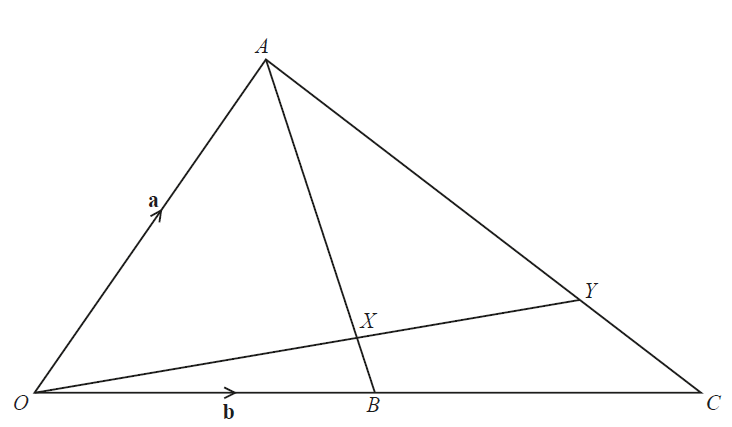
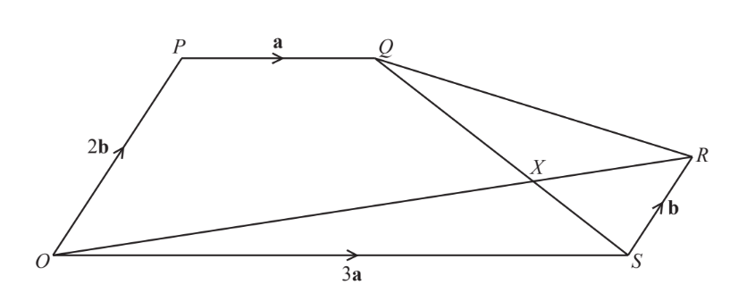
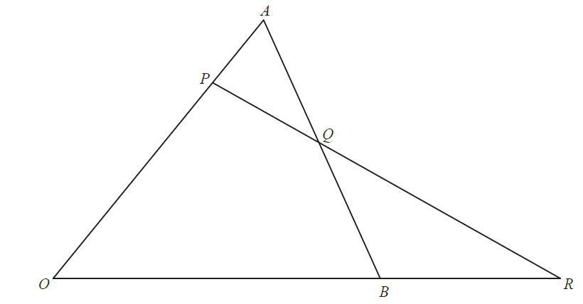

# Exam Questions — Vectors in Two Dimensions
**Vectors** · Cambridge (CIE) IGCSE further-maths (0606)
> Source: [https://www.savemyexams.com/igcse/further-maths/cie/additional-maths/25/topic-questions/](https://www.savemyexams.com/igcse/further-maths/cie/additional-maths/25/topic-questions/) · 12 questions across 1 sets

## Exam Questions (12 questions)

### Q1 — hard — 7 marks

**Q1** [3 marks]

The kite $ABCD$ has diagonals $CA$ and $BD$ which intersect at $O$, where $\overset{\rightarrow}{OA}=a$, $\overset{\rightarrow}{OB}=b$, $\overset{\rightarrow}{OC}=ka$ and $\overset{\rightarrow}{OD}=-b$.

The point $X$ is the midpoint of $AB$, as shown.

Find

(i) $\overset{\rightarrow}{AB}$ in terms of $a$ and $b$

(ii) $\overset{\rightarrow}{OX}$ in terms of $a$ and $b$

(iii) $\overset{\rightarrow}{CD}$ in terms of $k$, $a$ and $b$

**Q1** [4 marks]

The point $Y$ lies on $CD$ such that $CY:YD=1:2$.

If $\overset{\rightarrow}{YX}$ is parallel to $a+b$, find $k$.

### Q2 — medium — 6 marks

**Q2** [1 mark]

The unit vectors $i$ and $j$ represent due east and due north respectively.

Person A starts at a position of $( - 4 i + j )$ metres and walks with a constant velocity of $( 3 i - j )$ metres per second.

Find the position vector of person A after 5 seconds.

**Q2** [5 marks]

Person B walks with a constant velocity of $( 2 i + 2 \sqrt{3} j )$ metres per second.

Find

(i) the speed of person B,

(ii) the bearing of the direction in which person B is walking.

### Q3 — hard — 9 marks

**Q3** [3 marks]

The diagram shows the triangle $OAC$. The point $B$ is the midpoint of $OC$. The point $Y$ lies on $AC$ such that $OY$ intersects $AB$ at the point $X$ where $AX:XB=3:1$. It is given that $\overset{\rightarrow}{OA}=a$ and $\overset{\rightarrow}{OB}=b$.

Find $\overset{\rightarrow}{OX}$in terms of $a$ and $b$, giving your answer in its simplest form.

*Source: Nov 2020 0606/13 Q9A*

**Q3** [1 mark]

**Extract:**

The diagram shows the triangle OAC. The point B is the midpoint of OC. It is given that stack O A with rightwards arrow on top space equals space a and stack O B with rightwards arrow on top space equals space b.

Find *AC* in terms of **a** and **b**.

*Source: Nov 2020 0606/13 Q9B*

**Q3** [1 mark]

**Extract:**

The diagram shows the triangle OAC. The point B is the midpoint of OC. The point Y lies on AC such that OY intersects AB at the point X where AX : XB = 3:1. It is given that stack OA with rightwards arrow on top = a and stack OB with rightwards arrow on top = b.

From part a, stack OX with rightwards arrow on top = 1/4 a + 3/4 b

Given that $\overset{\rightarrow}{OY}=h\overset{\rightarrow}{OX}$ , find $\overset{\rightarrow}{AY}$ in terms of $a$, $b$ and $h$.

*Source: Nov 2020 0606/13 Q9C*

**Q3** [4 marks]

**Extract:**

Find *AC* in terms of **a** and **b**.

*B* is the midpoint of *OC*. Therefore, ![stack O C with rightwards arrow on top equals 2 bold italic b].

![table row cell stack A C with rightwards arrow on top end cell equals cell stack A O with rightwards arrow on top plus stack O C with rightwards arrow on top equals stack O C with rightwards arrow on top minus stack O A with rightwards arrow on top end cell row cell stack A C with rightwards arrow on top end cell equals cell 2 bold b bold minus bold a end cell end table]

![stack bold italic A bold italic C with bold rightwards arrow on top bold equals bold 2 bold b bold minus bold a]

Given that ![stack O Y with rightwards arrow on top space equals space h stack O X with rightwards arrow on top] , find ![stack A Y with rightwards arrow on top] in terms of ![a], ![b] and ![h].

![stack A Y with rightwards arrow on top equals stack A O with rightwards arrow on top plus stack O Y with rightwards arrow on top]. Since we are told that ![stack O Y with rightwards arrow on top equals h stack O X with rightwards arrow on top],

![stack A Y with rightwards arrow on top equals stack A O with rightwards arrow on top plus h stack O X with rightwards arrow on top equals h stack O X with rightwards arrow on top minus stack O A with rightwards arrow on top
stack A Y with rightwards arrow on top equals h open parentheses 1 fourth bold a plus 3 over 4 bold b close parentheses minus bold a]

![stack bold italic A bold italic Y with bold rightwards arrow on top bold equals stretchy left parenthesis fraction numerator h minus 4 over denominator 4 end fraction stretchy right parenthesis bold a bold plus fraction numerator bold 3 bold h over denominator bold 4 end fraction bold b]

Given that $\overset{\rightarrow}{AY}=m\overset{\rightarrow}{AC}$, find the value of $h$ and of $m$.

*Source: Nov 2020 0606/13 Q9D*

### Q4 — hard — 9 marks

**Q4** [1 mark]

In the diagram $\overset{\rightarrow}{OP}=2b$, $\overset{\rightarrow}{OS}=3a$, $\overset{\rightarrow}{SR}=b$ and $\overset{\rightarrow}{PQ}=a$. The lines $OR$ and $QS$ intersect at $X$.

Find $\overset{\rightarrow}{OQ}$ in terms of $a$ and $b$.

*Source: Nov 2020 0606/22 Q9A*

**Q4** [1 mark]

**Extract:**

In the diagram OP = 2 bold b, OS = 3 bold a, SR = bold b and PQ = bold a. The lines OR and QS intersect at X.

Find $\overset{\rightarrow}{QS}$ in terms of $a$ and $b$.

*Source: Nov 2020 0606/22 Q9B*

**Q4** [1 mark]

**Extract:**

In the diagram stack O P with rightwards arrow on top space equals space 2 bold b, stack O S with rightwards arrow on top space equals space 3 bold a, stack S R with rightwards arrow on top space equals space bold b and stack P Q with rightwards arrow on top space equals space bold a. The lines O R and Q S intersect at X.

From part (b): stack Q S with rightwards arrow on top equals 2 bold a minus 2 bold b

Given that $\overset{\rightarrow}{QX}=μ\overset{\rightarrow}{QS}$ , find $\overset{\rightarrow}{OX}$ in terms of $a,b\mathrm{and}μ$.

*Source: Nov 2020 0606/22 Q9C*

**Q4** [1 mark]

**Extract:**

In the diagram stack O P with rightwards arrow on top space equals space 2 bold b, stack O S with rightwards arrow on top space equals space 3 bold a, stack S R with rightwards arrow on top space equals space bold b and stack P Q with rightwards arrow on top space equals space bold a. The lines O R and Q S intersect at X.

Given that $\overset{\rightarrow}{OX}=λ\overset{\rightarrow}{OR}$, find $\overset{\rightarrow}{OX}$ in terms of $a,b\mathrm{and}λ$.

*Source: Nov 2020 0606/22 Q9D*

**Q4** [3 marks]

**Extract:**

From part (c): ![stack O X with rightwards arrow on top equals open parentheses 1 plus 2 mu close parentheses bold a plus open parentheses 2 minus 2 mu close parentheses bold b]

From part (d): ![stack O X with rightwards arrow on top equals 3 lambda bold a plus lambda bold b]

Find the value of $λ$ and of $μ$.

*Source: Nov 2020 0606/22 Q9E*

**Q4** [1 mark]

**Extract:**

Given that stack Q X with rightwards arrow on top space equals mu stack Q S with rightwards arrow on top

stack Q S with rightwards arrow on top equals 2 bold a minus 2 bold b

mu equals 5 over 8

Find the value of $\frac{QX}{XS}$.

*Source: Nov 2020 0606/22 Q9F*

**Q4** [1 mark]

**Extract:**

From part (d):
Given that OX = λOR, find OX in terms of a, b and λ.

Find OR:
OR = OS + SR
OR = 3a + b

Use this to find OX:
OX = λ(3a + b)
OX = 3λa + λb

From part (e):
From part (c), OX = (1 + 2μ)a + (2 - 2μ)b.
From part (d), OX = 3λa + λb.

Compare coefficients of b:
(1) 2 - 2μ = λ

Compare coefficients of a:
(2) 1 + 2μ = 3λ

Solve equations (1) and (2) simultaneously by adding them:
3 = 4λ
λ = 3/4

Substitute λ = 3/4 into equation (1) to find μ:
2 - 2μ = 3/4
-2μ = -5/4
μ = 5/8

λ = 3/4, μ = 5/8

Find the value of $\frac{OR}{OX}$.

*Source: Nov 2020 0606/22 Q9G*

### Q5 — hard — 5 marks

**Q5** [3 marks]

The vectors $a$ and $b$ are such that $a=αi+j$ and $b=12i+βj$.

Find the value of each of the constants $α$ and $β$ such that $4a-b=(α+3)i-2j$.

*Source: june 2020 0606/21 Q5A*

**Q5** [2 marks]

**Extract:**

The vectors bold a and bold b are such that bold a = α bold i + bold j and bold b = 12 bold i + β bold j.

α = 5
β = 6

Hence find the unit vector in the direction of $b-4a$.

*Source: june 2020 0606/21 Q5B*

### Q6 — hard — 5 marks

**Q6** [5 marks]

The parallelogram $OABC$ is such that $\overset{\rightarrow}{OA}=a$ and $\overset{\rightarrow}{OC}=c$. The point $D$ lies on $OC$ such that $OD:DC$ = $1:2$. The point $E$ lies on $AC$ such that $AE:EC$ =$2:1$.

Show that $\overset{\rightarrow}{OB}=k\overset{\rightarrow}{DE}$ , where $k$ is an integer to be found.

*Source: Specimen 2025 Paper 1 Q4*

### Q7 — very_hard — 8 marks

**Q7** [3 marks]

Relative to an origin $O$, the position vectors of the points $A,B,C$ and $D$ are

$\vec{OA} = ( \begin{gathered} 6 \\ - 5 \end{gathered} ) , \vec{OBspace} = ( \begin{gathered} 10 \\ 3 \end{gathered} ) , \vec{OC} = ( \begin{gathered} x \\ y \end{gathered} ) a n d \vec{OD} = ( \begin{gathered} 12 \\ 7 \end{gathered} )$

Find the unit vector in the direction of $\overset{\rightarrow}{AB}$.

*Source: june 2021 paper 21 Q10A*

**Q7** [2 marks]

**Extract:**

Relative to an origin O, the position vectors of the points A, B, C and D are

OA = (6, -5), OB = (10, 3), OC = (x, y) and OD = (12, 7)

The point $A$ is the mid‑point of $BC$. Find the value of $x$ and of $y$.

*Source: june 2021 paper 21 Q10B*

**Q7** [3 marks]

**Extract:**

Relative to an origin O, the position vectors of the points A, B, C and D are

stack O A with rightwards arrow on top space equals open parentheses table row 6 row cell negative 5 end cell end table close parentheses comma space stack O B space with rightwards arrow on top equals open parentheses table row 10 row 3 end table close parentheses comma space stack O C with rightwards arrow on top space equals space open parentheses table row x row y end table close parentheses space a n d space stack O D with rightwards arrow on top space equals space open parentheses table row 12 row 7 end table close parentheses

The point $E$ lies on $OD$ such that $OE:OD$ is $1:1+λ$. Find the value of $λ$ such that $\overset{\rightarrow}{BE}$ is parallel to the $x$‑axis.

*Source: june 2021 paper 21 Q10C*

### Q8 — very_hard — 8 marks

**Q8** [1 mark]

In this question all distances are in km. 
A ship $P$ sails from a point $A$, which has position vector $( \begin{gathered} 0 \\ 0 \end{gathered} )$, with a speed of $52\mathrm{kmh}^{-1}$ in the direction of $( \begin{gathered} - 5 \\ 12 \end{gathered} )$

Find the velocity vector of the ship.

*Source: March 2020 0606/12 Q8A*

**Q8** [1 mark]

**Extract:**

A ship P sails from a point A, which has position vector (0, 0), with a speed of 52 km/h in the direction of (-5, 12).

Velocity = 52 × 1/√((-5)² + 12²) (-5, 12)
Velocity = 52/13 (-5, 12)
Velocity = (-20, 48) km h⁻¹

Write down the position vector of $P$ at a time $t$ hours after leaving $A$.

*Source: March 2020 0606/12 Q8B*

**Q8** [1 mark]

At the same time that ship $P$ sails from $A$, a ship $Q$ sails from a point $B$, which has position vector $( \begin{gathered} 12 \\ 8 \end{gathered} )$, with velocity vector $( \begin{gathered} - 25 \\ 45 \end{gathered} ) kmh^{- 1}$.

Write down the position vector of $Q$ at a time $t$ hours after leaving $B$.

*Source: March 2020 0606/12 Q8C*

**Q8** [1 mark]

**Extract:**

Part (b): The position vector of P at time t hours after leaving A is (-20t, 48t).

Part (c): At the same time that ship P sails from A, a ship Q sails from a point B, which has position vector (12, 8), with velocity vector (-25, 45) kmh^(-1). The position vector of Q at time t is (12 - 25t, 45t + 8).

Using your answers to parts (b) and (c), find the displacement vector $\overset{\rightarrow}{PQ}$ at time$t$ hours.

*Source: March 2020 0606/12 Q8D*

**Q8** [2 marks]

**Extract:**

Using your answers to parts (b) and (c), find the displacement vector PQ at time t hours.

PQ = PO + OQ = OQ - OP

PQ = (12 - 25t, 45t + 8) - (-20t, 48t)

Hence show that $PQ=\sqrt{34t^{2}-168t+208}$.

*Source: March 2020 0606/12 Q8E*

**Q8** [2 marks]

**Extract:**

Hence show that PQ = √(34t² - 168t + 208)

Find the value of $t$ when $P$ and $Q$ are first $2\mathrm{km}$ apart.

*Source: March 2020 0606/12 Q8F*

### Q9 — very_hard — 5 marks

**Q9** [5 marks]

The position vectors of three points, $A,B\mathrm{and}C$, relative to an origin $O$, are `( | - 5 | | - 7 | | ) , ( | 10 | - 4 | | ) and ( | x | y | )` respectively. Given that $\overset{\rightarrow}{AC}$ = $4\overset{\rightarrow}{BC}$, find the unit vector in the direction of $\overset{\rightarrow}{OC}$.

*Source: March 2020 0606/22 Q4*

### Q10 — very_hard — 7 marks

**Q10** [3 marks]

A particle $P$ is initially at the point with position vector $( \begin{gathered} 30 \\ 10 \end{gathered} )$ and moves with a constant speed of $10\mathrm{ms}^{-1}$ in the same direction as $( \begin{gathered} - 4 \\ 3 \end{gathered} )$.

Find the position vector of $P$ after $ts$.

*Source: Nov 2020 0606/11 Q6A*

**Q10** [1 mark]

As $P$ starts moving, a particle $Q$ starts to move such that its position vector after$ts$ is given by  $( \begin{gathered} - 80 \\ 90 \end{gathered} ) + t ( \begin{gathered} 5 \\ 12 \end{gathered} )$.

Write down the speed of $Q$.

*Source: Nov 2020 0606/11 Q6B*

**Q10** [3 marks]

**Extract:**

A particle P is initially at the point with position vector (30, 10) and moves with a constant speed of 10 ms^(-1) in the same direction as (-4, 3).

The position vector of P after t seconds is (30, 10) + t(-8, 6) or (30-8t, 6t+10) m.

A particle Q starts to move such that its position vector after t s is given by (-80, 90) + t(5, 12).

Find the exact distance between $P$ and $Q$ when $t=10$, giving your answer in its simplest surd form.

*Source: Nov 2020 0606/11 Q6C*

### Q11 — medium — 8 marks

**Q11** [1 mark]

Find the unit vector in the direction of $( \begin{gathered} 5 \\ - 12 \end{gathered} )$.

*Source: june 2020 0606/13 Q6A*

**Q11** [3 marks]

Given that $( \begin{gathered} 4 \\ 1 \end{gathered} ) + k ( \begin{gathered} - 2 \\ 3 \end{gathered} ) = r ( \begin{gathered} - 10 \\ 5 \end{gathered} )$, find the value of each of the constants $k$ and $r$.

*Source: june 2020 0606/13 Q6B*

**Q11** [4 marks]

Relative to an origin $O$, the points $A,B$ and $C$ have position vectors $p,3q-p\mathrm{and}9q-5p$ respectively.

(i) Find $\overset{\rightarrow}{AB}$ in terms of $p$ and $q$.

[1]

(ii) Find $\overset{\rightarrow}{AC}$ in terms of $p$ and $q$.

[1]

(iii) Explain why $A,B\mathrm{and}C$ all lie in a straight line.

[1]

(iv) Find the ratio $AB:BC$.

[1]

*Source: june 2020 0606/13 Q6C*

### Q12 — very_hard — 10 marks

**Q12** [1 mark]

The diagram shows a triangle $OAB$ such that $\overset{\rightarrow}{OA}=a$ and $\overset{\rightarrow}{OB}=b$. The point $P$ lies on $OA$ such that $OP=\frac{3}{4}OA$. The point $Q$ is the mid-point of $AB$. The lines $OB$ and $PQ$ are extended to meet at the point $R$. Find, in terms of $a$ and $b$,

Find $\overset{\rightarrow}{AB}$

*Source: june 2020 0606/12 Q8A*

**Q12** [3 marks]

**Extract:**

The diagram shows a triangle OAB such that stack O A with rightwards arrow on top space equals space bold a and stack O B with rightwards arrow on top space equals space bold b. The point P lies on OA such that OP equals 3 over 4 OA. The point Q is the mid-point of AB. The lines OB and PQ are extended to meet at the point R.

stack A B with rightwards arrow on top equals bold b minus bold a

Find $\overset{\rightarrow}{PQ}$. Give your answer in its simplest form.

*Source: june 2020 0606/12 Q8B*

**Q12** [1 mark]

**Extract:**

Find stack P Q with rightwards arrow on top. Give your answer in its simplest form.

stack P Q with rightwards arrow on top equals stack P A with rightwards arrow on top plus stack A Q with rightwards arrow on top

Since O P equals 3 over 4 O A, we know that O P colon P A equals 3 colon 1. Find stack P A with rightwards arrow on top.

stack P A with rightwards arrow on top equals 1 fourth stack O A with rightwards arrow on top equals 1 fourth bold a

Point Q is the midpoint of AB. Find stack A Q with rightwards arrow on top.

stack A Q with rightwards arrow on top equals 1 half stack A B with rightwards arrow on top

stack A B with rightwards arrow on top equals bold b minus bold a from part (a).

stack A Q with rightwards arrow on top equals 1 half open parentheses bold b minus bold a close parentheses

Add these together to find stack P Q with rightwards arrow on top.

stack P Q with rightwards arrow on top equals stack P A with rightwards arrow on top plus stack A Q with rightwards arrow on top

stack P Q with rightwards arrow on top equals 1 fourth bold a plus 1 half open parentheses bold b minus bold a close parentheses

Expand and simplify.

stack P Q with rightwards arrow on top equals 1 fourth bold a plus 1 half bold b minus 1 half bold a

stack P Q with rightwards arrow on top equals 1 half bold b minus 1 fourth bold a

It is given that $n\overset{\rightarrow}{PQ}=\overset{\rightarrow}{QR}\mathrm{and}\overset{\rightarrow}{BR}=kb$, where $n\mathrm{and}k$ are positive constants.

Find $\overset{\rightarrow}{QR}$ in terms of $n,a\mathrm{and}b$.

*Source: june 2020 0606/12 Q8C*

**Q12** [2 marks]

**Extract:**

The diagram shows a triangle ![O A B] such that ![stack O A with rightwards arrow on top space equals space bold a] and ![stack O B with rightwards arrow on top space equals space bold b]. The point ![P] lies on ![O A] such that ![O P equals 3 over 4 O A]. The point ![Q] is the mid-point of ![A B]. The lines ![O B] and ![P Q] are extended to meet at the point ![R].

From part (a): ![stack A B with rightwards arrow on top equals bold b minus bold a]

It is given that ![n stack P Q with rightwards arrow on top space equals space stack Q R with rightwards arrow on top space and space stack B R with rightwards arrow on top space equals space k bold b], where ![n space and space k] are positive constants.

Find $\overset{\rightarrow}{QR}$ in terms of $k,a\mathrm{and}b$.

*Source: june 2020 0606/12 Q8D*

**Q12** [3 marks]

**Extract:**

From part (a):
![stack A B with rightwards arrow on top equals bold b minus bold a]

From part (b):
![stack P Q with rightwards arrow on top equals 1 half bold b minus 1 fourth bold a]

From part (c):
It is given that ![n stack P Q with rightwards arrow on top space equals space stack Q R with rightwards arrow on top space and space stack B R with rightwards arrow on top space equals space k bold b], where ![n space and space k] are positive constants.
![stack Q R with rightwards arrow on top equals n open parentheses 1 half bold b minus 1 fourth bold a close parentheses]

From part (d):
![stack Q R with rightwards arrow on top equals 1 half open parentheses bold b minus bold a close parentheses plus k bold b]

Hence find the value of $n$ and of $k$.

*Source: june 2020 0606/12 Q8E*

