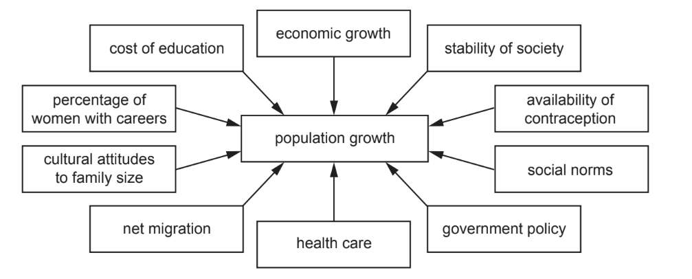
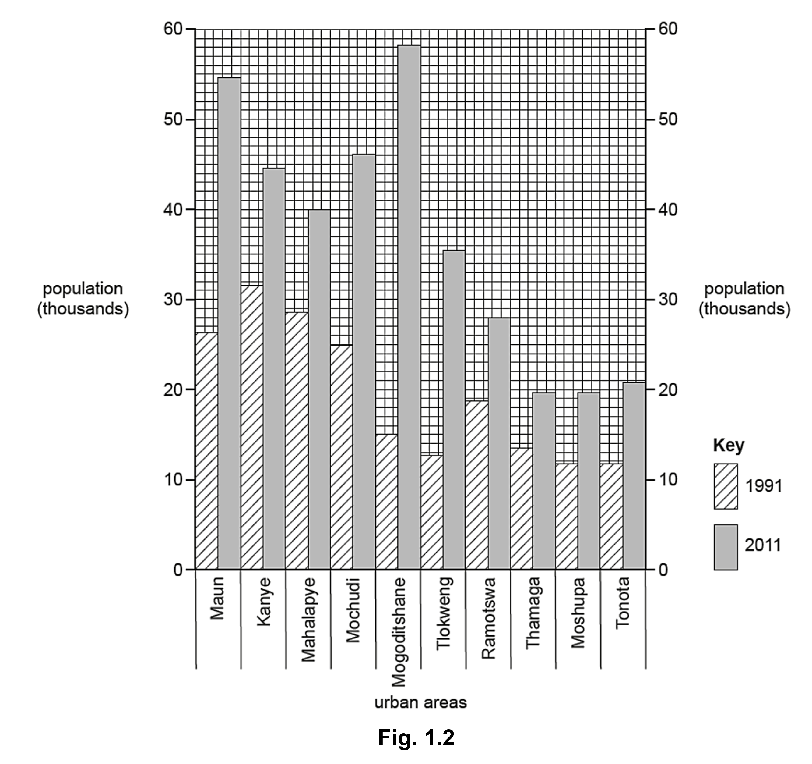
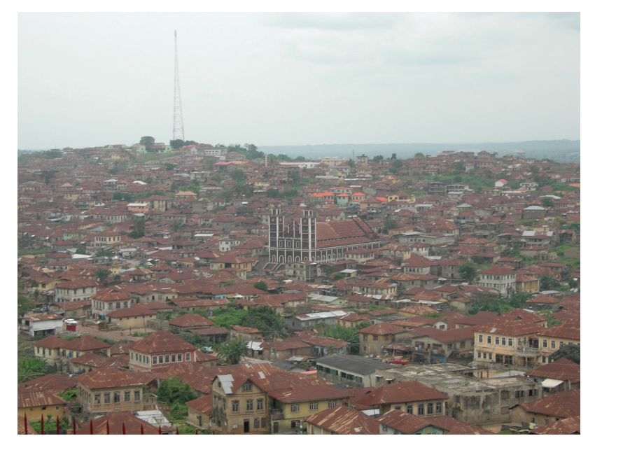
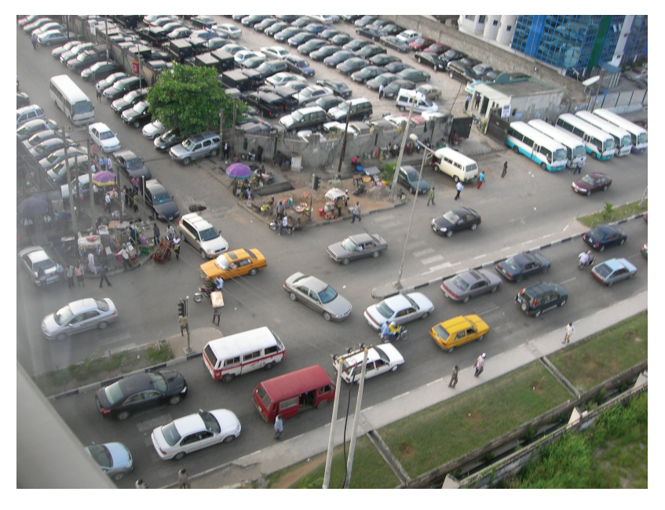
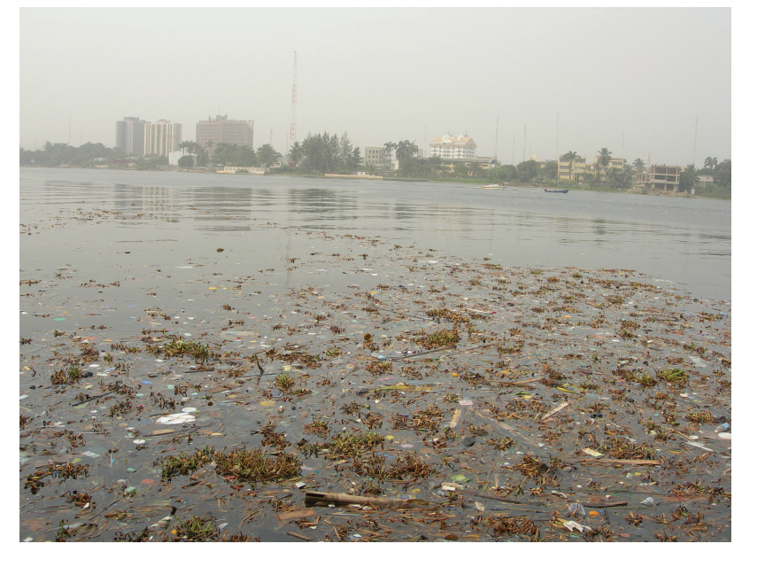
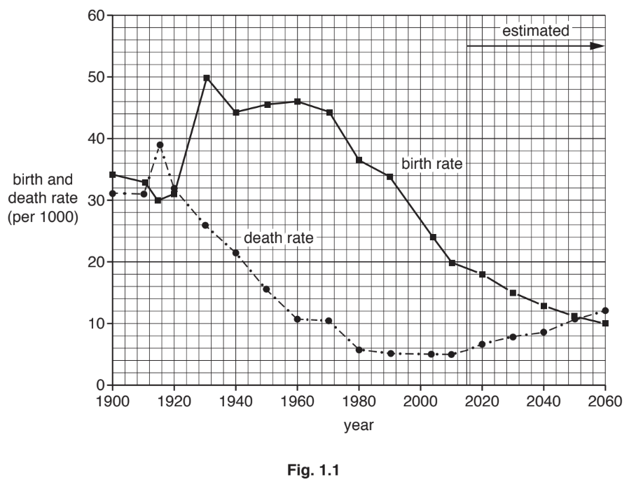
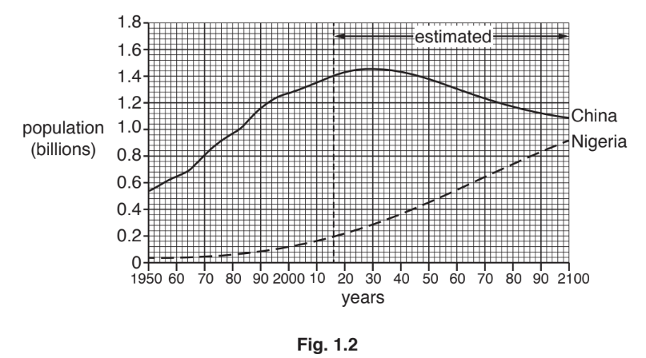
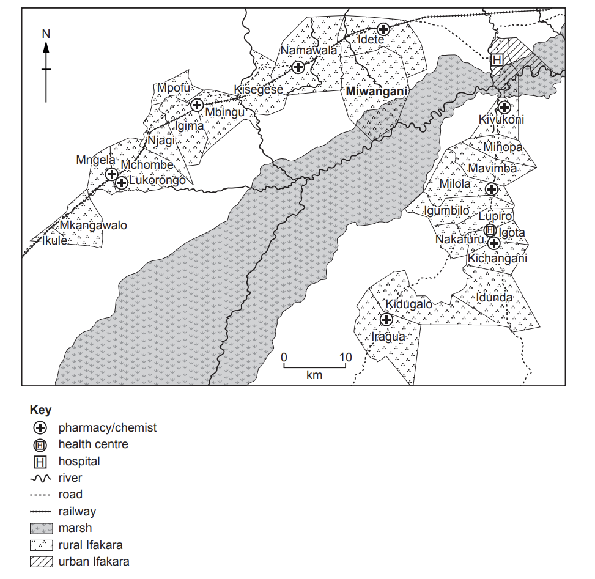
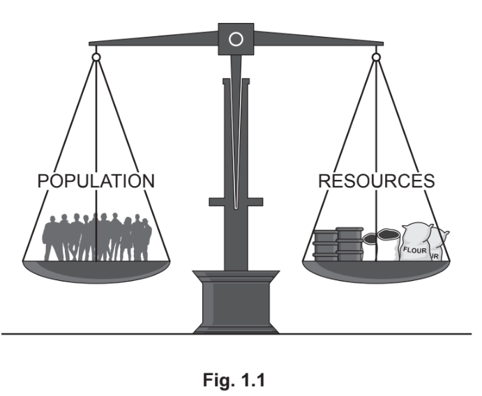

# Exam Questions — Population Dynamics
**Population & Settlement** · Cambridge (CIE) IGCSE geography (0460 & 0976)
> Source: [https://www.savemyexams.com/igcse/geography/cie/20/topic-questions/](https://www.savemyexams.com/igcse/geography/cie/20/topic-questions/) · 36 questions across 1 sets

## Paper 1 (36 questions)

### Q1 — hard — 7 marks

**Q1** [7 marks]

For a named country, explain the causes of a high rate of natural population growth.

### Q2 — medium — 3 marks

**Q2** [3 marks]

Study Figure 1.2, an extract from an interview about China’s One Child Policy.

| “When the One Child Policy was introduced, many families found it very difficult. In rural areas, parents worried because they relied on several children to help on farms and to support them when they were older. There was also strong pressure to have a son, which meant some girls were not valued equally. Now, China faces another problem, as there are fewer young people to work and a growing number of elderly people who need care.” |
|---|

Using **Figure 1.2, **identify **three **challenges created by China’s One-Child Policy.

### Q3 — medium — 5 marks

**Q3** [5 marks]

Explain why some countries may choose to introduce an anti-natalist policy.

### Q4 — hard — 7 marks

**Q4** [7 marks]

Describe the problems caused by a large dependent population in a named country you have studied.

Name of country ..................................

*Source: June 2021 0460/13 Q1C*

### Q5 — hard — 7 marks

**Q5** [7 marks]

For a named country you have studied, describe the causes and consequences of **under-population.**

Name of country .................................

*Source: June 2021 0460/12 Q1C*

### Q6 — hard — 7 marks

**Q6** [7 marks]

For a named country you have studied, describe the problems which have been caused by a rapid growth in its population.

Country ..........................................

*Source: June 2021 0460/11 Q1C*

### Q7 — hard — 7 marks

**Q7** [7 marks]

For a named country you have studied, describe a government policy used to influence population growth.

Country ........................................................................................

*Source: March 2021 0460/12 Q1C*

### Q8 — hard — 7 marks

**Q8** [7 marks]

For a named country you have studied, explain why its natural population growth is high.

Name of country .................................................................

*Source: 2020 May/June 0460/13 Q1C*

### Q9 — hard — 7 marks

**Q9** [7 marks]

For a named country you have studied, describe a policy which is used to influence natural population growth rates.

Name of country ........................................

*Source: Nov 2019 0460/13 Q1C*

### Q10 — hard — 7 marks

**Q10** [7 marks]

For an example of a country you have studied, explain why natural population growth rates are high.

Name of country .....................

*Source: 2019 0460/12 Q1C*

### Q11 — hard — 7 marks

**Q11** [7 marks]

For a named country you have studied, describe the problems caused by over-population.

Name of country..................................

*Source: Spec 2020 0460/01 Q1C*

### Q12 — hard — 7 marks

**Q12** [7 marks]

For a named country you have studied, describe and explain the impacts caused by under-population.

Named country…………………..

### Q13 — hard — 7 marks

**Q13** [7 marks]

For a named country you have studied, describe the problems which have been caused by a low rate of population growth or population decline.

Name of Country:……………………..

### Q14 — hard — 7 marks

**Q14** [7 marks]

For a named country you have studied, describe the problems caused by under population

### Q15 — hard — 7 marks

**Q15** [7 marks]

For a named country you have studied, describe the problems caused by overpopulation

### Q16 — hard — 7 marks

**Q16** [7 marks]

For a named country you have studied, explain why the population is increasing

### Q17 — medium — 5 marks

**Q17** [5 marks]

Some parts of Tanzania are over-populated. Describe the problems faced by people living in areas which are over-populated.

*Source: June 2021 0460/11 Q7B*

### Q18 — medium — 5 marks

**Q18** [5 marks]

Study Fig. 1.4, which shows information about the factors influencing population growth.

**Fig. 1.4**

Explain why improvements in health care can lead to changes in population growth rates.

*Source: June 2021 0460/11 Q1B*

### Q19 — medium — 5 marks

**Q19** [5 marks]

Study Fig. 1.2, which shows information about the population of 10 urban areas in Botswana (an LEDC in Africa) in 1991 and 2011.

Describe the problems caused by rapid population growth in urban areas in LEDCs.

*Source: Nov 2020 0460/12 Q1B*

### Q20 — medium — 5 marks

**Q20** [5 marks]

Study Figs. 1.3, 1.4 and 1.5 , which are photographs taken in an overpopulated country.

**Fig.1.3**

**Fig.1.4**

**Fig.1.5**

Overpopulation occurs when the population is greater than the resources can support. Explain why this may occur in a country.

*Source: March 2021 0460/12 Q1B*

### Q21 — medium — 4 marks

**Q21** [4 marks]

Study Fig. 1.1, which shows information about birth rates and death rates in Mexico (an LEDC) between 1900 and 2060 (estimated).

Suggest reasons to explain why the natural population growth rate in Mexico is likely to decrease between 2015 and 2050.

*Source: Nov 2019 0460/13 Q1A*

### Q22 — medium — 5 marks

**Q22** [5 marks]

Study Fig 1.2, which shows information about the population of China and Nigeria between 1950 and 2100 (estimated).

Explain why birth rates are high in LEDCs such as Nigeria.

*Source: 2019 0460/11 Q1B*

### Q23 — medium — 9 marks

**Q23** [4 marks]

Study Figs. 1.2 and 1.3, which show information about birth rates in Vietnam (an LEDC in South East Asia).

| The communist government of Vietnam is penalising couples who have more than two children. In the early 1960s it imposed a two-child limit for couples and there have been campaigns to promote contraception and abortion in the country since 1997.  By 2000, the birth rate had been reduced considerably by the use of fines and confiscation of land. The original policy ended in 2003 but was revived in 2008 after an increase in the birth rate.  Villagers in Thua Thien-Hue province are being fined for having more than two children under the government two-child policy. Catherine Pham Thi Thanh, 44, said that since 1996 she has been fined a total of 3800 kilograms of rice for having six children. This is a great loss for the family which makes an annual profit of only 700 kilograms of rice from their farm. |
|---|

**Fig. 1.3**

Suggest how government policies and other factors may have reduced Vietnam’s birth rate.

[4]

*Source: Spec 2020 0460/01 Q1B (I)*

**Q23** [5 marks]

Explain why the governments of some MEDCs are now concerned that birth rates are too low in their countries.

*Source: Spec 2020 0460/01 Q1B (II)*

### Q24 — medium — 7 marks

**Q24** [3 marks]

Study Fig. 1.1, which shows information about the Demographic Transition Model.

**Fig. 1.1**

Using information from Fig. 1.1 only, explain why the rate of population growth changes as a country moves from Stage 1 to Stage 4.

.........................................................................................................
.........................................................................................................
.........................................................................................................

[3]

*Source: Nov 2020 0460/12 Q1A (III)*

**Q24** [4 marks]

Explain why birth rates are still high in many LEDCs.

.........................................................................................................
.........................................................................................................

[4]

*Source: Nov 2020 0460/12 Q1A (IV)*

### Q25 — medium — 5 marks

**Q25** [5 marks]

Explain why increased economic growth can lead to changes in population growth rates

### Q26 — easy — 3 marks

**Q26** [3 marks]

Study Fig. 1.3, which is a map showing rural and urban Ifakara.

**Fig. 1.3**

Using evidence from Fig. 1.3 **only,** suggest **three** reasons why death rates are high in **Miwangani.**

1 ..................................................

2 ..................................................

3 ..................................................

*Source: June 2021 0460/13 Q1B*

### Q27 — easy — 3 marks

**Q27** [3 marks]

Study Fig. 1.4, which shows information about the factors influencing population growth.

**Fig. 1.4**

Explain how each of the following can affect population growth rates:

percentage of women with careers ..........................................
government policy ..........................................
net migration. ..........................................

*Source: June 2021 0460/11 Q1B*

### Q28 — easy — 3 marks

**Q28** [3 marks]

Study Figs. 1.2 and 1.3, which show information about birth rates in Vietnam (an LEDC in South East Asia).

| The communist government of Vietnam is penalising couples who have more than two children. In the early 1960s it imposed a two-child limit for couples and there have been campaigns to promote contraception and abortion in the country since 1997.  By 2000, the birth rate had been reduced considerably by the use of fines and confiscation of land. The original policy  ended in 2003 but was revived in 2008 after an increase in the birth rate.  Villagers in Thua Thien-Hue province are being fined for having more than two children under the government two-child policy. Catherine Pham Thi Thanh, 44, said that since 1996 she has been fined a total of 3800 kilograms of rice for having six children. This is a great loss for the family which makes an annual profit of only 700 kilograms of rice from their farm. |
|---|

**Fig. 1.3**

Using Fig. 1.2 **only**, describe the reduction in the birth rate of Vietnam between 1960 and 2015. Include statistics in your answer.

*Source: 2020 0460/01 Q1B*

### Q29 — easy — 3 marks

**Q29** [3 marks]

Study Figs. 1.3, 1.4 and 1.5 , which are photographs taken in an overpopulated country.

**Fig.1.3**

**Fig.1.4**

**Fig.1.5**

Use evidence in each of Figs. 1.3, 1.4 and 1.5 to identify different problems caused by overpopulation.

Fig. 1.3 ......................................................................................

Fig. 1.4 ......................................................................................

Fig. 1.5 ......................................................................................

*Source: March 2021 0460/12 Q1B*

### Q30 — easy — 3 marks

**Q30** [3 marks]

Study Fig. 1.2, which shows information about the population of 10 urban areas in Botswana (an LEDC in Africa) in 1991 and 2011.

Put the following urban areas in rank order according to their population growth between 1991 and 2011.

Kanye    Maun    Mogoditshane    Thamaga    Tonota

*Source: Nov 2020 0460/12 Q1B*

### Q31 — easy — 1 marks

**Q31** [1 mark]

Study Fig. 1.1, which shows information about population change in Norway between January 1 and 30 April 2013.

| births | 14168 |
|---|---|
| deaths | 11363 |
| immigration | 18948 |
| emigration | 9319 |

**Fig. 1.1**

The total population of Norway on 1 January 2013 was 5051275.

Which of the following describes what happened to the total population by 30 April 2013?

Tick **one** answer in the table below:

|   | Tick(✓) |
|---|---|
| decreased |   |
| increased |   |
| stayed the same |   |

*Source: Nov 2019 0460/11 Q1A*

### Q32 — easy — 6 marks

**Q32** [1 mark]

Study Fig. 1.1, which shows information about birth rates and death rates in Mexico (an LEDC) between 1900 and 2060 (estimated).

(i)

What is meant by *death rate*?

[1]

*Source: Nov 2019 0460/13 Q1A*

**Q32** [2 marks]

Which of the following statements is true about birth and death rates in Mexico? Tick **two** answers in the table below:

|   | Tick (✓) |
|---|---|
| The birth rate declined every year between 1900 and 2015. |   |
| The birth rate was always higher than the death rate between 1900 and 2015. |   |
| Both the birth rate and the death rate declined overall between 1960 and 2015. |   |
| Natural population growth was lower in 2015 than it was in 1980. |   |
| Natural population growth was high between 1900 and 1920. |   |

*Source: Nov 2019 0460/13 Q1A (II)*

**Q32** [3 marks]

Calculate the natural population growth rate of Mexico in 2010. You should show your calculations.

*Source: Nov 2019 0460/13 Q1A (III)*

### Q33 — easy — 3 marks

**Q33** [3 marks]

Study Fig 1.2, which shows information about the population of China and Nigeria between 1950 and 2100 (estimated).

Compare the populations of China and Nigeria between 1950 and 2100 (estimated). You should refer to years and use statistics in your answer.

*Source: Nov 2019 0460/11 Q1B*

### Q34 — easy — 10 marks

**Q34** [1 mark]

Study Fig. 1.1, which shows information about population and resources.

(i)

How does the balance between population and resources differ between a country which is under-populated and one which is over-populated?

[1]

*Source: 2020 May/June 0460/11 Q1A (I)*

**Q34** [2 marks]

Name a country which is:

under-populated ...................................................

over-populated .....................................................

*Source: May 2020 0460/11 Q1A (II)*

**Q34** [3 marks]

Give **three **reasons why the country you named in (ii) is **under-populated.**

1 ........................................................................................................................................

2 ........................................................................................................................................

3 ........................................................................................................................................

*Source: May 2020 0460/11 Q1A (III)*

**Q34** [4 marks]

Describe the problems caused by **over-population** in the country you named in (ii).

*Source: May 2020 0460/11 Q1A (IV)*

### Q35 — easy — 6 marks

**Q35** [1 mark]

Study Fig. 1.1, which shows information about the birth and death rates of three countries in 2013.

| Country | Birth rate (per 1000 of population) | Death rate (per 1000 of population) |
|---|---|---|
| Kuwait | 20.9 | 2.1 |
| South Africa | 19.3 | 17.2 |
| Vietnam | 16.8 | 5.9 |

**Fig. 1.1**

What is meant by South Africa has a death rate of 17.2?

*Source: Spec 2020 0460/01 Q1A (I)*

**Q35** [2 marks]

Using Fig. 1.1, identify the following:

– the country with the lowest birth rate; .....................

– the country with the highest rate of natural population growth ......................

*Source: Spec 2020 0460/01 Q1A (II)*

**Q35** [3 marks]

Give three reasons why death rates vary from country to country.

[3]

*Source: Spec 2020 0460/01 Q1A (III)*

### Q36 — easy — 3 marks

**Q36** [1 mark]

Study Fig. 1.1, which shows information about the Demographic Transition Model.

**Fig. 1.1**

(i)

Identify the stage when population is growing most rapidly.
.........................................

[1]

*Source: Nov 2020 0460/12 Q1A (I)*

**Q36** [2 marks]

Using Fig. 1.1 only, compare:
the birth rates in Stage 2 and Stage 3 ..............................................
...........................................................................................................
...........................................................................................................
the death rates in Stage 1 and Stage 2 .............................................
............................................................................................................
..........................................................................................................

[2]

*Source: Nov 2022 0460/12 Q1A (II)*

