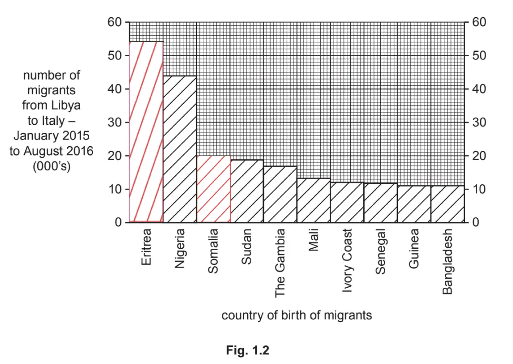

# Mark Schemes — Migration
**Population & Settlement** · Cambridge (CIE) IGCSE geography (0460 & 0976)

## Paper 1 (29 questions)

### Q1
1. Greece
2. **Spain**
3. **Italy**
4. **Cyprus**
5. **Malta**
6. Bulgaria

**[1 mark].**

> **[mark-scheme]**
> The correct order is needed for one mark.
**The area between Libya (or Tunisia) and Malta saw some of the highest deaths ****[1 mark].**

**Another high death rate was crossing the sea from northeast Morocco to the southern coast of Spain ****[1 mark].**

> **[mark-scheme]**
> Each valid suggestion receives one mark.
> 
> **Alternative content**
> 
> The answer above is just one example of a response to this question. Other information that could be used in the answer includes:
> 
> - Western/Eastern end of Mediterranean
> - between Spain and Morocco; Turkey and Greece
> - coast of Morocco; Turkey; Libya/Tunisia
> - from Morocco to Spain; Libya (or Tunisia) to Malta/Italy
> - crossing the sea from Turkey; Libya/Tunisia
One reason is that living there is very difficult due to a civil war in their nation.

A natural disaster such as drought may cause a lack of clean water.

People may face persecution due to their beliefs, which could lead them to flee their home country.

> **[mark-scheme]**
> - 1 mark for each valid reason.
> 
> **Alternative content**
> 
> The answer above is just one example of a response to this question. Other information that could be used in the answer includes:
> 
> - Famine/starvation/lack of food
> - Political, ethnic or gender persecution
> - Genocide
> - Discrimination
> - Natural disaster (or specific example, e.g., volcano, flood), etc.

### Q2
**International migration is the movement of people from one country to another country, across borders, or moving out of a country** **[1 mark].**

**Internal migration refers to the movement from one region within a country to another, or from a rural to an urban area ****[1 mark].**

**Forced migration is when people have no choice but to relocate due to unsafe conditions or other external factors ****[1 mark].**

### Q3
<u>Levels marking</u>

**Level 1                              **** (1–3 marks)**
Statements including limited detail which describe positive and/or negative impacts of migration on destination country.

**Level 2                             ****  (4–6 marks)**
Uses named example.
More developed statements which describe positive and/or negative impacts of migration on destination country.

**Note**: Credit development of impacts and not causes.

**(Note: Max 5 if no named or inappropriate example)**

**Level 3                             ****  (7 marks)**
Uses named example.
Comprehensive and accurate statements which describe positive and negative impacts of migration on destination country, including some place specific reference.

<u>Content Guide:</u>
Answers are likely to refer to:
• Labour supply
• Many immigrants will do dirty/low paid jobs
• Cultural understanding
• Provision of services e.g. ethnic restaurants
• Increases size of market for local businesses
• Racial tension;
• Pressure on employment
• Pressure on services e.g. health care, education
• Need for more housing/creation of ghettoes etc

<u>Place specific reference is likely to consist of:</u>
Named parts of the chosen country,
Countries where migrants have arrived from,
Population data etc

### Q4
Levels marking
<u>Level 1</u>                                                                                                                   **(1–3 marks)**
Statements including limited detail which describe the positive and/or negative impacts of large amounts of international migration to a country.

<u>Level 2</u>                                                                                                                  ** (4–6 marks)**
Uses named example.
More developed statements which describe the positive and/or negative impacts of large amounts of international migration to a country.

**(Note: Max 5 if no named or inappropriate example)**

<u>Level 3</u>                                                                                                                    **(7 marks)**
Uses named example.
Comprehensive and accurate statements which describe the positive and negative impacts of large amounts of international migration to a country including some place specific reference.

<u>**Content Guide:**</u>
Answers are likely to refer to:
• cheap labour
• skilled labour
• economic growth
• cultural diversity
• provision of variety of services (e.g. restaurants)
• pressure on public services or examples
• competition for jobs for local people
• racial conflict, etc.

<u>**Place specific reference is likely to consist of:**</u>
Named parts of the chosen country,
Population data

Etc.

### Q5
| **Indicative content** | **General Guidance** |
|---|---|
| **Positive impacts:**  - Larger available workforce - Increased productivity - Increased wealth / GDP - Increased tax income/revenue - Increased spending in shops/services - Increased cultural diversity - Increased birth rate - Reduced dependency ratio  **Negative impacts:**  - Competition for jobs - Higher unemployment - Shortage of housing - Pressure on schools/shortage of school places - Pressure on healthcare - Congestion - Overcrowding - Pressure on natural resources - Cultural/social tension - Discrimination - Leakage | - The command word ‘describe’ requires you to state the key positive and negative impacts of migration on the chosen country - This is a levelled response answer. It is important to remember that each point does not equate to a mark. The examiner will read your whole answer and make a decision about which level your answer fits into - If you do not name a country, or the country you choose is not appropriate, a maximum of 5 marks will be awarded |

| **Model Answer** | **Commentary** |
|---|---|
| Named country: USA  The USA is one of the world’s most popular destinations for migration, with over 40 million immigrants making up around 13% of the population. This large flow of migrants bring both positive and negative impacts.  Positive impacts include increased workforce and taxes. Migrants make up nearly 20% of the USA’s workforce. They pay taxes on those earnings and spend money on local goods and services which can help to boost the economy. Migration also brings cultural enrichment by bringing new traditions, languages and music to the USA. A final positive impact is the increased innovation and entrepreneurship. Migrants accounted for over 25% of new business owners in the USA in 2020, helping to provide goods and services as well as increasing employment opportunities.  Negative impacts include pressure on public services such as health and education. Threats of illegal immigration costs the USA millions of dollars for border patrols, fences and detention centres. Some people believe that migrants are willing to work for less money, which might keep wages low. This can cause social tensions and discrimination. Opposition to illegal immigration has also led to a rise of ‘Minutemen’ groups who patrol the borders and confront illegal workers around the country. A final negative is the loss of money from the economy when migrants send remittances back home. | **Marks 7/7**  - This is one possible way to answer this question – your answer does not have to be exactly the same - You need to refer to a named country in your answer - You also need to include place specific detail such as named places within the country, statistics or specific details of impacts in order to gain 7 marks - Using phrases such ‘this leads to’ and ‘this could cause’ will help you extend your explanation - This answer outlines several positive and negative impacts in two separate paragraphs for a clear structure - The answer is developed by quoting supporting facts and evidence |

### Q6
| **Indicative content** | **General Guidance** |
|---|---|
| Causes might include push factors and pull factors.  **Push factors:**  - Lack of employment - Low wages - Poverty - Poor quality healthcare - Poor provision of education - Wars / conflicts - Persecution - Natural disasters - Extreme climate - Lack of water supply - Poor food supply - Crime  **Pull factors:**  - Job availability - Higher wages - Good health services - Good education - Personal safety - Freedom of speech - Better lifestyle / improved quality of life - Family ties - Political stability - Moderate climate | - The command word ‘explain’ requires you to give reasons why different factors cause people to migrate to the chosen country - This is a levelled response answer. It is important to remember that each point does not equate to a mark. The examiner will read your whole answer and make a decision about which level your answer fits into - If you do not name a country, or the country you choose is not appropriate, a maximum of 5 marks will be awarded - Although you can gain marks for talking about both push and push factors, you will not be double credited for writing opposites e.g. a push factor was low wages and a pull factor was high wages |

| **Model Answer** | **Commentary** |
|---|---|
| Named country: USA  The USA is one of the world’s most popular destinations for migration, with over 40 million immigrants making up around 13% of the population. The largest source of these migrants is Mexico, with more than 10.9 million Mexicans living in the USA.  Push factors that cause people to leave Mexico include poverty and lack of jobs. There are also high levels of violence and crime in some parts of Mexico. For example, border states such as Chihuahua experience high levels of violence due to drug trafficking and organised crime. Finally, water shortages are a push factor with over 50% of Mexicans lacking access to a reliable and safe water supply. This is getting worse as a result of climate change and droughts.  A pull factor that attracts people to the USA is that the average GDP in the USA is more than three times higher than the average GDP in Mexico (\$63,700 compared to \$19,100). This means that migrants will be able to send money home to support family members as remittances. Another key pull factor is family ties, with the vast majority of people migrating to the USA being sponsored by family members. This makes it easier to find a job and housing and to fit into a new community more quickly. | **Marks 7/7**  - This is one possible way to answer this question – your answer does not have to be exactly the same - You need to refer to a named country in your answer - You also need to include place specific detail such as named places within the country, statistics or specific details of impacts in order to gain 7 marks - Using phrases such ‘this leads to’ and ‘this could cause’ will help you extend your explanation - This answer outlines several push factors and pull factors in two separate paragraphs for a clear structure - The answer is developed by naming located examples and quoting supporting facts and evidence |

### Q7
Levels marking
Level 1                                                                                                        **           (1–3 marks)**
Statements including limited detail which describe the positive and/or negative impacts on the migrants themselves in a country.

Level 2                                                                                                                   **(4–6 marks)**
Uses named example.
More developed statements which describe the positive and/or negative impacts on the migrants themselves in a country.

**(Note: Max 5 if no named or inappropriate example)**

Level 3                                                                                                                    **(7 marks)**
Uses named example.
Comprehensive and accurate statements which describe the positive and negative impacts of on the migrants themselves in a country. including some place specific reference.

**Content Guide:**
Answers are likely to refer to the fact that migration has both positive and negative impacts on migrants themselves

| **Positive impacts of migration on migrants** | **Negative impacts of migration on migrants** |
|---|---|
| Safety from conflict | Migrants may run out of money |
| A better education and job skills | Issues securing accommodation, passport, visas or general immigration issues on arrival |
| Improved quality of life | Illness through lack of access to healthcare |
| Wider job opportunities | Migrants can be exploited & experience racism |
| A sense of integration/ hope | Weather conditions - unsuitable clothing |
| Support family in country of origin through remittances | Language barriers and cultural assimilation |

**Place specific reference is likely to consist of:**
Named parts of the chosen country,
Population data

Etc.

### Q8
Levels marking

**Level 1                               ****(1–3 marks)**
Statements including limited detail which describe positive and/or negative impacts that remittances have on developing countries

**Level 2                               ****(4–6 marks)**
Uses named example.
More developed statements which describe positive and/or negative impacts that remittances have on developing countries

**Note**: Credit development of impacts and not causes.

**(Note: Max 5 if no named or inappropriate example)**

**Level 3                               ****(7 marks)**
Uses named example.
Comprehensive and accurate statements which describe positive and negative impacts  that remittances have on developing countries, including some place specific reference.

Content Guide:
Answers are likely to refer to:

- Money is often sent back to family and friends (known as remittances), boosting the local economy.
- Migrants sent about US\$450 billion to developing countries in 2017, ten times more than they did just 20 years earlier
- Remittances can be worth more than four times the value of foreign aid receipts
- Some countries rely heavily on remittances - Tonga lacks infrastructure and job opportunities and half of the country's population live overseas - US, Australia and New Zealand. Most of the money sent home are from these three countries.
- Money from remittances goes directly to families
- It is a key source of foreign savings for low income countries
- Increases a country's GNI and adds to consumers' real purchasing power
- Remittance income provides funds for business start-ups
- Remittances can reduce labour supply (brain drain) and create a culture of dependency that slows economic growth.
- Can limit overseas investment in infrastructure projects and aid
- Anti-immigration laws and polices can stop migrants entering a country and this slows or stops the flow of remittances
- Remittances can increase the value of the country's currency, which can lead to exports prices to increase and imports being cheaper, leading to an imbalance in trade - generates a demand for imported rather than locally produced goods
- Dependency link between sender and recipient of remittances and exerts pressure on the sender to send as much money back as possible, which can lead to a deterioration of their own living conditions.

Place specific reference is likely to consist of:
Named parts of the chosen country,
Countries where migrants have arrived from or where they are sending remittances to
Population data etc

### Q9
<u>Levels marking</u>

**Level 1                               ****(1–3 marks)**
Statements including limited detail which describe positive and/or negative impacts of migration on origin country.

**Level 2                               ****(4–6 marks)**
Uses named example.
More developed statements which describe positive and/or negative impacts of migration on origin country.

**Note**: Credit development of impacts and not causes.

**(Note: Max 5 if no named or inappropriate example)**

**Level 3                              **** (7 marks)**
Uses named example.
Comprehensive and accurate statements which describe positive and negative impacts of migration on origin country, including some place specific reference.

<u>Content Guide:</u>
Answers are likely to refer to:
Positive impacts on the origin location:
Reduce unemployment due to less job competition 
Reduced pressure on natural resources 
Returning migrants bring new skills and knowledge
Reduced pressure on services - health and education etc. 
Remittances boost local economy

Negative impacts include:
Reduced tax revenue
Brain drain - skilled workers leave the area
Brain drain reduces economic development
Separation of families - pressure is placed on other family members to care for elderly and or children
Gender imbalances - males often move.

<u>Place specific reference is likely to consist of:</u>
Named parts of the chosen country,
Countries where migrants have left,
Population data etc

### Q10
Migrants from China and Italy may face several challenges after moving to Canada. Language difficulties are common, especially for those from China who may not speak English or French fluently, making it hard to integrate and find jobs **[1 mark]**.

Employment can also be challenging due to discrimination, low pay, or exploitation in workplaces **[1 mark]**.

Finding and affording housing may be difficult, as housing costs in Canada can be high, leading to poor living conditions **[1 mark]**.

Furthermore, migrants may experience emotional challenges being far from friends and family, which can make settling into a new country harder **[1 mark]**.

> **[mark-scheme]**
> To gain 4 marks, answers will need to explain four **different **factors.
> 
> This answer should consider factors and classify them into social, economic, environmental and political benefits.
> 
> **Alternative content**
> 
> The answer above is just one example of a response to this question. Other information that could be used in the answer includes:
> 
> - Difficulty in finding employment.
> - Discrimination, racial abuse, racial conflict and tension or xenophobia.
> - Education and healthcare may not be affordable.
> - Qualifications may not be accepted.
> - Hard to get citizenship, a green card or permission to work in Canada.

### Q11
Migration to the USA has both positive and negative effects on small villages in Bolivia. One positive impact is the reduction of pressure on services such as healthcare, education, and food supplies, as fewer people remain in these villages **[1 mark]**.

Remittances are sent back by migrants, as are winnings and donations from football leagues in the USA, which provide significant financial support for investments in schools, infrastructure, and churches **[1 mark]**.

However, migration can cause challenges. Empty houses, shop closures, and school closures are common due to fewer residents **[1 mark]**.

There may also be an imbalance in the age structure, with only the elderly and children remaining, leading to a higher dependent population **[1 mark]**.

Additionally, the loss of skilled workers and workforce, known as a 'brain drain', can hinder local economic development **[1 mark]**.

> **[mark-scheme]**
> To gain 5 marks, answers will need to explain five **different **factors.
> 
> This answer should consider factors and classify them into social, economic, environmental and political benefits.
> 
> **Alternative content**
> 
> The answer above is just one example of a response to this question. Other information that could be used in the answer includes:
> 
> - Benefit from winnings or donations from football leagues in the USA for investment in schools, infrastructure, or churches.
> - Empty houses, school and shop closures.
> - New skills are brought back when a migrant returns.
> - Family breakdown.
> - Impact on culture, either positive or negative.
> - The village or country's economy develops.

### Q12
Migrants from LEDCs are often attracted to MEDCs, such as the UAE, by the promise of better economic and social factors. One of the main pulls is higher pay and regular income, which allow migrants to support their families and send money back home as remittances **[1 mark]**.

Additionally, MEDCs typically offer more job opportunities in industries such as construction, retail, and domestic work, which may be unavailable in LEDCs **[1 mark]**.

Migrants are also drawn to the reliable access to essential services, including healthcare, clean water, and electricity, which may not be as dependable in their home countries **[1 mark]**.

Furthermore, the possibility of better education for their children and exposure to modern infrastructure, entertainment, and safety in MEDCs is another strong attraction **[1 mark]**.

Finally, MEDCs may have more stable economies and political environments, offering migrants a sense of security and the ability to build a better future **[1 mark]**.

> **[mark-scheme]**
> To gain 5 marks, answers will need to explain five **different **factors.
> 
> This answer should consider factors and classify them into social, economic, environmental and political benefits.
> 
> **Alternative content**
> 
> The answer above is just one example of a response to this question. Other information that could be used in the answer includes:
> 
> - Improved health care.
> - Better entertainment and bright lights.
> - Better housing.

### Q13
Migrants arriving in Santa Cruz may face many challenges. One major issue is finding somewhere to live, as housing can be overcrowded, poorly built, or located in shanty towns with poor sanitation **[1 mark]**.

Jobs may be hard to obtain, and many available positions are low-paid, making it difficult for migrants to earn enough to support themselves and their families **[1 mark]**.

Migrants might also experience hostility or discrimination from locals, who may resent them for taking jobs or using local resources **[1 mark]**.

Additionally, the high cost of living in Santa Cruz means migrants may struggle to afford essentials like food, healthcare, or education for their children. These challenges can make it very difficult for migrants to settle and improve their quality of life **[1 mark]**.

> **[mark-scheme]**
> 1 mark per factor up to a maximum of 4 marks. There should be a range of factors.
> 
> Answer should also consider factors other than jobs and better opportunities.
> 
> **Alternative content**
> 
> The answer above is just one example of a response to this question. Other information that could be used in the answer includes:
> 
> - Finding somewhere to live or forced to live in poor quality housing or shanty towns.
> - Language barriers.
> - Being away from family and friends.
> - Can be hard to adapt to different cultures and religions.
> - High cost of living and can’t afford basics such as food, water, healthcare and education.
> - Threat of deportation or difficulty getting legal documents such as visas, work permits, passports, etc.

### Q14
One major challenge international migrants face is the high cost of moving, which can make it difficult for migrants to afford the journey and have money to settle in a new place **[1 mark]. **

Finding somewhere to live can also be a problem, with many migrants living in poor-quality housing or areas with poor sanitation **[1 mark].**

Language barriers make it hard for migrants to communicate, which can limit their opportunities to find work or access services **[1 mark]. **

Migrants may also face racial or religious discrimination, making it harder to get jobs or feel accepted in their new country **[1 mark]. **

> **[mark-scheme]**
> 1 mark per factor up to a maximum of 4 marks. There should be a range of factors.
> 
> Answer should also consider factors other than jobs and better opportunities.
> 
> **Alternative content**
> 
> The answer above is just one example of a response to this question. Other information that could be used in the answer includes:
> 
> - Dangers on their journey to a new country.
> - Obtaining paperwork, work visas or passports.
> - Political restrictions or threat of deportation.
> - Forced to live in shanty towns or examples of problems within them, e.g. poor sanitation.
> - Jobs are hard to obtain, are low paid or are not hired because they are immigrants.
> - Isolated from family and friends and don’t know people.
> - High cost of living; can’t afford food, schooling, healthcare, water or rent
> - Different religious beliefs may lead to discrimination.

> **[exam-tip]**
> Think about social, economic, environmental and political reasons; it shows the examiner that you have a wide depth of knowledge.

### Q15
One reason many people from LEDCs work in MEDCs is because of higher pay and regular wages, which allow workers to support their families back home **[1 mark]**.

They can also send home remittances, which help pay for schoolbooks, food, and other essentials for their families **[1 mark]**.

In MEDCs, jobs are often more stable than in LEDCs, where unemployment can be high and opportunities limited **[1 mark]**.

Workers in MEDCs may also have better rights and working conditions, ensuring they are treated fairly **[1 mark]**.

Finally, MEDCs offer a more reliable water supply and electricity, which makes everyday life easier and improves their living standards and plans for a better future **[1 mark]**.

> **[mark-scheme]**
> 1 mark per factor up to a maximum of 5 marks.
> 
> Answers will need to be developed to show reasoning for the factor.
> 
> Answer should consider factors other than just jobs and better opportunities.
> 
> **Alternative content**
> 
> The answer above is just one example of a response to this question. Other information that could be used in the answer includes:
> 
> - Improved education for their children.
> - Better entertainment and bright lights in urban areas.
> - Reliable and good food supply.

### Q16
Italy faces environmental pressures on food supplies as local resources may not be enough to meet the needs of both residents and migrants.

Another problem is housing. There might not be enough temporary housing for everyone, so shelters become overcrowded.

Unemployment can also rise, as migrants may struggle to find jobs in an already competitive job market, creating further economic challenges for Italy.

Government services and resources are put under strain trying to process large numbers of migrants. These problems can make things difficult between the people who live there and the refugees, which can lead to more social problems.

> **[mark-scheme]**
> To gain 4 marks, answers should explain four different factors.
> 
> There must be consideration of wider factors rather than jobs and conflict.
> 
> **Alternative content**
> 
> The answer above is just one example of a response to this question. Other information that could be used in the answer includes:
> 
> - Conflicts with or resentment of the local population.
> - The cost of providing patrols or rescue boats.
> - Lack of housing or cramped housing and spread of disease.
> - Cultural issues.

### Q17
International migrants often face social difficulties, such as cultural, religious and language barriers, in their neighbourhood**.** This can lead to a lack of social integration, where migrants may feel isolated or excluded from the wider community **[1 mark]**.

Economic difficulties are also common, such as the cost of moving and setting up in the new areas **[1 mark].** Migrants may face issues finding employment due to language barriers or a lack of recognition for qualifications obtained in their home country and have to take low-paid menial work instead **[1 mark].**

Environmental difficulties can include where they live. Housing might be in a poor area of town with little facilities or of poor construction. They may struggle to get the landlord to address problems or they may experience landlord discrimination **[1 mark].**

Finally, political challenges include the difficulty of obtaining a visa and official documents such as a USA Green Card **[1 mark].**

> **[mark-scheme]**
> To gain 5 marks, answers will need to explain five **different **factors.
> 
> This answer should consider factors and classify them into social, economic, environmental and political difficulties.
> 
> **Alternative content**
> 
> The answer above is just one example of a response to this question. Other information that could be used in the answer includes:
> 
> - Exploitation.
> - Discrimination.
> - Difficulty in practising their religion.
> - Away from friends and family.

### Q18
Many areas experience negative net migration because more people leave than arrive. One reason is unemployment or low pay, which pushes people to move to places with better job opportunities [**1 mark].** Poor healthcare systems, such as not having enough doctors or hospitals, encourage people to migrate for better medical services [**1 mark]**. Poverty and low GDP also play a role, as individuals leave to escape hardship and improve their quality of life [**1 mark]**. In some areas, natural disasters like droughts or tropical storms make living conditions unbearable, forcing people to migrate [**1 mark]**. Finally, war or conflict causes people to flee to safer places as they look for freedom and security away from violence [**1 mark]**.

> **[mark-scheme]**
> Negative net migration occurs when people leave areas where their basic needs are not met or where danger and poor living standards make it difficult to stay.
> 
> - To gain 5 marks, answers **will need **to explain five different factors.
> - Push factors will only be accepted if they are phrased as better or more.
> - Factors can be social, physical, environmental or political.
> 
> **Alternative content**
> 
> The answer above is just one example of a response to this question. Other information that could be used in the answer includes:
> 
> - There are more emigrants than immigrants.
> - There is a lack of clean water or sanitation.
> - There is either poor education or not enough schools in the area.
> - There are earthquakes, volcanic eruptions or a tsunami.
> - There are inadequate supplies of food, electricity or water.
> - There is a famine or soil too poor to grow crops, etc.
> - There is persecution or a lack of personal freedom.
> - There is corruption, political instability, poor government or dictatorship.
> - There is genocide or a high murder rate.
> - There are high levels of pollution.

> **[exam-tip]**
> It is important for this answer that you consider other factors and not just jobs and better opportunities.

### Q19
Cultural differences are a big problem because it can be hard to get used to a new language, customs, and social norms, making them feel alone or left out **[1 mark]. **International migrants may have trouble getting work because of language barriers or because their qualifications from their home country are not recognised **[1 mark].** Housing can also be a problem since migrants may not be able to afford homes in cities or may face discrimination from owners or neighbours **[1 mark].** Also, it might be hard for them to get services like schooling and health care if they do not know how these systems work **[1 mark]**.

> **[mark-scheme]**
> This question requires either four separate points or two points that are well developed. The answer above provides four issues that international migrants may face.
> 
> - 1 mark for each point or
> - 2 marks for a well-developed point.
> 
> The command word 'suggest’ expects answers that apply knowledge and understanding to outline some of the problems international migrants may face when they move to a new country.
> 
> **Alternative content**
> 
> The answer above is just one example of a response to this question. Other information that could be used in the answer includes:
> 
> - There is a lack of qualifications, skills or education.
> - They are not aware of minimum wage laws.
> - Jobs are low-paid or there is exploitation by employers.
> - There is a feeling of homesickness or separation from family.
> - Only poor quality housing is available.
> - There is discrimination or persecution.
> - The process of obtaining a visa is challenging.

### Q20
Males aged 20-45 often dominate migrant populations. The figure shows this imbalanced sex distribution, with a large male population, particularly those aged 25 to 35, dominating **[1 mark].**

The figure shows there are few young dependents aged 0–19 because of the imbalance between males and females in the population **[1 mark].**

There are few old dependents, as the majority of economically active migrant males have returned to their country of origin before reaching 40 years **[1 mark].**

> **[mark-scheme]**
> - 1 mark for each valid characteristic identified.
> 
> Although not explicitly asked, there is an expected explanation for the selection of characteristics.

### Q21
**International migration is the movement of people between countries. Internal migration is the movement of people within a country ****[1 mark].**

> **[exam-tip]**
> These questions are all about extracting information from a resource.
> 
> Spend at least a minute looking at the figure and working out where people are moving from, where they are mostly moving to and why they are they moving?
> 
> Are people moving for similar reasons?
> 
> Can you see a pattern?
1. **An example of international migration from Fig. 1.1 is Bolivia ****to ****the USA ****[1 mark].**
2. **An example of internal migration from Fig. 1.1 is La Paz ****to**** Santa Cruz ****[1 mark].**

> **[mark-scheme]**
> - 1 mark for a valid international movement from Fig. 1.1.
> - 1 mark for a valid internal movement from Fig. 1.1.
> 
> **Alternate content**
> 
> - Spain or Argentina to the USA
> - Europe/Brazil/Paraguay to Bolivia/Santa Cruz.
> - Andes/Andean regions to Santa Cruz.
**One reason is that Santa Cruz offers better job opportunities** **[1 mark]. **
**Another reason is the quality of health care and education in the Santa Cruz area**** [1 mark]. **
**Lastly, people are moving into the area seeking farmland and business opportunities** **[1 mark]. **

### Q22
1. **Teresa finds it difficult to be away from her family and children for such a long time ****[1 mark].**
2. **Teresa only gets one day off each week and has to fit everything into that day, including talking to her children and family** **[1 mark].**
3. **Teresa lives in poor and cramped accommodation with 3 other people ****[1 mark].**

> **[mark-scheme]**
> - 1 mark for each identified and developed difficulty.
> 
> **Alternative content**
> 
> - Living in a single room is a challenge.
> - Language difficulties.
> - Cultural differences**.**
> - Low wages.

> **[exam-tip]**
> Make sure you include the information from the extract and formulate full sentences.
> 
> e.g. It is difficult for Teresa to live so far away from her two children.

### Q23
**The correct answer is that the population increased** **[1 mark].**

> **[exam-tip]**
> Questions like these can be easily misinterpreted and it is important to read and re-read what is expected.
**The correct answer is 18948–9319** **[1 mark]**** = 9629** **[1 mark].**

> **[mark-scheme]**
> - 1 mark for the correct answer.
> - 1 mark for the calculation.
> 
> The question explicitly requests the display of the calculation.

> **[exam-tip]**
> Always check if the question needs the unit to be added (mm, km, thousands, etc.).
One reason is that more people are immigrating than emigrating, especially if a country is stable and the people are content **[1 mark]**. Another reason is that MEDCs have better-paid jobs that attract people into the country **[1 mark]**. Lastly, MEDCs in Europe have better schools and colleges and many are free to study in **[1 mark]**. This can attract more people to a country.

> **[mark-scheme]**
> - 1 mark for each valid point up to a max of 3 marks.
> 
> The command word is**'suggest'**, and answers should also include reasons.
> 
> **Alternative content**
> 
> - Better jobs or work.
> - Health care services are good.
> - Food supply is better.
> - Water supply/sanitation.
> - Any other valid point.

> **[exam-tip]**
> Formulate these answers into full sentences and think, 'so what does this mean?'
> 
> Why would people migrate to a MEDC?
> 
> What do they have that acts as a pull factor?

### Q24
**Two ports are Tripoli and Benghazi** **[1 mark].**

> **[mark-scheme]**
> - For one mark, two ports must be named.
> 
> **Alternative content** includes:
> 
> - The port of Zawiyah.
**The graph received** **2 marks**.

> **[mark-scheme]**
> - 1 mark for each correctly plotted bar; shading must follow the other bars up to 2 marks max.

> **[exam-tip]**
> When completing graphs, use a ruler and sharp pencil. If the figures indicate a midpoint in the graph, clearly mark the line. Examiners are looking for precise completion of the graph.
One reason could be due to a civil war **[1 mark]** within a country that forces people to flee. Another reason can be due to a drought **[1 mark] **where there is not enough water for people, crops or animals. Lastly, people can be forced to leave due to persecution of their beliefs **[1 mark]**.

> **[mark-scheme]**
> - 1 mark for each valid reason up to a max of 3 marks.
> 
> **Alternative content**
> 
> - Civil unrest.
> - Political pressure.
> - Cultural persecution.
> - Natural disaster or named example such as volcano, etc.

### Q25
**Three types of amenity are restaurants** **[1 mark], ****food shops ****[1 mark] ****and places to watch football on TV**** [1 mark].**

> **[mark-scheme]**
> - 1 mark for each feature mentioned in the extract that can be enjoyed.
> 
> **Alternative content**
> 
> - Meeting places.
> - Football leagues/teams.
> - Football pitches.

### Q26
The distribution of negative net migration follows a clustered and uneven pattern **[1 mark]**.** **It is concentrated mainly in the Northern Hemisphere on the continents of North Africa, Central America, the Caribbean, parts of Eastern Europe and the majority of Asia **[1 mark]**. On the Southern Hemisphere, negative net migration is clustered within Southeast Asia, Southeast Africa and northern South America and extends in a corridor down to the southeast coast **[1 mark]**.

> **[mark-scheme]**
> - 1 mark for identifying the pattern as clustered or concentrated and uneven.
> - 1 mark for identifying hemisphere.
> - 1 mark for correctly naming areas of continents.
> 
> The question asks for a description of the distribution, not the naming of individual countries so areas of continents are needed to gain the marks*.*

### Q27
**345–355 (thousand)** **[1 mark]**
**Final answer:** **The correct order is:**

1. **UK.**
2. **India.**
3. **Philippines.**
4. **Pakistan.**

> **[mark-scheme]**
> - All correct = **2 marks.**
> - 2/3 correct = **1 mark.**
The graph shows that in 1990, 170,000 more Italians than Chinese people arrived in Canada. However, in 2015, approximately 430,000 more Chinese than Italians arrived in Canada **[1 mark]**.** **

This indicates that the total number of Chinese immigrants to Canada increased by three times, reaching a total of 540,000.  At the same time, the number of Italian immigrants to Canada decreased by 60,000 **[1 mark]**.** **

The number of people from **Italy** **decreased **from 340,000 in 1990 to 280,000 in 2015, resulting in a total decrease of 60,000 people migrating into Canada. The number of people from **China increased **from 170,000 in 1990 to 710,000 in 2015, resulting in a total increase of 540,000 people migrating into Canada **[1 mark]**.** **

> **[mark-scheme]**
> - 1 mark for use of statistics.
> - 1 mark for identifying change.
> - 1 mark for year and country of origin.

### Q28
1. **Forced international ****[1 mark]**
2. **Voluntary international**** ****[1 mark]**
3. **Voluntary internal ****[1 mark]**

### Q29
**68,351 + 13,579 = 81,930** **[1 mark]**

> **[mark-scheme]**
> The command word ‘calculate’ needs you to work something out from the figures provided.
