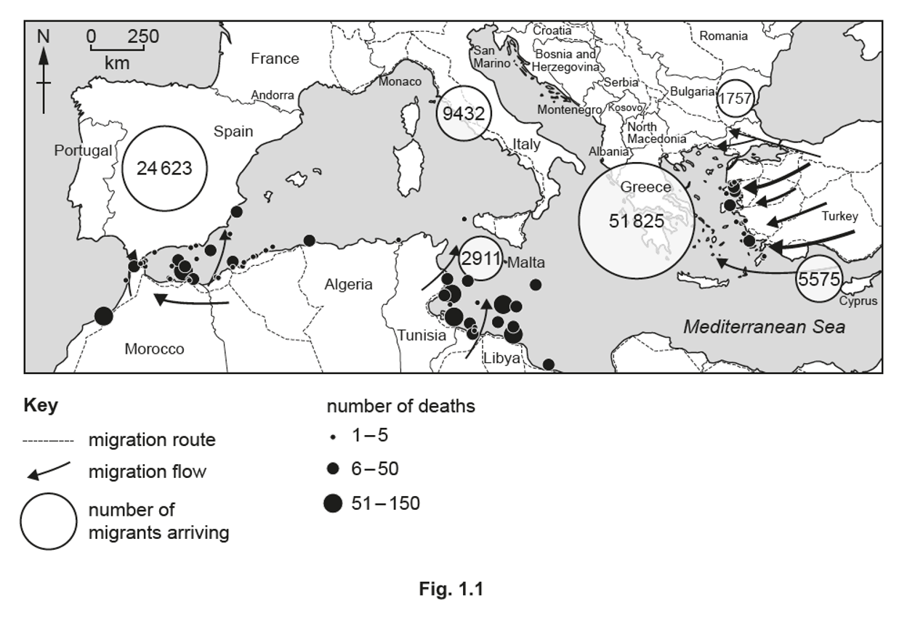
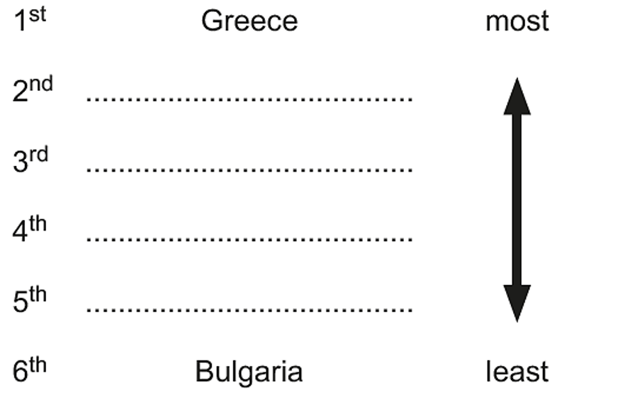
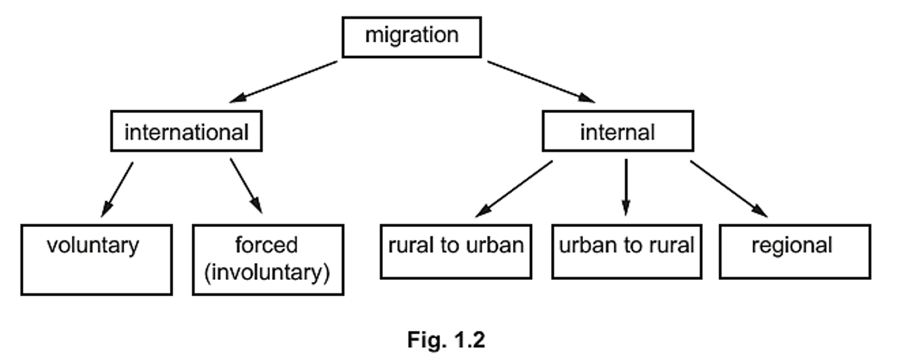
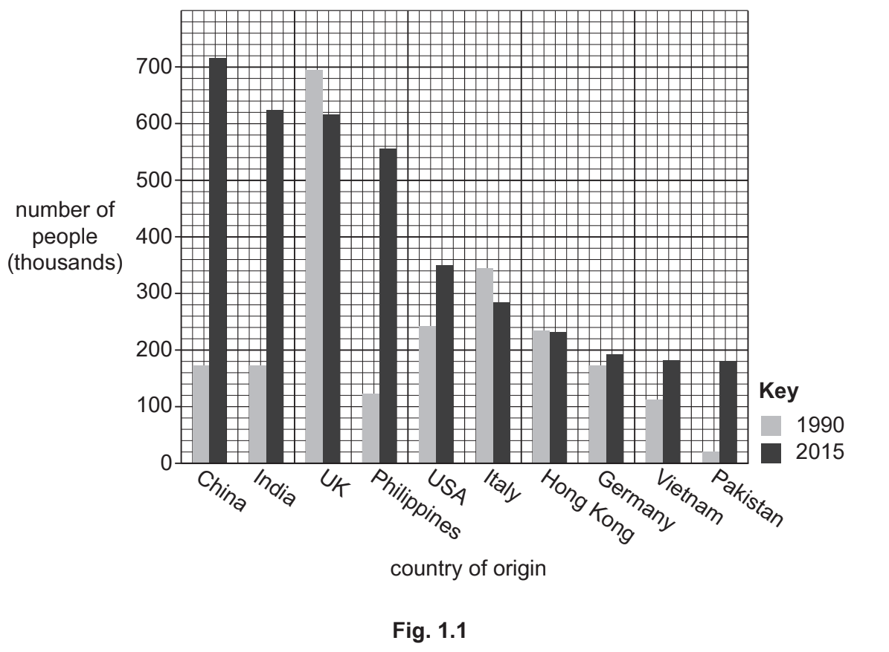
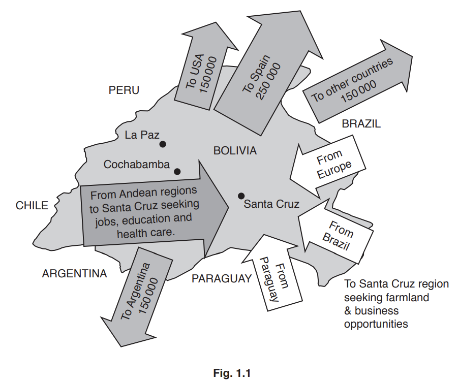
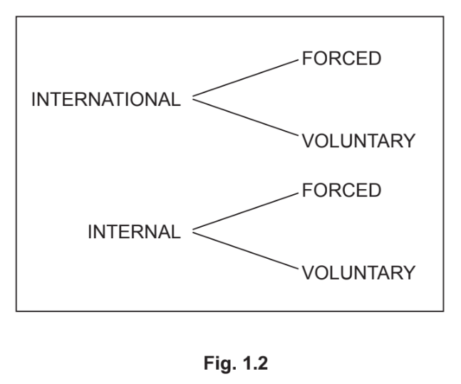
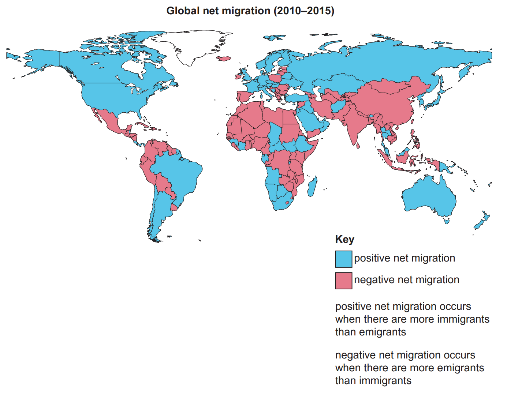
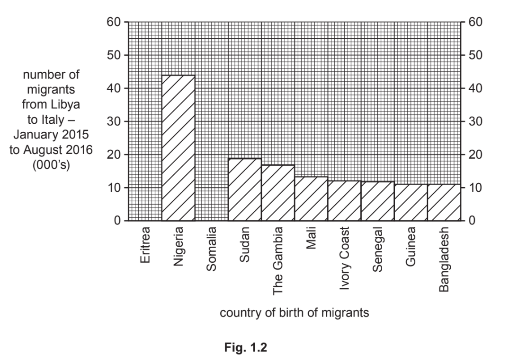
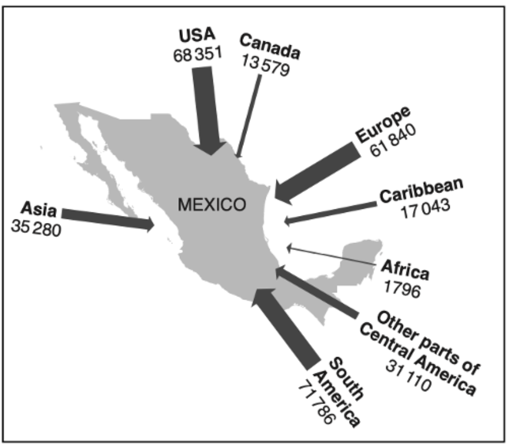

# Exam Questions — Migration
**Population & Settlement** · Cambridge (CIE) IGCSE geography (0460 & 0976)
> Source: [https://www.savemyexams.com/igcse/geography/cie/20/topic-questions/](https://www.savemyexams.com/igcse/geography/cie/20/topic-questions/) · 29 questions across 1 sets

## Paper 1 (29 questions)

### Q1 — easy — 5 marks

**Q1** [1 mark]

Study Fig. 1.1, which shows information about migration to selected countries in Europe between January and September 2019.

Put the following countries in rank order of the number of migrants arriving between January and September 2019. Two have been completed for you.

Cyprus    Italy    Malta    Spain

*Source:  June 2023 0460/12 Q1A I*

**Q1** [1 mark]

**Extract:**

Study Fig. 1.1, which shows information about migration to selected countries in Europe between January and September 2019.

Map showing Mediterranean migration routes and flows, with circles indicating migrants arriving and dots signifying number of deaths at locations.

Describe the locations of two different areas where there were many deaths of migrants as they attempted to cross the Mediterranean Sea.

*Source: June 2023 0406/12 Q1A II*

**Q1** [3 marks]

**Extract:**

Study Fig. 1.1, which shows information about migration to selected countries in Europe between January and September 2019.

Some of the migration to Europe, shown on Fig. 1.1, was forced (involuntary) migration from LEDCs.

Give **three **reasons why there is forced migration from some LEDCs.

*Source: June 2023 0460/12 Q1A III*

### Q2 — easy — 3 marks

**Q2** [3 marks]

Study Fig. 1.2, which shows information about types of migration.

Define the following types of migration:

1. international migration.
2. internal migration.
3. forced (involuntary) migration.

[3 marks]

*Source: June 2023 0460/11 Q1B I*

### Q3 — hard — 7 marks

**Q3** [7 marks]

For an example of international migration you have studied, describe the positive and negative impacts on the destination country.

Name of destination country .........................

*Source: 2019 0460/11 Q1C*

### Q4 — hard — 7 marks

**Q4** [7 marks]

Describe the positive and negative impacts of large numbers of immigrants on a country you have studied.

Name of country .........................................

*Source: 2020 May/June 0460/11 Q1C*

### Q5 — hard — 7 marks

**Q5** [7 marks]

Name an example of a country **to which** large numbers of people have migrated. Describe the positive and negative impacts of this migration on the named country they have migrated to.

### Q6 — hard — 7 marks

**Q6** [7 marks]

For a named country you have studied, explain why people migrate **to **it **from** other countries.

### Q7 — hard — 7 marks

**Q7** [7 marks]

Describe the positive and negative impacts of migration on the migrants themselves on a country you have studied.

Name of country .........................................

### Q8 — hard — 7 marks

**Q8** [7 marks]

Explain the positive and negative impacts that remittances have on developing countries.

### Q9 — hard — 7 marks

**Q9** [7 marks]

For an example of international migration you have studied, describe the positive and negative impacts on the country of origin.

Name of origin country .........................

### Q10 — medium — 4 marks

**Q10** [4 marks]

Study Fig. 1.1, which shows information about the country of origin of people living in Canada in 1990 and 2015.

Describe the problems that many migrants from China and Italy may face after moving to Canada.

*Source: Nov 2020 0460/13 Q1A*

### Q11 — medium — 5 marks

**Q11** [5 marks]

Study Fig. 1.2, which shows information about Arlington County, an area in the USA.

| Arlington County is home to the USA’s largest Bolivian community. In Arlington there are apartment buildings filled with people who have migrated from towns in the Cochabamba Valley in Bolivia, hence the nickname ‘Arlibamba’. There are many Bolivian restaurants and food shops, such as Pike Pizza, a converted pizza restaurant that now sells traditional Bolivian food. This is one of many meeting places for the Bolivian community. They are also places to watch the Bolivian national soccer team play games on TV.  Bolivians have formed several football leagues in the Arlington region. Over 2000 players and fans come out each Sunday to participate. Many of the teams are named after towns in Bolivia like Real Santa Cruz.  An aim of one of the Arlington football leagues is to improve life in the small villages in the Esteban Arce province of Bolivia. Most people there live off basic agriculture and remittances from abroad. Teams send their winnings back home to fund schools, infrastructure and churches. It has been estimated that villages in Bolivia received over US \$20000 a year from donations from the league. |
|---|

**Fig. 1.2**

Explain how migration to the USA is likely to have affected small villages in Bolivia and the people who still live there.

*Source: Nov 2019 0460/12 Q1B*

### Q12 — medium — 5 marks

**Q12** [5 marks]

Study Fig. 1.3, which is a population pyramid for the United Arab Emirates (UAE), an MEDC.

Most of the migration to the UAE is voluntary.

Describe the **attractions (pulls) **of MEDCs, such as the UAE, to migrants from LEDCs.

*Source: May/June 2020 0460/12 Q1B*

### Q13 — medium — 4 marks

**Q13** [4 marks]

Study Fig. 1.1, which shows information about international and internal migration in Bolivia (an LEDC) in South America.

Describe the problems that may be faced by migrants when they arrive in Santa Cruz.

*Source: 2019 0460/12 Q1A*

### Q14 — medium — 4 marks

**Q14** [4 marks]

Describe difficulties faced by international migrants when they move to and begin living in a new country.

*Source: 2019 1 Q1A*

### Q15 — medium — 5 marks

**Q15** [5 marks]

Study Fig. 1.2, which is an extract about a guest worker from the Philippines who is living in Dubai in the UAE.

| Teresa Cruz is one of many millions of adults who have travelled thousands of miles from home to earn money to send back to their families. Teresa lives in Dubai, the UAE’s largest city, 7000 kilometres from her home country, the Philippines. She earns the minimum wage as an assistant at a clothing store in a shopping mall in Dubai. She works six days a week and Friday is her day off.  On Friday at 12:00, it is time for Teresa to see her 11-year-old daughter and 8-year-old son who live with their aunt, who is raising them in the Philippines. As she is an overseas worker, she does this in the modern way. She pulls a stool up to a desk inside the small bedroom she shares with four other people. She logs on to the computer, clicks a video chat button and waits.  Teresa lives in the bedroom with her husband, Luis, who, like Teresa, left the Philippines years ago. They decided that the only way to do the things a parent wants to do—pay for schoolbooks, make sure the grandparents in the Philippines have enough to eat, prepare the children for college one day—is to leave the family behind and find work in a distant country with a different language and culture. |
|---|

**Fig. 1.2**

Explain why many people from LEDCs, such as the Philippines, work in MEDCs despite facing many difficulties.

*Source: 2020 May/June 0460/13 Q1B*

### Q16 — medium — 4 marks

**Q16** [4 marks]

Study **Fig. 1.1, **which shows information about migration across the Mediterranean Sea from Libya to Italy between January 2015 and August 2016.

Explain why the arrival of large numbers of migrants across the Mediterranean Sea may cause problems in Italy.

*Source: June 2020 0460/12 Q1A*

### Q17 — medium — 5 marks

**Q17** [5 marks]

Study Fig. 1.2, which shows information about types of migration.

Describe the difficulties that international migrants may face when moving to and settling in another country.

*Source: 2020 May/June 0460/11 Q1B*

### Q18 — medium — 5 marks

**Q18** [5 marks]

Study **Fig. 1.2, **which is a map showing information about global net migration.

**Fig 1.2**

Explain why many areas experience negative net migration.

*Source: Nov 2020 0460/13 Q1B*

### Q19 — medium — 4 marks

**Q19** [4 marks]

Suggest problems that international migrants may face when settling in a new country.

### Q20 — easy — 3 marks

**Q20** [3 marks]

Study Fig. 1.3, which is a population pyramid for the United Arab Emirates (UAE), an MEDC.

Identify **three **characteristics of the population pyramid for the UAE that suggest that it attracts many migrants.

*Source: May/June 2020 0460/12 Q1B*

### Q21 — easy — 6 marks

**Q21** [1 mark]

Study Fig. 1.1, which shows information about international and internal migration in Bolivia (an LEDC) in South America.

Explain the difference between international and internal migration.

[1 mark]

*Source: 2019 0460/12 Q1A*

**Q21** [2 marks]

**Extract:**

Study Fig. 1.1, which shows information about international and internal migration in Bolivia (an LEDC) in South America.

Map of Bolivia showing migration patterns with arrows: to USA, Spain, Argentina, and other countries; migration to Santa Cruz for jobs and opportunities.

Name from Fig. 1.1:

1. an example of international migration.
2. an example of internal migration.

[2 marks]

*Source: 2019 0460/12 Q1A II*

**Q21** [3 marks]

**Extract:**

Study Fig. 1.1, which shows information about international and internal migration in Bolivia (an LEDC) in South America.

Map of Bolivia showing migration patterns with arrows: to USA, Spain, Argentina, and other countries; migration to Santa Cruz for jobs and opportunities.

Identify, from Fig. 1.1, three different reasons why there are large amounts of migration to Santa Cruz.

[3 marks]

*Source: 2019 0460/12 Q1A III*

### Q22 — easy — 3 marks

**Q22** [3 marks]

Study Fig. 1.2, which is an extract about a guest worker from the Philippines who is living in Dubai in the UAE.

| Teresa Cruz is one of many millions of adults who have travelled thousands of miles from home to earn money to send back to their families. Teresa lives in Dubai, the UAE’s largest city, 7000 kilometres from her home country, the Philippines. She earns the minimum wage as an assistant at a clothing store in a shopping mall in Dubai. She works six days a week and Friday is her day off.  On Friday at 12:00, it is time for Teresa to see her 11-year-old daughter and 8-year-old son who live with their aunt, who is raising them in the Philippines. As she is an overseas worker, she does this in the modern way. She pulls a stool up to a desk inside the small bedroom she shares with four other people. She logs on to the computer, clicks a video chat button and waits.  Teresa lives in the bedroom with her husband, Luis, who, like Teresa, left the Philippines years ago. They decided that the only way to do the things a parent wants to do—pay for schoolbooks, make sure the grandparents in the Philippines have enough to eat, prepare the children for college one day—is to leave the family behind and find work in a distant country with a different language and culture. |
|---|

**Fig. 1.2**

Identify **three **difficulties Teresa faces as a guest worker in Dubai from Fig. 1.2.
1 ........................
2 .......................
3 .......................

*Source: 2020 May/June 0460/13 Q1B*

### Q23 — easy — 6 marks

**Q23** [1 mark]

Study Fig. 1.1, which shows information about population change in Norway between January 1 and 30 April 2013.

| births | 14168 |
|---|---|
| deaths | 11363 |
| immigration | 18948 |
| emigration | 9319 |

**Fig. 1.1**

The total population of Norway on 1 January 2013 was 5051275.

Which of the following describes what happened to the total population by 30 April 2013?

Tick **one** answer in the table below:

|   | Tick(✓) |
|---|---|
| decreased |   |
| increased |   |
| stayed the same |   |

[1 mark]

*Source: Oct/Nov 2019 0460/11 Q1A I*

**Q23** [2 marks]

**Extract:**

Study Fig. 1.1, which shows information about population change in Norway between January 1 and 30 April 2013.

| births | 14168 |
| deaths | 11363 |
| immigration | 18948 |
| emigration | 9319 |

**Fig. 1.1**

Calculate the net migration for Norway between 1 January and 30 April 2013.

You should show your calculations.

| ..................................... |
|---|

[2 marks]

*Source: Oct/Nov 2019 0460/11 Q1A II*

**Q23** [3 marks]

Suggest **three** reasons why many MEDCs in Europe have positive net migration.

[3 marks]

*Source: Oct/Nov 2019 0460/11 Q1A III*

### Q24 — easy — 6 marks

**Q24** [1 mark]

Study Figs. 1.1 and 1.2, which show information about migration across the Mediterranean Sea from Libya to Italy between January 2015 and August 2016.

Using Fig. 1.1 **only**, identify **two** ports in Libya from which migrants leave for Italy.

[1 mark].

*Source: June 2020 0460/12 Q1A I*

**Q24** [2 marks]

**Complete Fig. 1.2** by plotting the following information about the country of birth of migrants travelling from Libya to Italy between January 2015 and August 2016:

- 54,000 were from Eritrea
- 20,000 were from Somalia

[2 marks]

*Source: June 2020 0460/12 Q1A II*

**Q24** [3 marks]

Much of the migration across the Mediterranean Sea from Libya to Italy is forced (involuntary) migration.

Give **three** different reasons why forced (involuntary) migration may occur from a country.

[3 marks]

*Source: June 2020 0460/12 Q1A III*

### Q25 — easy — 3 marks

**Q25** [3 marks]

Study Fig. 1.2, which shows information about Arlington County, an area in the USA.

| Arlington County is home to the USA’s largest Bolivian community. In Arlington, there are apartment buildings filled with people who have migrated from towns in the Cochabamba Valley in Bolivia, hence the nickname ‘Arlibamba’.  There are many Bolivian restaurants and food shops, such as Pike Pizza, a converted pizza restaurant that now sells traditional Bolivian food. This is one of many meeting places for the Bolivian community. They are also places to watch the Bolivian national soccer team play games on TV.  Bolivians have formed several football leagues in the Arlington region. Over 2000 players and fans come out each Sunday to participate. Many of the teams are named after towns in Bolivia, like Real Santa Cruz.  An aim of one of the Arlington football leagues is to improve life in the small villages in the Esteban Arce province of Bolivia. Most people there live off basic agriculture and remittances from abroad. Teams send their winnings back home to fund schools, infrastructure and churches. It has been estimated that villages in Bolivia received over US \$20,000 a year from donations from the league. |
|---|

**Fig. 1.2**

Identify **three** different types of amenity in Arlington County that have been established for Bolivian migrants.

*Source: Oct/Nov 2019 0460/12 Q1B*

### Q26 — easy — 3 marks

**Q26** [3 marks]

Study **Fig. 1.2, **which is a map showing information about global net migration.

**Fig 1.2**

Describe the distribution of areas with negative net migration.

*Source: Nov 2020 0460/13 Q1B*

### Q27 — easy — 6 marks

**Q27** [1 mark]

Study Fig. 1.1, which shows information about the country of origin of people living in Canada in 1990 and 2015.

How many people from the USA lived in Canada in 2015?

..................................... thousand

[1]

*Source: Nov 2020 0460/13 Q1A I*

**Q27** [2 marks]

**Extract:**

Study Fig. 1.1, which shows information about the country of origin of people living in Canada in 1990 and 2015.

Using Fig. 1.1.

Put the following countries of origin in rank order for 1990 from **highest **to **lowest**.

India       Pakistan        Philippines          UK

*Source: Nov 2020 0460/13 Q1A II*

**Q27** [3 marks]

**Extract:**

Study Fig. 1.1, which shows information about the country of origin of people living in Canada in 1990 and 2015.

Using the information from Fig. 1.1.

Describe how the number of people from China and Italy living in Canada changed between 1990 and 2015.
You should use statistics in your answer.

*Source: Nov 2020 0460/13 Q1A III*

### Q28 — easy — 3 marks

**Q28** [3 marks]

Study Fig. 1.2, which shows information about types of migration.

Which type of migration are the following examples of?

**Circle **your answer for each of the three examples.

| **1) Refugees moving to another country to avoid persecution** |   |
|---|---|
| forced internal | forced international |
| voluntary internal | voluntary international |

| **2) Professional footballer moving from Spain to play in the English Premier League** |   |
|---|---|
| forced internal | forced international |
| voluntary internal | voluntary international |

| **3) Teenage girl moving from rural Kenya to study in Nairobi, the capital city of Kenya** |   |
|---|---|
| forced internal | forced international |
| voluntary internal | voluntary international |

*Source: 2020 May/June 0460/11 Q1B*

### Q29 — easy — 1 marks

**Q29** [1 mark]

Study Fig. 1, which shows information about the number of immigrants to Mexico (an LEDC) in 2011.

**Fig 1**

Calculate the total number of immigrants to Mexico from the USA and Canada
