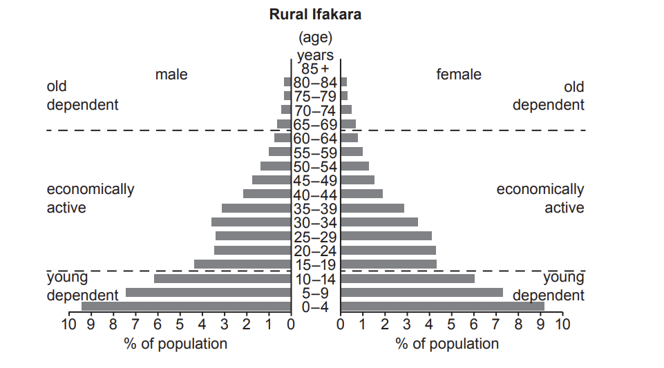
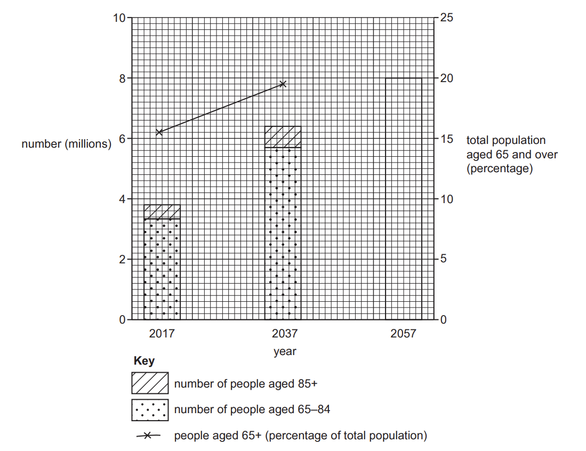
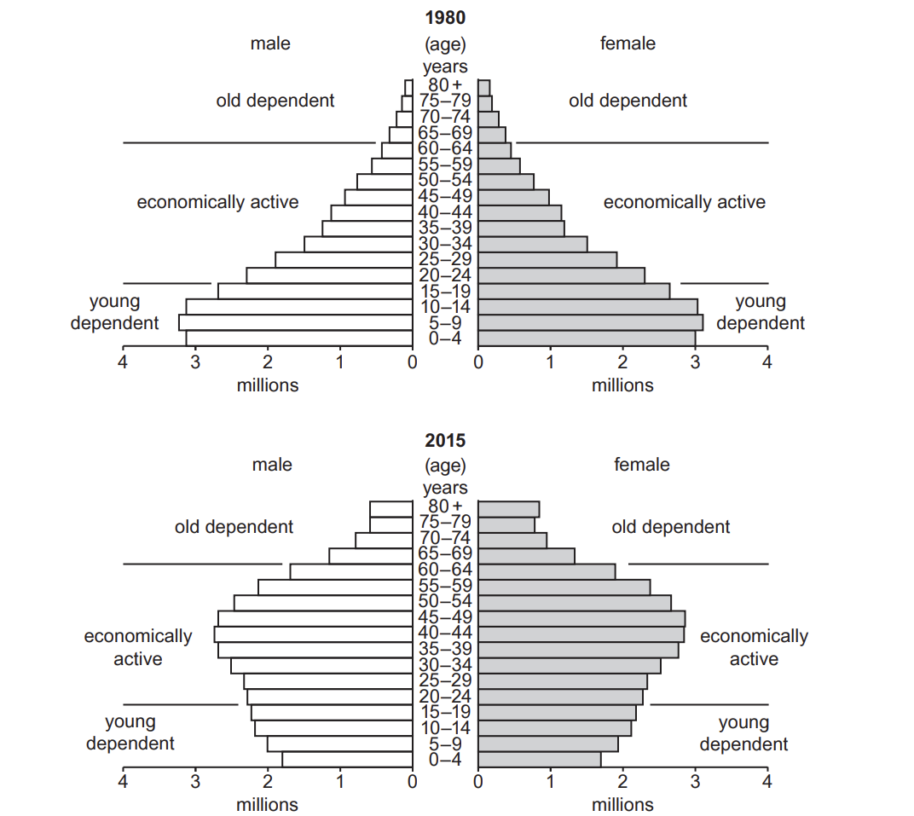
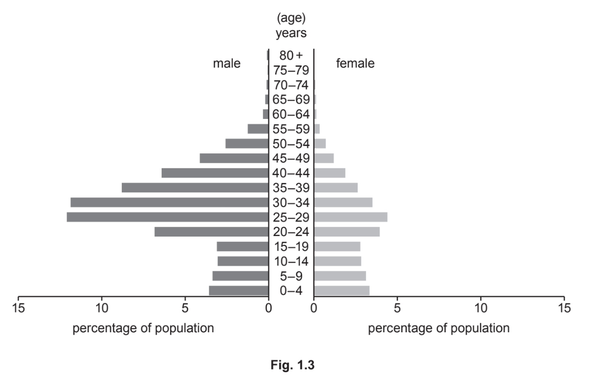
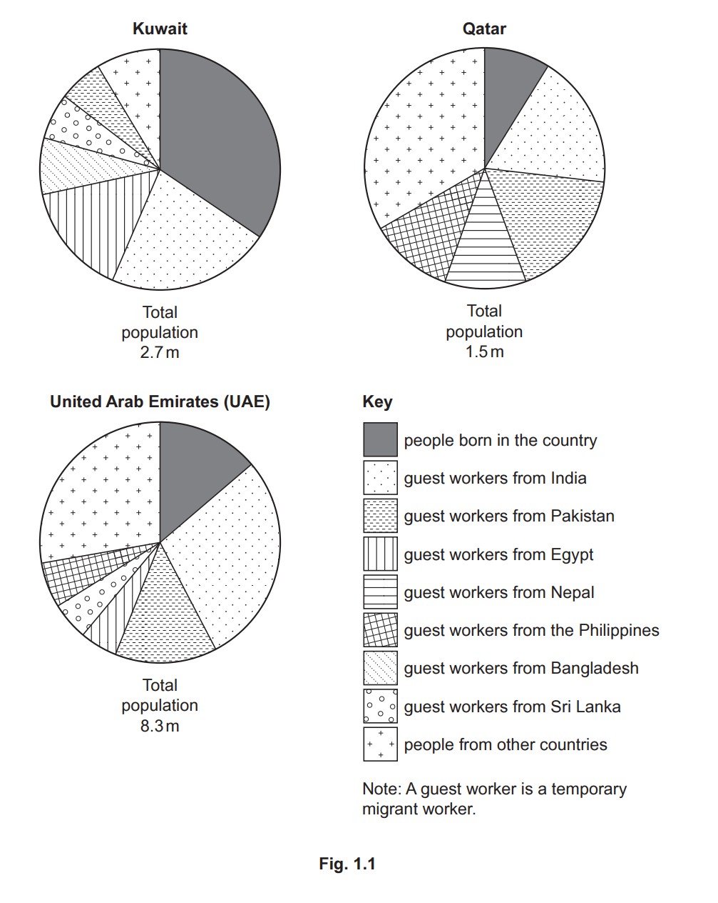

# Exam Questions — Population Structure
**Population & Settlement** · Cambridge (CIE) IGCSE geography (0460 & 0976)
> Source: [https://www.savemyexams.com/igcse/geography/cie/20/topic-questions/](https://www.savemyexams.com/igcse/geography/cie/20/topic-questions/) · 16 questions across 1 sets

## Paper 1 (16 questions)

### Q1 — hard — 7 marks

**Q1** [7 marks]

For a country, you have studied with a high young or old dependent population, describe the problems caused by this population structure. Circle your choice of young or old dependent population.

Name of country ..............................................

      Young dependent       Old dependent

*Source: Nov 2020 0460/11 Q1C*

### Q2 — hard — 7 marks

**Q2** [7 marks]

For a named country you have studied, describe and explain the causes of an ageing population.

### Q3 — hard — 7 marks

**Q3** [7 marks]

For a named country you have studied, describe and explain the impacts of having a large percentage of dependent population.

### Q4 — medium — 4 marks

**Q4** [4 marks]

Study Figs. 1.1 and 1.2, which show the population structure for a rural and urban area in Tanzania (an LEDC in Africa).

Fig. 1.1 is the population structure of rural Ifakara.

Fig. 1.2 is the population structure of urban Ifakara.

**Fig. 1.1**

**Fig. 1.2**

Suggest reasons why birth rates are high in rural areas of Tanzania.

*Source: June 2021 0460/13 Q1A*

### Q5 — medium — 5 marks

**Q5** [5 marks]

Study Fig. 1.2, which predicts how the number and percentage of people aged 65 and over in Australia (an MEDC) may change between 2017 and 2057.

**Fig. 1.2**

Explain why increasing numbers of people aged 65 and over may cause problems for MEDCs, such as Australia.

*Source: June 2021 0460/12 Q1B*

### Q6 — medium — 4 marks

**Q6** [4 marks]

Study Fig. 1.1, which shows information about the population structure of Thailand (an LEDC in Southeast Asia) in 1980 and 2015.

**Fig. 1.1**

Suggest reasons for the decrease in the number of young dependents in Thailand between 1980 and 2015.

*Source: June 2021 0460/12 Q1A*

### Q7 — medium — 5 marks

**Q7** [5 marks]

Study Fig. 1.3, which is a population pyramid for the United Arab Emirates (UAE), an MEDC.

Most of the migration to the UAE is voluntary migration. Describe the **attractions (pulls) **of MEDCs, such as the UAE, to migrants from LEDCs.

*Source: May/Jun 2020 0460/12 Q1B*

### Q8 — medium — 5 marks

**Q8** [5 marks]

Study Fig 1.2, which shows population pyramids of the structure of Mexico’s population in 1980 and 2010.

Suggest ways in which a large young dependent population is likely to cause problems for a country.

*Source: Nov 2019 0460/13 Q1B*

### Q9 — medium — 10 marks

**Q9** [1 mark]

Study Fig. 1.1, which shows information about the population of Kuwait, Qatar and the United Arab Emirates (UAE), which are MEDCs.

Which country shown in Fig. 1.1 has the highest total population?

*Source: 2020 May/June 0460/13 Q1A (I)*

**Q9** [2 marks]

Identify the country shown in Fig. 1.1 which has:

- the largest proportion of the population who were born there

- the same proportion of guest workers from India and Pakistan.

*Source: May 2020 0460/13 Q1A (II)*

**Q9** [3 marks]

Compare the countries of origin of guest workers in Kuwait and the UAE.

*Source: May 2020 0460/13 Q1A (III)*

**Q9** [4 marks]

Describe two benefits and two disadvantages of large numbers of guest workers for countries such as Kuwait and the UAE.

Benefit 1 .............................................................................

Benefit 2 .............................................................................

Disadvantage 1 ..................................................................

Disadvantage 2 ..................................................................

*Source: May 2020 0460/13 Q1A (IV)*

### Q10 — medium — 5 marks

**Q10** [5 marks]

Study Fig 1, which shows the age structure of size countries.

| **Age Group** | **Percentage of population** |   |   |   |   |   |
|---|---|---|---|---|---|---|
|   | **Country A** | **Country B** | **Country C** | **Country D** | **Country E** | **Country F** |
| 65 and over | 18.3 | 4.1 | 5.5 | 13.2 | 3.1 | 17.3 |
| 15-64 | 63.0 | 59.1 | 61.6 | 70.3 | 69.3 | 67.6 |
| 0-14 | 18.7 | 36.8 | 32.9 | 16.5 | 27.6 | 15.1 |

**Fig 1**

Suggest reasons why populations in MEDCs such as country A and country F are ageing

### Q11 — easy — 6 marks

**Q11** [1 mark]

Study Figs. 1.1 and 1.2, which show the population structure for a rural and urban area in Tanzania (an LEDC in Africa).

Fig. 1.1 is the population structure of rural Ifakara.

Fig. 1.2 is the population structure of urban Ifakara.

**Fig. 1.1**

**Fig. 1.2**

What percentage of the people in **urban** Ifakara are female and aged 0 to 4?

........................................ %

*Source: June 2021 0460/13 Q1A (I)*

**Q11** [2 marks]

Describe **two** differences between the **old dependent** population in rural and urban Ifakara.

1 ....................................................

2 ....................................................

[2]

*Source: June 2021 0460/13 Q1A (II)*

**Q11** [3 marks]

What evidence in Figs. 1.1 and 1.2 suggests that:

the birth rate is high in rural Ifakara?

....................................................

life expectancy is low in rural Ifakara?

....................................................

many men have migrated from both rural and urban Ifakara?

....................................................

[3]

*Source: June 2021 0460/13 Q1A (III)*

### Q12 — easy — 3 marks

**Q12** [3 marks]

Study Fig. 1.2, which predicts how the number and percentage of people aged 65 and over in Australia (an MEDC) may change between 2017 and 2057.

**Fig. 1.2**

**Complete Fig. 1.2** by plotting the following information for 2057.

Number of people aged 65–84 years = 7 million

Number of people aged 85+ years = 1 million

People over 65 years as a percentage of total population = 23%

*Source: June 2021 0460/12 Q1B*

### Q13 — easy — 6 marks

**Q13** [1 mark]

Study Fig. 1.1, which shows information about the population structure of Thailand (an LEDC in Southeast Asia) in 1980 and 2015.

**Fig. 1.1**

How many of the population of Thailand in 1980 were female and aged 0 to 4?

.............................................million

*Source: June 2021 0460/12 Q1A (I)*

**Q13** [2 marks]

Describe how the total population of Thailand aged 0 to 4 changed between 1980 and 2015. You should use statistics in your answer.

*Source: June 2021 0460/12 Q1A (II)*

**Q13** [3 marks]

Describe how the **shape** of Thailand’s population pyramid changed between 1980 and 2015.

*Source: June 2021 0460/12 Q1A (III)*

### Q14 — easy — 3 marks

**Q14** [3 marks]

Study Fig 1.2, which shows population pyramids of the structure of Mexico’s population in 1980 and 2010.

Describe the changes in Mexico’s population structure between 1980 and 2010.

*Source: Nov 2019 0460/13 Q1B*

### Q15 — easy — 3 marks

**Q15** [3 marks]

Study Fig. 1.3, which is a population pyramid for the United Arab Emirates (UAE), an MEDC.

Identify three characteristics of the population pyramid for the UAE which suggest that it attracts many migrants.

*Source: May/June 2020 0460/12 Q1B*

### Q16 — easy — 2 marks

**Q16** [1 mark]

**Study Fig. 1**, which shows the age structure of a number of countries.

| **Age Group** | **Percentage of Population (%)** |   |   |   |   |   |
|---|---|---|---|---|---|---|
|   | **Country A** | **Country B** | **Country C** | **Country D** | **Country E** | **Country F** |
| **65 and over** | 18.3 | 4.1 | 5.5 | 13.2 | 3.1 | 17.3 |
| **15-64** | 63.0 | 59.1 | 61.6 | 70.3 | 69.3 | 67.6 |
| **0-14** | 18.7 | 36.8 | 32.9 | 16.5 | 27.6 | 15.1 |

**Fig 1**

a) Identify the country with the highest percentage of population aged 65 and over** [1]**

**Q16** [1 mark]

Identify the country with the lowest percentage of dependent population **[1]**
