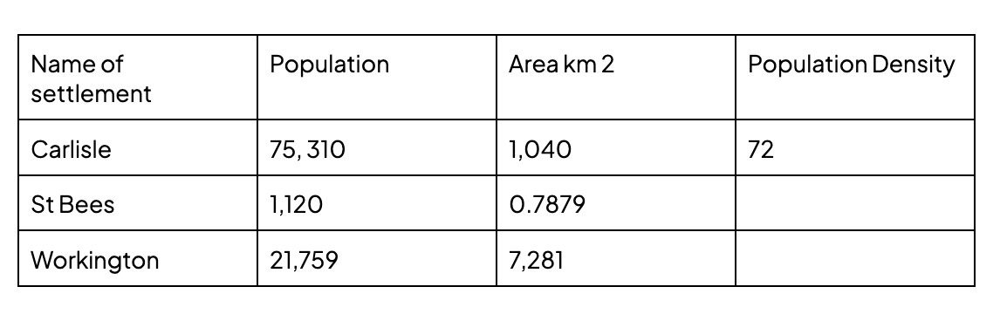
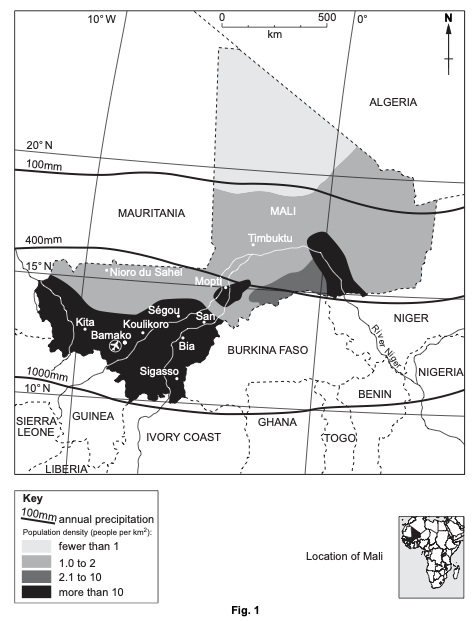
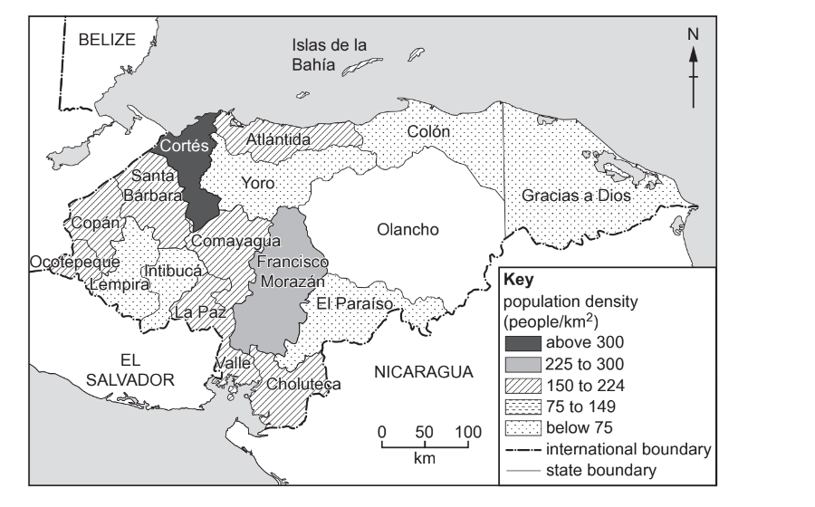
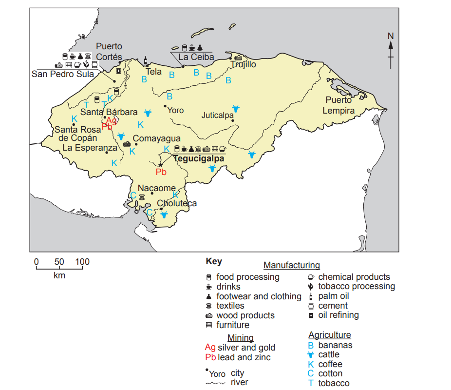
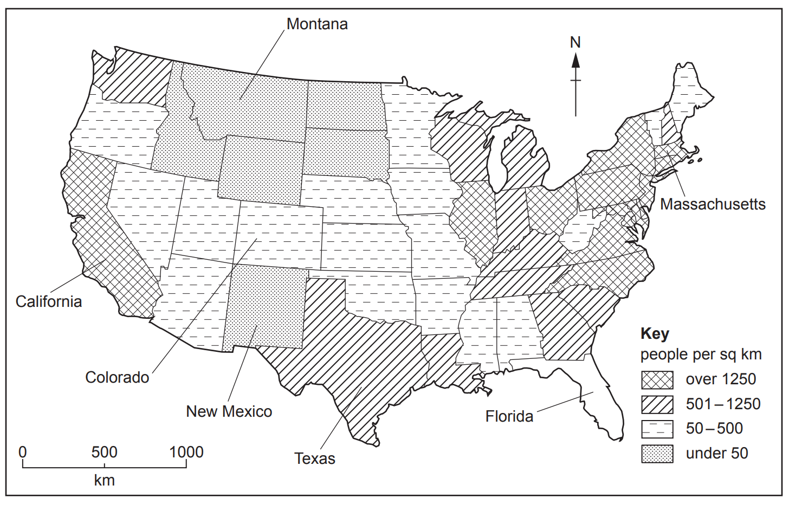
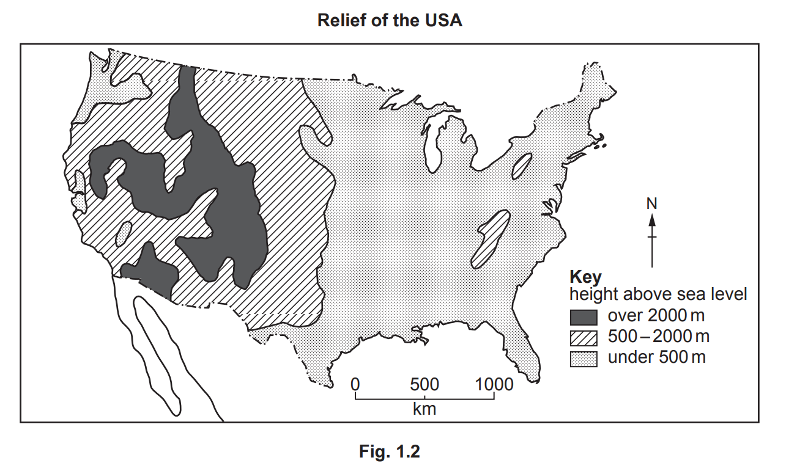
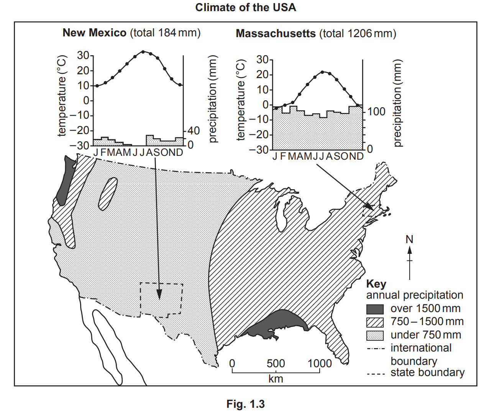
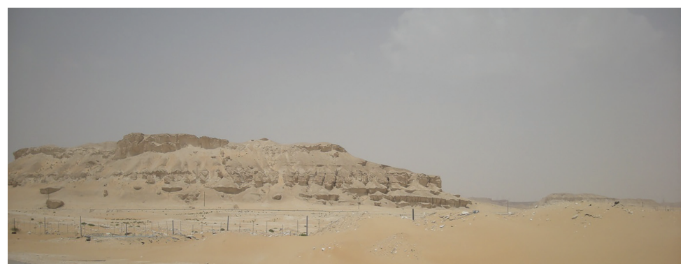
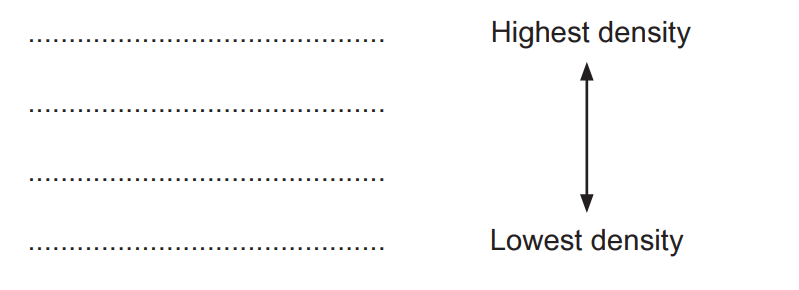
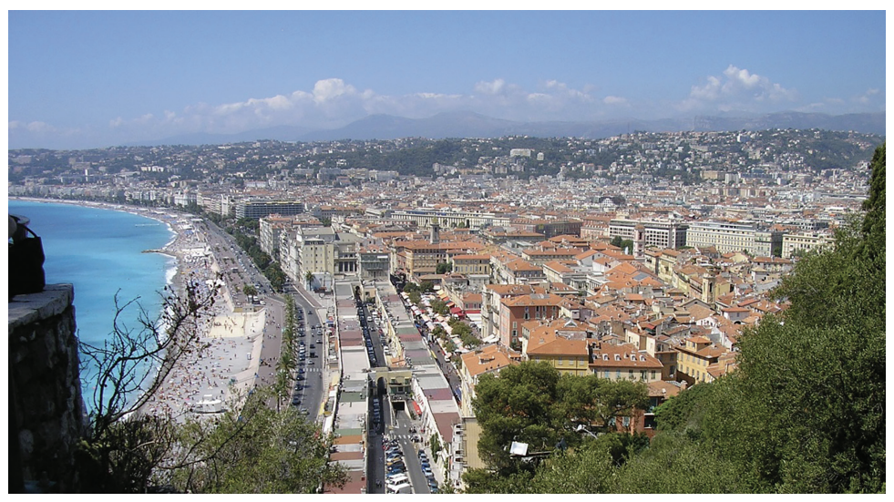

# Exam Questions — Population Density & Distribution
**Population & Settlement** · Cambridge (CIE) IGCSE geography (0460 & 0976)
> Source: [https://www.savemyexams.com/igcse/geography/cie/20/topic-questions/](https://www.savemyexams.com/igcse/geography/cie/20/topic-questions/) · 16 questions across 1 sets

## Paper 1 (16 questions)

### Q1 — medium — 4 marks

**Q1** [4 marks]

Explain two reasons why some areas of HICs experience low population density.

### Q2 — easy — 6 marks

**Q2** [1 mark]

Fig 1.1 below is a table that shows the population density for Carlisle, in the north west of the UK.

*Figure 1 - Population density for Carlisle*

Define the term ‘population density’?

**Q2** [2 marks]

Using **Figure 1.1**, complete the table by calculating the population density **to the nearest whole number **of St Bees and Workington.

**Q2** [3 marks]

Compare the population of these three areas.

Include data in your answer.

### Q3 — hard — 7 marks

**Q3** [7 marks]

For a named country or area you have studied, explain why it is sparsely populated.

Name of country or area ..............................

*Source: 2020 0460/12 Q1C*

### Q4 — hard — 7 marks

**Q4** [7 marks]

For a country or area you have studied which is sparsely populated, explain why there is a low population density.

Name of country or area

*Source: Nov 2020 0460/12 Q1C*

### Q5 — hard — 7 marks

**Q5** [7 marks]

For a named country you have studied, explain why it has a low population density

### Q6 — hard — 7 marks

**Q6** [7 marks]

For a country or area you have studied, explain why it is densely populated.

Name of country or area ............................................

### Q7 — easy — 6 marks

**Q7** [6 marks]

Study Fig, 1, which shows population density in Mali

(i)

Which part of Mali has the lowest population density

[1]

(ii)

Describe two features of the areas where population density is over 10 people per square kilometre

[2]

(iii)

Suggest reasons why the population of Mali is unevenly distributed

[3]

*Source: 2018 Specimen 0460/01 Q1A*

### Q8 — easy — 6 marks

**Q8** [6 marks]

Study Fig. 1.1 and Fig. 1.2 (below), which show information about population density and economic activity in Honduras (an LEDC in Central America).

**Fig. 1.1**

**Fig. 1.2**

(i)

On Fig. 1.1, **complete the shading** for the Olancho region.

The Olancho region has a population density of 24 people per km2.

[1]

(ii)

Put the following regions in rank order of their population density.

| Atlántida | Colón | Cortés | Francisco Morazán |
|---|---|---|---|
| 1st .................................  2nd .................................  3rd ..................................  4th .................................. | highest density  ** ↕**  lowest density |   |   |

[2]

(iii)

Using evidence from Fig. 1.2 **only,** suggest **three** different reasons why some regions of Honduras are densely populated.

1 ........................................................................................................

2 .......................................................................................................

3 .......................................................................................................

[3]

*Source: March 2021 0460/12 Q1A*

### Q9 — easy — 3 marks

**Q9** [3 marks]

Look again at Fig. 1.1 along with Figs. 1.2 and 1.3, which show information about relief and climate in the USA.

**Fig. 1.1**

Using Figs. 1.1 and 1.2 **only**, state how relief influences population density in the USA.

*Source: Nov 2020 0460/11 Q1B*

### Q10 — easy — 6 marks

**Q10** [6 marks]

Study Fig. 1.1, which shows information about four countries.

| **country** | **area (km****2****)** | **population** | **population density (per km****2****)** |
|---|---|---|---|
| Australia | 7682300 | 24450561 | 3 |
| China | 9388211 | 1409517397 | 150 |
| Saudi Arabia | 2149690 | 32939213 |   |
| USA | 9147420 | 324459463 | 35 |

**Fig. 1.1**

(i)

Which one of the following countries is most sparsely populated? Circle your answer below.

Australia              China              USA

[1]

(ii)

In the box below, calculate the population density of Saudi Arabia. You should include your calculations and give an answer to the nearest whole number.

[2]

................................. per km2

(iii)

Many parts of Saudi Arabia are hot deserts, as shown in Fig. 1.2.

**Fig. 1.2**

Explain why areas like those shown in Fig. 1.2 have a low population density.

[3]

*Source: June 2021 0460/11 Q1A*

### Q11 — easy — 6 marks

**Q11** [6 marks]

Study Fig. 1.1, which is a map showing population density in mainland USA

(i)

Florida has a population density of 980 people per square kilometre. **Complete the shading** in Fig. 1.1 for the state of Florida.

[1]

(ii)

Put the following states in rank order according to their population density. California    Colorado    Montana    Texas

[2]

(iii)

Describe the distribution of states with a population density of over 1250 people per square kilometre.

[3]

*Source: Nov 2020 0460/11 Q1A*

### Q12 — medium — 4 marks

**Q12** [4 marks]

Study Fig. 1.1, which is a map showing population density in mainland USA

Explain how economic factors can influence population density.

*Source: Nov 2020 0460/11 Q1A*

### Q13 — medium — 4 marks

**Q13** [4 marks]

Study Fig. 1.1 and Fig. 1.2, which show information about population density and economic activity in Honduras (an LEDC in Central America).

**Fig. 1.1**

**Fig. 1.2**

Explain how **physical** factors can influence population density.

*Source: March 2021 0460/12 Q1A*

### Q14 — medium — 4 marks

**Q14** [4 marks]

**Fig. 1.3**

Suggest reasons why many coastal lowland areas, such as the area shown in Fig. 1.3, have a high population density.

*Source: June 2021 0460/11 Q1A*

### Q15 — medium — 5 marks

**Q15** [5 marks]

Look again at Fig. 1.1 along with Figs. 1.2 and 1.3, which show information about relief and climate in the USA.

**Fig.1.1**

Using Figs. 1.1 and 1.3 **only**, suggest reasons for the difference in population density between New Mexico and Massachusetts. Use statistics in your answer.

*Source: Nov 2020 0460/11 Q1B*

### Q16 — medium — 4 marks

**Q16** [4 marks]

Suggest how physical factors affect population density
